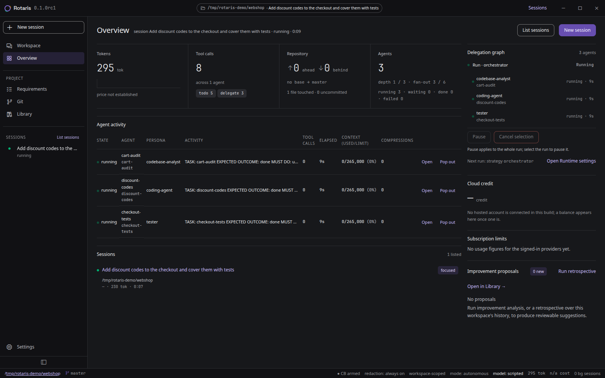
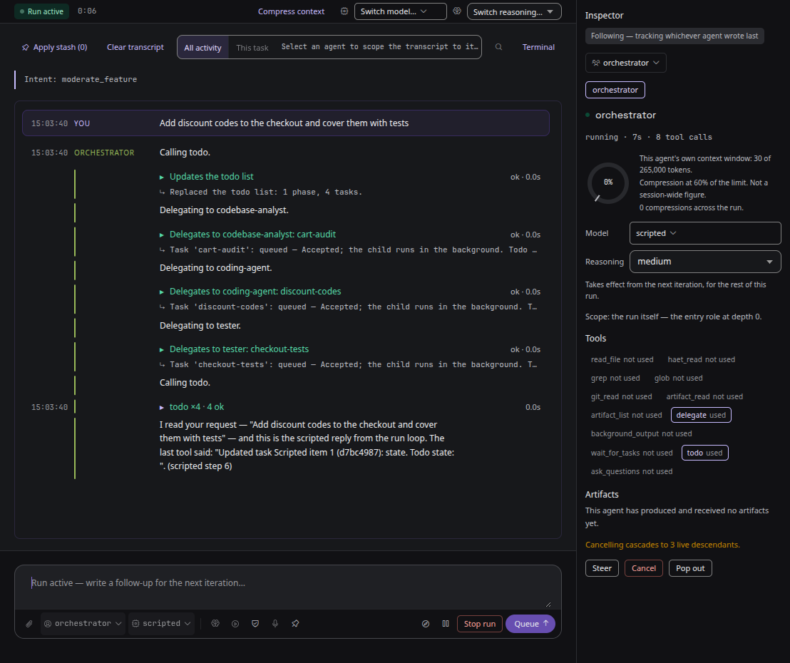
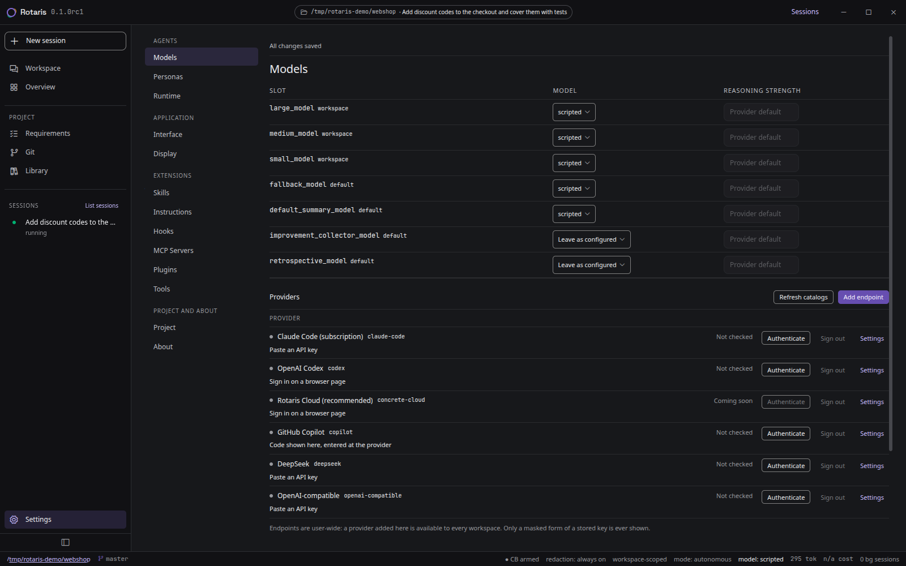

<div align="center">


# Rotaris

**A desktop app that carries a coding task to a result in your project — with a team of AI agents you can watch, steer and stop.**

[](https://github.com/Concrete-Dynamics/Rotaris/actions/workflows/ci.yml)
[](https://github.com/Concrete-Dynamics/Rotaris/actions/workflows/release.yml)
[](https://github.com/Concrete-Dynamics/Rotaris/releases/latest)
[](LICENSE)

[**Download for Windows and Linux**](https://github.com/Concrete-Dynamics/Rotaris/releases/latest) · [Website](https://rotaris.ai) · [Build from source](#build-from-source) · [Documentation](#documentation)



<sub>The Overview during a run: three specialist agents working on one task. A scripted demo run, captured from the built application.</sub>

</div>

---

## What Rotaris does

You describe a task. Rotaris classifies it, hands it to a coordinator agent, and the coordinator delegates to
specialists — an analyst, a coding agent, a tester and nine more built-in roles. The run works through a todo list one
item at a time and checks what it changed with deterministic checks before it decides what comes next.

- **You see everything while it happens.** A live transcript of messages, reasoning, tool calls and diffs, and an
  Overview of every agent, what it is doing and what it has cost.
- **You stay in charge.** Steer an agent mid-run, queue a follow-up, edit the todo list, switch the model, pause or
  cancel — without restarting.
- **Nothing runs unasked.** Every tool call passes one permission gate — allow, ask or deny — before anything
  executes, and every decision lands in an audit trail.
- **You can go back.** A checkpoint is taken after each iteration that changed your tree, and any of them can be
  restored from the Git view.
- **Nothing is lost when the window closes.** Each session is stored on your machine and can be browsed, continued
  and exported.
- **Your models, your keys.** A provider catalogue plus any OpenAI-compatible endpoint; the session record stays on your machine.

<div align="center">


<sub>The Workspace: the transcript of a live run, the composer, and the inspector for the agent you follow.</sub>
</div>

## Why it is built this way

An agent left alone in a repository can run a command you did not want, write outside the project, lose track of
what it did, or report work as finished that does not hold up. Each of those has a mechanism here:

| What can go wrong | What Rotaris does about it | Specified in |
|---|---|---|
| A tool call does something you did not agree to | Every call resolves to allow, ask or deny at one gate before it runs; every decision is written to a per-session audit trail with secrets redacted | [05](docs/spec/05-tools-permissions-approvals.md) |
| An agent writes outside the project | File tools are fenced to the workspace; a path outside it fails with a path-fence error | [05](docs/spec/05-tools-permissions-approvals.md) §15 |
| A command reaches the network or the machine unchecked | A per-host egress policy for `fetch`, and optional operating-system confinement of terminal commands | [10](docs/spec/10-sandbox-network-egress.md) |
| A run leaves the tree in a state you cannot get back from | A checkpoint at the close of each iteration that changed the tree, restorable from the desktop | [06](docs/spec/06-git-worktrees-checkpoints.md) |
| Work is declared done without evidence | Changed work is verified with deterministic checks before the run decides what to do next | [01](docs/spec/01-run-orchestration.md) |
| What happened is gone when the window closes | Every run is persisted as it proceeds in a machine-local session store | [07](docs/spec/07-sessions-persistence.md), [20](docs/spec/20-event-history-replay-export.md) |

<a id="quick-start"></a>

## Get started

### Download (Windows x64, Linux x86_64)

1. Open the [latest release](https://github.com/Concrete-Dynamics/Rotaris/releases/latest) and download the file for your system:

   | System | File | What it is |
   |---|---|---|
   | Windows x64 | `Rotaris-<version>-windows-x64-setup.exe` | installer |
   | Windows x64 | `Rotaris-<version>-windows-x64-portable.exe` | runs without installing |
   | Linux x86_64 | `Rotaris-<version>-linux-x86_64.AppImage` | one file: make it executable and run it; updates itself |
   | Debian, Ubuntu (x86_64) | `Rotaris-<version>-linux-x86_64.deb` | `sudo apt install ./Rotaris-<version>-linux-x86_64.deb`; updated by installing a newer package |

2. Optionally check the file against `SHA256SUMS.txt` beside it.
3. Start Rotaris and open a project folder.
4. <a id="1-register-a-provider"></a><a id="providers-auth-and-models"></a>Under **Settings › Models**, sign in to a provider with an API key, or add your own OpenAI-compatible endpoint.
5. Type what you want done into the composer in the **Workspace** and press Run.

> [!NOTE]
> **Rotaris is pre-release software.** The binaries are not Authenticode-signed, so Windows SmartScreen will ask
> before the first start; what is signed is the checksum manifest, which the in-app updater verifies before it
> downloads anything. See [Status](#status).

<div align="center">


<sub>Settings › Models: which model serves which slot, and the providers you can sign in to.</sub>
</div>

### Build from source

On any platform Node 24 runs on. Windows x64 and Linux x86_64 have a published release.

**Prerequisites.**

- Node.js 24 or later (the root `package.json`'s `engines.node`; Node 26 works).
- pnpm 11.9.0, the version the root `package.json` pins in `packageManager`.
- Git on `PATH`.
- On Linux: `build-essential` and `python3` (apt) to compile native modules, and a display, or `xvfb-run`,
  for anything that opens a window.
- For `pnpm package` only: a Rust toolchain (`cargo`), which builds the portable's launcher stub
  ([first-release plan §4.5](docs/architecture/first-release-plan/04-4-the-windows-release-pipeline.md#4-the-windows-release-pipeline)).
- Network access for `pnpm code-intel:bundle`, which builds the bundled code-intelligence runtime from pinned
  versions of `uv`, a Python interpreter and its packages. `pnpm notices`, `pnpm package` (which runs it itself) and
  some proofs need that runtime. It cannot yet be built on a Windows ARM64 host
  ([defect note](docs/defects/no-code-intelligence-bundle-can-be-built-for-a-windows-arm64-development-tree.md)).

```sh
pnpm install --prefer-offline                       # dependencies; Electron's install script fetches its runtime
pnpm dev                                            # the application through electron-vite, against the workspace source
```

`packages/kernel/src/generated/`, which every build imports, is not committed: the first `pnpm dev`, `pnpm build` or
`pnpm package` writes it with the generator behind `pnpm symbols`, and `pnpm symbols` or a test run keeps it current
([the repaired note](docs/archive/defects/a-fresh-clone-cannot-build-until-pnpm-symbols-has-run.md)). If Electron's runtime is
missing, as it is in a new Git worktree, `node node_modules/electron/install.js` installs it.

## Status

Rotaris is **pre-release**. The version it declares is `0.1.0rc9` (`apps/desktop/package.json`).

**What is published.** `v0.1.0rc9` is a release candidate for **Windows x64** — a setup installer and a portable
executable — and **Linux x86_64** — an AppImage and a Debian package
([`PD-STARTUP-013`](docs/product/directives/pd-startup-013.md#pd-startup-013)) — with a CycloneDX SBOM for each platform,
`SHA256SUMS.txt` and its signature, built, signed and drafted by the tag workflow (`.github/workflows/release.yml`). It
follows `v0.1.0rc7` of 2026-11-21 and six candidates before it. It carries Rotaris Cloud as a provider
([`PD-PROVIDER-004`](docs/product/directives/pd-provider-004.md#pd-provider-004)) and an agent changing Rotaris's own
configuration through `configure` with the approval dialog naming the value
([`PD-CONFIG-014`](docs/product/directives/pd-config-014.md#pd-config-014)). `v0.1.0rc8` built nothing.

Three things a reader should know about it:

- **It is shown as GitHub's latest release, not flagged as a pre-release**, by the owner's choice, so that the
  download link and the in-app updater — both read `releases/latest`, which skips flagged pre-releases — find it
  ([R-103](docs/product/requests.md#r-103), as for `v0.1.0rc2` to `v0.1.0rc7`; the same reading for `v0.1.0rc1` is
  [this note](docs/defects/the-published-rc1-release-is-marked-stable.md)).
- **The release gate's clean-machine check was not performed for it.** No artifact was launched on a clean,
  offline machine before publication; the Debian package was installed nowhere
  ([the gate](docs/architecture/first-release-plan/06-5-the-release-gate.md#5-the-release-gate); R-103 records the owner's waiver).
- **The binaries are not Authenticode-signed**, by design (REQ-STARTUP-021/023;
  [first-release plan §4](docs/architecture/first-release-plan/04-4-the-windows-release-pipeline.md#4-the-windows-release-pipeline)).

**Platforms.**

- **Windows x64** and **Linux x86_64** are the platforms a release publishes for
  ([`PD-STARTUP-013`](docs/product/directives/pd-startup-013.md#pd-startup-013)). `pnpm package` builds the installer on
  Windows x64, and the AppImage and the Debian package on Linux x86_64.
- **The Linux AppImage was held to four acceptance criteria**
  ([ADR-0066](docs/architecture/adr/0066-the-linux-artifact-is-built-on-a-developer-host.md);
  [the readings](docs/architecture/spikes/linux-appimage-acceptance.md)): it starts unextracted on Ubuntu 24.04 that never had
  the legacy FUSE library; its native modules are load-proved; a second launch is handed to the first; and its window is
  shown in about a second on physical hardware — with one exception recorded as measured: the first-ever launch on a shared
  virtual runner took 7.5 s against the 5 s bound.
- **No 32-bit Linux build exists**, x86 or ARM: the Electron the product ships on publishes Linux builds for `x64` and
  `arm64` only. **Linux arm64** is the stated next step and is not published yet.
- **macOS** has no build host yet, so no release artifact is produced for it
  ([IC-3](docs/architecture/implementation-conditions/ic-3-the-build-host-obligations.md);
  [`PD-STARTUP-001`](docs/product/directives/pd-startup-001.md#pd-startup-001)). Nothing in the application is removed or
  disabled there. The proofs are run from source on Windows and on Linux.

**What stands between `v0.1.0rc9` and `v0.1.0`**, from
[`docs/architecture/first-release-plan.md`](docs/architecture/first-release-plan.md):

- **The release gate** ([§5](docs/architecture/first-release-plan/06-5-the-release-gate.md#5-the-release-gate)): the installer and the
  portable launched to first paint on a clean Windows x64 machine with no development runtimes and no network (O-6).
  It is not recorded as run.
- **The owner's remaining items** ([§6](docs/architecture/first-release-plan/07-6-what-only-the-owner-can-do.md#6-what-only-the-owner-can-do)): the
  gate machine (O-6), the machine-rename half of IC-4 (O-7), and the power-loss test's fault half (O-8).
- **The apply and restart of an update against a real Windows artifact** are unit-tested over fakes and still owed
  ([§4.6](docs/architecture/first-release-plan/04-4-the-windows-release-pipeline.md#4-the-windows-release-pipeline)).

## A tour of what is built

The window shows six primary views, in this order: **Workspace, Overview, Requirements, Git, Library, Settings**
([`PD-SHELL-016`](docs/product/directives/pd-shell-016.md#pd-shell-016);
[the map](docs/design/information-architecture.md)). A sidebar holds them and the workspace's sessions. Rotaris is
graphical only: there is no command-line interface and no terminal user interface.

The specification in [`docs/spec/`](docs/spec/README.md) states the behaviour, one domain per file.

<details>
<summary><b>Every built capability, by domain</b></summary>

- **Runs** ([01](docs/spec/01-run-orchestration.md)). One task, classified for intent and carried by a coordinator
  that delegates to child agents, works one todo item per iteration, verifies what changed, and ends with a stop
  reason and a terminal status.
- **Monitoring and steering** ([02](docs/spec/02-run-monitoring-steering.md)). The Overview shows the delegation
  tree and what each agent is doing, beside the session's figures (`PD-MONITOR-009`). While a run is live you can steer an agent, queue follow-up prompts, edit the
  todo list, switch the model, reasoning level or permission mode, force a context compression, pause or cancel.
- **Conversation and transcript** ([03](docs/spec/03-conversation-composer-transcript.md)). A composer that adapts to
  the run's state, slash commands, image attachments, and a live transcript of messages, reasoning, grouped tool
  calls, edit diffs, questions and approvals.
- **Model providers** ([04](docs/spec/04-model-providers-auth.md)). A fixed provider catalogue plus user-defined
  OpenAI-compatible endpoints, with discovered model catalogues. Sign-in is by API key; the device-code and browser
  sign-in flows are not built yet.
- **Tools, permissions and approvals** ([05](docs/spec/05-tools-permissions-approvals.md)). See [Tools](#tools) and
  [Permissions](#permissions).
- **Network egress and confinement** ([10](docs/spec/10-sandbox-network-egress.md)). A per-host egress policy for the
  URL-fetch tool, and optional operating-system confinement of terminal commands through bubblewrap on Linux. The
  macOS backend is written but not yet proven (IC-8); native Windows has no confinement and reports it unavailable.
- **Worktrees and checkpoints** ([06](docs/spec/06-git-worktrees-checkpoints.md)). A session can work in a Git
  worktree of its own, a checkpoint is recorded at the close of each iteration that changed the tree, and a tree can
  be restored to any checkpoint. Merging a finished worktree back is not built yet.
- **Sessions** ([07](docs/spec/07-sessions-persistence.md), [20](docs/spec/20-event-history-replay-export.md)). Every
  run is persisted as it proceeds in the workspace's machine-local session store. Sessions can be browsed, continued,
  exported and deleted, and the store can be backed up and restored.
- **Requirements board and traceability** ([08](docs/spec/08-requirements-traceability.md)). A project's own
  requirements, kept as versioned documents in its repository and compiled into symbols its code and tests reference.
  The board shows their health and starts the runs that deliver them.
- **Lifecycle hooks** ([09](docs/spec/09-lifecycle-hooks.md)). Shell commands attached to named points of a run.
  Hooks a repository declares stay inert until they are reviewed and approved.
- **Workspace context and skills** ([13](docs/spec/13-workspace-context-onboarding.md)). Workspace instruction files
  (`AGENTS.md`) and a discovered catalogue of portable skills (`SKILL.md`) are injected into every agent, and a
  one-time project initialization prepares code intelligence for the workspace.
- **Library** ([14](docs/spec/14-library-artifacts-improvements.md)). The artifacts agents publish, saved prompts, and
  improvement proposals from a post-run analysis or a user-started retrospective, reviewed and then applied by a
  checkpointed improvement run.
- **Tool servers** ([16](docs/spec/16-mcp-integration.md)). External MCP servers as tool providers, declared in
  configuration or in `mcp.json` files, beside a bundled code-intelligence server.
- **Settings and the desktop shell** ([15](docs/spec/15-settings-configuration.md),
  [12](docs/spec/12-desktop-shell-windows.md), [19](docs/spec/19-notifications-errors-recovery.md)). Layered YAML
  configuration, edited from Settings; the six primary views, a command palette, agent and terminal windows, three
  built-in themes, and notices that say what failed and how to recover.
- **Updates** ([11](docs/spec/11-startup-distribution-updates.md)). An installed build checks this repository's latest
  GitHub release (`apps/desktop/src/main/updater/feed.ts`), verifies the signed checksum manifest before it parses it
  or downloads an asset, and offers the update in a notice.

Where the owner decided behaviour the specification does not state, a product directive in
[`docs/product/directives.md`](docs/product/directives.md) governs over the requirements it names.

</details>

<details>
<summary><b>Concepts</b> — workspace, session, run, persona, checkpoint, skill, hook, artifact</summary>

| Term | What it means here | Where it is defined |
|---|---|---|
| **Workspace** | The project folder a window has open. Its per-workspace configuration lives in `<workspace>/.rotaris/` | [13](docs/spec/13-workspace-context-onboarding.md), [15](docs/spec/15-settings-configuration.md) |
| **Session** | The durable record of a conversation and its runs, kept in the workspace's session store | [07](docs/spec/07-sessions-persistence.md) |
| **Run** | One task carried to a stop reason and a terminal status | [01](docs/spec/01-run-orchestration.md) |
| **Persona** | A role an agent is built from: its instructions and the tools it is granted. 13 are built in: `orchestrator` (the coordinator), `requirements-engineer`, `codebase-analyst`, `librarian`, `architect`, `planner`, `coding-agent`, `tester`, `docs-writer`, `refactorer`, `verifier`, `ui-verifier`, `gatekeeper` | `packages/engine/src/children/personas.ts`, [01](docs/spec/01-run-orchestration.md) |
| **Delegation** | The coordinator handing work to a child agent with `delegate`, and collecting it with `wait_for_tasks` / `background_output` | [05](docs/spec/05-tools-permissions-approvals.md) §20 |
| **Checkpoint** | A snapshot of the tree at the close of an iteration that changed it | [06](docs/spec/06-git-worktrees-checkpoints.md) |
| **Skill** | A portable `SKILL.md` discovered from the workspace up to its repository root, then in user-scope directories such as `~/.agents/skills`; injected into agents or loaded with `/skill` | [13](docs/spec/13-workspace-context-onboarding.md) |
| **Hook** | A shell command attached to a named point of a run; inert until reviewed and approved | [09](docs/spec/09-lifecycle-hooks.md) |
| **Artifact** | A document an agent publishes to the Library with the artifact tools | [14](docs/spec/14-library-artifacts-improvements.md) |

The full vocabulary, one context at a time, is [`CONTEXT-MAP.md`](CONTEXT-MAP.md).

</details>

<a id="tools"></a>

<details>
<summary><b>Tools</b> — what an agent may be granted</summary>

The public tools a persona may be granted are exactly these (`REQ-TOOLS-001`). MCP servers are granted separately,
through a persona's `mcp_servers` key.

| Tool | What it does | Reads files | Writes files | Runs commands |
|---|---|:-:|:-:|:-:|
| `read_file` | Read a workspace file, or list a directory | ✓ | | |
| `write_file` | Write a workspace file | ✓ | ✓ | |
| `haet_read` / `haet_edit` (alias `haet`) | Read a file with its content hash, then edit it anchored to that hash | ✓ | ✓ (`haet_edit`) | |
| `grep`, `glob` | Search file contents and names | ✓ | | |
| `git_read` | Read the HEAD commit and branch, or a named ref | ✓ | | |
| `git_commit` | Declared, **not built**: it has no executor, so it is never granted | ✓ | ✓ | |
| `terminal` | Run a command in a terminal, foreground or background | | | ✓ |
| `fetch` | Fetch a URL under the egress policy | | | |
| `todo` | The run's task list | | | |
| `ask_questions` | Ask you a question and wait for the answer | | | |
| `delegate`, `wait_for_tasks`, `background_output` | Hand work to a child agent and collect it | | | |
| `artifact_write`, `artifact_read`, `artifact_list` | Publish and read Library artifacts | | | |

The capability columns are the declarations of `REQ-TOOLS-001`. The executors are in `packages/agent-tools/src/`; a
declared tool with no executor is removed from the persona rather than offered (`apps/desktop/src/run-host/tools.ts`).

</details>

<a id="permissions"></a><a id="permissions-and-security"></a>

<details>
<summary><b>Permissions</b> — the three modes and the starter rules</summary>

Every tool call resolves to **allow**, **ask** or **deny** at one gate before anything runs, and every decision is
written to the session's audit trail (spec [05](docs/spec/05-tools-permissions-approvals.md) §2, §8).

| Mode | Default when no rule matches | In short |
|---|---|---|
| `restricted` | deny | Read-only tools are allowed, but a read outside the workspace asks; `fetch` to another host asks; network commands are denied; the nine starter command rules apply |
| `ask` *(default)* | ask | Read-only tools are allowed wherever they read; `fetch` to another host asks; network commands ask; the nine starter command rules apply |
| `autonomous` | allow | Allowed, except the five starter deny rules; it never asks, and a path outside the workspace fails the path fence instead |

- The **nine starter command rules** (`REQ-TOOLS-039`): five **deny** — recursive delete, privilege escalation, force
  push, package publish, piping into a shell — and four **ask** — a command that cannot be read statically, history
  rewrites, dependency installs, container and service control.
- The modes, their rules and the default are `REQ-TOOLS-041` to `REQ-TOOLS-046`; an unrecognised mode name resolves
  to `restricted`.
- You choose the mode in the desktop selector, which lists the modes strictest first, asks you to confirm
  `autonomous`, and saves the choice to `runtime.permission_mode` in `<workspace>/.rotaris/agents.yaml`. It can be
  changed mid-run (`REQ-TOOLS-077`).
- **The mode you ask for is the mode the run gets.** An unattended or unconfined run is not silently downgraded
  ([`PD-TOOLS-002`](docs/product/directives/pd-tools-002.md#pd-tools-002)).
- An approval you grant for the session covers matching calls for the rest of it, including after a mode change
  (`REQ-TOOLS-023`).

</details>

<details>
<summary><b>Reference</b> — slash commands, files on disk, themes, repository commands</summary>

There is no command line to document. What follows is the in-app command surface, the files the application reads
and writes, and the repository's own commands.

### Slash commands, in the composer

`/stop`, `/pause`, `/compress`, `/clear`, `/search`, `/new`, `/resume`, `/sessions`, `/worktree`, `/stash <prompt>`,
`/pop`, `/model <name>`, `/persona <name>`, `/theme <name>`, `/logout <provider>`, plus `/skill <path>`, `/skills`, one
command per discovered skill, and your saved prompts (`packages/ui/src/slash/catalogue.ts`,
`packages/ui/src/slash/skills.ts`, `packages/ui/src/slash/prompts.ts`). A command that cannot run in the current state
says why rather than doing nothing.

### Files and directories

| What | Windows | Linux | macOS |
|---|---|---|---|
| Global configuration (`agents.yaml`, `models.yml`, `secrets.yaml`, `project_settings.yaml`) | `%LOCALAPPDATA%\rotaris\rotaris\` | `$XDG_CONFIG_HOME/rotaris/` (else `~/.config/rotaris/`) | `~/Library/Application Support/rotaris/` |
| Machine-local data (workspace stores, provider tokens, the instance record) | `%LOCALAPPDATA%\rotaris\data\` | `$XDG_DATA_HOME/rotaris/` (else `~/.local/share/rotaris/`) | `~/Library/Application Support/rotaris/data/` |
| Per-workspace configuration | `<workspace>\.rotaris\` | `<workspace>/.rotaris/` | `<workspace>/.rotaris/` |

Sources: `packages/platform/src/dirs.ts` (`resolveUserDirs`, `dataLayout`) and the files-on-disk table of the
[process view](docs/architecture/views/02-process-view.md). On Windows nothing is written to the roaming
`%APPDATA%` (`REQ-STARTUP-145`). The workspace configuration layers over the global one (spec
[15](docs/spec/15-settings-configuration.md)).

### Themes

`rotaris-dim` (the default), `nocturne`, `high-contrast` (`packages/contracts/src/theme/themes.ts`).

### Repository commands

```sh
pnpm dev                                        # the application through electron-vite, against the workspace source
pnpm build                                      # the production build, into apps/desktop/out/
pnpm exec electron apps/desktop/out/main/index.js   # runs that build
pnpm check                                      # the gate: symbols, typecheck, lint and tests
pnpm package                                    # Windows only: the installer and the portable, with its load evidence
pnpm preflight [proof-id …]                     # checks the machine before a proof launches; launches nothing
pnpm <area>-proof                               # the built app measuring one mechanism
pnpm verify:plan                                # for a diff: the gate, the affected proof suites, the docs to consult
pnpm app:drive start|shot|inspect|stop          # drive the built app, free, no provider
pnpm live-run                                   # the built app against a real key — spends money; never automatic
pnpm notices                                    # the third-party notices a build ships
```

Each proof launches the **built** application against a scratch profile and measures one mechanism;
[`docs/proofs/README.md`](docs/proofs/README.md) is the registry of all of them. `pnpm live-run` is the one check that
spends real money, and an agent asks before running it ([`AGENTS.md`](AGENTS.md)).

</details>

## How it is put together

It is **one Electron desktop application**, built as a pnpm workspace of TypeScript packages.

One application, five composition roots in `apps/desktop/src/`. They are the only places `electron` is imported
([`docs/module-map.md`](docs/module-map.md), [component view](docs/architecture/views/01-component-view.md)).

| Root | What it owns |
|---|---|
| `main/` | Windows and dialogs, the command router, provider sign-in and credentials, notices, preferences, process supervision, the updater |
| `preload/` | The one frozen bridge a window gets, `window.rotaris` |
| `renderer/` | The React surfaces, one role per route (main, approval, pause, hook review, provider, persona, terminal) |
| `run-host/` | One live session: runs, turns, tools, hooks, MCP servers, the skill catalogue, checkpoints, terminal streams |
| `workspace-service/` | Workspace identity, the store's open and migration, backup and restore, configuration, traceability, saved prompts |

| Path | What is there |
|---|---|
| [`apps/desktop/`](apps/desktop/) | The Electron application: its five composition roots in `src/`, the portable's launcher stub in `launcher/`, the packaging configuration, and the proof, packaging and code-intelligence scripts in `scripts/`. |
| [`packages/`](packages/) | Fifteen TypeScript packages (`@rotaris/<name>`), cut along process boundaries rather than features, from `kernel` at the foundation to `ui`. [`docs/module-map.md`](docs/module-map.md) says what each owns and which file to open first. |
| [`tools/`](tools/) | Build-time and lint-time code, not product code: the checks the gate runs, the symbol generator behind `pnpm symbols`, the release guard and pipeline, the notices and build-identifier generators, `pnpm verify:plan`, and the worktree and development-time tooling. |
| [`docs/`](docs/) | The record: the specification, the product directives and the request log, the architecture and its decisions, the design language, the defect notes and the proof index. |
| [`.github/workflows/`](.github/workflows/) | `ci.yml` (**CI**: the gate, and a development package on Windows x64 and on Linux x86_64, for every push and pull request) and `release.yml` (**Release**: the tag workflow). |

All three of `apps/*`, `packages/*` and `tools/*` are workspace members (`pnpm-workspace.yaml`).

## Development

- **The gate.** `pnpm check` — symbols, typecheck, lint and tests — passes before a commit. `pnpm vitest run <path>`
  is the narrowest check; tests sit beside the unit they cover.
- **Where a change lands.** Every change is built on a temporary branch in its own worktree and reaches `main` by a
  rebase onto `origin/main`, the gate on the rebased head, and a fast-forward push. `main`'s history is linear.
  `pnpm worktree:new` and `pnpm worktree:land` wrap those steps, and [`docs/clean-room/agent-workflow.md`](docs/clean-room/agent-workflow.md) states the rules.
- **A request that would change what the product does** is logged in
  [`docs/product/requests.md`](docs/product/requests.md) and classified before any code is written, using the table in
  [`docs/product/README.md`](docs/product/README.md). Work that implements behaviour cites the `REQ` and `PD`
  identifiers it satisfies.
- **A defect noticed along the way** is written up in `docs/defects/` in the shape
  [`docs/defects/README.md`](docs/defects/README.md) gives, whether or not it is in scope to fix.
- **The architecture views** in [`docs/architecture/views/`](docs/architecture/views/README.md) are read before an
  edit and updated in the same commit as one.
- **The design language** in [`docs/design/README.md`](docs/design/README.md) binds every drawn surface.

### Documentation

- **Specification:** [`docs/spec/README.md`](docs/spec/README.md) — 3,973 requirement identifiers across 19 shipping
  domains, 258 of them withdrawn in place, as that file counts them; two further domains, the terminal UI and the
  command line, are retired.
- **Product directives:** [`docs/product/directives.md`](docs/product/directives.md), and the request log
  [`docs/product/requests.md`](docs/product/requests.md).
- **Architecture:** [`docs/architecture/README.md`](docs/architecture/README.md), the
  [views](docs/architecture/views/README.md), the [decision records](docs/architecture/adr/), and
  [`codebase.md`](docs/architecture/codebase.md) for what landed and what is owed.
- **Domain glossary:** [`CONTEXT-MAP.md`](CONTEXT-MAP.md).
- **Defects:** [`docs/defects/`](docs/defects/README.md), open notes; repaired ones in [`docs/archive/defects/`](docs/archive/defects/).
- **Proofs:** [`docs/proofs/README.md`](docs/proofs/README.md).
- **Working in the repository:** [`AGENTS.md`](AGENTS.md) — the rules, for every agent and harness; the skills are under `.agents/skills/`.

## The clean-room boundary binds every contribution

Rotaris is a clean-room reimplementation. Its code is written only from approved behavioural specifications
(`docs/spec/`), the owner's product directives (`docs/product/`), approved architecture decisions
(`docs/architecture/`), public technical documentation and approved design material. The specifications were produced
under a zone policy that kept the two sides apart: no agent that read the earlier implementation wrote a specification
or any code in this repository, and no implementation agent reads it.

The earlier implementation, which served as the behavioural reference, is archived at
`https://github.com/Concrete-Dynamics/Rotaris-legacy`. **Do not read, clone, search or quote it, or any fork, mirror or
package of it, when contributing here** — not its code, not its documentation. If a change seems to need it, it does
not: raise the gap as an open question against the relevant requirement instead. [`AGENTS.md`](AGENTS.md) states the
boundary in full.

## Licence

Rotaris is licensed under the GNU General Public License, version 3 only (`GPL-3.0-only`). See [`LICENSE`](LICENSE).

The notices for the third-party components a build ships are produced by `pnpm notices`. It computes the shipped
dependency closure, validates it, and only then writes `apps/desktop/resources/THIRD-PARTY-LICENSES.txt`, which
packaging carries into the application and the About page in Settings opens. While validation fails it writes nothing.
