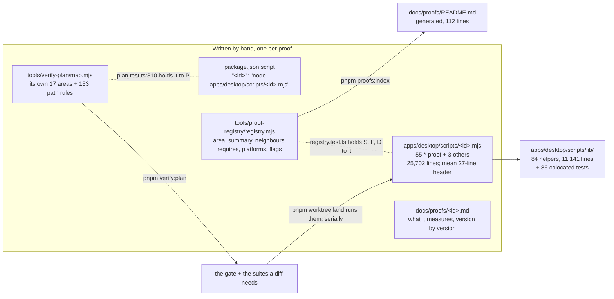

# The proofs concept — an assessment of the script, doc and registry chain

- **Status:** assessment, analysis only, written 2026-10-26 against `main` at `0a932670`. It changes no proof, no
  checker, no gate and no CI. It is a proposal for the owner, and it decides nothing.
- **Asked by:** the owner, meeting of 2026-10-27 (WP7). The ask was to evaluate ("bewerten") whether the proof concept,
  "a script that runs a proof, which has a doc, which has something in a launcher in the apps folder", is an
  anti-pattern. The ask was also that it must not pollute the context or raise development and review time.
- **Why no `R-` entry:** this assessment changes nothing the product does, so `docs/product/README.md`'s
  classification does not apply to it. If one of the proposals below is adopted, it changes repository tooling, not
  product behaviour.
- **Scope:** this assessment covers the **repository's development-time proof harness**. It does not cover the
  product's own evidence features, which are out of scope and named only so the two are not confused:

  | | What it is | Where |
  |---|---|---|
  | **Repository harness** (this assessment) | 58 scripts that launch the *built* app and measure one mechanism, plus their registry, docs, planner and helpers. `pnpm evidence`, `pnpm app:drive` and `pnpm live-run` belong to this group too: they are developer tools in `apps/desktop/scripts/`, **not** product features. The brief listed them as "the product's own seam", which is a misreading. | `apps/desktop/scripts/`, `tools/proof-registry/`, `tools/verify-plan/`, `docs/proofs/` |
  | **Product evidence** (out of scope) | The requirements board's per-requirement evidence states (`satisfied` / `stale` / `failed`, REQ-TRACE-270) and a tool call's evidence record (REQ-SESSION-136) | `packages/contracts/src/requirements.ts:51-53`, `packages/agent-tools/src/gate.ts:20` |

  Every finding below concerns the repository harness.

## 1. The chain, as it stands

| # | Link | Where | Count on `0a932670` | Hand-written? | What keeps it honest |
|---|---|---|---|---|---|
| 1 | Launcher script | `apps/desktop/scripts/<id>.mjs` | 55 `*-proof.mjs` + `live-run`, `ui-audit`, `ui-review` = **58 registry entries**. 64 top-level `.mjs` files in all, **31,679 lines**, of which the 55 `*-proof.mjs` are **25,702**. Their header comments total **1,504 lines / 142 KB** (mean 27 lines, max 80) | yes | `registry.test.ts` (one record per script); `lib/launch-sites.test.ts` (no bare Electron `spawn`) |
| 1′ | Shared helpers | `apps/desktop/scripts/lib/` | **84 `.mjs`, 11,141 lines**, plus **86 `*.test.ts`, 11,893 lines** | yes | their own tests, in `pnpm check` |
| 2 | Root script | `package.json:19-100` | **68 of 90** root scripts point into `apps/desktop/scripts/`. 58 are registry entries, plus 3 `theme-proof:counterfactual:*`, `preflight`, `evidence`, `app:drive`, `autopsy` and 3 `code-intel:*` | yes | `registry.test.ts` "names the pnpm script that runs each entry" |
| 3 | Registry (source) | `tools/proof-registry/registry.mjs` (663 lines), `flags.mjs` (152), `generate.mjs` (119) | 58 records in 7 areas, **166 directed neighbour edges** (max 10 for one proof) | yes | `registry.test.ts` (156 lines): scripts, docs, symmetric neighbours, flags matched against each script's argv |
| 3′ | Registry (rendered) | `docs/proofs/README.md` | 112 lines, 18.4 KB | **no**, generated | `pnpm lint` runs `generate.mjs --check` (see the `lint` script) |
| 4 | Per-proof record | `docs/proofs/<id>.md` | **58 files, 379 lines, 96 KB.** 55 of the 58 are exactly 6 lines long (see §2.2), with a median of **1,193 bytes** and a maximum of 5,744 (`notice-proof.md`) | yes | `registry.test.ts` "keeps a record document for each entry, opening with the entry's id" |
| 5 | Planner | `tools/verify-plan/map.mjs` (398 lines), `plan.mjs` (528) | **17 areas** of its own (finer than the registry's 7), **153 path rules**, the longest match wins | yes | `plan.test.ts`; `:310` holds the map to `package.json` |
| 6 | The rules | `AGENTS.md:27-91`, `docs/proofs/README.md:6-18` | 65 lines / 6.0 KB of AGENTS.md's 724 lines / 85 KB | yes | — |

So one proof identifier is written by hand in **five places**: the script's filename, `package.json`, `registry.mjs`,
`docs/proofs/<id>.md` and `map.mjs`. It is rendered into a sixth, the README. Three tests and one `--check` hold
those six places together. What a proof measures is written **four times**, in decreasing detail: the script header,
the per-proof doc, the registry's one-line `summary`, and the README row (generated from the summary).

## 2. Is it an anti-pattern?

**Verdict: no in its core, yes in its bookkeeping.** The evidence model is sound, and it is the reason the
product's defects were found. The *bookkeeping around it* has grown by accretion into five hand-maintained copies of
each identifier and **two independent models of "what else breaks when this changes"**. Those two models disagree on
half of their edges (§2.3). That is the "zerschossen" the owner sees, and part of it is real redundancy rather than
mere appearance.

### 2.1 Load-bearing, so keep it

- **The launcher launches the built app.** Every proof runs `apps/desktop/out/` against a scratch profile through
  `lib/bounded-launch.mjs` (`AGENTS.md:31-34, 51-80`). This is why proofs find what unit tests over fakes cannot: the
  1000×682 window ([note](../defects/plan-gate-proofs-window-reads-1000x682-where-1000x680-is-asked-on-windows.md)), the spellchecker's dictionary fetch (`apps/desktop/scripts/updater-proof.mjs` header, first
  execution 2026-09-28), and the 23-vs-152 extension list that only a screenshot caught
  (`first-executions.md:120`). The `lib/` helpers (11k lines, each with its own test) are the shared harness, not
  per-proof ceremony, and they are tested like product code.
- **The registry is generated and checked.** `docs/proofs/README.md` cannot drift from `registry.mjs`
  (`generate.mjs --check` in `pnpm lint`). The registry cannot drift from the scripts' argv or from the file tree
  (`registry.test.ts:44-117`). Of the six links, this is the best-engineered one.
- **`verify:plan` is the mechanism that answers "not the whole suite for every small feature".** A renderer
  preference change plans **2 proofs (≈5 min)**. A run-host loop change plans **10 (≈28 min)**. A docs-only change
  plans **0**. Only a shared seam, such as `run-host/dispatch`, plans **25 (≈63 min)**, and the planner flags it
  for review (`map.mjs:156-157`). These durations are the dev-time store's last green per proof, run
  sequentially; §3.2 has the method. The full suite is never what a normal landing runs.
- **The per-proof record holds what was found and when.** This is the clean-room rule: "a mechanism's first
  execution reports back into the record that decided it" (`CLAUDE.md`, Process state). A proof's doc is where the
  "since 2026-10-14 (fin46, OQ-311) …" clauses accumulate.

### 2.2 Ceremony, argued with its trade-offs

- **Five hand-written copies of one identifier.** Adding a proof means editing the script, `package.json`,
  `registry.mjs`, a new `docs/proofs/<id>.md` and `map.mjs`, and then regenerating the README. Nothing is lost by
  this, because the tests catch every omission. But it is five touches for one fact, and each one is a place an
  agent has to read to understand the chain. *Trade-off:* the copies are redundant only for the identifier. Each
  one also carries information the others do not have (argv, platform clauses, path rules, the narrative).
- **68 of 90 root scripts are harness entries** (`package.json:19-100`). The manifest's real commands (`check`,
  `build`, `dev`, `lint`, `worktree:*`) are hard to see among them. *Trade-off:* `pnpm <id>` is cited
  **899 times in 331 files**, 210 of them in `docs/defects/fixed/`. Removing the entries would leave the historical
  record's reproduction commands broken.
- **The "6-line" docs are not placeholders.** `updater-proof.md` and `workspace-proof.md` are 6 lines long, but
  line 6 of `updater-proof.md` is **2,073 characters**, and `workspace-proof.md` is **5,122 bytes**. The line count
  understates them. Every one of the 55 six-line docs has the same shape: a two-line boilerplate preamble and **one
  run-on paragraph that grows by appended clauses** ("so, since 2026-10-21 (OQ-361, ruled 2026-10-20), is …"). The
  real finding is the form, not the length. A version-by-version record written as one sentence cannot be skimmed,
  and much of it restates the script's own header: 142 KB of headers against 96 KB of docs, describing the same
  mechanism.
- **Repository tooling under `apps/desktop/scripts/`.** The harness is not part of the desktop app, yet it lives in
  the app's package. *Trade-off:* the path is cited **1,471 times in 491 files**. `plan.mjs:35` keys on it, and so do
  `registry.test.ts`, `launch-sites.test.ts` and the boundary lint. Moving it would cost far more than it saves (§4,
  P5).

### 2.3 The one structural defect: two models of "what else breaks"

The registry's `neighbours` and the planner's `AREAS` both answer the same question: if this mechanism changes, which
other proofs are at risk? They are maintained independently:

| | Registry (`registry.mjs`) | Planner (`map.mjs`) |
|---|---|---|
| Areas | 7 | 17 |
| Coupling | 166 neighbour edges | 153 path rules; no area declares `neighbors` (0 of 17) |
| Consumed by selection? | **No**. `generate.mjs` renders it into the README, and `preflight` reads `requires` | **Yes**. `worktree:land` runs its plan (`tools/worktree/land.mjs:404-423`) |

**84 of the 166 registry neighbour edges (51%) join proofs the planner places in no common area.** One example:
`part-h-proof` lists `mission-proof` and `todo-proof` as neighbours, but a `run-host/loop` change plans the *run*
suite, which contains neither. `AGENTS.md:36-37` tells an agent to "run the whole suite a part touches"
because "a change that moves a shared seam breaks a neighbour's proof". `AGENTS.md:87-89` then tells it to follow
`verify:plan` rather than the registry. An agent that reads both gets two different answers, and only one of them is
executed. This is the costliest kind of ceremony: it is documentation an agent must read in order to discount it.

One related observation, not recorded as a defect because the rule is explicit and may be deliberate: `packages/kernel/`
maps to `known`, with no suite and no review (`map.mjs:305`), while `packages/contracts/` asks for review
(`map.mjs:299-302`). The kernel holds the clock ports, ids, money and glob, which every root imports.

## 3. The two costs the owner named

### 3.1 Context pollution

The bound: **≈ 4 bytes per token for English prose and code**. This is an *explicit team working bound*, not a
measurement. The WP5 lane's researched figure was not available to this lane, so every token number below is
bytes ÷ 4 and should be rescaled if WP5's figure differs. Exact counts are available from the Messages API's token
counting endpoint (<https://docs.claude.com/en/docs/build-with-claude/token-counting>, consulted 2026-10-26).

**Today's path**, for an agent asked to change one run-host area and verify it the way the documents instruct:

| File | Bytes | ≈ tokens | Why it is read |
|---|---:|---:|---|
| `CLAUDE.md` | 15,305 | 3,800 | auto-loaded |
| `AGENTS.md` (whole) | 85,175 | 21,300 | "Read `CLAUDE.md` and `AGENTS.md` first". Codex-style agents load it automatically. **Its `live-run` part (line 211 on) is 67,664 B ≈ 16,900 tokens (79%)**, against 6.0 KB for the proof rules |
| `.claude/rules/tests-and-proofs.md` | 2,158 | 540 | path-attached when a script is read |
| `docs/proofs/README.md` | 18,357 | 4,600 | linked from AGENTS.md as "which proof covers what" |
| `docs/proofs/<id>.md` × 10 (the run suite) | 21,879 | 5,500 | "the detail behind a row" |
| `pnpm verify:plan` output | 668 | 170 | the actual answer |
| **Total** | **≈ 143.5 KB** | **≈ 35,900** | |

**A sufficient path** for the same decision: `CLAUDE.md` (3,800), the proof rules alone (6.0 KB ≈ 1,500), and the
plan output (170), for **≈ 5,500 tokens**. That is about **one-seventh** of the current path. Nothing in the
README or the ten docs changes *which* proofs run; the plan output already names them. The README and the docs are
worth reading only when a proof goes **red**, and then only the one doc for the red proof.

Two observations follow:

- **The proof chain is not the main context cost; `AGENTS.md`'s `live-run` section is.** At ≈ 16,900 tokens, it is
  larger than the README and all ten run-suite docs together. Every agent that reads AGENTS.md as instructed pays
  for it, whether or not it will ever run a live run. Next in line is `docs/architecture/first-executions.md`, which
  agents are told to append rows to: **934 KB ≈ 234,000 tokens**. An agent must never read it whole.
- **Most of the per-proof cost is avoidable by instruction alone.** Today the README's preamble and AGENTS.md's
  registry paragraph (`:82-91`) present the registry as part of planning. Then, two sentences later, they say it is
  *not* how the suite is chosen.

### 3.2 Development and review time

**Measured here:** nothing. This host has no display, no `xvfb-run` and no Electron binary in this worktree
(`pnpm preflight`: `FAIL the electron executable is absent`, `FAIL no DISPLAY is set and xvfb-run is not on PATH`).
**No proof was run for this assessment**, and none is reported as having run.

**Recorded:** the dev-time store (`~/.rotaris/dev-time/log.jsonl`, 408 records, 2026-10-22 → 2026-10-26, two Linux
hosts with 4 and 8 CPUs; `pnpm dev-time report`):

| | Runs | Wall time | Red | Share of measured time |
|---|---:|---:|---:|---:|
| `gate:check` (the whole of `pnpm check`) | 37 | **4 h 05 m** (median 7 m 15 s) | **25** | 34.2% |
| of which `gate:test` | 34 | 3 h 15 m (median 5 m 42 s) | 22 | 27.2% |
| every proof span | 105 | **3 h 06 m** | 27 | ≈ 26% |
| `build:desktop` | 35 | 2 m | 1 | 0.3% |

- **Full suite, sequential, estimated:** 45 of the 58 entries have a green record. Their last green durations sum to
  **≈ 116 min** (median 98 s; the longest are `code-intel-proof` at 14 m 28 s, `resilience-proof` at 7 m 29 s,
  `mission-proof` at 7 m 26 s and `requirements-proof` at 7 m 00 s). The other 13 have **no green record** in
  the store: `restore-kill`, `todo`, `attachments`, `terminal-stream`, `exit-trace`, `terminal`, `improvements`,
  `requirements-runs`, `directive`, `slice`, `ui-audit`, `ui-review` and `live-run`. They are not in the 116 min, so
  the real full suite is **longer than ~2 h**, by an unmeasured amount. Proof sweeps run one at a time
  (`.agents/skills/orchestrated-build/references/workflow-tool.md:88`, "Proof sweeps are still serialized").
- **The owner's datum (32 min and 3 M tokens for "a Linux image") is not in the store.** The store begins on
  2026-10-22 and holds no Linux package span (one `other:package` record, 0 s). It cannot be attributed to the proof
  chain, or excluded from it, from this lane. That is reported as **open**.

What the numbers say:

1. **In the measured window, the unit-test gate cost more wall time than every proof together**, and two-thirds of
   its runs were red. Part of that red is the known baseline: `main` is red on
   `packages/agent-tools/src/terminal/terminal.test.ts` (four real-PTY cases under load; see
   [the PTY flake note](../defects/the-pty-process-death-assertions-flake-on-a-loaded-host.md) and
   [the Windows gate note](../defects/the-windows-gate-goes-red-on-a-different-test-each-time-on-one-tree.md)). A
   gate that is red on `main` turns every agent's "is this mine?" into a review step. **Making the baseline green is
   the cheapest time lever available, and it weakens nothing.**
2. **Selection matters more than existence.** A typical change lands with 2–10 proofs (5–28 min), and only
   shared seams cost an hour. The planner's correctness is the lever: if it over-selects, the cost is minutes; if it
   under-selects (§2.3's 84 edges, or the kernel), the cost is a defect found later.
3. **Serial execution is the remaining multiplier.** A 25-proof plan at ≈ 63 min sequential sits on one display.
   Proofs that do not share a display, a profile or `.proof/` could run concurrently, but this has not been
   measured (§4, P4b).

## 4. Proposals

Ordered by value per risk. Each one keeps the evidence unless it says otherwise.

### P1 — One coupling model *(recommended)*

- **(a) What changes:** the planner's areas become the only grouping. Each registry record carries the planner area
  or areas it belongs to, either derived from `map.mjs` or with `map.mjs` reading it from the registry; one source
  either way. `neighbours` is retired. Before that, **each of the 84 cross-area edges is reviewed once**: it either
  becomes a planner rule (the coupling is real, so the planner should schedule it) or it is dropped (it was a
  guess). The README renders the planner's areas.
- **(b) Saves:** 166 hand-maintained edges and one of the two groupings. It also removes the contradiction between
  `AGENTS.md:36-37` and `:87-89`, so an agent reads one model, not two.
- **(c) Evidence lost:** none, because `neighbours` drives no selection today. Evidence **gained**: wherever a
  reviewed edge is real, the planner starts scheduling the neighbour it was missing.
- **(d) Migration:** about one day, guarded by existing tests. Files: `tools/proof-registry/{registry.mjs,
  generate.mjs, registry.test.ts}`, `tools/verify-plan/{map.mjs, plan.mjs, plan.test.ts}`, `docs/proofs/README.md`
  (regenerated, so `pnpm lint`'s `--check` follows), `AGENTS.md:82-91`, `.claude/rules/tests-and-proofs.md`,
  `.agents/skills/verify-plan/SKILL.md`, `docs/architecture/views/01-component-view.md`. **Blast radius:** the plans
  for some diffs get larger.

### P2 — Read the plan, not the registry *(instruction only; can go with P1 or alone)*

- **(a) What changes:** `AGENTS.md`'s proof section and the README preamble say that planning reads **only**
  `pnpm verify:plan`, and that a proof's doc is read when that proof is red or is being edited. `AGENTS.md`'s
  `live-run` part (lines 211–724) moves to `docs/proofs/live-run.md` or `docs/clean-room/`, and AGENTS.md keeps a
  ten-line pointer.
- **(b) Saves:** ≈ 30,000 tokens on the planning path (§3.1: ≈ 35,900 → ≈ 5,500), of which ≈ 16,900 come from
  every AGENTS.md read.
- **(c) Evidence lost:** none. Nothing is deleted; it is only read later.
- **(d) Migration:** under an hour. Files: `AGENTS.md`, `tools/proof-registry/generate.mjs` (the preamble is
  generated) with a regenerated README, `docs/proofs/live-run.md`. `tools/check-record-links.mjs` must stay green for
  every anchor that points into the moved section. **Blast radius:** the inbound links to `AGENTS.md#…` anchors.

### P3 — One description per proof

- **(a) What changes:** the per-proof doc becomes the only prose for *what a proof measures*. The script's header
  shrinks to a pointer to that doc plus the notes that only an editor of the script needs. The doc's run-on paragraph
  becomes a short statement followed by a **dated list**, one bullet per change, so it can be skimmed.
- **(b) Saves:** most of the 142 KB of header prose that restates the 96 KB of docs, and an agent editing a script
  stops reading the same mechanism twice.
- **(c) Evidence lost:** none, if the move is faithful. *Risk:* the headers hold harness detail (why a reading is
  taken from a file and not `/proc`), and this must not be lost in the edit. The move needs a reviewer.
- **(d) Migration:** large but mechanical, with comments only and no behaviour change: all 55 `*-proof.mjs`
  headers, all 58 `docs/proofs/*.md`. `registry.test.ts:56` (the doc's first line) is unchanged. **Blast radius:**
  every proof script's diff, so it collides with any parallel lane that edits a proof (`pnpm worktree:overlaps`
  first).

### P4 — Spend less wall time on the same evidence

- **(a)** *Make the baseline green.* This is a separate lane (the two defect notes in §3.2). It saves the review
  step behind every red gate, and it loses no evidence.
- **(b)** *Run disjoint proofs concurrently,* each on its own `xvfb-run -a` display and its own `.proof/` scratch
  directory. On an 8-CPU host this could cut a 25-proof plan's ≈ 63 min substantially, but the gain is
  **unmeasured**, and the per-launch CPU and memory headroom on these hosts is unknown. It must start as a spike, as
  the first act of building it (`CLAUDE.md`). It is not a decision this assessment can make. *Risk:* load-induced
  reds, the class of the PTY flake. Files: `tools/worktree/land.mjs`, `steps.mjs` and the orchestrated-build lock.
- **(c)** *A landing tier.* At landing, run the proofs whose **own** script or directly mapped area the diff
  touches. The complete-suite sweep runs once per batch, in the orchestrated build's acceptance round. **This
  weakens a guarantee**: `AGENTS.md:36` says to run the whole suite a part touches, so a neighbour's break would be
  found at the sweep instead of at the landing. **It is the owner's to choose, not an agent's.**

### P5 — Fold the 58 root scripts into `pnpm proof <id>`, or move the harness out of `apps/desktop/` *(not recommended now)*

- **(a)** A single `pnpm proof <id> [flags]` dispatcher that reads the registry, or moving `apps/desktop/scripts/`
  into `tools/proofs/`.
- **(b)** It saves 58 of the 90 `package.json` lines (≈ 1,500 tokens, in a file no planning path reads), and puts
  repository tooling under `tools/`.
- **(c)** No evidence is lost, but **899 `pnpm <id>` citations in 331 files** (210 in `docs/defects/fixed/`) and
  **1,471 path citations in 491 files** lose their reproduction commands, unless aliases are kept. Keeping the
  aliases removes the saving.
- **(d)** Large: `package.json`, `registry.test.ts:49`, `plan.mjs:35`, `plan.test.ts:310`, `land.mjs`,
  `launch-sites.test.ts`, the boundary lint, `AGENTS.md`, the orchestrated-build skill, and every relative import in
  `lib/`. This would mostly be a cosmetic win at a high migration cost.

## 5. Recommended next step

**Adopt P1 and P2 together, as one bounded lane** (≈ 1 day, all of it guarded by `registry.test.ts`,
`plan.test.ts` and `pnpm lint`). Together they remove the half of the chain that is ceremony: the second coupling
model and the reading of the registry during planning. They keep every proof, every record and every guarantee, and
they cut the planning context to about one-seventh. Do **P4a** in its own lane, because the red baseline costs more
wall time than the proofs do.

**The owner chooses between keeping and relaxing the landing rule (P4c)**, after P4b's spike says how much
concurrency buys. If parallel runs bring a 25-proof plan near the gate's own 7 minutes, the rule can stay as it is. If
not, the choice is between a neighbour's break found at landing and a faster landing. That trade-off is the owner's.
P3 is worth doing once no lane is editing proof scripts. P5 is not worth its cost now.

## Sources

`AGENTS.md:27-91` · `docs/proofs/README.md:1-18` · `tools/proof-registry/registry.mjs:1-33` ·
`tools/proof-registry/registry.test.ts:43-156` · `tools/verify-plan/map.mjs:1-9, 33-143, 146, 155-157, 299-305` ·
`tools/verify-plan/plan.mjs:35` · `tools/verify-plan/plan.test.ts:310` · `tools/worktree/land.mjs:404-423` ·
`package.json:19-100` · `.agents/skills/orchestrated-build/references/workflow-tool.md:88` ·
`docs/architecture/first-executions.md:120` · `pnpm preflight` and `pnpm dev-time report` on this host, 2026-10-26.
Every count in this document was produced on `0a932670` by `wc`, `git grep`, or an import of the registry and the
map; the commands are in the PR that adds this file.
