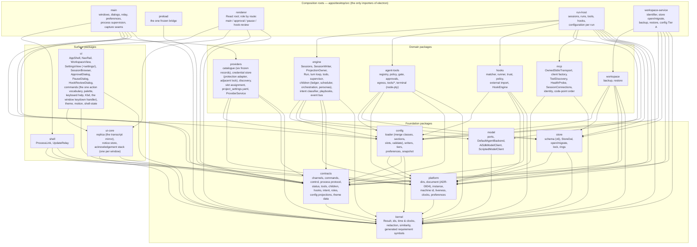

# Component view — packages and the edges between them

Packages follow **process boundaries** (ADR-0002, `codebase.md`): every package is instantiated by one or
more of the five composition roots, arrows point downward only, and `eslint-plugin-boundaries` fails
`pnpm lint` on any edge outside the matrix below (`eslint.config.js`, `ALLOW`). Composition roots are the
only places `electron` is imported.

## The packages

## The allowed-edge matrix (the lint rule, verbatim)

| From | May import |
|---|---|
| `kernel` | — |
| `contracts` | kernel |
| `platform` | kernel |
| `store` | kernel, platform |
| `config` | kernel, contracts, platform |
| `hooks` | kernel, contracts, platform, config |
| `providers` | kernel, contracts, platform, config |
| `engine` | kernel, contracts, store, platform, model, config |
| `agent-tools` | kernel, contracts, store, platform, config |
| `model` | kernel |
| `mcp` | kernel, platform |
| `workspace` | kernel, contracts, store, platform, config |
| `shell` | kernel, contracts, platform, release-naming |
| `ui-core` | kernel, contracts |
| `ui` | kernel, contracts, ui-core |
| `app-main` | kernel, contracts, platform, shell, release-naming, providers, config |
| `app-preload` | contracts |
| `app-renderer` | kernel, contracts, ui-core, ui |
| `app-run-host` | kernel, contracts, platform, store, engine, agent-tools, model, mcp, config, hooks |
| `app-workspace-service` | kernel, contracts, platform, store, workspace, config |

Edges worth knowing the reason for:

- **`engine` → `model`** (ADR-0026): the run loop drives `AgentBackend`; `model` sits over `kernel` only, so the
  arrow still points down.
- **`engine` does not import `agent-tools`** and `agent-tools` does not import `engine`: the run-host root fills
  the engine's `ToolPort` with the gate (`run-host/tools.ts`), so both stay structural.
- **`config` takes no database handle** (ADR-0036's guard) and cannot import `store`.
- **`main` cannot import `ui`/`ui-core`**: theme data the main process needs before first paint lives in
  `contracts/src/theme/`; the persona vocabulary the loader and the engine share lives in `contracts/src/roles.ts`.
- **`providers` lives in main and only main** (ADR-0030): the credential store, sign-in and discovery run in the
  main process; the run host is *leased* a resolved bearer per run over the utility-process channel and never
  reads `tokens/`. `main` therefore imports `providers` and `config` (for the snapshot layer's types and the
  bootstrap writer) but still no `store`.
- **`ui` cannot import `config`**: the Settings screen reads `ConfigSnapshot` and emits a save, a per-field write
  or its live state (`contracts/src/config.ts`); the workspace service commits.

## Where the responsibilities sit

| Concern | Package(s) | Root that instantiates it |
|---|---|---|
| Session identity, lock, writer, projection | `engine` (`sessions.ts`, `session-writer.ts`, `projection-owner.ts`) | run-host |
| The run loop, turn loop, todo, stop conditions, supervisor | `engine/src/run/` | run-host |
| Children: ledger, scheduler, orchestration, personas, reports | `engine/src/children/` | run-host |
| Intent classification, playbooks, pre-flight | `engine/src/intent/`, `engine/src/playbooks/`, `preflight.ts` | run-host |
| Tools, policy, approvals, terminal | `agent-tools` | run-host (`run-host/tools.ts`) |
| Lifecycle hooks | `hooks` (+ `config` hooks section) | run-host (`run-host/hooks.ts`) |
| Provider catalogue, credentials, discovery, the snapshot, sign-in | `providers` | main |
| Configuration: load, write, Tier B, projection | `config` | run-host (Tier B, `run-host/configuration.ts`), workspace-service (Tier A) |
| Model port and clients | `model` | run-host |
| Store schema and DAL | `store` | workspace-service (open/migrate), run-host (DAL) |
| Backup and restore | `workspace` | workspace-service |
| Process links, the update relay | `shell` | main |
| Preferences, theme data | `platform` (store), `contracts/theme` (data), `ui/theme.ts` (projection) | main, renderer |
| Views and dialogs | `ui`, `ui-core` | renderer |

### `mcp` (Part S, 2026-09-05)

No longer a placeholder: ADR-0033's `OwnedStdioTransport` over `platform`'s one spawn helper, the client factory over
`@modelcontextprotocol/client` 2.0.0 (pinned; the SDK's own transports for `http` and `sse`), and ADR-0034's three
paths. **Edges unchanged** — `mcp → kernel, platform`. The code-point comparator both `mcp` and `config` order by
lives in `kernel` (`order.ts`), so neither package needed a new edge. The configuration pipeline of ADR-0034 lives in
`config` (`src/mcp/`, `sections/mcp-servers.ts`); the run host composes the two (`run-host/mcp.ts`, `McpHost`) and
is the only process that instantiates either.

### The bundled code-intelligence runtime (Part T, 2026-09-06; ADR-0035's first execution)

Not a package — a **resources tree** and three build scripts. `apps/desktop/resources/code-intelligence/` (git-ignored)
holds `runtime/` — a self-contained CPython 3.13.15 with `serena-agent==1.7.0` in its own site-packages, no virtual
environment, its console-script launchers trimmed — and `bundle.json`, the marker with the pins' hash and the
interpreter's own answers. `apps/desktop/scripts/code-intelligence/pins.json` is the one place the build pins the
interpreter, the distribution and `uv` (by version and sha256; never shipped); `bundle.mjs` builds the tree
(`pnpm code-intel:bundle`, idempotent on the marker; the build fetches, the product never does); `manifest.mjs`
starts the bundled runtime, reads `tools/list` and its version and the extensions it indexes, and **generates**
`packages/config/src/mcp/code-intelligence-manifest.generated.ts` — REQ-MCP-116's binding manifest, committed so
`pnpm check` needs no Python, regenerated and diffed by `pnpm package` (`--check`). `config/src/mcp/code-intelligence.ts`
is the typed reader every consumer goes through (a test greps the tree for a runtime tool name anywhere else).
**Edges unchanged**: `config` still imports nothing new; `mcp` gains `setup.ts` (REQ-MCP-099's step runner over
`platform`'s spawn helper and the clock ports); the run host's `mcp.ts` reads `agent-tools`' gitignore reader for the
contains-code walk (an edge it already had). Main gains its first module, `main/sentinel.ts` (the pre-bootstrap
branch: `platform` for the per-user directory, nothing else), imported before anything that touches `electron`.
`electron-builder.yml` carries the tree as `extraResources` outside the asar (a Python tree cannot run from an
archive); `build-hooks.cjs`'s `afterPack` asserts the interpreter answers from inside `win-unpacked`.
