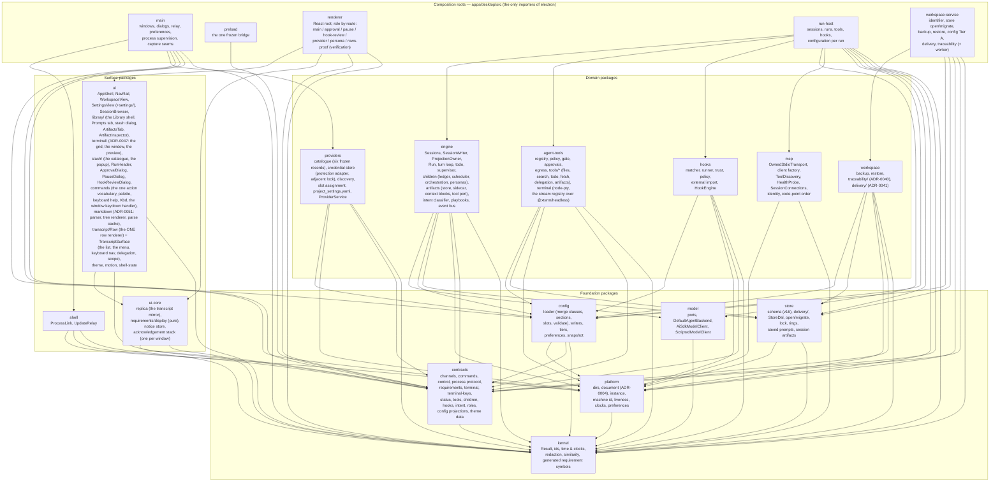

# Component view — packages and the edges between them

Packages follow **process boundaries** (ADR-0002, `codebase.md`): every package is instantiated by one or
more of the five composition roots, arrows point downward only, and `eslint-plugin-boundaries` fails
`pnpm lint` on any edge outside the matrix below (`eslint.config.js`, `ALLOW`). Composition roots are the
only places `electron` is imported.

## The packages

## The allowed-edge matrix (the lint rule, verbatim)

| From | May import |
|---|---|
| `kernel` | — |
| `contracts` | kernel |
| `platform` | kernel |
| `store` | kernel, platform |
| `config` | kernel, contracts, platform |
| `hooks` | kernel, contracts, platform, config |
| `providers` | kernel, contracts, platform, config |
| `engine` | kernel, contracts, store, platform, model, config |
| `agent-tools` | kernel, contracts, store, platform, config |
| `model` | kernel |
| `mcp` | kernel, platform |
| `workspace` | kernel, contracts, store, platform, config |
| `shell` | kernel, contracts, platform, release-naming |
| `ui-core` | kernel, contracts |
| `ui` | kernel, contracts, ui-core |
| `app-main` | kernel, contracts, platform, shell, release-naming, providers, config |
| `app-preload` | contracts |
| `app-renderer` | kernel, contracts, ui-core, ui |
| `app-run-host` | kernel, contracts, platform, store, engine, agent-tools, model, mcp, config, hooks |
| `app-workspace-service` | kernel, contracts, platform, store, workspace, config |

Edges worth knowing the reason for:

- **`engine` → `model`** (ADR-0026): the run loop drives `AgentBackend`; `model` sits over `kernel` only, so the
  arrow still points down.
- **`engine` does not import `agent-tools`** and `agent-tools` does not import `engine`: the run-host root fills
  the engine's `ToolPort` with the gate (`run-host/tools.ts`), so both stay structural.
- **`config` takes no database handle** (ADR-0036's guard) and cannot import `store`.
- **`main` cannot import `ui`/`ui-core`**: theme data the main process needs before first paint lives in
  `contracts/src/theme/`; the persona vocabulary the loader and the engine share lives in `contracts/src/roles.ts`.
- **`providers` lives in main and only main** (ADR-0030): the credential store, sign-in and discovery run in the
  main process; the run host is *leased* a resolved bearer per run over the utility-process channel and never
  reads `tokens/`. `main` therefore imports `providers` and `config` (for the snapshot layer's types and the
  bootstrap writer) but still no `store`.
- **`ui` cannot import `config`**: the Settings screen reads `ConfigSnapshot` and emits a save, a per-field write
  or its live state (`contracts/src/config.ts`); the workspace service commits.

## Where the responsibilities sit

| Concern | Package(s) | Root that instantiates it |
|---|---|---|
| Session identity, lock, writer, projection | `engine` (`sessions.ts`, `session-writer.ts`, `projection-owner.ts`) | run-host |
| The run loop, turn loop, todo, stop conditions, supervisor | `engine/src/run/` | run-host |
| Children: ledger, scheduler, orchestration, personas, reports | `engine/src/children/` | run-host |
| Intent classification, playbooks, pre-flight | `engine/src/intent/`, `engine/src/playbooks/`, `preflight.ts` | run-host |
| Tools, policy, approvals, terminal | `agent-tools` | run-host (`run-host/tools.ts`) |
| Lifecycle hooks | `hooks` (+ `config` hooks section) | run-host (`run-host/hooks.ts`) |
| Provider catalogue, credentials, discovery, the snapshot, sign-in | `providers` | main |
| Configuration: load, write, Tier B, projection | `config` | run-host (Tier B, `run-host/configuration.ts`), workspace-service (Tier A) |
| Model port and clients | `model` | run-host |
| Store schema and DAL | `store` | workspace-service (open/migrate), run-host (DAL) |
| Backup and restore | `workspace` | workspace-service |
| Process links, the update relay | `shell` | main |
| Preferences, theme data | `platform` (store), `contracts/theme` (data), `ui/theme.ts` (projection) | main, renderer |
| Views and dialogs | `ui`, `ui-core` | renderer |
| The session artifact store: records, documents, the two context blocks, the tool port | `engine/src/artifacts/` (+ `store` v12, `contracts/artifacts.ts`) | run-host (`Sessions` builds one per live session; `run-host/tools.ts` binds the three executors) |
| Markdown: the subset, its tree, its renderer, the bounded parse cache (ADR-0051) | `ui/src/markdown/` | renderer (the artifact inspector's Preview tab and, from Part AA, the transcript's agent-message rows — nothing renders Markdown a second way) |
| The transcript engine: the recycled slot pool, the apply pipeline's steps 3-5, the two bounded caches, the search index (ADR-0045, ADR-0046) | `ui/src/transcript/` | renderer (the Workspace transcript; the persona window keeps a plain list) |
| One transcript row, drawn: the categories, the outcomes, the group header, the trailers, the stalled indicator (REQ-CHAT-056/057/060/061/062/065/164) | `ui/src/transcript/Row.tsx` — a **pure function of its props**, holding no state, because Part Z's pool rebinds slots (ADR-0045) | renderer (the Workspace transcript and every persona window) |
| A transcript surface: the expansion map, the one context menu, keyboard navigation, the delegation-context header, the scope toggle (REQ-CHAT-059/068/069/075/077) | `ui/src/TranscriptSurface.tsx` | renderer |
| The traceability engine: the store parse, the sweep, the verification pass, the four operations, the artifacts' one I/O owner, the worker (ADR-0040, REQ-TRACE-001..229); since Part AJ′ the syntax-tree parser (`parser.ts`, the TypeScript compiler API loaded at first use — no new edge, `typescript` is resolved at run time) and the consumer half (`consumer.ts`, REQ-TRACE-176/182/183/500) | `workspace/src/traceability/` | workspace-service (`traceability.ts`, `traceability-worker.ts` — the `?nodeWorker` entry; `delivery.ts`'s two operation arms); ui (`settings/ProjectSettings.tsx`, the Settings card) |
| The delivery store and the board projection: the transition, the two handles, the gate, the reap, one frozen value per generation (ADR-0041, REQ-TRACE-232..483) | `workspace/src/delivery/`, `store/src/delivery/`, `contracts/requirements.ts`, `ui-core/requirements/display.ts` (the pure display mapping) | workspace-service (`delivery.ts`); main stamps the `Actor` (`main/requirements.ts`) |
| The terminal stream: one emulator per stream, the frames, the flush, the controls, the audit line (ADR-0021, REQ-TOOLS-126/127/128, REQ-SHELL-103..107) | `agent-tools/src/terminal/streams.ts` (+ `engine` for the row's `streamId`) | run-host (`terminal.ts`, `tools.ts`); main (`terminal.ts` — the delivery bound across every window taken together, Part T″ 2026-09-11: one budget the windows share, never one each) |
| The terminal display: the emulator port and its two adapters, the stream set, the input rules, the window and the preview (ADR-0047, REQ-SHELL-079..107); the renderer's third-party emulator is `@xterm/xterm` + `@xterm/headless` 6.0.0, pinned (agent-tools takes headless + `@xterm/addon-serialize`) | `ui/src/terminal/` (+ `host.tsx`, Part AL′: the per-renderer terminal host the pane, the persona card, the toolbar control and the palette entry read) | renderer (the main window's and each persona window's previews; the terminal window, `role=terminal` — Part AL′) |
| The composer's slash catalogue: the parser, the registry, the built-ins and the palette mirror, the highlighting, the popup (REQ-CHAT-018..034, 159) | `ui/src/slash/`, `ui/src/RunHeader.tsx` | renderer (`main.tsx` passes the `slash` host) |
| The adopted design language, drawn once: the twenty-eight component briefs, their typed props, and the verification-only layout contracts (`docs/design/README.md` §2, §7) | `ui/src/design-system/` | renderer (every view and window imports through `@rotaris/ui`; nothing else in `ui` writes a design-equivalent control — `tools/check-ui-language.mjs` fails `pnpm lint` on one) |

### `ui/transcript` (Parts Z and AA, 2026-09-07; ADR-0045's first execution, ADR-0046 steps 3-5, ADR-0051's second)

The transcript engine, as its own module because it is the most intricate component in the product and ordinary list
idioms are wrong inside it: `types.ts` (the `DisplayRow` / `RowRenderProps` seam, and the one statement of how
REQ-CHAT-046's twelve row categories map onto three display shapes), `constants.ts` (`H_MAX`, the pool capacity, and
**the product's ONE definition of `widgets` and `ui_objects`** — ADR-0045's closing obligation, cited from the proof
and owed to ADR-0053 rather than restated by it), `project.ts` (ADR-0046 step 4, pure), `pool.ts` (the offset table,
the visible span, the anchor, REQ-CHAT-053's four update shapes, pure), `cache.ts` (REQ-CHAT-058's two bounded LRU
caches and the four-part reuse predicate), `search.ts` (REQ-CHAT-074, incremental), `TranscriptPane.tsx` (the fixed
slot pool and step 5) and `Row.tsx` (Part AA's renderer, which the pane binds into each slot; Part Z's
`PlaceholderRow.tsx` stood in for it until the two branches merged and is gone). **Edges unchanged** —
`ui -> kernel, contracts, ui-core`. `ui-core`'s replica gains ADR-0046 step 3 (`classifyRows` and the six row-level
counters `REQ-UIBENCH-064` fixes, distinct from the seven publication classes it already had). `config` gains
`display-section.ts`, the reader `SECTION_KEYS` had declared and nothing stood behind; `model` gains `reasoning.ts`,
the pure normaliser for REQ-CHAT-163's three provider shapes.

### `mcp` (Part S, 2026-09-05)

No longer a placeholder: ADR-0033's `OwnedStdioTransport` over `platform`'s one spawn helper, the client factory over
`@modelcontextprotocol/client` 2.0.0 (pinned; the SDK's own transports for `http` and `sse`), and ADR-0034's three
paths. **Edges unchanged** — `mcp → kernel, platform`. The code-point comparator both `mcp` and `config` order by
lives in `kernel` (`order.ts`), so neither package needed a new edge. The configuration pipeline of ADR-0034 lives in
`config` (`src/mcp/`, `sections/mcp-servers.ts`); the run host composes the two (`run-host/mcp.ts`, `McpHost`) and
is the only process that instantiates either.

### `ui/library` (Part X, 2026-09-07)

The Library view's shell and its Prompts tab: `LibraryView.tsx` (the title, the ONE search field, the three tabs of
REQ-LIBRARY-103), `types.ts` (`LibraryTabProps` — the query, already case-folded by the shell, and the revision a tab
re-reads on), `PromptsTab.tsx` and `StashDialog.tsx`. **Edges unchanged** — `ui → kernel, contracts, ui-core` — and the
new contract file `contracts/src/library.ts` (the two prompt lists, the prompt state, and REQ-LIBRARY-105's closed set
of library changes) sits beside `notices.ts`, which keeps the single copy of the three tab names. `main` gains
`main/library.ts`, the revision counter whose `bump` takes a member of that closed set, which is how a settings write
is kept from counting as a library change (`app-main → contracts`, an edge it already had). The tab bodies reach
`LibraryView` as nodes, so a tab built elsewhere needs no change to the shell.

### The bundled code-intelligence runtime (Part T, 2026-09-06; ADR-0035's first execution)

Not a package — a **resources tree** and three build scripts. `apps/desktop/resources/code-intelligence/` (git-ignored)
holds `runtime/` — a self-contained CPython 3.13.15 with `serena-agent==1.7.0` in its own site-packages, no virtual
environment, its console-script launchers trimmed — and `bundle.json`, the marker with the pins' hash and the
interpreter's own answers. `apps/desktop/scripts/code-intelligence/pins.json` is the one place the build pins the
interpreter, the distribution and `uv` (by version and sha256; never shipped); `bundle.mjs` builds the tree
(`pnpm code-intel:bundle`, idempotent on the marker; the build fetches, the product never does); `manifest.mjs`
starts the bundled runtime, reads `tools/list` and its version and the extensions it indexes, and **generates**
`packages/config/src/mcp/code-intelligence-manifest.generated.ts` — REQ-MCP-116's binding manifest, committed so
`pnpm check` needs no Python, regenerated and diffed by `pnpm package` (`--check`). `config/src/mcp/code-intelligence.ts`
is the typed reader every consumer goes through (a test greps the tree for a runtime tool name anywhere else).
**Edges unchanged**: `config` still imports nothing new; `mcp` gains `setup.ts` (REQ-MCP-099's step runner over
`platform`'s spawn helper and the clock ports); the run host's `mcp.ts` reads `agent-tools`' gitignore reader for the
contains-code walk (an edge it already had). Main gains its first module, `main/sentinel.ts` (the pre-bootstrap
branch: `platform` for the per-user directory, nothing else), imported before anything that touches `electron`.
`electron-builder.yml` carries the tree as `extraResources` outside the asar (a Python tree cannot run from an
archive); `build-hooks.cjs`'s `afterPack` asserts the interpreter answers from inside `win-unpacked`.

### `ui/design-system` (2026-09-12)

The adopted design language's **one** implementation, and the only place in `ui` where a design-equivalent control
is written: `core.tsx` (`Button`, `StatusDot`, `Tag`, `ToggleSwitch`, `SegmentedControl`, `Kbd`), `forms.tsx`
(`Input`, `TextArea`, `Select`, `Checkbox`), `surfaces.tsx` (`Card`, `KpiCard`, `SectionLabel`), `data.tsx` (`Sparkline`,
`MeterBar`, `ContextRing`, `Table`), `feedback.tsx` (`Dialog`, `Tooltip`, `Spinner`, and the `Acknowledgement` /
`AcknowledgementStack` adapter that keeps REQ-SHELL-115's vocabulary over the visual the design material calls a
toast), `navigation.tsx` (`Tabs`, `NavRail`, `CommandPalette`), `patterns.tsx` (`TableCard`, `PageHeader`,
`EmptyState`, `LogPanel`, `ConfirmDialog`) — twenty-eight briefs, thirty exports — plus `shared.ts` (the two
class helpers) and `layout-contract.ts`. **Edges unchanged** — `ui → kernel, contracts, ui-core`; the layer imports
nothing but `react`, which is what lets `tools/check-ui-language.mjs` forbid a raw `button`, `input`, `textarea`,
`select` or `table` everywhere *else* under `packages/ui/src` and `apps/desktop/src/renderer` without an exception
list. Each component forwards native attributes and its ref, so a caller's `data-testid`, `aria-*` and handler
survive the substitution; a specialised class already carrying a requirement's visual contract is passed through
rather than overwritten (`componentClass`).

`layout-contract.ts` is **verification-only data, not behaviour**: a `UiLayoutContract` on a component root is
serialised into `data-ui` / `data-ui-contract` and evaluated by `ui-audit` against live geometry after layout and
animation settle (nine relations — `align-x`, `align-y`, `equal-width`, `equal-height`, `spacing-token`,
`containment`, `text-fit`, `hit-test`, `viewport-scroll`). Nothing in the product reads it, so a contract can
neither move a pixel nor hide a defect; it can only be wrong in public.

The nine relations are **opt-in**, and one question is asked of every marked box whether or not it published
anything: `shrunkBoxes` reports a box standing smaller than the content inside it on an axis whose `overflow` is
`visible` — the case where nothing is clipped, because the box does not scroll, and the remainder simply pays out
past the edge under whatever paints next. It exists because `text-fit` says the same thing on request and no
header had ever been asked (UIR-014). The verdict is pure and lives beside the relations in
`apps/desktop/scripts/lib/layout-relations.mjs`; the probe measures, `ui-audit` reports it as `SHRUNK`.
