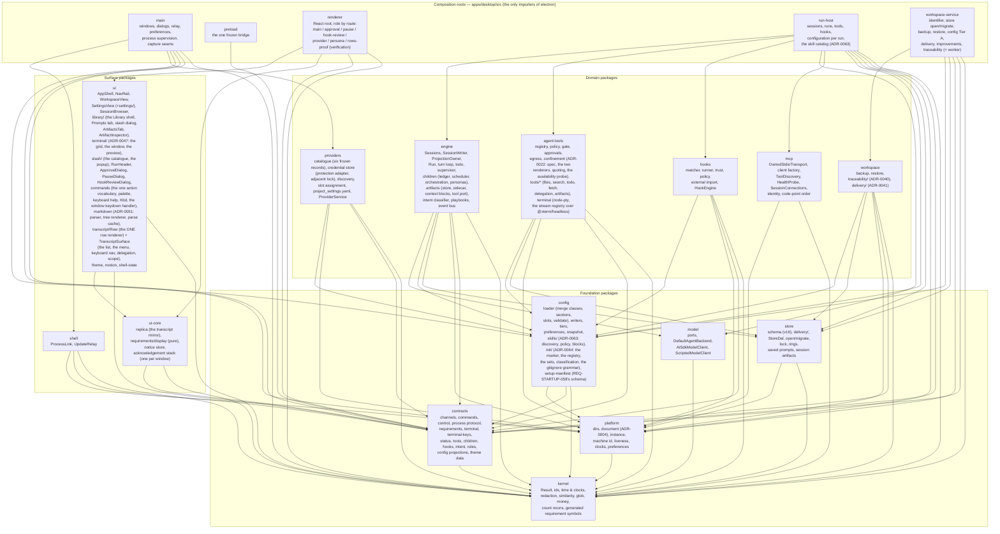

# Component view — packages and the edges between them

Packages follow **process boundaries** (ADR-0002, `codebase.md`): every package is instantiated by one or
more of the five composition roots, arrows point downward only, and `eslint-plugin-boundaries` fails
`pnpm lint` on any edge outside the matrix below (`eslint.config.js`, `ALLOW`). Composition roots are the
only places `electron` is imported.

| Read this section when you are | Section |
|---|---|
| adding a package, or asking which one work belongs in | [The packages](#the-packages) |
| adding an import that crosses a package | [The allowed-edge matrix](#the-allowed-edge-matrix-the-lint-rule-verbatim) |
| deciding where a responsibility sits | [Where the responsibilities sit](#where-the-responsibilities-sit) |
| touching the transcript, the Library, MCP, the code-intelligence bundle, the notices generator, the build-identifier writer and the bundled assets, the setup manifest, or the design system | the `###` sections after it |

## The packages

## The allowed-edge matrix (the lint rule, verbatim)

| From | May import |
|---|---|
| `kernel` | — |
| `contracts` | kernel |
| `platform` | kernel |
| `store` | kernel, platform |
| `config` | kernel, contracts, platform |
| `hooks` | kernel, contracts, platform, config |
| `providers` | kernel, contracts, platform, config |
| `engine` | kernel, contracts, store, platform, model, config |
| `agent-tools` | kernel, contracts, store, platform, config |
| `model` | kernel |
| `mcp` | kernel, platform |
| `workspace` | kernel, contracts, store, platform, config |
| `shell` | kernel, contracts, platform, release-naming |
| `ui-core` | kernel, contracts |
| `ui` | kernel, contracts, ui-core |
| `app-main` | kernel, contracts, platform, shell, release-naming, providers, config |
| `app-preload` | contracts |
| `app-renderer` | kernel, contracts, ui-core, ui |
| `app-run-host` | kernel, contracts, platform, store, engine, agent-tools, model, mcp, config, hooks |
| `app-workspace-service` | kernel, contracts, platform, store, workspace, config |

Edges worth knowing the reason for:

- **`engine` → `model`** (ADR-0026): the run loop drives `AgentBackend`; `model` sits over `kernel` only, so the
  arrow still points down.
- **`engine` does not import `agent-tools`** and `agent-tools` does not import `engine`: the run-host root fills
  the engine's `ToolPort` with the gate (`run-host/tools.ts`), so both stay structural.
- **`config` takes no database handle** (ADR-0036's guard) and cannot import `store`.
- **portable skills live in `config`, not in `workspace`** (ADR-0063), although `workspace/CONTEXT.md` owns the
  vocabulary: the matrix gives the run host no `workspace` edge, and skill injection happens at agent
  construction, which is the run host's. Contexts follow **spec domains**, not packages (`CONTEXT-MAP.md`).
- **project initialization lives in `config` too, and its coordinator in `main`** (ADR-0064): the marker's one
  writer is the workspace service and the one shipped task's work is the run host's, and the matrix gives
  neither of those two an edge to the other. `config` is the one package all three roots may read, and it
  already owns the YAML document model the marker is a section of and the code-intelligence binding the task
  is built from.
- **`main` cannot import `ui`/`ui-core`**: theme data the main process needs before first paint lives in
  `contracts/src/theme/`; the persona vocabulary the loader and the engine share lives in `contracts/src/roles.ts`, and since live-run finding K1
  (2026-09-29) so do the built-in roles' tool declarations (`BUILT_IN_ROLE_TOOLS`, `declaredToolsOf`) — the loader's role
  view and the run host's persona resolver read one rule; the prompts stay in the engine.
- **`providers` lives in main and only main** (ADR-0030): the credential store, sign-in and discovery run in the
  main process; the run host is *leased* a resolved bearer per run over the utility-process channel and never
  reads `tokens/`. `main` therefore imports `providers` and `config` (for the snapshot layer's types and the
  bootstrap writer) but still no `store`.
- **`ui` cannot import `config`**: the Settings screen reads `ConfigSnapshot` and emits a save, a per-field write
  or its live state (`contracts/src/config.ts`); the workspace service commits.
- **`app-main` → `release-naming` is the updater's edge** (ADR-0054, built 2026-09-28): the asset name it asks the
  feed for, the strict version order it compares by and the checksum-manifest format it parses are all the one naming
  authority's (`tools/release-naming/src/index.ts`), so the pipeline that writes those names and that manifest and the
  updater that reads them cannot disagree. The updater itself is `apps/desktop/src/main/updater/`, in the main root,
  because it is the process that owns the windows, the notices and the instance record it needs; its ports over
  Electron and the disk are one file (`electron.ts`) and everything else is pure.

## Where the responsibilities sit

| Concern | Package(s) | Root that instantiates it |
|---|---|---|
| Session identity, lock, writer, projection | `engine` (`sessions.ts`, `session-writer.ts`, `projection-owner.ts`) | run-host |
| The run loop, turn loop, todo, stop conditions, supervisor | `engine/src/run/` | run-host |
| Children: ledger, scheduler, orchestration, personas, reports | `engine/src/children/` | run-host |
| Intent classification, playbooks, pre-flight | `engine/src/intent/`, `engine/src/playbooks/`, `preflight.ts` | run-host |
| Tools, policy, approvals, terminal | `agent-tools` | run-host (`run-host/tools.ts`) |
| Lifecycle hooks | `hooks` (+ `config` hooks section) | run-host (`run-host/hooks.ts`) |
| Provider catalogue, credentials, discovery, the snapshot, sign-in | `providers` | main |
| Configuration: load, write, Tier B, projection | `config` | run-host (Tier B, `run-host/configuration.ts`), workspace-service (Tier A) |
| Model port and clients | `model` | run-host |
| Store schema and DAL | `store` | workspace-service (open/migrate), run-host (DAL) |
| Backup and restore | `workspace` | workspace-service |
| Process links, the update relay | `shell` | main |
| Preferences, theme data | `platform` (store), `contracts/theme` (data), `ui/theme.ts` (projection) | main, renderer |
| Views and dialogs | `ui`, `ui-core` | renderer |
| The session artifact store: records, documents, the two context blocks, the tool port | `engine/src/artifacts/` (+ `store` v12, `contracts/artifacts.ts`) | run-host (`Sessions` builds one per live session; `run-host/tools.ts` binds the three executors) |
| Markdown: the subset, its tree, its renderer, the bounded parse cache (ADR-0051) | `ui/src/markdown/` | renderer (the artifact inspector's Preview tab and, from Part AA, the transcript's agent-message rows — nothing renders Markdown a second way) |
| The transcript engine: the recycled slot pool, the apply pipeline's steps 3-5, the two bounded caches, the search index (ADR-0045, ADR-0046) | `ui/src/transcript/` | renderer (the Workspace transcript; the persona window keeps a plain list) |
| One transcript row, drawn: the categories, the outcomes, the group header, the trailers, the stalled indicator (REQ-CHAT-056/057/060/061/062/065/164) | `ui/src/transcript/Row.tsx` — a **pure function of its props**, holding no state, because Part Z's pool rebinds slots (ADR-0045) | renderer (the Workspace transcript and every persona window) |
| A transcript surface: the expansion map, the one context menu, keyboard navigation, the delegation-context header, the scope toggle (REQ-CHAT-059/068/069/075/077) | `ui/src/TranscriptSurface.tsx` | renderer |
| The traceability engine: the store parse, the sweep, the verification pass, the four operations, the artifacts' one I/O owner, the worker (ADR-0040, REQ-TRACE-001..229); since Part AJ′ the syntax-tree parser (`parser.ts`, the TypeScript compiler API loaded at first use — no new edge, `typescript` is resolved at run time) and the consumer half (`consumer.ts`, REQ-TRACE-176/182/183/500) | `workspace/src/traceability/` | workspace-service (`traceability.ts`, `traceability-worker.ts` — the `?nodeWorker` entry; `delivery.ts`'s two operation arms); ui (`settings/ProjectSettings.tsx`, the Settings card) |
| The delivery store and the board projection: the transition, the two handles, the gate, the reap, one frozen value per generation (ADR-0041, REQ-TRACE-232..483) | `workspace/src/delivery/`, `store/src/delivery/`, `contracts/requirements.ts`, `ui-core/requirements/display.ts` (the pure display mapping) | workspace-service (`delivery.ts`); main stamps the `Actor` (`main/requirements.ts`) |
| The improvement lifecycle: bounded terminal-state capture, no-tools analyst, app-wide FIFO coordinator, validated records, immutable versions, gap counters, legacy import and reader/writer capability split (ADR-0061, REQ-LIBRARY-002/015..058/125..131/165) | `engine/src/improvements/`, `workspace/src/improvements/`, `store/src/improvements/`, `contracts/improvements.ts` | run host captures and analyzes; main coordinates one FIFO and publishes activity; workspace-service owns reads and writes |
| The terminal stream: one emulator per stream, the frames, the flush, the controls, the audit line (ADR-0021, REQ-TOOLS-126/127/128, REQ-SHELL-103..107) | `agent-tools/src/terminal/streams.ts` (+ `engine` for the row's `streamId`) | run-host (`terminal.ts`, `tools.ts`); main (`terminal.ts` — the delivery bound across every window taken together, Part T″ 2026-09-11: one budget the windows share, never one each) |
| The terminal display: the emulator port and its two adapters, the stream set, the input rules, the window and the preview (ADR-0047, REQ-SHELL-079..107); the renderer's third-party emulator is `@xterm/xterm` + `@xterm/headless` 6.0.0, pinned (agent-tools takes headless + `@xterm/addon-serialize`) | `ui/src/terminal/` (+ `host.tsx`, Part AL′: the per-renderer terminal host the pane, the persona card, the toolbar control and the palette entry read) | renderer (the main window's and each persona window's previews; the terminal window, `role=terminal` — Part AL′) |
| The composer's slash catalogue: the parser, the registry, the built-ins and the palette mirror, the highlighting, the popup (REQ-CHAT-018..034, 159) | `ui/src/slash/`, `ui/src/RunHeader.tsx` | renderer (`main.tsx` passes the `slash` host) |
| Portable skills: the two-scope search, the disable manifest, the `SKILL.md` grammar, the name normal form, the policy resolution, the two model-facing blocks (ADR-0063, REQ-WORKSPACE-051..066) | `config/src/skills/` (+ `config/src/sections/skills.ts`, `contracts/skills.ts` — which also fixes the `/skills` listing's row text, written by the run host and read back by the renderer, REQ-CHAT-162) | run-host (`run-host/skills.ts`, the `SkillHost`: the per-root cache cleared at session creation, the session state, the context units, the read roots; `writeSkillListing`, the listing row through the session's writer); ui (`settings/SkillsSettings.tsx`, `slash/skills.ts`, `transcript/Row.tsx` drawing the listing) |
| Project initialization: the persisted marker and its outcome patch, the task registry, the five set derivations, the nine values and their set-wise equality, one execution, and `code`/`non-code` classification with the full gitignore grammar (ADR-0064, REQ-WORKSPACE-078..115) | `config/src/init/` (+ `contracts/initialization.ts`); `agent-tools/src/tools/search.ts` re-exports the grammar and keeps no second reader | main (`main/initialization.ts`: one resolution per open, the ONE marker write through `config.setField`, the `code-intelligence-setup` runner over `mcp.setup`); run-host (classification and `McpSetupStatus.applicable`); ui (`ProjectSetupDialog.tsx`, `settings/project-init.ts`, the Project card, the sidebar section, the composer gate) |
| The adopted design language, drawn once: the twenty-eight component briefs, their typed props, and the verification-only layout contracts (`docs/design/README.md` §2, §7) | `ui/src/design-system/` | renderer (every view and window imports through `@rotaris/ui`; nothing else in `ui` writes a design-equivalent control — `tools/check-ui-language.mjs` fails `pnpm lint` on one) |

### `ui/transcript` (Parts Z and AA, 2026-09-07; ADR-0045's first execution, ADR-0046 steps 3-5, ADR-0051's second)

The transcript engine, as its own module because it is the most intricate component in the product and ordinary list
idioms are wrong inside it: `types.ts` (the `DisplayRow` / `RowRenderProps` seam, and the one statement of how
REQ-CHAT-046's twelve row categories map onto three display shapes), `constants.ts` (`H_MAX`, the pool capacity, and
**the product's ONE definition of `widgets` and `ui_objects`** — ADR-0045's closing obligation, cited from the proof
and owed to ADR-0053 rather than restated by it), `project.ts` (ADR-0046 step 4, pure), `pool.ts` (the offset table
and, since 2026-09-29, the measurement ledger it is rebuilt from where it changed, the visible span, the anchor,
REQ-CHAT-053's four update shapes, pure), `cache.ts` (REQ-CHAT-058's two bounded LRU
caches and the four-part reuse predicate), `search.ts` (REQ-CHAT-074, incremental; since 2026-10-14 also `searchPanelCloser`, the closer the pane holds in REQ-SHELL-055's `searchPanel` Escape slot while its panel is open), `projector.ts` (2026-09-28: step 4
run once per change of its inputs rather than once per render — the R-048 measurement round's repair, pure,
`projector.test.ts` beside it), `TranscriptPane.tsx` (the fixed
slot pool and step 5) and `Row.tsx` (Part AA's renderer, which the pane binds into each slot; Part Z's
`PlaceholderRow.tsx` stood in for it until the two branches merged and is gone). **Edges unchanged** —
`ui -> kernel, contracts, ui-core`. **`PD-CHAT-004` (2026-09-15) moved one decision inside this module and added
no edge:** the third display shape is the **activity line**, a run of one agent's tool *and* streamed-reasoning
rows, so `project.ts` now decides the run boundary from the agent plus `display/showReasoning` rather than from
the tool family, and `types.ts` gains `ActivitySegment` beside `DisplayRow`. `isReasoningRow` moved from `Row.tsx`
into `project.ts` and is re-exported — `Row.tsx` already depended on `project.ts`, and declaring the run boundary's
own predicate in the file that consumes step 4 would have closed a cycle inside the module. `ui-core`'s replica
gains ADR-0046 step 3 (`classifyRows` and the six row-level
counters `REQ-UIBENCH-064` fixes, distinct from the seven publication classes it already had). `config` gains
`display-section.ts`, the reader `SECTION_KEYS` had declared and nothing stood behind; `model` gains `reasoning.ts`,
the pure normaliser for REQ-CHAT-163's three provider shapes. **`PD-CHAT-004` revision 3 (2026-09-15, landed after revision 2) added no
module and no edge:** `project.ts` gains `segmentFacts` beside `segmentSummary` — the segment's drawable parts,
each carrying the outcome it states — and the summary becomes the join of them, so the text `Row.tsx` draws and
the text copy emits have one definition and cannot drift. Nothing moved between files.

**`PD-CHAT-004` revision 2 and `PD-CHAT-005` (2026-09-16) changed two decisions inside the same module and added
no edge:** the run boundary is now the **agent alone** — `project.ts` holds one open run per agent in a map
instead of scanning strictly consecutive rows, so two agents working at once yield two activity lines that
interleave, each drawn at its own earliest member. That makes the incremental boundary harder than a walk
backwards: `cleanCut` takes the earliest first-member index of any run still open at the update point, because a
cut *inside* a run would drop members the reused prefix no longer holds and the re-projected suffix never sees
(REQ-MONITOR-223 forbids re-projecting the whole state). `buildSegments` now accumulates **one segment per
family** carrying that family's totals, ordered by first appearance, rather than one per switch. On the drawing
side, `Row.tsx` takes the persona's colour for the role line and an indent by delegation depth; the depth arrives
as `agentDepth` on `TranscriptSurface`, supplied by `WorkspaceView` from `session.agents`. Display-only: no new
edge, no new message, nothing reaches a model.

### `mcp` (Part S, 2026-09-05)

No longer a placeholder: ADR-0033's `OwnedStdioTransport` over `platform`'s one spawn helper, the client factory over
`@modelcontextprotocol/client` 2.0.0 (pinned; the SDK's own transports for `http` and `sse`), and ADR-0034's three
paths. **Edges unchanged** — `mcp → kernel, platform`. The code-point comparator both `mcp` and `config` order by
lives in `kernel` (`order.ts`), so neither package needed a new edge. The configuration pipeline of ADR-0034 lives in
`config` (`src/mcp/`, `sections/mcp-servers.ts`); the run host composes the two (`run-host/mcp.ts`, `McpHost`) and
is the only process that instantiates either.

### `ui/library` (Part X, 2026-09-07)

The Library view's shell and its Prompts tab: `LibraryView.tsx` (the title, the ONE search field, the three tabs of
REQ-LIBRARY-103), `types.ts` (`LibraryTabProps` — the query, already case-folded by the shell, and the revision a tab
re-reads on), `PromptsTab.tsx` and `StashDialog.tsx`. **Edges unchanged** — `ui → kernel, contracts, ui-core` — and the
new contract file `contracts/src/library.ts` (the two prompt lists, the prompt state, and REQ-LIBRARY-105's closed set
of library changes) sits beside `notices.ts`, which keeps the single copy of the three tab names. `main` gains
`main/library.ts`, the revision counter whose `bump` takes a member of that closed set, which is how a settings write
is kept from counting as a library change (`app-main → contracts`, an edge it already had). The tab bodies reach
`LibraryView` as nodes, so a tab built elsewhere needs no change to the shell.

### The bundled code-intelligence runtime (Part T, 2026-09-06; ADR-0035's first execution)

Not a package — a **resources tree** and three build scripts. `apps/desktop/resources/code-intelligence/` (git-ignored)
holds `runtime/` — a self-contained CPython 3.13.15 with `serena-agent==1.7.0` in its own site-packages, no virtual
environment, its console-script launchers trimmed — and `bundle.json`, the marker with the pins' hash and the
interpreter's own answers. `apps/desktop/scripts/code-intelligence/pins.json` is the one place the build pins the
interpreter, the distribution and `uv` (by version and sha256; never shipped); `bundle.mjs` builds the tree
(`pnpm code-intel:bundle`, idempotent on the marker; the build fetches, the product never does) for one target
architecture — since OQ-400 (2026-10-15) `--target=<platform>-<arch>`, the host by default (since 2026-10-16, OQ-401's
reading, `win32-x64` on a Windows ARM64 host, `defaultTargetKey`) and `win32-x64` from `package.mjs`, the interpreter installed by its full uv key and the target's architecture in the marker and its hash
(`target.mjs`), a Windows ARM64 host using the pinned `win32-x64` uv; `build-hooks.cjs`'s `afterPack` refuses a packaged
interpreter whose PE machine field is not the artifact's (`peArchOf`, `checkRuntime`); `manifest.mjs`
starts the bundled runtime, reads `tools/list` and its version and the extensions it indexes, and **generates**
`packages/config/src/mcp/code-intelligence-manifest.generated.ts` — REQ-MCP-116's binding manifest, committed so
`pnpm check` needs no Python, regenerated and diffed by `pnpm package` (`--check`). Since `PD-MCP-001` (2026-10-06) the
generator also writes the product's own descriptions for named capabilities (`productDescriptions`), held in
`manifest.mjs` and checked only to name a capability of the tiers. Since fin32 (PD-ORCH-004, the a68f121 duress run's D1)
it also writes `editArguments`: for each EDIT-tier capability, the argument naming the file its tool writes and, where it
has one, the preview argument, checked against the input schema the server lists; `codeIntelligenceEditPaths` reads it,
and `engine`'s child report and cut-off (an edge `engine → config` it already had) read the paths through it. Since fin35
(OQ-245) each entry carries a `scope` — `argument`, or `reach` with what it reaches (`project` for a rename, `path` for a
cross-file replacement), validated by generation — and `codeIntelligenceEdit` returns the reach the run host observes:
`agent-tools`' `observe.ts` (`snapshotTree`, `snapshotChanges`, `WriteJournal`, `observeReach`, over `config`'s gitignore
reader, an edge it already had) and the run host's `mcp.ts` executor around a reach call. Since `PD-MCP-004` (OQ-273,
2026-10-13) it also writes `warmUps` (the symbol rename warmed by the referencing-symbol search, with the two arguments they
share), refused by `scripts/lib/code-intelligence-warm-ups.mjs` unless the server lists both tools with both arguments, and read
by `codeIntelligenceWarmUp` for the run host's executor; no edge changed. `config/src/mcp/code-intelligence.ts`
is the typed reader every consumer goes through (a test greps the tree for a runtime tool name anywhere else).
**Edges unchanged**: `config` still imports nothing new; `mcp` gains `setup.ts` (REQ-MCP-099's step runner over
`platform`'s spawn helper and the clock ports); the run host's `mcp.ts` reads `agent-tools`' gitignore reader for the
contains-code walk (an edge it already had). Main gains its first module, `main/sentinel.ts` (the pre-bootstrap
branch: `platform` for the per-user directory, nothing else), imported before anything that touches `electron`.
`electron-builder.yml` carries the tree as `extraResources` outside the asar (a Python tree cannot run from an
archive); `build-hooks.cjs`'s `afterPack` asserts the interpreter answers from inside `win-unpacked`.

### The notices generator (2026-09-27; `first-release-plan.md` §4.3, ADR-0054)

Not a package — a **build-time tool** under `tools/notices/`, with no `package.json`, so the lockfile does not see it.
It imports nothing from `packages/` or `apps/`, and nothing in the product imports it. `pnpm notices`
(`generate.mjs`, a thin CLI over `notices.mjs`, typed by `notices.d.mts`) reads the installed tree: the desktop
application's and the workspace packages' `package.json` production edges, `node_modules`, Electron's `dist/`, the
bundled runtime under `apps/desktop/resources/code-intelligence/`, `packages/ui/src/fonts.css` and the font files it
names, `apps/desktop/resources/setup-manifest.json` as the setup manifest (since 2026-09-28; its field names are a copy
of `config`'s `SetupManifestSchema`, held to it by the test), and `apps/desktop/scripts/code-intelligence/pins.json` for
the runtime's name only. It writes one file,
`apps/desktop/resources/THIRD-PARTY-LICENSES.txt`, only when REQ-STARTUP-143's validation passes. Three
version-controlled tables sit beside it, as REQ-STARTUP-143 asks of the first:

- `reviewed-exceptions.json`, the maintainer-review table;
- `release-inputs.json`, O-3's LGPL address;
- `bundled-assets.json`, the fonts and the icon set, with their licence texts under `licenses/`.

The product meets the tool at one literal: `main/about.ts`'s `THIRD_PARTY_LICENSES_ASSET` equals the generator's
`NOTICES_FILE`, and `about.test.ts` holds them equal. **Edges unchanged**: `tools/**` is outside the boundary rule, and
the two tests that cross are tests — `about.test.ts` into the tool, and (since 2026-09-28) `notices.test.ts` into
`config`'s `setup-manifest.ts`, to hold the generator's copy of the manifest's field names to the schema.

### The build-identifier writer and the About page's two files (2026-09-27; `first-release-plan.md` §4.4, ADR-0054)

`tools/build-id/` is the notices generator's sibling: a **build-time tool** with no `package.json`, importing nothing
from `packages/` or `apps/`. `pnpm build-id` (`write.mjs`, a thin CLI over `build-id.mjs`, typed by `build-id.d.mts`)
asks the local git for HEAD's commit and whether the tree differs from it, and writes
`apps/desktop/resources/build-id.txt`. The product meets it at one literal, as it meets the generator:
`main/about.ts`'s `BUILD_ID_ASSET` equals `BUILD_ID_FILE`, held by `about.test.ts`.

`apps/desktop/scripts/package.mjs` runs both tools before freezing. `electron-builder.yml`'s `extraResources` carries
both files to the root of the artifact's resources, and leaves the tool server's dist-info licence out
(REQ-STARTUP-015). `scripts/lib/about-assets.mjs` holds the rules `package.mjs` and `build-hooks.cjs`'s `afterPack`
share: whether a refused notices step may be passed over (and, for `package.mjs` alone, whether the flag's value is one
it understands), and what the artifact must carry. It takes the two names, and the generator's `normalize`, from the two
tools, and `afterPack` asks `build-id.mjs`'s `identifyBuild` again for the tree being packed. Its two files are bundled
assets in the specification's sense, as the fonts and the icon set are; `bundled-assets.json` above holds only those
that carry a licence file (REQ-STARTUP-143), so this module is named for the surface it serves.
`scripts/lib/package-verdict.mjs` holds the lines `package.mjs` closes on, each printed only when the steps that ran
make it true. `scripts/lib/staged-resources.mjs` is `settings-proof`'s, for staging the two files and giving them back;
the proof also takes the writer's list of git's redirecting variables from `build-id.mjs`, and so does
`scripts/lib/working-directory.mjs`, also `settings-proof`'s since fin47. That module makes the empty directory, in no
repository, where a launch with no workspace argument runs (the app opens its working directory, REQ-SHELL-010 (c)), and
reads from the launch's log what it opened. `package.mjs` launches the
packaged application through `scripts/lib/bounded-launch.mjs`'s `spawnBounded`, as every proof launch a script starts
itself does since 2026-09-29 (`fetch-proof`'s, `workspace-proof`'s hand-over and `mcp-console-spike`'s since 2026-09-30),
so a launch that overruns its bound is ended and reported as a failure with its log tail. The driven launch is ended by
`lib/driver.mjs`'s `stopApp`, or by its `endLaunch` from a proof's own `finally`. Since 2026-10-07 (finacc3 A2-19) a launch
ends with its whole process group: a driven launch leads a group of its own as a bounded one does, and once the main
process has exited `bounded-launch.mjs`'s `drainGroup` gives the rest of the group three seconds, then SIGKILLs and names
what is left; `code-intel-proof`'s branch and `live-run`'s `runElectron` keep their own bounds, for the
reasons `scripts/lib/launch-sites.test.ts` names beside them. **Edges unchanged**:
`apps/desktop/scripts/**` and `tools/**` are outside the boundary rule, the scripts reach the tools and never the
reverse, and no product code imports either.

*Added 2026-09-28 (R-062, ADR-0054 "The prerelease naming repair").* `scripts/lib/artifact-names.mjs` is a fourth
shared module: the declared product version read as `apps/desktop/package.json` writes it (`declaredProductVersion`,
validated through REQ-STARTUP-029's grammar), the installer names rendered from it (`packagingArtifactNames`), the
configuration electron-builder is run with — the yml with `win.artifactName` and `nsis.artifactName` set to those
literals (`configurationWithNames`, `namedConfigurationText`) — and the rule a produced file's name is held to
(`producedNameProblem`). `package.mjs` imports it; `build-hooks.cjs` loads it by dynamic import in `afterPack`'s
`checkNaming` and in `artifactBuildCompleted`; it imports `tools/release-naming/src/index.ts` by path, as the hook did
before it. **Edges unchanged**: a script reaching a tool, as above.

### The requirement coverage report (2026-10-13; fin42, whats-next item N90)

`tools/requirement-coverage/` is a **report-time tool** with no `package.json`. It runs from `pnpm req-coverage`
(`coverage.mjs`, tests in `coverage.test.ts`) and is in no gate. It imports the generated artifact
(`packages/kernel/src/generated/requirements.ts`, through Node's type stripping) and reads the tracked files under
`packages/`, `apps/` and `tools/` through `git ls-files`. Nothing in `packages/` or `apps/` imports it, and it changes nothing
the product ships. **Edges unchanged**: `tools/**` is outside the boundary rule, and its test reaches the artifact through
`@rotaris/kernel`, as `symbol-artifact`'s does.

### The development-time store behind `pnpm dev-time` (2026-10-18; R-075)

`tools/dev-time/` is a **development-time tool** with no `package.json`. It runs from `pnpm dev-time`
(`cli.mjs`; the library is `dev-time.mjs`, tests in `dev-time.test.ts`) and measures spans of the work around
the product rather than the product: setup, build, each gate stage, proofs, repairs and repeated rebases.
Each span is one JSON record appended to an append-only log — `~/.rotaris/dev-time/log.jsonl`, or the
directory `ROTARIS_DEV_TIME_HOME` names, so every worktree of a host shares one history and no store dies
with a removed tree. `pnpm dev-time gate` runs the four `pnpm check` stages in `pnpm check`'s order, one
record each and stop on the first failure as its `&&` does; `proof <script>` runs a named script of the root
`package.json`; `run` measures one command; `start`/`stop` measure work no single command covers. A record
carries the command as spelled, the working directory, the repository, branch and head, whether the tree was
dirty, the host, and the exit. It imports nothing of the product and nothing in `packages/` or `apps/`
imports it. **Edges unchanged**: `tools/**` is outside the boundary rule, and the test imports the library
directly, as its siblings' tests do.

### The platform preflight (2026-10-19)

`apps/desktop/scripts/preflight.mjs` (`pnpm preflight [proof-id …]`, tests in `preflight.test.ts`) is a **machine
check for proof launches**: node against `engines.node`, git, the Electron binary, the desktop build's freshness
against the app's and the packages' sources (a `generated/` tree is skipped — `pnpm symbols` rewrites it), the
code-intelligence bundle through `scripts/lib/code-intelligence-bundle.mjs`'s `runBundleScript --check`, `.proof/`'s
writability, an exported `ROTARIS_*` variable and the display, plus each named proof's registry record read from
`tools/proof-registry/registry.mjs`: its hosts, its `requires` and its per-host clauses. It launches nothing and
writes nothing but a scratch probe it removes. It sits in `scripts/` rather than `tools/` because the scripts reach
the tools and never the reverse, and an endpoint proof's key needs `scripts/lib/endpoint-registry.mjs`.
**Edges unchanged**: no product code imports it.

### The evidence manifest (2026-10-19)

`apps/desktop/scripts/evidence.mjs` (`pnpm evidence write|verify <dir>`, tests in `evidence.test.ts`) writes and
verifies `evidence-manifest.json` in an evidence directory (`scripts/lib/evidence-manifest.mjs`): the environment
block `scripts/lib/environment-facts.mjs` reads — platform, node and Electron, the display, the git head and dirty
flag, the desktop build's freshness against its sources and the build identifier — and every file with its size
and sha256. A live run writes one into its pack as it finishes, last, so `results.json` is covered; `verify`
re-hashes the directory and names every file that changed, went missing or arrived after the manifest was written.
A `pnpm ui-review` pack's `manifest.json` is the critic protocol's own and is untouched. **Edges unchanged**: the
tool launches nothing, no product code imports it, and `environment-facts.mjs` is the one reading the preflight's
checks and the manifest's record are both taken from.

### The worktree wrappers behind `pnpm worktree:new` / `pnpm worktree:land` (2026-10-19)

`tools/worktree/` is a **process tool** with no `package.json`. `new.mjs` and `land.mjs` wrap the two halves of
`docs/clean-room/agent-workflow.md`: a branch in a fresh worktree beside the primary checkout, cut from
`origin/main` (fetch, `git worktree add -b`, `pnpm install --prefer-offline`, electron's `install.js` and
`pnpm preflight`), and the landing sequence — fetch, `git rebase origin/main` (a conflict aborts the rebase and
hands back; the tool never resolves one), a **landing worktree** detached at the rebased head and re-installed,
`tools/verify-plan`'s plan read against `origin/main` (its `review` list demands `--reviewed`), `pnpm check` then
the named proof suites on that exact head (`--skip-proofs` skips them loudly), `git push origin HEAD:main` —
fast-forward only, re-rebasing while `main` moves under it — and the removal of both worktrees and the branch.
`exec.mjs` runs a command with its output inherited or captured and builds pnpm's own command line
(`dev-time.mjs`'s `npm_execpath` pattern); `git.mjs` holds the git reads, with the git-hook variables cleared so a
read cannot land in another repository; `steps.mjs` gathers the heavy steps as seams, which is how the tests run
the wrappers end to end against a scratch repository with git real. **Edges unchanged**: `tools/**` is outside
the boundary rule, nothing here imports the product, and no product code imports it.

### The setup manifest and its schema (2026-09-28; `first-release-plan.md` §4.1, ADR-0054)

`apps/desktop/resources/setup-manifest.json` is REQ-STARTUP-058's manifest: committed, not generated, and carried by
`electron-builder.yml`'s `extraResources` to the root of the artifact's resources beside the two About files. Its shape
lives in **`config`** — `setup-manifest.ts`, `SetupManifestSchema` (zod, strict, so a key it does not name refuses the
file) — because both of its readers may import `config` and nothing lower could hold what it is cross-checked against:
`SHIPPED_MCP_SERVERS` and `CODE_INTELLIGENCE_LANGUAGE_SERVERS` are `config`'s. The pre-build guard
(`tools/release-guard`, outside the matrix) already read the defaults there and now takes the schema version and the
complete-version pattern from the same module; the product's reader, the machine-setup flow, would be main's
(REQ-STARTUP-089), and main imports `config`. **That flow is not built.** `setup-manifest.test.ts` validates the shipped
file, refuses each malformed shape and holds its `languageServers` equal to `pins.json` and to
`CODE_INTELLIGENCE_LANGUAGE_SERVERS`, so the two files cannot drift; `about-assets.test.ts` copies the file through
electron-builder's own `copyFiles`. The schema's `PLATFORM_KEYS` (REQ-STARTUP-060) is a second literal of
`tools/release-naming`'s, the naming authority — `config` has no edge to it — and `tools/release-guard`'s `pins.test.ts`,
which imports both, holds the two lists equal and every shipped archive under one of them; the raw `<os>-<machine>`
fallback key is refused as an archive key. The notices generator reads it as its manifest since 2026-09-28, by a copy of the field names rather than an import. **Edges
unchanged**: `config` gains the `zod` dependency `contracts` already carries; no package edge moves.

### `agent-tools`' JSON Schema validator (2026-10-06; fin18, live-run finding G3)

`agent-tools/advertised-schema.ts` checks an MCP call against the input schema its server advertised (REQ-TOOLS-032), and
validates with **`ajv` 8.20.0**, pinned exactly and declared by `agent-tools`, which imports it, and by `apps/desktop` beside
the app's other node-side runtime dependencies (`zod`, the MCP client); the build bundles it into `out/main/run-host.js`,
as it does those. It is the engine `@modelcontextprotocol/client` 2.0.0
bundles and validates with (ADR-0033 leaves schema validation to the SDK), declared directly because the SDK's validator
returns one flattened error string and does not export its 2020-12 engine, and the gate needs each violation's location.
The lockfile already carried 8.20.0 (beneath electron-builder). **Edges unchanged**: a third-party dependency; no package
edge moves. Its manifest now declares everything its source imports (2026-10-06, fin21): `zod ^4.5.4`, which the gate and every tool's
argument schema import, and `@rotaris/config`, which `tools/search.ts` imports for the gitignore grammar along the
`agent-tools → config` edge the table above already allows; both had resolved only through the flat `node_modules`, and
`agent-tools/src/manifest.test.ts` now fails an undeclared import.

### `ui/design-system` (2026-09-12)

The adopted design language's **one** implementation, and the only place in `ui` where a design-equivalent control
is written: `core.tsx` (`Button`, `StatusDot`, `Tag`, `ToggleSwitch`, `SegmentedControl`, `Kbd`), `forms.tsx`
(`Input`, `TextArea`, `Select`, `Checkbox`), `surfaces.tsx` (`Card`, `KpiCard`, `SectionLabel`), `data.tsx` (`Sparkline`,
`MeterBar`, `ContextRing`, `Table`), `feedback.tsx` (`Dialog`, `Tooltip`, `Spinner`, and the `Acknowledgement` /
`AcknowledgementStack` adapter that keeps REQ-SHELL-115's vocabulary over the visual the design material calls a
toast), `navigation.tsx` (`Tabs`, `NavRail`, `CommandPalette`), `patterns.tsx` (`TableCard`, `PageHeader`,
`EmptyState`, `LogPanel`, `ConfirmDialog`), `overlays.tsx` (`PopoverMenu` — PD-CHAT-001's press-revealed value
chip: the trigger button carries the current value with `aria-haspopup`/`aria-expanded`, and the alternatives open
in an anchored `role="menu"` panel of `menuitemradio` rows, Escape closing back to the trigger) — twenty-nine
briefs, thirty-one exports — plus `shared.ts` (the two class helpers) and `layout-contract.ts`. **Edges unchanged**
— `ui → kernel, contracts, ui-core`; the layer imports nothing but `react`, which is what lets
`tools/check-ui-language.mjs` forbid a raw `button`, `input`, `textarea`, `select` or `table` everywhere *else*
under `packages/ui/src` and `apps/desktop/src/renderer` without an exception list. Each component forwards native
attributes and its ref, so a caller's `data-testid`, `aria-*` and handler survive the substitution; a specialised
class already carrying a requirement's visual contract is passed through rather than overwritten
(`componentClass`). **`Tag` and `StatusDot` are the exceptions** (acceptance A40, 2026-10-01): `Tag` joins a caller's
class to the `tag tag-<kind>` it draws, its kinds the design Tag's seven tones (`TAG_KINDS`), and
`tools/check-ui-language.mjs` refuses a Tag whose class spells `tag` or a `tag-` tone; `StatusDot` writes the design
StatusDot's state (`STATUS_DOT_STATES`) to `data-state`, which `shell.css` paints from its token at the specificity of
`.status-dot` alone.

`layout-contract.ts` is **verification-only data, not behaviour**: a `UiLayoutContract` on a component root is
serialised into `data-ui` / `data-ui-contract` — by `layoutContractAttributes` alone, which `tools/check-ui-language.mjs` enforces — and evaluated by `ui-audit` against live geometry after layout and
animation settle (nine relations — `align-x`, `align-y`, `equal-width`, `equal-height`, `spacing-token`,
`containment`, `text-fit`, `hit-test`, `viewport-scroll`). Nothing in the product reads it, so a contract can
neither move a pixel nor hide a defect; it can only be wrong in public.

The nine relations are **opt-in**, and one question is asked of every marked box whether or not it published
anything: `shrunkBoxes` reports a box standing smaller than the content inside it on an axis whose `overflow` is
`visible` — the case where nothing is clipped, because the box does not scroll, and the remainder simply pays out
past the edge under whatever paints next. It exists because `text-fit` says the same thing on request and no
header had ever been asked (UIR-014). The verdict is pure and lives beside the relations in
`apps/desktop/scripts/lib/layout-relations.mjs`; the probe measures, `ui-audit` reports it as `SHRUNK`.

### Transcript rendering note

The Workspace transcript keeps ADR-0045's fixed recycled slot pool and positions each bound slot with its measured `translateY` offset. Browser-selected text layers preserve native glyph rasterization during steady-state reading; `rows-proof` verifies the default layer hint and live coordinate transform.
