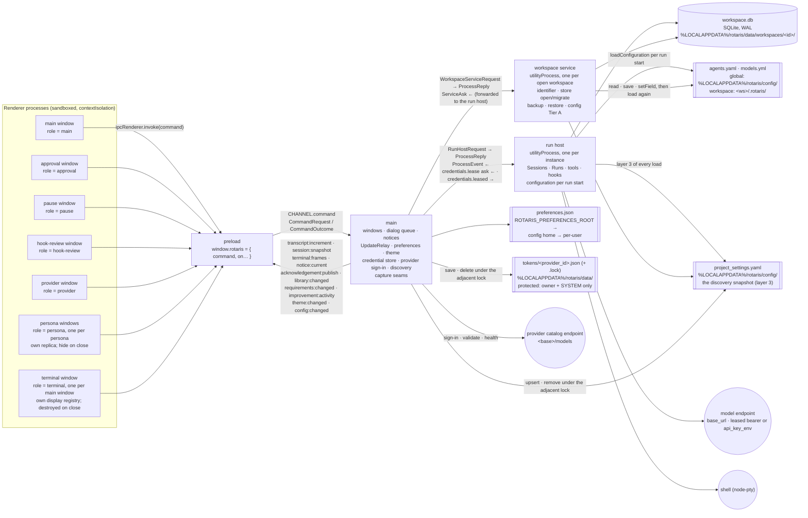

# Process view — five processes and what crosses each boundary

One Electron instance (SR-1; ADR-0055's claim), five kinds of process (ADR-0002). Every message crossing a
boundary is a Zod schema in `packages/contracts/src/` — `commands.ts` (renderer ↔ main), `channels.ts`
(main → renderer, eleven named channels), `process-protocol.ts` (main ↔ run host, main ↔ workspace service,
and the service's narrow asks back to main).

| Read this section when you are | Section |
|---|---|
| asking which process may do a thing at all | [What each process owns](#what-each-process-owns) |
| adding or changing a message, a command or a channel | [Message families](#message-families) |
| reaching into a live run from outside it | [The control channel](#the-control-channel-adr-0010-1-across-the-boundaries) |
| touching what the run host publishes internally | [The wire bus](#the-wire-bus-adr-0010-2-stays-in-the-run-host) |
| writing, reading or relocating a file | [Files and directories on disk](#files-and-directories-on-disk) |

The ordered edit path for a new command, channel or message is [`04-seams.md`](04-seams.md); who owns a fact
once it exists is [`05-state-ownership.md`](05-state-ownership.md).

## What each process owns

| Process | Owns | Never does |
|---|---|---|
| **main** | window lifecycle and the close guard — since 2026-09-12 **every main window is built, tracked, and coordinated through `MainWindows`** (`apps/desktop/src/main/main-windows.ts`, executing ADR-0055 consequence 6's two entrances and ADR-0048's registry over main windows with Electron and in-memory adapter seams) and lives in a private registry keyed by `webContents` id, so several main windows of the one instance are ordinary rather than exceptional (REQ-STARTUP-161) and every workspace-scoped command is answered for the window that sent it (REQ-SHELL-020); **startup workspace resolution** (REQ-SHELL-010's three-way precedence: an explicitly selected folder, else a remembered one that still names a directory, else the working directory with a chooser scheduled), the one **deferred first-paint offer** (REQ-SHELL-011's 650 ms, per window and abandoned unshown once the question has been answered) and the **gated replacement** (REQ-SHELL-017 – REQ-SHELL-021: build, open the service, show, await the old window's own close, then persist) are main's alone; `workspace/lastOpened` is written by main and by nothing else — the key is registered in `platform`'s `PREFERENCE_KEYS` and deliberately absent from `PREFERENCE_COMMAND_KEYS`, which is an allow-list, so no renderer can read or write it over `prefs.get/set`; **application modality across a window family** (ADR-0048, Part W: `setFamilyModal` disables every persona window while the main window holds an application-modal surface, restores them when it closes, creates a new one disabled while one is up, and restores the family on the main renderer's navigation, reload or crash); **the persona-window registry** (ADR-0048, Part R: one window per persona, hidden on close, destroyed with the main window and on a new session; `main/windows.ts`); **the terminal-window registry** (ADR-0021's and ADR-0047's window, Part AL′: ONE per main window, 900×620, DESTROYED on close and rebuilt on the next open — the deliberate difference from the persona window, ADR-0047 consequence 3 — shown without focus when opened automatically under `terminal/autoOpen`, closed and reopened without focus when the main window's renderer reports a change of the followed session, closed and discarded when a session starts from none, gone with its main window; `TerminalWindows` in `main/windows.ts`, the five `window.*` commands below); the per-window approval **dialog queue** and the pause window; the single current notice; the `UpdateRelay` (sequence-preserving fan-out of the run host's publications to subscribed windows); theme and preferences (ADR-0042); the instance claim; forking and shutting down the two child kinds; **the credential store, the provider catalogue, sign-in, discovery and the snapshot** (ADR-0029/0030, `packages/providers`); the verification seams under `ROTARIS_CAPTURE_PNG` — **compiled in only where `__ROTARIS_SEAMS__` is true** (2026-09-11), and since 2026-09-17 a module of their own rather than six hundred lines inside `main()`: `apps/desktop/src/main/capture/` holds the step grammar and the host main gives it (`host.ts`, with a test over the grammar), the part a shipped build still answers (`probe.ts` — the typed prompt and the photograph that ends the launch), the scriptable half (`seams.ts`) and the theme proof's capture pass (`theme-proof.ts`). The last two are reached by a **dynamic import inside `if (__ROTARIS_SEAMS__)`**: `scripts/package.mjs` builds with `ROTARIS_BUILD=package`, which makes the flag false, rollup removes the branch, and the chunk is then unreferenced and never emitted — leaving only the three the packaged probe itself drives (`_PNG`, `_PROMPT`, `_AFTER_MS`). The gate is build-time and not run-time on purpose: an environment variable cannot turn the seams back on in a binary built without them, and the build asserts it — the deliberately un-numbered **seam check**, which since the same date reads **every emitted file of the main section** rather than `index.js` alone, because a chunk is exactly the shape that surface could come back in; **every renderer command, in a module of its own** (2026-09-17): `apps/desktop/src/main/commands/` holds one facet per family — `dialogs`, `providers`, `session`, `hooks`, `mcp`, `initialization`, `skills`, `shell`, `git`, `checkpoints`, `library`, `improvements`, `config`, `requirements`, `windows`, `workspace` — beside `context.ts`, which names `CommandContext` (the inventory main hands them, which used to be the closure `runCommand` was written inside) and `CommandHandlers` (**total** over `CommandRequest['kind']`, so a kind the contract declares and no facet answers fails to compile rather than answering `command.unimplemented` at run time). `runCommand` itself is three moves — resolve the window the command was raised for, read the request, call the handler the table names — and holds no case; a facet declares the slice of the context it uses, which is what lets `commands/mcp.test.ts` drive real handlers with a plain object where the run host is; **the checkpoint gate** moved with its commands (`commands/checkpoints.ts`), main keeping only the holder the quit path waits on (REQ-GIT-101); **the driver seam under `ROTARIS_DRIVER`** (2026-09-11, verification only, `main/driver.ts`: a loopback listener on an ephemeral port, minted with a per-launch secret written to the endpoint file the variable names, answering newline-delimited JSON — `waitFor`, `click`, `type`, `chord`, `inspect`, `probe`, `eval`, `screenshot`, `resize`, `quit`, and `command`, which is relayed to main's own `runCommand` rather than around it. Nothing listens when the variable is unset; no renderer, run host or workspace service message is involved, and no product surface can reach it) | decide a permission, run a tool, read the store, read `agents.yaml`, hand a credential to a renderer |
| **run host** | **the portable-skill catalog** (ADR-0063): cached per resolved workspace root, cleared at SESSION creation (REQ-WORKSPACE-058) rather than per run, warmed on workspace open, with the session-scoped forced set and hand-loaded skills keyed by session id and one pending bucket per root (OQ-58); it composes the always-active context units at every agent construction and answers the skill directories as additional read roots; every session lock this instance holds; the writers, projection owners and runs; the tool gate per session; hooks per run; the checkpoint port per run (the capture at iteration close, the rows and the retention trim — ADR-0039); the configuration resolved per run start (Tier B) with the live state main handed over; the bearers main **leased** for the run; the loop supervisor; the terminal manager; **the MCP holder** (Part S): the discovery memo, the probe path, the per-session connection registries and their stdio children, the session enable-override, the one diagnostic sink, and — in the `mcp` package, for the process rather than for a session — the protocol era each server has already answered with, so the three connection paths probe it once between them (ADR-0033, 2026-09-16); **the live terminal streams** (Part AL, ADR-0021: one headless emulator per stream, the frames on channel 3 with a per-stream `seq`, the sampling period as a ceiling with the flush armed at the 20 ms floor by input the USER has directed at a stream whose control they have taken — never by output, and since the OQ-38 ruling of 2026-09-11 never by an agent's own `is_input` call either (REQ-CONFIG-117), the seven `terminal.*` controls, the REQ-SHELL-107 audit line redacted and written through the session writer; `tools.ts` reads the background-session limits into the manager); **since 2026-09-17 the process is three modules, not one file**: `host.ts` is `createRunHost()` — the thirty-six bindings this process holds, built when it is CALLED rather than when the module is imported, so the MCP host, the confinement service, the terminal manager and the code-intelligence launch no longer come up as a side effect of loading the file; `dispatch.ts` is `dispatch(req, host)`, the request path over what that built, which is now importable without starting anything; `index.ts` is the entry and holds only the port listener; `scripted-client.ts` is the step-driven stand-in every proof runs against (`ROTARIS_SCRIPT`), two hundred and fifty-seven lines that used to sit between the two | resolve a workspace identifier; migrate the store; write configuration files; read `tokens/`; spawn Git (it asks main, which asks the service) |
| **workspace service** | the workspace identifier; opening and migrating the store (the only process that migrates, W-02); backup and restore with its refusal lease on the run host; configuration Tier A (`config.read` / `config.save` / `config.setField`, each followed by the load again); **every Git invocation** (ADR-0038): the repository and Git-view reads, the worktree writes, and the checkpoint capture, preview, restore and prune through a private index (ADR-0039); **the delivery store and the board projection** (Part AK, ADR-0041: v15's `delivery*` tables, the reader and writer handles, the transition in one transaction, one frozen projection per generation, the restart reap); **the traceability engine** (Part AJ, ADR-0040: the one I/O owner of the five repository artifacts, every pass on a terminable worker thread — `traceability-worker.ts` is the `?nodeWorker` entry) | run anything; hold a session lock; write a checkpoint row |
| **renderer** (per window) | the replica (a mirror of one session's rows and record, ADR-0043), local shell state (view, guards), the Settings pending state; one role per route (`main`, `approval`, `pause`, `provider`, `hook-review`, `persona`, `terminal` — Part AL′: the terminal window, one per main window, whose registry's emulators paint (`@xterm/xterm`) over the same frames the previews consume; it subscribes to the followed session for itself and asks the run host for the resync — and `rows-proof` — Part AA's harness, served only under `ROTARIS_CAPTURE_PNG`); the main window and each persona window hold one `TerminalStreamSet` over the headless emulator for the row previews (Part AL′, REQ-SHELL-075 b / 079); every transcript surface's own expansion map, context menu and acknowledgement stack; the terminal display (Part AM: the emulator port over the same frames, the grid, the window component, the transcript preview) and the composer's slash catalogue (Part AN); **since 2026-09-17 the bundle is five modules, not one file**: `shell.ts` is what a window HAS — the bridge, the replica, the notice and acknowledgement stacks, the terminal registry, the display preferences, the theme it wears and the eleven session gestures, all wired to the numbered channels once per window; `session-actions.ts` is those gestures, taking the bridge and the replica as arguments rather than closing over them, which is what `session-actions.test.ts` drives with two plain objects (the first tests of renderer code); `session-view.ts` is the four readings a transcript surface makes of the followed session, shared with the persona window so the entry role has ONE answer (REQ-MONITOR-057/058); `windows.tsx` is every role that is not `main` — approval, provider, pause, hook-review, persona, terminal — over one `mountWindow` that asks main for the payload the window was opened for and draws its headline instead when main refuses; `main.tsx` is the main window alone | touch a file, a store, a credential, **navigate** — a link asks main to open it (`shell.openExternal`, ADR-0051) |
| **preload** | the one frozen namespace: `command` plus one subscription per channel | anything else |

## Message families

**Per-launch board permissions (2026-09-13, REQ-TRACE-470/471).** The main-to-run-host `session.start`
accepts optional `boardPermissions: permissive`, produced by main's board coordinator after the existing
disclosure and preference checks. Renderer `session.start` retains its existing fields. The grant applies
to the captured configuration for that launch, including autonomous mode and the unsandboxed opt-in.
Board dispatch therefore crosses this boundary once to start the session. `config.liveState` continues
to carry the Settings surface's live values.

**Renderer → main (`CommandRequestSchema`).** `shell.hello`, `theme.get/set`, `prefs.get/set` (keys: the theme, the motion preference, the Settings tab, `panels/overview`, `panels/git`, `panels/library`, `interface/agentPopOut` — REQ-SHELL-073's "agent pop-out", Part R — and the transcript's three display preferences, all booleans registered in `platform`'s `PREFERENCE_KEYS`: `display/groupTools` (REQ-CHAT-067's tool-grouping switch, default **ON**, Part Z), `display/showReasoning` (REQ-CHAT-167, which names the key literally, default **off**, Part AA), `display/autoCollapseTools` (REQ-CHAT-067, default **off**, Part AA) and **`panels/workspace`** (Part AB, REQ-CHAT-010's transcript/composer divider under REQ-SHELL-069's key rule, pane count 2)), and **the requirements board's keys** (Part AK′; spec 08 §Persisted state, REQ-TRACE-301: `requirements/filter/{text,epic,source,lifecycle,health,priority}`, `requirements/sort`, `requirements/axis`, `requirements/blocked_column` — the person's display state, strings; `requirements/fullPermissionRuns`, `requirements/fullPermissionNoticeSuppressed`, `requirements/answerWaitSeconds` — REQ-CONFIG-405's, registered with the family and read by Part AP, never by the board; and ONE placeholder key `workspaces/{workspace}/requirementColumnFolds`, sent literally by the renderer and resolved by main to `workspaces/<digest of the open workspace>/requirementColumnFolds` — the same discipline as the composer draft, so a window can neither read nor write another workspace's folds, REQ-TRACE-312), **`composer.readDraft` / `composer.writeDraft {text}`** (Part AB, REQ-CHAT-015 / REQ-SHELL-159 / REQ-NOTIFY-066: the per-workspace composer draft. They carry **no key and no workspace** — main resolves `workspaces/{workspace-key}/composerDraft` from the workspace it opened, so a renderer cannot name another workspace's draft, which is what REQ-CHAT-015's last sentence forbids; the key family is registered in `platform`'s `PREFERENCE_KEYS` and minted only by `composerDraftKey`), `shell.openExternal {url}` (Part AA, REQ-CHAT-076 — see the row-renderer paragraph below), `window.openPersona {persona, agentId, focusSteer?}` / `window.personaPayload` (Part R: open or raise the persona window; the window reads its persona, the followed session and the instance to select — answered by main from the registry; a raise is a request, REQ-SHELL-161), **the terminal window's five (Part AL′; contracts `terminal.ts`, answered by main's registry, none reaching the run host): `window.openTerminal {streamId?}` (open or raise the main window's one terminal window, bringing the stream forward when retained — from the toolbar, the palette's Ctrl+Shift+T, a row's preview, a persona card's; REQ-SHELL-080/081/085), `window.terminalPayload` → `{sessionId, focusStream, autoOpen}` (the window asks what it was opened onto), `window.terminalSession {sessionId | null}` (the main window's renderer reports the session it follows; main closes the window and reopens it without focus when it had been open on a session — REQ-SHELL-110/111; refused `window.notMain` from any other window), `window.terminalAutoOpen {value}` (REQ-SHELL-109's preference, `terminal/autoOpen` in `platform`'s `PREFERENCE_KEYS`, key-less on the wire like the composer draft), `window.showWorkspace` (REQ-SHELL-083's "Go to Workspace": the main window switches view and is surfaced as a request)**, `repository.read` (the Overview's card; relayed to the workspace service, waiting for a workspace open in flight),
`session.start/newId/list/resume/prompt/continue/subscribe/unsubscribe/reconcile/pageOlder/control` (`pageOlder`
is wired end to end and, from Part Z, is CALLED: the transcript asks for the next older span when the reader scrolls
toward the top, and the replica's `prependOlder` places it above — REQ-CHAT-165, REQ-SESSION-192),
**`session.planEdit {text}` / `session.planDecision {decision, changes?}` / `session.planRearm {sessionId}`**
(ADR-0062 and PD-ORCH-003, REQ-ORCH-152/153/154: the plan gate's three entries, relayed to the run host that owns
the session and answered `ack` / `{cycle, relaunched}` / `ack`. They are session commands and **not** control
operations, because `CONTROL_OPS` is REQ-MONITOR-004's closed enumeration over a LIVE run and a run held at the
gate is parked — the answer must reach a session whose hosting process may have exited since the gate opened.
`planEdit` records the user's text and approves nothing; `planDecision` carries one of exactly three answers;
`planRearm` drops the approval's release so the session's next run is held again, refused while a run is active and
a successful no-op on a session holding none — it addresses a session with no run at all, live or parked),
`git.read`, `worktree.create/remove/chooseAttach/probePath` (Part O — see the Git paragraph below),
`pause.present/payload`, `approval.payload`, `approval.raise {requestId}` (Part AC, REQ-CHAT-098/103: the approval
trailer row shares the question trailer's one click handler, and an approval's modal is a separate window, so
"re-openable while pending" is main raising the dialog already up; refused when no dialog is open for that request —
a queued one never jumps the queue), `notice.acknowledge {noticeId?}` (Part V: an absent identifier clears
whatever is current, one given is a compare-and-clear — REQ-NOTIFY-026), **`notice.report {severity, title, message?, detail?, persistent, sessionId?}`** (Part AO: a renderer surface raising a PERSISTENT notice through main's one store — ADR-0049 decision B's missing entry for a renderer, defect fifty-seven, first needed by REQ-CHAT-021's "Command not run"; `sessionId` absent means the focused run and REQ-NOTIFY-268's record applies; answered `{id}`), **`prompts.roots.read`** (Part AO, REQ-CHAT-160: no workspace on the wire — main names the open one and relays to the workspace service, below), **`skills.read` / `skills.rescan` / `skills.forceLoad {name}` / `skills.loadFile {path?}`** (ADR-0063, REQ-WORKSPACE-051..073/151: none carries a workspace or a session — main names the window's open workspace and the session it follows and relays to the RUN HOST, which owns the catalog; `skills.loadFile` with no path opens the native chooser in main first, on REQ-SHELL-164's terms, and a dismissal answers `{cancelled: true}` having changed nothing), `workspace.backup/restore`,
**`workspace.choose`** (Stage B, REQ-SHELL-035 / REQ-WORKSPACE-016: the title-bar chip asking for the
project-folder flow. It carries **no folder and no window** — main evaluates REQ-SHELL-021's three gates in that
requirement's fixed order, opens the native chooser asynchronously (ADR-0019's application-wide prohibition on a
synchronous one) and interprets every answer the host can return, so no surface can skip a gate or name a folder
it was not given; the request is attributed to the window that sent it, REQ-SHELL-020. **`newWindow`** is
`PD-SHELL-001`'s add route, decided by the gesture before the chooser opens — a palette entry or the chip with the
platform's secondary-activation modifier — on which REQ-SHELL-021's three gates are not evaluated and no window is
closed; a folder another window already holds surfaces that window and builds none, on REQ-STARTUP-163's rule),
`shell.switchView`, **`window.state` / `window.minimize` / `window.toggleMaximize` / `window.close`**
(PD-SHELL-003: the frameless main window's renderer asks main to operate the BrowserWindow that sent the command;
close calls `BrowserWindow.close()` so the existing guarded close event remains the only decision point),
`window.modality {active}` (Part W: the main window's application-modal surface — the command
palette, the keyboard help — registering itself open or closed; main's registry disables input in every persona window
of that family for the duration, ADR-0048; a persona window sending it is refused `window.notMain`),
`hooks.summary/review/reviewPayload/reviewDecide/clearDecision/setToggle`,
`playbooks.catalogue`, `config.read/save/setField/liveState`, `providers.list/health/open/save/validate/signOut/
delete/refresh`, `provider.payload/signIn`. Main relays a session or hook command to the run host, a workspace or
config command to the workspace service, and answers preference, theme and **provider** commands itself (the
credential store lives in main). `provider.signIn` is the one command carrying a pasted key inward; no outcome
carries one back — the list shows the display mask. A sign-in that succeeds asks the workspace service
`config.bootstrap` (the starter `agents.yaml` if absent, then the load again) and broadcasts `config:changed`. **`repository.read`
{workspaceRoot}` → `repository.state {gitAvailable, isRepository, branch, base, ahead, behind, touched, uncommitted, failed,
readMs}`** is the workspace service's answer for the Overview's repository card — ADR-0038's helper lives there and
nowhere else; every read bounded at 15 s, every failure an empty value (REQ-GIT-102).

**The Git view and the worktrees (Part O; ADR-0038's second execution).** Renderer → main: `git.read` → the whole
`GitViewState` (header, worktrees with the base tree by common directory, 30 history rows with the local flag; a
`gitAvailable: false` answer raises the fixed-identity notice `git.missing` "Working without Git", REQ-GIT-104);
`worktree.create {branch, path}` (the user's own path, REQ-GIT-115); `worktree.remove {path, force}` (a refusal Git
would lift with `--force` comes back as code `worktree.needs-force`, REQ-GIT-117); `worktree.chooseAttach` (main's
folder chooser, then the service's REQ-GIT-011 check); `worktree.probePath {path}` (answered by main from the
filesystem, for the dialog's live message); `session.newId` (main mints `randomUUID` and holds it for the next
isolated or attached start); and `session.start` gains `isolation {branch}` | `attach {path}` and `sandboxMode`. Main →
workspace service: `git.view {workspaceRoot}` → `git.state`; `worktree.create {workspaceRoot, branch, collisionSafe,
baseRevision?, target: path {path} | session {sessionId, subpath?}}` → `worktree.created {path, branch, baseBranch,
baseRevision}` | `refused` (the Git failure text as the headline); `worktree.remove {workspaceRoot, path, force}` →
`worktree.removed` | `refused {…, needsForce}`; `worktree.checkAttach {workspaceRoot, path}` → `worktree.attachable
{path, branch, baseBranch, baseRevision}` | `refused`. Main → run host: `session.start` gains `sessionId`,
`effectiveRoot`, `worktree` (REQ-GIT-015's binding) and `sandboxMode`; the binding is made BEFORE the run host is
asked, so a binding failure leaves no session behind (REQ-GIT-023 by construction). `SessionListItem` gains `worktree`
and `checkpointCount` (REQ-GIT-018); `SessionRecord` gains `worktreeBranch` for the status strip (REQ-GIT-122).

**Checkpoints (Part P; ADR-0039's first execution).** Renderer → main: `checkpoints.list {sessionId}` (rows only, REQ-GIT-050),
`checkpoints.preview {sessionId, sequence}` and `checkpoints.restore {sessionId, sequence, force}`; main holds ONE desktop
checkpoint operation in flight (REQ-GIT-091) and declines a second with code `checkpoint.busy`, which the view shows as the
toast or, for a listing, retries once after 150 ms against the then-selected session (REQ-GIT-095). Main → run host:
`checkpoint.list {workspaceId, sessionId}` → `checkpoint.list {listing}` (the rows with pre-formatted local-time labels,
`lastRestoredSequence`, REQ-GIT-093's `liveness` verdict, the tree root of REQ-GIT-053, an `unavailable` reason when the
binding's tree is gone, `repaired` when REQ-GIT-094's stale-session repair ran, `includeUntracked`);
`checkpoint.recordSafety {…}` → `checkpoint.recorded {sequence, trimmed}` (the pre-restore row through the writer's one
transaction, its trimmed refs pruned by the run host's own ask, then the event published); `checkpoint.recordRestore {…}` →
`ack` (REQ-GIT-062/068/155). Main → workspace service, where every Git call lives (ADR-0038 c.4): `checkpoint.capture
{workspaceRoot, treeRoot, sessionId, sequence, iteration, childName, checkpointKind, includeUntracked, message}` →
`checkpoint.captured {outcome: recorded | nothing-to-record | unavailable | failed, ref?, commit?, files?, detail?,
invocations, elapsedMs}`; `checkpoint.refs {treeRoot, sessionId}` → `checkpoint.refs {ok, entries}`; `checkpoint.preview
{…, commit, candidates, includeUntracked}` → `checkpoint.previewed {treeState, entries, dirty, blockedReason, text,
invocations, elapsedMs}`; `checkpoint.restore {…, commit, entries}` → `checkpoint.restored {ok, touched, detail?, …}`;
`checkpoint.prune {treeRoot, sessionId, refs}` → `checkpoint.pruned {deleted, failed}`. **The run host's three checkpoint
asks back to main** (`ServiceAsk`, beside `credentials.lease`): `checkpoint.capture`, `checkpoint.refs`, `checkpoint.prune`
— main relays each to the workspace service of `workspaceRoot` and answers the run host with the service's reply; the two
children still never talk directly (ADR-0002 c.4). The service tracks its in-flight checkpoint operations and its `shutdown`
waits for them (REQ-GIT-101); main sends every service `shutdown` after the run host's and awaits it, bounded by REQ-GIT-033's
limits, before it quits. The two paths that end the process at once rather than through `app.quit()` — the capture
seam's exit and the driver's `quit` — go through `exitCleanly` (`main/exit.ts`): every child window is destroyed, its
`closed` awaited (bounded at 2 s), and `app.exit` runs on the next turn, because on Linux `app.exit` over an open modal
child segfaults.

**The session browser's actions (Part U).** Renderer → main: `session.repair {sessionId?}` (one stale session, or every
stale session when the id is absent — REQ-SESSION-060/182) → `{report: {repaired[{sessionId, from, to: interrupted,
reason}], skipped[], nothingStale}}`; `session.delete {sessionId}` → `{existed, refsDeleted, refsLeft, filesRemoved,
unreadable, elapsedMs}` (a live session refused with its sentence); `session.export {sessionId}` (REQ-SESSION-199's
four records) and `session.exportTrajectory {sessionIds}` (one document, or REQ-EVENTS-144's wrapper in selection
order) — main opens the save dialog first and nothing is written until a path is chosen; `session.openLog {sessionId}`
and `session.revealFiles {sessionId}` (REQ-SESSION-191, answered from main with `shell.openPath` /
`shell.showItemInFolder`, a missing file reported). Main → run host: `session.repair {workspaceId, sessionId?}` →
`session.repaired {report}`; `session.delete {workspaceId, sessionId}` → `session.deleted {…}`; `session.export
{workspaceId, sessionId, destination}` and `session.exportTrajectory {workspaceId, sessionIds, destination}` →
`session.exported {destination, bytes, documents, warnings, elapsedMs}` (the run host writes the file from its one open
connection through ADR-0004's replace under REQ-TRACE-061's ladder); `session.files {workspaceId, sessionId}` →
`session.files {directory, log, summary, artifacts}` (null for a file never written). **The run host's fourth checkpoint
ask** back to main: `checkpoint.deleteNamespace {workspaceRoot, treeRoot, sessionId}`, relayed to the workspace service
as the request of the same name → `checkpoint.namespaceDeleted {deleted, detail?}` (REQ-GIT-069, best-effort).
`SessionListItem` gains `unreadable` (REQ-SESSION-041: the parse detail, or null). Verification seam:
`ROTARIS_CAPTURE_SAVE_PATH` answers the export save dialogs with `;;`-separated paths consumed in order (the backup's
`ROTARIS_CAPTURE_BACKUP_TO` is unchanged).

**The Library's saved prompts and its change channel (Part X; REQ-LIBRARY-105/137/138).** Renderer → main:
`prompts.read`, `prompts.push {list, text}` and `prompts.take {list, index, remove}` — no session id, because the two
lists belong to the workspace and outlive every session; `remove` is a REQUIRED boolean, not a defaulted one
(REQ-LIBRARY-107 makes keeping and removing two deliberate acts), and `index` is the entry's position in the WHOLE
list, newest first, so a filtered view acts on the row the user chose. Main relays each to the run host, which owns
the store, exactly as it relays `timeline.append`: `prompts.read {workspaceId}` → `prompts.state {state}`,
`prompts.push {workspaceId, list, text}` → `prompts.state`, `prompts.take {workspaceId, list, index, remove}` →
`prompts.taken {text, state}`; a store failure comes back `refused` and main raises REQ-LIBRARY-138's persistent
notice "Could not save prompt history" while the window keeps its lists in memory. **A ninth channel,
`library:changed`** (main → every live window), carries `{v, revision}` and nothing else: a counter cannot be
overtaken, so a burst settles with the last write visible (REQ-LIBRARY-105), and a window off the Library sees the
move and re-reads when it is next shown. Main bumps it for exactly the four things REQ-LIBRARY-105 closes a
"library change" to (`LIBRARY_CHANGES` in `contracts/src/library.ts`) — Part X writes the two prompt members and Part Y's `artifacts.save` writes `session-artifacts` — and
`bump` takes a member of that union, so a settings write has no way to reach it. A `prompts.take` that KEPT the
entry writes nothing and bumps nothing. `prefs.set` gains `panels/library` (REQ-SHELL-069, no arrangement suffix).
Verification seam: `ROTARIS_CAPTURE_PROMPTS="history>>text@ms;;stash>>{n}text @ms"` pushes through the real command.

**The post-run improvement analyst (REQ-LIBRARY-015..035/125..131/165).** The run host publishes `run.result` first,
then captures a frozen, bounded job from the persisted task run: progress, todo, child reports, transcript, gate evidence
and at most five prior artifacts, with unavailable sources represented explicitly. Skipped terminal reasons and
`improvement_run` sessions produce no job. Main queues `improvement.job` in one application-wide FIFO and asks the run
host to execute `improvement.analyze`; the analyst receives no tools, retries malformed JSON once and has a hard configured
timeout. Main then relays `save-collected` to the workspace service, rereads the canonical record, bumps
`improvement-artifacts`, and publishes the ready notice. `improvement:activity` carries only workspace identity, active
state, queued count and source session. Workspace close or application shutdown sends `improvement.cancel`, aborts active
analysis and discards queued jobs before any artifact or notice is written.

**The retrospective pass (Part AT; `PD-LIBRARY-002`, ADR-0065).** The same analyst, reached without a run. A gesture on
any of three surfaces sends main `improvements.retrospective {workspaceRoot}`; main asks the run host for
`retrospective.capture {workspaceRoot}`, which resolves the workspace's configuration through `configuredFor` (no run
context exists), leases its bearers through `leaseForContinuation`, and answers the existing `improvement.job` event —
carrying `pass: 'retrospective'` and a `retrospective` sources block (session digests, prior proposals, saved prompts,
persona memory, instruction files, each entry naming its record) — or `retrospective.no-model` when nothing resolves.
The **instruction files are decided by the run host, not by the engine**: `dispatch` passes
`skills.instructionFiles(root)` — the same discovery and the same per-file and master switches that workspace-context
injection consumes — on the capture input, and `captureRetrospectiveJob` reads what it is handed and discovers
nothing itself. An omitted set reads nothing rather than falling back to the workspace root (OQ-65).
From there the path is the post-run one, unchanged: the same application-wide FIFO, the same `improvement.analyze`
(whose run-free branch takes its backend and `credentialFor` from the configured workspace rather than from
`improvementContexts`), the same `save-collected` to the workspace service, the same canonical reread and bump. Two
things differ at the ends. The artifact carries `source_kind: 'retrospective'` and a NULL `source_session_id`, naming
what it read in `considered_session_ids` and attributing each evidence entry to its own record. And
`improvement:activity` gains `pass`, which is what lets the two indicators (REQ-LIBRARY-125/126, built in this part and
not before) say WHICH analysis is running. `improvement.cancel`, the queue's ordering and shutdown's discard are
untouched: a retrospective is an ordinary job on the ordinary queue.

**The session artifact store (Part Y; REQ-LIBRARY-087..101, REQ-ORCH-149).** Renderer → main: `artifacts.list` (the
Library's Artifacts tab), `artifacts.body {ref}` (the inspector's load), `artifacts.save {ref, body}` (REQ-LIBRARY-133's
save, the body ONLY). Main relays each to the run host as `artifacts.list {workspaceId}` → `artifacts.state {state:
{sessionId, artifacts[], warnings[]}}`, `artifacts.body {workspaceId, ref}` → `artifacts.body {id, slug, title, kind_,
status, producer, persona, edited, body, fallback}`, `artifacts.save {workspaceId, ref, body}` → `artifacts.saved {id,
editedAt}`. **No session id crosses**: REQ-LIBRARY-136 scopes the tab to the LOADED session, so the run host answers for
the session it holds and reports none when it holds none, rather than letting a renderer name a session that is not

loaded. A refusal carries REQ-LIBRARY-134's and REQ-LIBRARY-136's own sentences as its headline (`Unknown artifact:
'<id>'`, `Artifact not found in the loaded session.`, the load failure's reason). The bodies themselves never cross a
boundary as files: the run host reads and writes them beside the store (REQ-SESSION-002) and the renderer sees text. The
scripted client's step `artifact:<tool>[:<key>]` calls one of the three artifact tools with arguments from
`ROTARIS_SCRIPT_ARTIFACT_ARGS` (verification only).

**The improvement artifact store (ADR-0061; REQ-LIBRARY-002/036/042..058).** Main → workspace service:
`improvements.command {workspaceRoot, command}` → `improvements.result {value, changed?}`. The command union carries
list, detail, history, approved-proposal, collected-save, review, edit, delete, run preparation, applied-checkpoint,
rollback-preview and rollback operations. The workspace service
constructs `ImprovementReader` from its writable store handle and `ImprovementWriter` from that reader plus the
mutation path, runs the legacy import on first construction, and remains the sole process with the write capability.
Session creation crosses `runType` to the run host; existing callers default to `task_run`, and the session row keeps
the first value across resume.

**Reviewed improvement execution and rollback (REQ-LIBRARY-059..078/169..176).** Renderer → main:
`improvements.start {artifactId}` prepares the approved-only todo, applies approved verifier blocks through the shared
configuration writer, records or reuses the dedicated `pre_improvement` checkpoint, then starts a normal run-host
session with `runType: improvement_run` and `initialTodo`. A terminal result asks the workspace service to record the
`applied` checkpoint. `improvements.rollbackPreview {artifactId}` is read-only and returns sorted path actions plus any
post-run work at risk; `improvements.rollback {artifactId, force}` first records `pre_rollback`, restores through Git,
and records proposal reversal through the improvement writer. Improvement refs live under
`refs/rotaris/improvements/<artifactId>/<sequence>` with independent retention. Every successful mutation bumps the
`improvement-artifacts` library revision, while main publishes the persistent start, refusal, success, or discrepancy
notice. Export is assembled from the same current records and retained history and written only after the desktop file
chooser returns a destination.

**The transcript's row renderer and the one command it needed (Part AA; ADR-0051's second execution).** Renderer →
main: **`shell.openExternal {url}`** → `{url}` | a refusal. `REQ-CHAT-076` opens an `http(s)` link from transcript text
in the **system browser**; the renderer is sandboxed and never navigates (ADR-0051), so a link is an element that asks
for this command, and it is a command with an OUTCOME rather than a fire-and-forget message because the requirement
makes the opening acknowledged and the failure reported. **Main checks the scheme and nothing else does**: transcript
text is model-authored, so anything that is not `http:` or `https:` — a `file:`, a `javascript:`, a shell-registered
scheme — is refused with the target named (`link.scheme`), and an unparseable target with `link.unreadable`. No new
channel and no run-host hop: main answers it itself, as it answers `theme.set`. Verification seams (under
`ROTARIS_CAPTURE_PNG` only): `ROTARIS_CAPTURE_OPEN_EXTERNAL=record|fail` records or refuses instead of launching a
browser; `ROTARIS_CAPTURE_NET=1` logs every request the window's session issues, which is how `REQ-CHAT-056`'s "no
image is ever loaded" is measured from **main** rather than from the page; `ROTARIS_CAPTURE_DRAG_AT="selector@ms"`
performs a real pointer selection across an element and logs what was selected (`REQ-CHAT-075`); `ROTARIS_ROWS_PROOF=1`
loads the renderer in the `rows-proof` role, the row renderer over a fixture array in both surfaces at once.

**The About page's two commands (Part AG).** Renderer → main: **`shell.openThirdPartyLicenses`** → `{path}` | a refusal.
`REQ-SHELL-142`'s notices bundle is a **local file shipped with the build**, so it cannot travel through
`shell.openExternal`, which refuses every scheme but `http(s)` for the reason above; it takes its own command, the
renderer names no path, and main answers `licenses.absent` when the build carries no bundle — the ordinary case today,
since nothing produces the asset (owed to ADR-0054). `shell.hello`'s reply gains three local facts beside the version
for `REQ-SHELL-140`'s product card: `build` (the bundled build identifier, null when the asset is missing or
unreadable), `standalone` (`app.isPackaged`) and `thirdPartyLicenses` (whether a bundle exists). The About page issues
no request of its own — `REQ-SHELL-139` requires zero network requests at render — and the same capture seam
(`ROTARIS_CAPTURE_OPEN_EXTERNAL=record|fail`) covers both openers.

**The requirements board's contracts (Part AK; ADR-0041's first execution).** Renderer → main: `requirements {command}` — ONE envelope member carrying the `name`-discriminated `RequirementsCommand` (`board`, `detail {id}`, `refresh`, `reachable {id, from, to}`, `act {id, action, target?, payload?}`, `operation`, `cancel`, `queue.set`, `source.write`, `source.previewLocation`); main replaces `workspace` with the open root and stamps the `Actor` (REQ-CONFIG-198), a renderer never sends one. Main → workspace service: `requirements.command {workspaceRoot, command, actor}` → `requirements.result {value, changed?}`. Main → renderer: **channel 10 `requirements:changed {v, workspace, generation, affected | null, progress?}`**, broadcast to every window only after a reply carrying `changed` (persist before publish). The workspace service's case takes the one traceability engine `traceability.ts` holds for the process (since the merge of 2026-09-09; it shipped with `ENGINE_NOT_MERGED`).

**Runs from the board, the queue and the panes (Part AP; ADR-0041's second execution).** Renderer → main gains ONE command kind: `requirements.runs {op: preview | dispatch | suppress | live, id?, action?, suppressed?}`. Main's run coordinator (`main/requirements-runs.ts`) owns the elevation's two desktop preferences, the session start and the run's lifetime, so a surface asks it for a launch preview, a dispatch, the permanent suppression and the live board runs — never the service. Main → workspace service: the `requirements.*` family gains a **run half only the system may speak** — `run.preview`, `run.claim`, `run.started`, `run.ended`, `run.abandon`, `run.waiting`, `run.reap`; a person's copy of any of them is refused (REQ-TRACE-392) — and two pane reads, `review {id}` and `blocker {id}`; `queue.set` gains `start`, `hold`, `release` and `disclosure`, and `source.write` / `source.previewLocation` answer for real instead of refusing. Main → run host: for a claim that was disclosed, the coordinator sends `config.liveState {runtime: {permission_mode: autonomous}}`, then the ONE `session.start` bound to the provisioned worktree (`effectiveRoot` and a `WorktreeBinding`), then `config.liveState {}` at once — the elevation is confined to that start (REQ-TRACE-470/471) and the composer's next run reads the restored state. It settles the run row from the host's own `run.result` (REQ-TRACE-477) and marks a run waiting on a person from `publish.snapshot` (REQ-TRACE-466). A run-host **exit** re-runs the reap with an empty live set (REQ-TRACE-476 under SR-2), and the last window closing cancels the board's runs. No new channel and no new process: the board's refreshes ride channel 10 as before, published after the service's committed reply.

**The traceability operations (Part AJ; ADR-0040's first execution).** Main → workspace service: `traceability.operate {workspaceRoot, operation: check | regenerate | baselines | compare, base?}` → `traceability.result {operation, root, elapsedMs, result: {ok, value?, error?}}`; `traceability.cancel {workspaceRoot, operation}` → `traceability.cancelled {cancelled}`. The service discovers the repository root from the workspace root (REQ-TRACE-512); a renderer never nominates one. Progress is logged by phase name in wave 1; channel 10's `progress?` is where it goes. **Since Part AJ′ (2026-09-09)** the renderer reaches the same four operations through the board's family — `requirements {command: operation | cancel}` → `requirements.command` → the delivery service's two arms, which run the injected engine and answer `requirements.result {value: <the traceability.result reply>, changed?}`; a successful check, regeneration or baseline update re-reads the projection and moves the generation (channel 10 follows), a comparison does not. No new message kind, channel or command: the two arms that refused in wave 1 now run. The Settings Project category's traceability card is the surface; the parser (`workspace/src/traceability/parser.ts`) runs inside the sweep on the worker thread and loads `typescript` from `node_modules` at first use.

**The prompt-file commands and the two chat control arms (Part AO).** Main → workspace service: `prompts.roots.read {workspaceRoot}` → `prompts.roots {result: {files[], skipped[]}}` — REQ-CHAT-160's three roots in their order (`<workspace>/.agents/prompts/`, `~/.agents/prompts/`, `<user config dir>/prompts/`), read by the process that reads the user's files; each file crosses ONCE with its stem, its frontmatter `description`/`argument-hint` and its UNEXPANDED body, a malformed or unreadable file as a `skipped` entry with its reason. The naming, the first-root-wins collision rule and REQ-CHAT-161's one-pass expansion are the renderer's (`ui/src/slash/prompts.ts`), because the catalogue that holds the other names lives there; the renderer re-reads on composer focus and on a configuration change, and a read still in flight is the window's answer — a second caller joins it rather than putting a second `prompts.roots.read` on the wire (defect AO-3; the `skills.read` reader beside it joins the same way, where three effects start one). Run host → main: the two control arms (`forceCompression`, `clearTranscript` — armed in Part AO) answer over the existing `control.result` with two OPTIONAL fields beside the boolean, `compression {compressed, unchanged, failed[{agent, reason}]}` and `refusal {code: no_run | no_active_conversations | transcript_busy | clear_failed, message}`, and raise what only the run host knows through the existing `acknowledgement.publish` (the count of REQ-CHAT-080, REQ-CHAT-084's "Transcript cleared.") and `notice.publish` ("Context compression incomplete" with the per-agent list as the copyable detail, REQ-MONITOR-094; "Could not clear transcript"). `forceCompression` is the one control the run host AWAITS (`Sessions.controlAsync`): it settles once every live conversation has (REQ-MONITOR-092), so main's `session.control` relay bounds it at 130 s — the pass is bounded by `compressor.timeout_seconds`, 120 s by default — where every other control keeps 10 s.

**The live terminal (Parts AL and AM; ADR-0021's and ADR-0047's first executions).** Run host → main: `publish.terminal {payload}` — one frame `{v, sessionId, streamId, seq, kind: delta | screen | meta, payload, meta?, closing?}`; main delivers it on **channel 3** to `subscribersOf(sessionId)` through `FrameDeliveryLimiter`, which caps delivery at 1,000 frames/s **across every window taken together** by merging a stream's frames into larger steps, never dropping (REQ-MONITOR-306, REQ-SHELL-103). **Since 2026-09-11 (Part T″, defect T2-1) the sliding second is ONE ledger every window shares** rather than one ledger per window: a frame fanned to two windows spends two of the budget, because REQ-MONITOR-306 counts a stream shown in more than one window "once per window … the cost this bound exists to control is paid per delivery". The drain goes round the windows one segment at a time, so a window saturating on forty streams cannot starve the window beside it of the second they share. Renderer → main → run host: `terminal.streams {sessionId}` → `terminal.streams {streams}`; `terminal.sendKeys {streamId, keys: EncodedKey[]}`, `terminal.resize {streamId, cols, rows}`, `terminal.interrupt`, `terminal.endInput`, `terminal.kill`, `terminal.audit {streamId, entry}` — each answered with a refusal from the closed set `ended | unknown-stream | no-kill-capability | streaming-disabled` when it cannot act. The commands discriminate on `kind` like every other member of the union. Streams are `fg:<agentName>` (scoped by the frame's `sessionId`) and `bg:<id>`; the transcript row's `streamId` is a display field the projection owner publishes while a foreground command runs and never records.

**MCP (Part S; ADR-0033/0034's first execution).** Renderer → main: `mcp.list` (every configured server: name, type, the
masked line, origin, enabled, overridden, available, unresolved placeholders, expected env keys), `mcp.probe {name?}` (one
server per request so the category probes sequentially under main's bound), `mcp.setEnabled {name, enabled}` (the session
override, REQ-MCP-094; never on disk), `mcp.secrets {server?}` (the read side: server, key, the `***` mask, scope). Main
relays each to the run host as `mcp.list {workspaceId}` → `mcp.list {listing}`, `mcp.probe {workspaceId, name?}` →
`mcp.probe {results}`, `mcp.setEnabled` → `ack`, `mcp.secrets {workspaceId, server?}` → `mcp.secrets {view}`. The run
host's `notice.publish` event gains `ttlMs` (REQ-MCP-044's 8 s auto-dismiss on the one notice slot).

**Confinement (Part AR; ADR-0022's first execution).** Renderer → main: `confinement.status {recheck?}`; main relays it
to the run host unchanged and answers with `{available, backend, reason, remediation}` — REQ-SANDBOX-071's four fields,
which every surface presents as the same text. **No workspace is required**: whether this HOST can confine anything is a
property of the machine, and REQ-SANDBOX-130's disclosure is owed on the settings surface before any workspace question
is settled. The verdict lives in the **run host** and nowhere else, because that is the process that executes commands —
the verdict that gates a session and the mechanism that would confine its commands are then one reading, and no message
between processes can land between them (REQ-SANDBOX-094). One probe per process, cached for the life of the
application, cleared only by `recheck: true` (REQ-SANDBOX-067, REQ-SANDBOX-129); bounded at 5.0 s and never retried
(REQ-SANDBOX-069), so no surface blocks on it. The run host writes the verdict's own text to the application log once,
on whichever path settles it first — the settings read or a launch.

**The MCP child
processes** live under the run host: one per stdio server per session (`SessionConnections`), one transient per discovery
or probe, all through `OwnedStdioTransport` (three piped streams, hidden window, `.cmd`/`.bat` runners through
`cmd.exe`), killed by `terminateTree` (terminate, 5 s, force, the tree). A child's stderr reaches the log redacted and
at **debug** — its diagnostics are its own, and a real server writes them by the dozen per connection — while
`REQ-MCP-107`'s tail keeps every line for the failure account. **Debug is a label here and not a filter:** the
application log has no level threshold anywhere in main, so those lines still reach it — 141 of them in one
measured launch. What level, if any, that log should take is **OQ-63**; every level requirement in the corpus
governs the per-session log. Since 2026-09-22 the level is at least a **value** rather than text: `index.ts`
carries `logAt(level, source, message)` and the two forwarders pass `e.level` to it instead of interpolating
it into the message. The rendered line is unchanged (`run host debug: …`), so a threshold, when OQ-63 rules,
is one predicate in one function rather than a parse of a formatted string in two places. The fixture server the proof and the tests speak
to is `apps/desktop/scripts/fixtures/mcp-fixture-server.mjs`. The scripted client's step `mcp:<server>.<tool>` calls an
MCP tool by its callable name; `ROTARIS_CAPTURE_PROMPT_MS` delays the typed prompt (verification only).

**The bundled code-intelligence runtime (Part T; ADR-0035's first execution).** A `stdio` entry whose command is the
reserved token `builtin:code-intelligence` launches **the application's own executable** with the token first and `--`
second (`Rotaris.exe builtin:code-intelligence -- start-mcp-server --transport stdio --context ide --project <root>`;
in development `electron.exe out/main/index.js` before them): that process is a **sixth process shape**, the
**sentinel** — Electron's main entry whose first module (`main/sentinel.ts`) sees the token, resolves the bundled
interpreter under `process.resourcesPath/code-intelligence/runtime/` (the source tree's `apps/desktop/resources/` in
development), seeds the runtime's per-user home once (`<data>/code-intelligence/`, its interface off), and runs the
runtime **synchronously with the parent's own pipes** (`stdio: 'inherit'`), exiting with the runtime's status — no
window, no instance claim, no store, nothing of main's body evaluated. Under it the runtime (`python.exe`) and, at
first use of a language, the language server it provisions (`npm`/`uvx` children; IC-7, adopted under ESC-32 — the packages declared
in the binding manifest and disclosed on the MCP category, `REQ-MCP-118`; the status carries `provisioning`). It lives under the run host
like every other MCP child: one per session, one transient per discovery or probe, killed by `terminateTree` (the
`/T` reaches the runtime below the sentinel while both live; on stdin's end the runtime exits by itself). The
`--` is Electron's, not ours: a scheme-looking positional followed by another positional exits the binary before any
JavaScript (spike `code-intelligence-branch.md`). The transport tolerates the one CR LF Electron writes to standard
output at start. **`mcp.setup`** — renderer → main `{action: start | cancel | status}`; main → run host
`{workspaceId, action}` → `mcp.setup {status}` (or `refused mcp.setup.running`): REQ-MCP-099's three steps run in the
run host as children of the derived invocation (`Rotaris.exe builtin:code-intelligence -- project create <root>`, then
`project index`, then `memories initialize`), each polled at 0.25 s on the clock port under 300 / 1800 / 120 s, asked to
terminate then tree-killed after 5 s on cancel or timeout; the category polls the status every 500 ms while it runs.
`ROTARIS_SCRIPT_MCP_ARGS` (verification only) hands the scripted client the arguments of an MCP step.

**`initialization.*` (Part AS, ADR-0064).** Five commands, renderer → main and no further: `initialization.read`
(REQ-WORKSPACE-115's refresh — the persisted section as it is on disk, nothing else disturbed),
`initialization.resolve` (REQ-WORKSPACE-102's "Check again", additional to the one automatic resolution per
workspace open), `initialization.start`, `initialization.skip {ids}` and `initialization.cancel`. Each answers with
the whole state. Main is the coordinator because REQ-WORKSPACE-085 gives the marker **one writer** and that file
is the workspace service's (`config.setField`, Tier A) while the one shipped task's work is the run host's
(`mcp.setup`) — and the matrix gives neither of those two an edge to the other. The run host gained one event,
`mcp.setupStatus`, pushed on every change of the setup's status: the task follows a live setup through it rather
than on a cadence, because REQ-WORKSPACE-109 wants a step visible at the moment it finishes and SR-3 withdrew
polling wherever two processes can talk. `ROTARIS_INIT_TEST_TASK=consent|fail` (verification only) registers an
ordinary task through the ordinary registry, which is the only way to reach the consent dialog and the composer
gate: the shipped set requires no consent (REQ-WORKSPACE-088, REQ-WORKSPACE-104).

**Main → renderer (`CHANNEL`).** Since 2026-09-09 channel 3 has a producer and a delivery bound (Part AL, above), which since 2026-09-11 is one budget across every window rather than one per window (Part T″, above), and channel 10 carries the board's generation (Part AK, above). `transcript:increment` and `session:snapshot` share one per-session
sequence stamped in the run host and relayed unchanged (REQ-MONITOR-214); `terminal:frames` has its own
per-stream sequence; `notice:current` is the single notice or null; `acknowledgement:publish` (channel 8, Part V) is a transient for ONE
window's own stack — the stack is per window and is not the notice store (ADR-0049); `library:changed` (channel 9,
Part X) is the library revision, to every live window; `initialization:state` (channel 12, Part AS) is
the nine values of REQ-WORKSPACE-105, their labels and descriptions, and the live run report, to every live
window whichever view it is showing; `theme:changed` and `config:changed`
repaint or repopulate every live window.

**Main ↔ run host (`RunHostRequestSchema` / `ProcessReplySchema` / `ProcessEventSchema`).** Since 2026-09-09 (Part AL): the seven `terminal.*` requests, the `terminal.streams` reply and the `publish.terminal` event, listed above. Requests:
`workspace.opened/closing/refuseRuns/renewLease/closeStore/release`, `session.*` (start, list, resume,
continue, prompt, attach, detach, reconcile, pageOlder, control), `runs.active`, `circuit_breaker.status`,
`config.liveState`, `presenter.register/revoke/pollReply`, `approval.shown`, `hooks.*`, `playbooks.catalogue`,
`checkpoint.list/recordSafety/recordRestore` (Part P), `prompts.read/push/take` (Part X, session-less like
`session.list` — REQ-LIBRARY-137/138), `timeline.append` (Part V, REQ-NOTIFY-268; its optional
`severity` is REQ-SESSION-134's vocabulary and `info` where absent, while the entry's `id` is minted by the writer
that records it and never travels on the wire), `shutdown`. Events back: `publish.increment`, `publish.snapshot`,
`run.result` (since 2026-09-13 it may carry `persistence: {confirmed: false, last_event_ordinal}` — present only when
terminal persistence could not be confirmed, and what main reads to suppress its own terminal notice, `REQ-EVENTS-088`
allowing exactly one failure notification per affected run), `run.paused`, `approval.present/close`, `presenter.poll`, `notice.publish` (Part V: the fields
REQ-NOTIFY-023 lists, `sessionId` and `persistent` among them; the `ttlMs` Part S added is gone — REQ-NOTIFY-040
forbids a notice leaving on a timer), `acknowledgement.publish` (REQ-MCP-044's warning, now a transient),
`log`, `ready`. **The run host's
asks back to main** (on the `ServiceAsk` envelope): `credentials.lease {providerIds}` (ADR-0030), answered
`credentials.leased {bearers, report}` — the only message in the product that carries a credential value, and it never
crosses a renderer boundary — and the three checkpoint asks of the paragraph above, relayed to the workspace service.

**Main ↔ workspace service.** Since 2026-09-09: `prompts.roots.read` → `prompts.roots` (Part AO, above), `requirements.command` → `requirements.result` (Part AK) and `traceability.operate`/`traceability.cancel` → `traceability.result`/`traceability.cancelled` (Part AJ), listed above. Requests: `workspace.open/close/backup/restore.assess/restore.perform`,
`config.read/save/setField/bootstrap`, `repository.read`, `git.view`, `worktree.*`, `checkpoint.capture/refs/preview/
restore/prune` (Part P), `shutdown`. The service's narrow asks back to main (`ServiceAskSchema`, ADR-0002 c.7) —
`runHost.refuseRuns/renewLease/closeStore/release/reopen` — are forwarded by main to the run host; the two children never
talk directly.

**Every window subscribes for itself (Part R).** `session.subscribe` / `session.unsubscribe` bind the relay subscription to the **sender's** webContents id — the persona window's when it asks — not the main window's (the twenty-seventh defect, ADR-0043's note); the run host's `session.attach` then re-delivers the whole-session update and the resident rows to every subscriber of the session. A persona window subscribes on show and unsubscribes on hide (ADR-0048's zero-work rule).

## The control channel (ADR-0010 #1) across the boundaries

A control is `{ op, sessionId, args }` from the renderer, carried unchanged through main to the run host, and
answered `{ ok, value? }`; `value` is populated for exactly `createQueuedPrompt` and `submitSteeringPrompt`.
The twenty-two operations are `contracts/src/control.ts` (REQ-MONITOR-004's enumeration). **The argument value space
is a scalar, an array of scalars or a record of scalars** — REQ-MONITOR-013's "text, numbers, booleans, and simple
collections of those" encoded literally — and Part AC found it too narrow for REQ-CHAT-095's answers map, which is a
record of records; `answerQuestion` therefore carries two flat maps keyed by step id rather than widening the space
(ADR-0010's fourth note). Nothing in main
decides a control's outcome; main logs it.

## The wire bus (ADR-0010 #2) stays in the run host

Every event is recorded in the store before it is forwarded to any consumer (REQ-SESSION-147); the only
consumer today is the application itself (`run.result` → main's notice). No consumer in another process is
licensed.

## Files and directories on disk

| Path | Written by | Read by |
|---|---|---|
| `<repo>/rotaris-traceability.json` — the layout configuration (REQ-TRACE-040; Part AJ) | the user | workspace service |
| `<repo>/<generated_path>` (default `src/requirement_ids.ts`), `<store>/debt-baseline.txt`, `orphan-modules.txt`, `orphan-tests.txt`, `retired-identifiers.tsv` — the five traceability artifacts (Part AJ) | the workspace service's owner thread alone (ADR-0004's replace with REQ-TRACE-061's ladder; a worker receives bytes, never a path) | workspace service; the user's own build |
| `%LOCALAPPDATA%/rotaris/data/workspaces/<id>/workspace.db` (+ `sessions/<sid>/summary.md`, `session.log`, and **`artifact-<id>.md`** — Part Y's artifact bodies, one file per artifact, named FLAT beside the other two rather than under a subdirectory, because REQ-SESSION-002 closes that place to three kinds of file and says nothing that makes a directory one of them; the directory removed whole by the session's delete, Part U) | workspace service (migrate), run host (everything else) | run host, workspace service (backup/restore), **a person or another tool — the body is the REQ-LIBRARY-090 rendering so an artifact is readable without this application** |
| an export the user chose through the save dialog — REQ-SESSION-199's four-record document, REQ-SESSION-153's trajectory or REQ-EVENTS-144's batch (Part U) | run host (ADR-0004's replace, REQ-TRACE-061's ladder, parents created) | nothing in the product — a stock parser elsewhere |
| `<tree>/.rotaris/checkpoints/index-<sid>-<pid>-<t>-<n>` — the private Git index of one checkpoint operation (ADR-0039 §1), removed when it ends; `refs/rotaris/checkpoints/<sid>/<n>` in the user's repository | workspace service | workspace service (Git) |
| `<workspace>/.rotaris/workspace-id` | workspace service | workspace service |
| `<workspace>/.rotaris/agents.yaml`, `models.yml`; `%LOCALAPPDATA%/rotaris/config/agents.yaml`, `models.yml` | workspace service (the four writers, ADR-0036) | run host (per run start), workspace service |
| `<workspace>/.mcp.json`, `%APPDATA%/mcp.json` (REQ-MCP-017; user-level skipped when `APPDATA` is unset) | nothing in the product — consumed strictly read-only, byte-identical after any number of loads (REQ-MCP-027) | run host (per run start), workspace service (the configuration read) |
| `<workspace>/.rotaris/secrets.yaml`, `%LOCALAPPDATA%/rotaris/config/secrets.yaml` (REQ-MCP-082) | nothing yet — the write side (REQ-MCP-084/110/111) is owed | run host (per run start; values masked `***` wherever rendered) |
| `%LOCALAPPDATA%/rotaris/config/playbooks/`, `intent-tools.yaml`, `hooks-policy` | user (playbooks, mapping); run host (hook policy) | run host |
| `<preferences root>/preferences.json` | main (ADR-0042; the theme write synchronous and flushed) | main |
| `%LOCALAPPDATA%/rotaris/data/tokens/<provider_id>.json` (+ `<provider_id>.lock` while a write is in flight) | main (`CredentialStore`: staged `.tmp` protected before a byte is written, renamed; owner + SYSTEM only, read back; ADR-0029) | main only — the run host is leased the bearer |
| `%LOCALAPPDATA%/rotaris/config/project_settings.yaml` (+ `.lock`) | main (`ProjectSettingsStore`: under the lock, behind the secret screen, mode 0644) | run host and workspace service (layer 3 of every `loadConfiguration`, no lock) |
| the instance claim | main (ADR-0055) | main (a second launch hands over and exits) |
