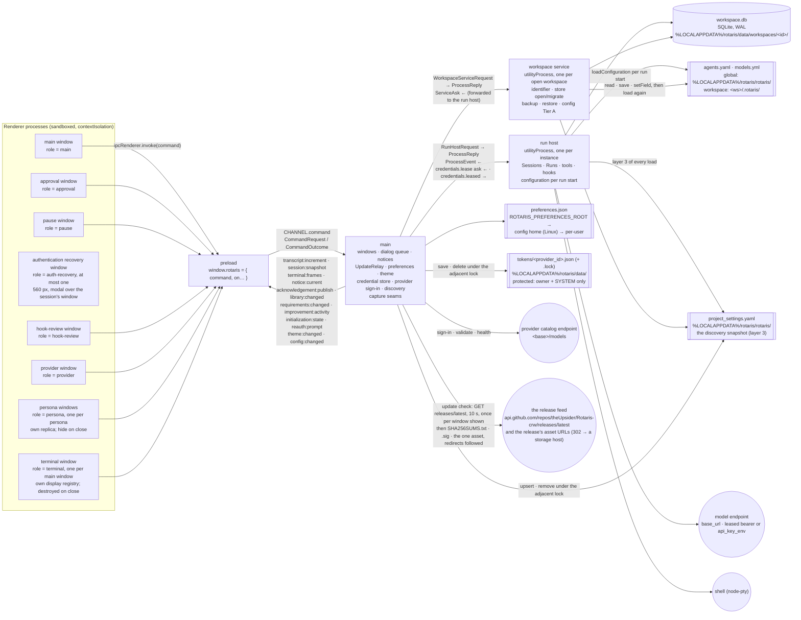

# Process view — five processes and what crosses each boundary

One Electron instance (SR-1; ADR-0055's claim), five kinds of process (ADR-0002). Every message crossing a
boundary is a Zod schema in `packages/contracts/src/` — `commands.ts` (renderer ↔ main), `channels.ts`
(main → renderer, eleven named channels), `process-protocol.ts` (main ↔ run host, main ↔ workspace service,
and the service's narrow asks back to main).

| Read this section when you are | Section |
|---|---|
| asking which process may do a thing at all | [What each process owns](#what-each-process-owns) |
| adding or changing a message, a command or a channel | [Message families](#message-families) |
| reaching into a live run from outside it | [The control channel](#the-control-channel-adr-0010-1-across-the-boundaries) |
| touching what the run host publishes internally | [The wire bus](#the-wire-bus-adr-0010-2-stays-in-the-run-host) |
| writing, reading or relocating a file | [Files and directories on disk](#files-and-directories-on-disk) |

The ordered edit path for a new command, channel or message is [`04-seams.md`](04-seams.md); who owns a fact
once it exists is [`05-state-ownership.md`](05-state-ownership.md).

**The runtime's own requests: none (REQ-STARTUP-160, REQ-SHELL-005; 2026-09-28).** Electron and Chromium add no host
of their own to the ones the product reaches, so every host the application reaches is one the product itself asks
for. The diagram draws only some of those — the agent's fetch tool and a remote MCP server, for two, reach hosts it
does not show — so it is not the list of them. Electron's built-in spellchecker would add one — a Hunspell dictionary
from `redirector.gvt1.com`, requested while each session is built — so main registers `app.on('session-created')`
before `app.whenReady()` and empties that session's dictionary list and turns its spellchecker off there
(`main/runtime-requests.ts`; a failure there is logged at `error`, naming REQ-STARTUP-160); no switch and nothing later
prevents the download. `pnpm updater-proof` holds the built application to zero connections at a proxy sink from launch
to first paint and an orderly quit — that interval is measured; later in a session is not. Whether a text field is
spell-checked at all is OQ-93.

## What each process owns

| Process | Owns | Never does |
|---|---|---|
| **main** | window lifecycle and the close guard — since 2026-09-12 **every main window is built, tracked, and coordinated through `MainWindows`** (`apps/desktop/src/main/main-windows.ts`, executing ADR-0055 consequence 6's two entrances and ADR-0048's registry over main windows with Electron and in-memory adapter seams) and lives in a private registry keyed by `webContents` id, so several main windows of the one instance are ordinary rather than exceptional (REQ-STARTUP-161) and every workspace-scoped command is answered for the window that sent it (REQ-SHELL-020); **startup workspace resolution** (REQ-SHELL-010's three-way precedence: an explicitly selected folder, else a remembered one that still names a directory, else the working directory with a chooser scheduled), the one **deferred first-paint offer** (REQ-SHELL-011's 650 ms, per window and abandoned unshown once the question has been answered) and the **gated replacement** (REQ-SHELL-017 – REQ-SHELL-021: build, open the service, show, await the old window's own close, then persist) are main's alone; `workspace/lastOpened` is written by main and by nothing else — the key is registered in `platform`'s `PREFERENCE_KEYS` and deliberately absent from `PREFERENCE_COMMAND_KEYS`, which is an allow-list, so no renderer can read or write it over `prefs.get/set`; **application modality across a window family** (ADR-0048, Part W: `setFamilyModal` disables every persona window while the main window holds an application-modal surface, restores them when it closes, creates a new one disabled while one is up, and restores the family on the main renderer's navigation, reload or crash); **the persona-window registry** (ADR-0048, Part R: one window per persona, hidden on close, destroyed with the main window and on a new session; `main/windows.ts`); **the terminal-window registry** (ADR-0021's and ADR-0047's window, Part AL′: ONE per main window, 900×620, DESTROYED on close and rebuilt on the next open — the deliberate difference from the persona window, ADR-0047 consequence 3 — shown without focus when opened automatically under `terminal/autoOpen`, closed and reopened without focus when the main window's renderer reports a change of the followed session, closed and discarded when a session starts from none, gone with its main window; `TerminalWindows` in `main/windows.ts`, the five `window.*` commands below); the per-window approval **dialog queue** and the pause window; **the authentication recovery dialog** (REQ-NOTIFY-072..075/079/080, the 401 note's part C, 2026-10-02: `main/auth-recovery.ts` over the classifier `main/failure-class.ts` — a failed run's failure matched in REQ-NOTIFY-060's order; for the authentication class main asks the run host `session.authRecovery`, raises the class's error notice and opens ONE modal window 560 px wide over the main window following the session, role `auth-recovery`, its payload read by `authRecovery.payload`; Retry is relayed as `session.authRestart`; Cancel closes it and nothing else); the single current notice; the `UpdateRelay` (sequence-preserving fan-out of the run host's publications to subscribed windows); theme and preferences (ADR-0042); the instance claim; forking and shutting down the two child kinds; **the credential store, the provider catalogue, sign-in, discovery and the snapshot** (ADR-0029/0030, `packages/providers`); the verification seams under `ROTARIS_CAPTURE_PNG` — **compiled in only where `__ROTARIS_SEAMS__` is true** (2026-09-11), and since 2026-09-17 a module of their own rather than six hundred lines inside `main()`: `apps/desktop/src/main/capture/` holds the step grammar and the host main gives it (`host.ts`, with a test over the grammar), the part a shipped build still answers (`probe.ts` — the typed prompt and the photograph that ends the launch), the scriptable half (`seams.ts`) and the theme proof's capture pass (`theme-proof.ts`). The last two are reached by a **dynamic import inside `if (__ROTARIS_SEAMS__)`**: `scripts/package.mjs` builds with `ROTARIS_BUILD=package`, which makes the flag false, rollup removes the branch, and the chunk is then unreferenced and never emitted — leaving only the three the packaged probe itself drives (`_PNG`, `_PROMPT`, `_AFTER_MS`). **Since 2026-09-27 the run host and the workspace service read seams under the same flag too**: `ROTARIS_CAPTURE_INSTRUCTIONS_MACHINE` in both (the machine-wide instruction base's directory) and `ROTARIS_CAPTURE_MODEL_REQUESTS` in the run host (the scripted client's call record). A packaged build compiles both out, and `scripts/package.mjs` refuses one in which either survives. The gate is build-time and not run-time on purpose: an environment variable cannot turn the seams back on in a binary built without them, and the build asserts it — the deliberately un-numbered **seam check**, which since the same date reads **every emitted file of the main section** rather than `index.js` alone, because a chunk is exactly the shape that surface could come back in; **every renderer command, in a module of its own** (2026-09-17): `apps/desktop/src/main/commands/` holds one facet per family — `dialogs`, `providers`, `session`, `hooks`, `mcp`, `initialization`, `skills`, `shell`, `git`, `checkpoints`, `library`, `improvements`, `config`, `requirements`, `windows`, `workspace` — beside `context.ts`, which names `CommandContext` (the inventory main hands them, which used to be the closure `runCommand` was written inside) and `CommandHandlers` (**total** over `CommandRequest['kind']`, so a kind the contract declares and no facet answers fails to compile rather than answering `command.unimplemented` at run time). `runCommand` itself is three moves — resolve the window the command was raised for, read the request, call the handler the table names — and holds no case; **the window rule is `MainWindows.forCommand(senderId)`** (2026-10-03): a main window answers for itself, a persona or terminal window for the main window that owns it (`ownerOfAuxiliary`, ADR-0048 B), any other sender (an approval dialog, the driver speaking for no window) for the active window — until then a non-main sender fell back to the active window, so with two main windows on two workspaces a persona window's `config.read` and `artifacts.body`/`artifacts.save` and a terminal window's `session.list` answered for the wrong workspace (REQ-MONITOR-069, REQ-STARTUP-163); handlers that key on the sender itself (`session.subscribe`'s relay and follow) are untouched; a facet declares the slice of the context it uses, which is what lets `commands/mcp.test.ts` drive real handlers with a plain object where the run host is; **the checkpoint gate** moved with its commands (`commands/checkpoints.ts`), main keeping only the holder the quit path waits on (REQ-GIT-101); **the driver seam under `ROTARIS_DRIVER`** (2026-09-11, verification only, `main/driver.ts`: a loopback listener on an ephemeral port, minted with a per-launch secret written to the endpoint file the variable names, answering newline-delimited JSON — `waitFor`, `click` (since 2026-10-06 its `settle` presses only once the match has held one box across two of the renderer's frames and is the element at its own centre, then reads what the press met and fails one that met something else, `docs/defects/fixed/driver-proof-clicks-pop-out-at-a-box-the-notice-banner-moves.md`), `type`, `chord`, `inspect`, `probe`, `eval`, `screenshot` (since 2026-09-29 after four frames of the renderer's, so a shot is never the frame before a change), `resize`, `quit` (since 2026-09-29 the application's quit, `app.quit()`, unless it names the immediate exit), and `command`, which is relayed to main's own `runCommand` rather than around it; since 2026-09-29 every op may act on a persona window, the approval dialog or the terminal window as well as a main window, named by role (`persona:<persona>`, `approval`, `terminal`, and since 2026-10-02 `auth-recovery`) through `useWindow` or its own `window`, main handing the driver each main window's auxiliary windows (`DriverDeps.auxiliary`). Nothing listens when the variable is unset; no renderer, run host or workspace service message is involved, and no product surface can reach it); **the updater** (ADR-0054's bespoke main-process updater, first-release-plan.md §4.6, built 2026-09-28: `apps/desktop/src/main/updater/` — `classify.ts` decides the installation flavour ONCE from the artifact the launch started from (REQ-STARTUP-106: the `APPIMAGE` variable first, then whether the build is packaged at all, then the macOS bundle, then on Windows the installer's `InstallDir` against the artifact and the launcher's `ROTARIS_PORTABLE_ARTIFACT` — both handed to it by the first statement of main's body, which takes them out of main's own environment, see *The environment a child is started with* below; a source-tree or development launch is not updatable and issues no request), `feed.ts` the one endpoint, the offer rule, the summary, `keys.ts` the compiled-in key set — EMPTY until O-2 — and the Ed25519 signature format, `install.ts` REQ-STARTUP-122's strict sequence with the signature verified before the manifest is parsed and before any asset is fetched, `download.ts` the 1 MiB chunks, `strategies.ts` the portable rename-aside and the installer hand-off (the dmg and AppImage strategies wait for `PD-STARTUP-001`'s withdrawal), `updater.ts` the one held offer, the one operation in flight and the notice it lives in, `successor.ts` main's wait for the restart's successor (it settles once: passed, not started, or refused a record pass — REQ-STARTUP-121), `electron.ts` the one file that touches `net.fetch`, the disk, `reg.exe` and a process. The check is initiated from `MainWindows`' post-show activation, once per main window shown and never during construction (REQ-STARTUP-043/114); the offer, its download progress, its applied outcome and its failure are ONE notice updated in place through the store's `update` (REQ-SHELL-118); `updates/dismissedVersion` is written by main alone when that notice is dismissed (REQ-STARTUP-116/117/146); `Restart now` is ADR-0055's hand-over of the instance record to a successor started on the sentinel branch (`builtin:update-successor`, `inheritInstance` in `platform/instance.ts`; REQ-STARTUP-121); a quit waits at most 5000 ms for update work in flight (REQ-STARTUP-046). Nothing in main reads a configuration value, an environment variable or a preference other than that one key to decide whether, when or where the check happens: REQ-STARTUP-111's four enumerations carry no such entry) | decide a permission, run a tool, read the store, read `agents.yaml`, hand a credential to a renderer |
| **run host** | **the portable-skill catalog** (ADR-0063): cached per resolved workspace root, cleared at SESSION creation (REQ-WORKSPACE-058) rather than per run, warmed on workspace open, with the session-scoped forced set and hand-loaded skills keyed by session id and one pending bucket per root (OQ-58); it composes the always-active context units at every agent construction and answers the skill directories as additional read roots; and it writes REQ-CHAT-162's `/skills` listing into a loaded session as one saved `system` row through that session's writer (`writeSkillListing`, 2026-09-27) — no new state, the catalog it already owns written where the session's rows already go; every session lock this instance holds; the writers, projection owners and runs; the tool gate per session; hooks per run; the checkpoint port per run (the capture at iteration close, the rows and the retention trim — ADR-0039); the configuration resolved per run start (Tier B) with the live state main handed over; the bearers main **leased** for the run; the loop supervisor; the terminal manager; **the MCP holder** (Part S): the discovery memo, the probe path, the per-session connection registries and their stdio children, the session enable-override, the one diagnostic sink, and — in the `mcp` package, for the process rather than for a session — the protocol era each server has already answered with, so the three connection paths probe it once between them (ADR-0033, 2026-09-16); **the live terminal streams** (Part AL, ADR-0021: one headless emulator per stream, the frames on channel 3 with a per-stream `seq`, the sampling period as a ceiling with the flush armed at the 20 ms floor by input the USER has directed at a stream whose control they have taken — never by output, and since the OQ-38 ruling of 2026-09-11 never by an agent's own `is_input` call either (REQ-CONFIG-117), the seven `terminal.*` controls, the REQ-SHELL-107 audit line redacted and written through the session writer; `tools.ts` reads the background-session limits into the manager); **since 2026-09-17 the process is three modules, not one file**: `host.ts` is `createRunHost()` — the thirty-six bindings this process holds, built when it is CALLED rather than when the module is imported, so the MCP host, the confinement service, the terminal manager and the code-intelligence launch no longer come up as a side effect of loading the file; `dispatch.ts` is `dispatch(req, host)`, the request path over what that built, which is now importable without starting anything; `index.ts` is the entry and holds only the port listener; `scripted-client.ts` is the step-driven stand-in every proof runs against (`ROTARIS_SCRIPT`), two hundred and fifty-seven lines that used to sit between the two | resolve a workspace identifier; migrate the store; write configuration files; read `tokens/`; spawn Git (it asks main, which asks the service) |
| **workspace service** | the workspace identifier; opening and migrating the store (the only process that migrates, W-02); backup and restore with its refusal lease on the run host; configuration Tier A (`config.read` / `config.save` / `config.setField`, each followed by the load again); **every Git invocation** (ADR-0038): the repository and Git-view reads, the worktree writes, and the checkpoint capture, preview, restore and prune through a private index (ADR-0039); **the delivery store and the board projection** (Part AK, ADR-0041: v15's `delivery*` tables, the reader and writer handles, the transition in one transaction, one frozen projection per generation, the restart reap); **the traceability engine** (Part AJ, ADR-0040: the one I/O owner of the five repository artifacts, every pass on a terminable worker thread — `traceability-worker.ts` is the `?nodeWorker` entry) | run anything; hold a session lock; write a checkpoint row |
| **renderer** (per window) | the replica (a mirror of one session's rows and record, ADR-0043), local shell state (view, guards), the Settings pending state; one role per route (`main`, `approval`, `pause`, `auth-recovery` — REQ-NOTIFY-072's recovery dialog, 2026-10-02 —, `provider`, `hook-review`, `persona`, `terminal` — Part AL′: the terminal window, one per main window, whose registry's emulators paint (`@xterm/xterm`) over the same frames the previews consume; it subscribes to the followed session for itself and asks the run host for the resync — and `rows-proof` — Part AA's harness, served only under `ROTARIS_CAPTURE_PNG`); the main window and each persona window hold one `TerminalStreamSet` over the headless emulator for the row previews (Part AL′, REQ-SHELL-075 b / 079); every transcript surface's own expansion map, context menu and acknowledgement stack; the terminal display (Part AM: the emulator port over the same frames, the grid, the window component, the transcript preview) and the composer's slash catalogue (Part AN); **since 2026-09-17 the bundle is five modules, not one file**: `shell.ts` is what a window HAS — the bridge, the replica, the notice and acknowledgement stacks, the terminal registry, the display preferences, the theme it wears and the eleven session gestures, all wired to the numbered channels once per window; `session-actions.ts` is those gestures, taking the bridge and the replica as arguments rather than closing over them, which is what `session-actions.test.ts` drives with two plain objects (the first tests of renderer code); `session-view.ts` is the four readings a transcript surface makes of the followed session, shared with the persona window so the entry role has ONE answer (REQ-MONITOR-057/058); `windows.tsx` is every role that is not `main` — approval, provider, pause, auth-recovery, hook-review, persona, terminal — over one `mountWindow` that asks main for the payload the window was opened for and draws its headline instead when main refuses; `main.tsx` is the main window alone | touch a file, a store, a credential, **navigate** — a link asks main to open it (`shell.openExternal`, ADR-0051) |
| **preload** | the one frozen namespace: `command` plus one subscription per channel | anything else |

**The environment a child is started with (REQ-STARTUP-106/147; ADR-0054 "The updater", item 6; 2026-09-28).** No
child is handed an environment of its own making: `utilityProcess.fork` gives the run host and each workspace service
main's environment as it stands when they are forked, and the run host hands its own `process.env` on — to the
confinement service that starts tools and terminals, to the hook engine (REQ-HOOKS-032), to the MCP transport and so to
the code-intelligence branch; main's detached spawns (the update successor, the installer hand-off) inherit main's
too. So what main's environment holds after its first statement is what every child of the product receives, and that
statement removes the two variables that name the artifact this launch started from — `APPIMAGE` and
`ROTARIS_PORTABLE_ARTIFACT` — after reading them for the updater's classification (`takeArtifactVariables`,
`packages/platform/src/artifact-environment.ts`). Nothing else is removed. A Rotaris started from inside a Rotaris
terminal therefore classifies from its own launch alone. Whether the specification says so is **OQ-90**.

## Message families

**Per-launch board permissions (2026-09-13, REQ-TRACE-470/471).** The main-to-run-host `session.start`
accepts optional `boardPermissions: permissive`, produced by main's board coordinator after the existing
disclosure and preference checks. Renderer `session.start` retains its existing fields. The grant applies
to the captured configuration for that launch, including autonomous mode and the unsandboxed opt-in.
Board dispatch therefore crosses this boundary once to start the session. `config.liveState` continues
to carry the Settings surface's live values.

**Renderer → main (`CommandRequestSchema`).** `shell.hello`, `theme.get/set`, `prefs.get/set` (keys: the theme, the motion preference, the Settings tab, `panels/overview`, `panels/git`, `panels/library`, `interface/agentPopOut` — REQ-SHELL-073's "agent pop-out", Part R — and the transcript's three display preferences, all booleans registered in `platform`'s `PREFERENCE_KEYS`: `display/groupTools` (REQ-CHAT-067's tool-grouping switch, default **ON**, Part Z), `display/showReasoning` (REQ-CHAT-167, which names the key literally, default **off**, Part AA), `display/autoCollapseTools` (REQ-CHAT-067, default **off**, Part AA) and **`panels/workspace`** (Part AB, REQ-CHAT-010's transcript/composer divider under REQ-SHELL-069's key rule, pane count 2)), and **the requirements board's keys** (Part AK′; spec 08 §Persisted state, REQ-TRACE-301: `requirements/filter/{text,epic,source,lifecycle,health,priority}`, `requirements/sort`, `requirements/axis`, `requirements/blocked_column` — the person's display state, strings; `requirements/fullPermissionRuns`, `requirements/fullPermissionNoticeSuppressed`, `requirements/answerWaitSeconds` — REQ-CONFIG-405's, registered with the family and read by Part AP, never by the board; and ONE placeholder key `workspaces/{workspace}/requirementColumnFolds`, sent literally by the renderer and resolved by main to `workspaces/<digest of the open workspace>/requirementColumnFolds` — the same discipline as the composer draft, so a window can neither read nor write another workspace's folds, REQ-TRACE-312), **`composer.readDraft` / `composer.writeDraft {text}`** (Part AB, REQ-CHAT-015 / REQ-SHELL-159 / REQ-NOTIFY-066: the per-workspace composer draft. They carry **no key and no workspace** — main resolves `workspaces/{workspace-key}/composerDraft` from the workspace it opened, so a renderer cannot name another workspace's draft, which is what REQ-CHAT-015's last sentence forbids; the key family is registered in `platform`'s `PREFERENCE_KEYS` and minted only by `composerDraftKey`), `shell.openExternal {url}` (Part AA, REQ-CHAT-076 — see the row-renderer paragraph below), `window.openPersona {persona, agentId, focusSteer?}` / `window.personaPayload` (Part R: open or raise the persona window; the window reads its persona, the followed session and the instance to select — answered by main from the registry; a raise is a request, REQ-SHELL-161), **the terminal window's five (Part AL′; contracts `terminal.ts`, answered by main's registry, none reaching the run host): `window.openTerminal {streamId?}` (open or raise the main window's one terminal window, bringing the stream forward when retained — from the toolbar, the palette's Ctrl+Shift+T, a row's preview, a persona card's; REQ-SHELL-080/081/085), `window.terminalPayload` → `{sessionId, focusStream, autoOpen}` (the window asks what it was opened onto), `window.terminalSession {sessionId | null}` (the main window's renderer reports the session it follows; main closes the window and reopens it without focus when it had been open on a session — REQ-SHELL-110/111; refused `window.notMain` from any other window), `window.terminalAutoOpen {value}` (REQ-SHELL-109's preference, `terminal/autoOpen` in `platform`'s `PREFERENCE_KEYS`, key-less on the wire like the composer draft), `window.showWorkspace` (REQ-SHELL-083's "Go to Workspace": the main window switches view and is surfaced as a request)**, `repository.read` (the Overview's card; relayed to the workspace service, waiting for a workspace open in flight),
`session.start/newId/list/resume/prompt/continue/subscribe/unsubscribe/reconcile/pageOlder/control` (`pageOlder`
is wired end to end and, from Part Z, is CALLED: the transcript asks for the next older span when the reader scrolls
toward the top, and the replica's `prependOlder` places it above — REQ-CHAT-165, REQ-SESSION-192; `continue`
carries `{action, withoutPaused?}` since PD-ORCH-005's phase 5, the option clause 6's "continue without them",
relayed as it is to the run host's `session.continue`, which since clause 18 also continues a session a crash left),
**`session.retry {sessionId}`** (REQ-NOTIFY-045 / REQ-CHAT-173, OQ-178; 2026-10-02: a notice's retry with a blank composer draft, relayed to the run host as itself after the continuation lease a `session.prompt` takes; `Sessions.retry` resubmits the session's last submitted prompt — read over every row, released ones included (`lastSubmittedPrompt`) — with its images read back from the session's directory and verified by digest (`readBackAttachments`), so no prompt text or image bytes cross from the renderer again; answered `ack`, or refused `session.no-prompt`, `session.attachment-unavailable` naming the image, or any refusal a `session.prompt` meets), **`authRecovery.payload` / `authRecovery.retry {modelKey}` / `authRecovery.reauthenticate {apiKey}` / `authRecovery.cancel`** (REQ-NOTIFY-072..077/080, 2026-10-02: the recovery window's payload and answers, keyed by the SENDER as a pause window's are, so the window acts on the session it was opened for and names none; `retry` is relayed to the run host as `session.authRestart {sessionId, modelKey}` — refused for a key the dialog did not list; `reauthenticate` carries a pasted key INWARD to main's provider key store (`ProviderService.reauthenticateWithKey`, validated by discovery before it is saved, never logged) and then relays `session.authRestart {sessionId, modelKey: null}`; each answered `{ok}` or the sentence the dialog shows), **`session.planEdit {text}` / `session.planDecision {decision, changes?}` / `session.planRearm {sessionId}`**
(ADR-0062 and PD-ORCH-003, REQ-ORCH-152/153/154: the plan gate's three entries, relayed to the run host that owns
the session and answered `ack` / `{cycle, relaunched}` / `ack`. They are session commands and **not** control
operations, because `CONTROL_OPS` is REQ-MONITOR-004's closed enumeration over a LIVE run and a run held at the
gate is parked — the answer must reach a session whose hosting process may have exited since the gate opened.
`planEdit` records the user's text and approves nothing; `planDecision` carries one of exactly three answers;
`planRearm` drops the approval's release so the session's next run is held again, refused while a run is active and
a successful no-op on a session holding none — it addresses a session with no run at all, live or parked),
**`session.chooseNextModel {sessionId, modelKey}`** (REQ-MONITOR-146/194, 2026-10-02, fin10: the composer's "Model for the
next run" chosen, sent by `session-actions.ts`'s `setNextModel` once its `config.setField` write of `personas.<entry>.model`
succeeds and only with a session followed; relayed to the run host as itself and answered `ack`, or refused
`session.unknown-model` / `session.no-catalogue`. `Sessions.chooseNextModel` resolves the key through the side-effect-free
`restingCatalogue` port and clears the pair's exclusion if the session holds it out of quota — in its memory and a resting
read's, and as a `model_exhausted` entry carrying `cleared: true`; a session command for the plan gate's reason, no run
being needed),
`git.read`, `worktree.create/remove/chooseAttach/probePath` (Part O — see the Git paragraph below),
`pause.present/payload`, `approval.payload`, `approval.raise {requestId}` (Part AC, REQ-CHAT-098/103: the approval
trailer row shares the question trailer's one click handler, and an approval's modal is a separate window, so
"re-openable while pending" is main raising the dialog already up; refused when no dialog is open for that request —
a queued one never jumps the queue), `notice.acknowledge {noticeId?}` (Part V: an absent identifier clears
whatever is current, one given is a compare-and-clear — REQ-NOTIFY-026; since 2026-09-28 main asks the updater FIRST whether the notice being cleared is the update offer, and if so records its version as waved off before the clear, REQ-STARTUP-116/117, REQ-SHELL-114), **`update.install` / `update.restart`** (the updater, first-release-plan.md §4.6, 2026-09-28: the targets of the `install-update` and `restart` notice actions. Neither carries anything — main holds the offer, runs REQ-STARTUP-122's sequence and reports into the same notice; `update.install` is `Update now` and `Try again`, `update.restart` is `Restart now`, and both are refused, not queued, while an update operation is in flight, REQ-STARTUP-114), **`reauth.submit {sessionId, apiKey}` / `reauth.dismiss {sessionId}` / `reauth.read`** (2026-10-02, the 401 note's part B: the two
answers of channel 13's prompt, and `reauth.read` answering `{prompts}`, every prompt open now, read by a window as it mounts so a reload or a new window draws them — main holds the prompt, saves a supplied key through the credential store
(~~`providers.replaceKey`~~ since the merge beside the recovery dialog `providers.reauthenticateWithKey`, the dialog's validate-then-save path with its refusing stage named; never logged), clears its first-failure bookkeeping and relays `session.repinPrimary` to the run
host, answering `{ok, applies}` or `{ok: false, message}`; the dismissal closes the prompt and keeps the fallback,
REQ-NOTIFY-071/078), **`notice.report {severity, title, message?, detail?, persistent, sessionId?}`** (Part AO: a renderer surface raising a PERSISTENT notice through main's one store — ADR-0049 decision B's missing entry for a renderer, defect fifty-seven, first needed by REQ-CHAT-021's "Command not run"; `sessionId` absent means the focused run and REQ-NOTIFY-268's record applies; answered `{id}`), **`prompts.roots.read`** (Part AO, REQ-CHAT-160: no workspace on the wire — main names the open one and relays to the workspace service, below), **`skills.read` / `skills.rescan` / `skills.forceLoad {name}` / `skills.loadFile {path?}`** (ADR-0063, REQ-WORKSPACE-051..073/151: none carries a workspace or a session — main names the window's open workspace and the session it follows and relays to the RUN HOST, which owns the catalog; `skills.loadFile` with no path opens the native chooser in main first, on REQ-SHELL-164's terms, and a dismissal answers `{cancelled: true}` having changed nothing), **`skills.list`** (REQ-CHAT-162's `/skills`, 2026-09-27: no argument — main refuses a window following no session before anything crosses (OQ-67), else relays `skills.list {workspaceRoot, sessionId}` to the run host, which writes the listing as ONE `system` row through that session's own writer and answers `skills.listed {count, index}`; the row reaches every window following the session on the transcript channel like any other row, so nothing is drawn from the answer), `workspace.backup/restore`,
**`workspace.choose`** (Stage B, REQ-SHELL-035 / REQ-WORKSPACE-016: the title-bar chip asking for the
project-folder flow. It carries **no folder and no window** — main evaluates REQ-SHELL-021's three gates in that
requirement's fixed order, opens the native chooser asynchronously (ADR-0019's application-wide prohibition on a
synchronous one) and interprets every answer the host can return, so no surface can skip a gate or name a folder
it was not given; the request is attributed to the window that sent it, REQ-SHELL-020. **`newWindow`** is
`PD-SHELL-001`'s add route, decided by the gesture before the chooser opens — a palette entry or the chip with the
platform's secondary-activation modifier — on which REQ-SHELL-021's three gates are not evaluated and no window is
closed; a folder another window already holds surfaces that window and builds none, on REQ-STARTUP-163's rule),
**`workspace.openFolder`** (fin10, REQ-SHELL-040: the status strip's workspace-path link; no path on the wire — main
opens the folder of the window that asked with `shell.openPath`, bounded at 5 s because an opener that cannot be launched
may never answer (`main/open-folder.ts`), and answers a failure as a refusal naming the path, which the renderer raises on
the transient error surface; OQ-191), **`workspace.usage`** (fin10, REQ-SHELL-044/045: the strip's tokens and cost, relayed
as the run host's `workspace.usage {workspaceId}`, answered `{tokens, cost}` by `workspaceUsage` over the workspace's stored
sessions; OQ-190), `shell.switchView`, **`window.state` / `window.minimize` / `window.toggleMaximize` / `window.close`**
(PD-SHELL-003: the frameless main window's renderer asks main to operate the BrowserWindow that sent the command;
close calls `BrowserWindow.close()` so the existing guarded close event remains the only decision point),
`window.modality {active}` (Part W: the main window's application-modal surface — the command
palette, the keyboard help — registering itself open or closed; main's registry disables input in every persona window
of that family for the duration, ADR-0048; a persona window sending it is refused `window.notMain`),
`hooks.summary/review/reviewPayload/reviewDecide/clearDecision/setToggle`,
`playbooks.catalogue`, `config.read/save/setField/liveState`, `providers.list/health/open/save/validate/signOut/
delete/refresh`, `provider.payload/signIn`. Main relays a session or hook command to the run host, a workspace or
config command to the workspace service, and answers preference, theme and **provider** commands itself (the
credential store lives in main). `provider.signIn` is the one command carrying a pasted key inward; no outcome
carries one back — the list shows the display mask. A sign-in that succeeds asks the workspace service
`config.bootstrap` (the starter `agents.yaml` if absent, then the load again; since 2026-10-03 the open has already
written it, so the answer is normally `exists`) and broadcasts `config:changed` (to each main
window's family with its own workspace's snapshot, `announceConfig`, since 2026-10-03). **`repository.read`
{workspaceRoot}` → `repository.state {gitAvailable, isRepository, branch, base, ahead, behind, touched, uncommitted, failed,
readMs}`** is the workspace service's answer for the Overview's repository card — ADR-0038's helper lives there and
nowhere else; every read bounded at 15 s, every failure an empty value (REQ-GIT-102).

**The Git view and the worktrees (Part O; ADR-0038's second execution).** Renderer → main: `git.read` → the whole
`GitViewState` (header, worktrees with the base tree by common directory — each row also carrying `upstreamAhead`, its
branch's commits ahead of THAT branch's own upstream from one `for-each-ref … %(upstream:track)` read, 0 with none, for the
status strip while it names an isolated worktree's branch (REQ-WORKSPACE-020; acceptance repair F8, 2026-10-03) — 30
history rows with the local flag; a
`gitAvailable: false` answer raises the fixed-identity notice `git.missing` "Working without Git", REQ-GIT-104);
`worktree.create {branch, path}` (the user's own path, REQ-GIT-115); `worktree.remove {path, force}` (a refusal Git
would lift with `--force` comes back as code `worktree.needs-force`, REQ-GIT-117); `worktree.chooseAttach` (main's
folder chooser, then the service's REQ-GIT-011 check); `worktree.probePath {path}` (answered by main from the
filesystem, for the dialog's live message); `session.newId` (main mints `randomUUID` and holds it for the next
isolated or attached start); and `session.start` gains `isolation {branch}` | `attach {path}` and `sandboxMode`. Main →
workspace service: `git.view {workspaceRoot}` → `git.state`; `worktree.create {workspaceRoot, branch, collisionSafe,
baseRevision?, target: path {path} | session {sessionId, subpath?}}` → `worktree.created {path, branch, baseBranch,
baseRevision}` | `refused` (the Git failure text as the headline); `worktree.remove {workspaceRoot, path, force}` →
`worktree.removed` | `refused {…, needsForce}`; `worktree.checkAttach {workspaceRoot, path}` → `worktree.attachable
{path, branch, baseBranch, baseRevision}` | `refused`. Main → run host: `session.start` gains `sessionId`,
`effectiveRoot`, `worktree` (REQ-GIT-015's binding) and `sandboxMode`; the binding is made BEFORE the run host is
asked, so a binding failure leaves no session behind (REQ-GIT-023 by construction). *Since 2026-10-06 (finacc2's A1):*
main sends `sessionId` on every start, minting the base tree's too, and marks it as the asking window's start
(`MainWindows.beginStart`) before the run host is asked, so the focus test reads a run that fails before the renderer's
`session.subscribe` as the focused session's (REQ-NOTIFY-032); the message's shape is unchanged. `SessionListItem` gains `worktree`
and `checkpointCount` (REQ-GIT-018); `SessionRecord` gains `worktreeBranch` for the status strip (REQ-GIT-122), and
since 2026-10-02 `sandboxBackend` beside `sandboxed` (REQ-SANDBOX-121: the backend the latest run was confined by, '' when
it was not; the strip's sandbox indicator reads both). A run of the session refused at the confinement gate republishes the
record with both cleared until a run of it starts (REQ-NOTIFY-061, `Sessions.refusedAtStart`); the row is not written. Also since 2026-10-02
`modelOverrides` (REQ-CHAT-006, REQ-SESSION-026): each configured model key a session-wide override replaces, with the key
it runs on, derived at every snapshot from the run's catalogue and the session's memory — for a session no run of this
process has started, from its workspace's catalogue read once where its timeline holds an override, through the
side-effect-free `SessionsDeps.restingCatalogue` port (the run host's `restingCatalogueOf`: the load, the live overlay and
the snapshot fold, never the per-run `configure` with its MCP configuration load and run maps), against a memory of its own
(`Sessions.modelOverridesOf`) — so the composer's model chip names what the next run starts with, as the inspector does at
rest; while a run is live the run-level agent's Model names **`entryModelKey`** instead (since 2026-10-03, REQ-MONITOR-052/066):
the key the live root's ladder cell runs on (`Run.entryModelKey`, the key the cell carries, `AgentResilienceCell.key`), null with
no live run. A child's `AgentRecord.model` and `contextLimit` likewise name the key its live ladder cell runs on, and measure
against that model, once a fallback or an override has moved it (`Run.childModel`, since 2026-10-03). At rest they come from
its row's `model_key`. The record's `wait` carries `excluded`
(REQ-MONITOR-194/303, since 2026-10-02): the configured keys the session holds out of quota, which the quota-wait chooser
annotates and leaves choosable. Since fin10 the same list rides outside a wait as **`excludedModels`** (REQ-MONITOR-194): from
the live run's memory (`Run.excludedModelKeys`), else — a session at rest — the memory its timeline rehydrates through the
same `restingCatalogue` read, now taken where the timeline holds a `model_exhausted` entry too (`Sessions.restingReadOf`);
the run header's Switch model, the inspector's Model field and the composer's next-run chip annotate each key with the
reason and leave it choosable (`annotatedModelOptions`, `packages/ui/src/model-options.ts`) — since 2026-10-03 choosable when
it is already the selector's value too: each excluded key is marked `rechoosable`, and the design system's searchable select
fires a choice of its current value for such a row alone (`choiceFires`), so the composer's chip showing the excluded
configured key sends `session.chooseNextModel` for it.

**Checkpoints (Part P; ADR-0039's first execution).** Renderer → main: `checkpoints.list {sessionId}` (rows only, REQ-GIT-050),
`checkpoints.preview {sessionId, sequence}` and `checkpoints.restore {sessionId, sequence, force}`; main holds ONE desktop
checkpoint operation in flight (REQ-GIT-091) and declines a second with code `checkpoint.busy`, which the view shows as the
toast or, for a listing, retries once after 150 ms against the then-selected session (REQ-GIT-095). Main → run host:
`checkpoint.list {workspaceId, sessionId}` → `checkpoint.list {listing}` (the rows with pre-formatted local-time labels,
`lastRestoredSequence`, REQ-GIT-093's `liveness` verdict, the tree root of REQ-GIT-053, an `unavailable` reason when the
binding's tree is gone, `repaired` when REQ-GIT-094's stale-session repair ran, `includeUntracked`);
`checkpoint.recordSafety {…}` → `checkpoint.recorded {sequence, trimmed}` (the pre-restore row through the writer's one
transaction, its trimmed refs pruned by the run host's own ask, then the event published); `checkpoint.recordRestore {…}` →
`ack` (REQ-GIT-062/068/155). Main → workspace service, where every Git call lives (ADR-0038 c.4): `checkpoint.capture
{workspaceRoot, treeRoot, sessionId, sequence, iteration, childName, checkpointKind, includeUntracked, message}` →
`checkpoint.captured {outcome: recorded | nothing-to-record | unavailable | failed, ref?, commit?, files?, detail?,
invocations, elapsedMs}`; `checkpoint.refs {treeRoot, sessionId}` → `checkpoint.refs {ok, entries}`; `checkpoint.preview
{…, commit, candidates, includeUntracked}` → `checkpoint.previewed {treeState, entries, dirty, blockedReason, text,
invocations, elapsedMs}`; `checkpoint.restore {…, commit, entries}` → `checkpoint.restored {ok, touched, detail?, …}`;
`checkpoint.prune {treeRoot, sessionId, refs}` → `checkpoint.pruned {deleted, failed}`. **The run host's three checkpoint
asks back to main** (`ServiceAsk`, beside `credentials.lease`): `checkpoint.capture`, `checkpoint.refs`, `checkpoint.prune`
— main relays each to the workspace service of `workspaceRoot` and answers the run host with the service's reply; the two
children still never talk directly (ADR-0002 c.4). The service tracks its in-flight checkpoint operations and its `shutdown`
waits for them (REQ-GIT-101); main sends every service `shutdown` after the run host's and awaits it, bounded by REQ-GIT-033's
limits, before it quits. The two paths that end the process at once rather than through `app.quit()` — the capture
seam's exit and the driver's `quit` when it is asked for the immediate exit — go through `exitCleanly` (`main/exit.ts`):
every child window is destroyed, its `closed` awaited (bounded at 2 s), and `app.exit` runs on the next turn, because on
Linux `app.exit` over an open modal child segfaults. Neither sends `shutdown`; both are verification seams
(`ROTARIS_CAPTURE_PNG`, and the driver under `ROTARIS_DRIVER`), and every quit a user can reach goes through
`window-all-closed`, the main window's close guard turning an `app.quit()` into one. **Since 2026-09-29 the driver's
`quit` is `app.quit()` unless it names the immediate exit** (`pnpm app:drive stop` against `stop --crash`), and **a
capture whose wait timed out ends through `app.quit()`** rather than `exitCleanly` (`CaptureHost.quit`, `capture/probe.ts`):
both then take the user's path below and send `shutdown`, so a live run comes to rest as a quit leaves it (PD-ORCH-005
clause 3). A capture whose wait was satisfied, or that had none, still ends by `exitCleanly`
(`docs/defects/fixed/the-drivers-quit-skips-the-applications-shutdown.md`). A quit Electron starts on its own account (SIGTERM, the desktop's logout where Electron emits `before-quit`, `app.quit()`)
is turned into the same path. **On Windows Electron emits no `before-quit` at a logout, restart or system shutdown**; since
2026-10-07 (fin29) each main window's `session-end` (Windows only, and not refusable) starts the same orderly shutdown
`window-all-closed` runs — memoized, so it runs once whichever starts it — with the quit marked as the process's exit and no
guard asked, and the process exits when it is done (`SessionEndShutdown`, `main/exit.ts`;
`docs/defects/fixed/a-windows-logout-skips-the-orderly-shutdown.md`; not yet observed on a Windows host). For the quits
that do emit it: `before-quit` is held while any main window is open, and the main windows are closed
through their guards, all or none (`closeThroughGuards`: every guard asked, every close confirmed, then every window
closed). Nothing a quit closes answers for a person. `QuitState` (`main/exit.ts`) knows the quit from
`exitCleanly` and from each main window's confirmed close, which `guardClose` reports before closing. While it is under
way an approval dialog that closes sends no Deny, and the question dock's cancellation is not forwarded. The run host's
`shutdown` withdraws both instead (PD-ORCH-005 clause 9, OQ-96). **Since 2026-10-06 a person's close of a main window asks
REQ-SHELL-119's guards in order** (REQ-STARTUP-046, OQ-206; fin22): the renderer's unsaved-settings guard, then, when no
other main window stays open and the run host's `runs.active` counts a run (a count that cannot be read counts), the
active-run confirmation — a message box over the closing window, "Quit while a run is active?" with Cancel and Yes, Cancel
the default and Escape's answer (`activeRunCloseBox`, `confirmActiveRunClose`, `main/close-confirmation.ts`, reached through
the adapter's `confirmRunsAtClose`). Only Yes confirms the close; Cancel leaves the window, its state and the run as they
were. A close made while the guards are being asked is held and asks nothing more. The application's quit
(`closeThroughGuards`) asks the renderer's guard alone: it is not a person's close of a window. **Since 2026-10-07 the close
of one of several main windows ends its own project's runs, asking first** (PD-SHELL-009, OQ-206 ruled under R-072; fin28):
main → run host `runs.active {workspaceId, scope: 'stoppable'}` counts that workspace's runs the stop would take (the
session row's `workspace_root`, `Sessions.stoppableRunCount`: a live run whose end is not yet written — the predicate
`Sessions.stopActiveIn` stops by, since fin29; the plain keyed count, `activeRunCount`, also counts a run still ending, which
no stop takes; the empty id counts the instance's, as the last window's close and the update's close ask), and while it is
above zero (or cannot be read) the box asks "Close this window while a run is active?" (`windowCloseBox`). Its Yes sends `runs.stopWorkspace
{workspaceId}` → `runs.stopped {workspaceId, sessionIds}` — the stop control's graceful stop over that workspace's runs
(`Sessions.stopActiveIn`), which rest `paused` by `stop` — and only then does the guard confirm the close, so the stop reaches
the run host before `presenter.revoke`. Main keeps the stopped ids in `QuitState.stoppedByClose`: until the stopped run's own `run.result`
arrives, an approval dialog closing for one answers nothing, a queued approval is not reported unshown, the question dock's
cancellation is not forwarded (the stop withdraws all three, PD-ORCH-005 clause 9), and a `notice.publish` for it is held
back from the windows that stay (REQ-STARTUP-046's last sentence); the `run.result` is the rest's own notice — main holds
the outcome notice it would raise from it and does the rest of what it asks — and ends the hold. A run whose `run.result`
reached main between the stop's request and its reply (`QuitState.stopAsked`) is not held. (Until fin29 the hold followed
`publish.snapshot` statuses — rest, then active — which named no run: a run stopped before it had saved an active status lost
its hold at its `cancelling`, a session never continued kept its notices held for good, and the outcome notice was never
held.) The event relay asks `QuitState.holdsBack` of every run host event, and `unshownApprovals` filters through
`QuitState.unshownToReport`. A window whose
workspace has no active run closes unasked. REQ-SHELL-021's gate 3 and the restore's refusal send their window's workspace
id and so count that workspace alone. ~~`session.start`'s forced isolation (REQ-GIT-120, REQ-MONITOR-251: "whenever any run is
active") sends the empty id, so a launch without an explicit tree is placed in a worktree while a run executes in any
project.~~ *Replaced 2026-10-07 by PD-GIT-001 (OQ-224; fin29).* `session.newId` and `session.start` ask one count,
`runs.active {workspaceId, scope: 'sharing'}` (`Sessions.activeRunsSharing`: the window's workspace's own runs, and any run
whose tree is its folder, inside it or around it; a run of an unrelated project never counts). `session.newId` answers
`{sessionId, isolationRequired}` — above zero or unreadable — and the launch dialog shows that answer as REQ-GIT-119's lock;
`session.start` forces the default tree for a launch without an explicit tree on the same answer and, when it forces, raises
an informational notice scoped to the new session carrying REQ-GIT-119's hint and the branch. The run host refuses to start
a further run of a base-tree session (a message at rest, Continue, the retry, the plan gate's relaunch) while that count,
with the session excluded, is above zero, with REQ-GIT-120's words.

**The session browser's actions (Part U).** Renderer → main: `session.repair {sessionId?}` (one stale session, or every
stale session when the id is absent — REQ-SESSION-060/182) → `{report: {repaired[{sessionId, from, to: interrupted,
reason}], skipped[], nothingStale}}`; `session.delete {sessionId}` → `{existed, refsDeleted, refsLeft, filesRemoved,
unreadable, elapsedMs}` (a live session refused with its sentence); `session.export {sessionId}` (REQ-SESSION-199's
four records) and `session.exportTrajectory {sessionIds}` (one document, or REQ-EVENTS-144's wrapper in selection
order) — main opens the save dialog first and nothing is written until a path is chosen; `session.openLog {sessionId}`
and `session.revealFiles {sessionId}` (REQ-SESSION-191, answered from main with `shell.openPath` /
`shell.showItemInFolder`, a missing file reported). Main → run host: `session.repair {workspaceId, sessionId?}` →
`session.repaired {report}`; `session.delete {workspaceId, sessionId}` → `session.deleted {…}`; `session.export
{workspaceId, sessionId, destination}` and `session.exportTrajectory {workspaceId, sessionIds, destination}` →
`session.exported {destination, bytes, documents, warnings, elapsedMs}` (the run host writes the file from its one open
connection through ADR-0004's replace under REQ-TRACE-061's ladder); `session.files {workspaceId, sessionId}` →
`session.files {directory, log, summary, artifacts}` (null for a file never written). **The run host's fourth checkpoint
ask** back to main: `checkpoint.deleteNamespace {workspaceRoot, treeRoot, sessionId}`, relayed to the workspace service
as the request of the same name → `checkpoint.namespaceDeleted {deleted, detail?}` (REQ-GIT-069, best-effort).
`SessionListItem` gains `unreadable` (REQ-SESSION-041: the parse detail, or null). Verification seam:
`ROTARIS_CAPTURE_SAVE_PATH` answers the export save dialogs with `;;`-separated paths consumed in order (the backup's
`ROTARIS_CAPTURE_BACKUP_TO` is unchanged).

**The Library's saved prompts and its change channel (Part X; REQ-LIBRARY-105/137/138).** Renderer → main:
`prompts.read`, `prompts.push {list, text}` and `prompts.take {list, index, remove}` — no session id, because the two
lists belong to the workspace and outlive every session; `remove` is a REQUIRED boolean, not a defaulted one
(REQ-LIBRARY-107 makes keeping and removing two deliberate acts), and `index` is the entry's position in the WHOLE
list, newest first, so a filtered view acts on the row the user chose. Main relays each to the run host, which owns
the store, exactly as it relays `timeline.append`: `prompts.read {workspaceId}` → `prompts.state {state}`,
`prompts.push {workspaceId, list, text}` → `prompts.state`, `prompts.take {workspaceId, list, index, remove}` →
`prompts.taken {text, state}`; a store failure comes back `refused` and main raises REQ-LIBRARY-138's persistent
notice "Could not save prompt history" while the window keeps its lists in memory. **A ninth channel,
`library:changed`** (main → every live window), carries `{v, revision}` and nothing else: a counter cannot be
overtaken, so a burst settles with the last write visible (REQ-LIBRARY-105), and a window off the Library sees the
move and re-reads when it is next shown. Main bumps it for exactly the four things REQ-LIBRARY-105 closes a
"library change" to (`LIBRARY_CHANGES` in `contracts/src/library.ts`) — Part X writes the two prompt members and Part Y's `artifacts.save` writes `session-artifacts` — and
`bump` takes a member of that union, so a settings write has no way to reach it. A `prompts.take` that KEPT the
entry writes nothing and bumps nothing. `prefs.set` gains `panels/library` (REQ-SHELL-069, no arrangement suffix).
Verification seam: `ROTARIS_CAPTURE_PROMPTS="history>>text@ms;;stash>>{n}text @ms"` pushes through the real command.

**The post-run improvement analyst (REQ-LIBRARY-015..035/125..131/165).** The run host publishes `run.result` first,
then captures a frozen, bounded job from the persisted task run: progress, todo, child reports, transcript, gate evidence
and at most five prior artifacts, with unavailable sources represented explicitly. Skipped terminal reasons and
`improvement_run` sessions produce no job. The capture is detached and never rejects (`run-host/improvement-capture.ts`):
a stop reason on REQ-ORCH-137's skip list ends it before main is asked for the history, the store is looked up again
after that ask, and a store the quit or a workspace close has closed meanwhile, or a capture that throws, yields no job
and a log line. Main queues `improvement.job` in one application-wide FIFO and asks the run
host to execute `improvement.analyze`; the analyst receives no tools, retries malformed JSON once and has a hard configured
timeout. Main then relays `save-collected` to the workspace service, rereads the canonical record, bumps
`improvement-artifacts`, and publishes the ready notice. `improvement:activity` carries workspace identity, active
state, queued count and source session, the running pass (`pass`, Part AT) and, per main window, whether a retrospective of
that window's own workspace is pending (`retrospective_pending`, PD-LIBRARY-002 revision 2 (e)); the paragraphs below say
how each is read. Workspace close or application shutdown sends `improvement.cancel`, aborts active
analysis and discards queued jobs before any artifact or notice is written.

**The retrospective pass (Part AT; `PD-LIBRARY-002`, ADR-0065).** The same analyst, reached without a run. A gesture on
any of three surfaces sends main `improvements.retrospective {workspaceRoot}`; main asks the run host for
`retrospective.capture {workspaceRoot}`, which resolves the workspace's configuration through `configuredFor` (no run
context exists), leases its bearers through `leaseForContinuation`, and answers the existing `improvement.job` event —
carrying `pass: 'retrospective'` and a `retrospective` sources block (session digests, prior proposals, saved prompts,
persona memory, instruction files, each entry naming its record) — or `retrospective.no-model` when nothing resolves.
The **instruction files are decided by the run host, not by the engine**: `dispatch` passes
`skills.retrospectiveInstructionFiles(root)` — the same discovery and the same per-file and master switches that
workspace-context injection consumes (OQ-65), kept to the files discovered at the **workspace root**, so no file under
the global, home-relative or machine-wide bases reaches the analysis (`PD-LIBRARY-002` revision 2, OQ-235; until
2026-10-13 it passed `skills.instructionFiles(root)` whole) — on the capture input, and `captureRetrospectiveJob` reads
what it is handed and discovers nothing itself. An omitted set reads nothing rather than falling back to the workspace
root.
From there the path is the post-run one, unchanged: the same application-wide FIFO, the same `improvement.analyze`
(whose run-free branch takes its backend and `credentialFor` from the configured workspace rather than from
`improvementContexts`), the same `save-collected` to the workspace service, the same canonical reread and bump. Two
things differ at the ends. The artifact carries `source_kind: 'retrospective'` and a NULL `source_session_id`, naming
what it read in `considered_session_ids` and attributing each evidence entry to its own record. And
`improvement:activity` gains `pass`, which is what lets the two indicators (REQ-LIBRARY-125/126, built in this part and
not before) say WHICH analysis is running, and — since `PD-LIBRARY-002` revision 2 (OQ-236) — `retrospective_pending`,
which main computes **per main window** from the coordinator's `retrospectivePending(workspaceId)`, because the rest of
the publication is application-wide and this one fact is a workspace's. Since fin38 a main window that opens a workspace
(a launch, an added or replacement window, a hand-over, a reopen) is also sent the activity as it stands
(`ImprovementCoordinator.current()`, through `MainWindows`' `workspaceOpened` hook, after the window has loaded), and the
window **reads** the same once as it mounts, after subscribing (**`improvements.activity`**, renderer → main, answered once the
window's workspace is open with that workspace's own `retrospective_pending`), since a push sent before the root has
subscribed is lost — so a window opened while its workspace's retrospective is pending draws the gesture at rest at once
rather than at the next publication. It is the only thing that rests the gesture's two
buttons; a post-run analysis never does. `improvements.retrospective` itself refuses while that workspace's retrospective
is queued, running or still being captured, with one info notice ("A retrospective is already queued or running.") and no
`retrospective.capture`, which is the palette's refusal. `improvement.cancel`, the queue's ordering and shutdown's discard are
untouched: a retrospective is an ordinary job on the ordinary queue.

**The session artifact store (Part Y; REQ-LIBRARY-087..101, REQ-ORCH-149).** Renderer → main: `artifacts.list` (the
Library's Artifacts tab), `artifacts.body {ref}` (the inspector's load), `artifacts.save {ref, body}` (REQ-LIBRARY-133's
save, the body ONLY). Main relays each to the run host as `artifacts.list {workspaceId}` → `artifacts.state {state:
{sessionId, artifacts[], warnings[]}}`, `artifacts.body {workspaceId, ref}` → `artifacts.body {id, slug, title, kind_,
status, producer, persona, edited, body, fallback}`, `artifacts.save {workspaceId, ref, body}` → `artifacts.saved {id,
editedAt}`. **No session id crosses**: REQ-LIBRARY-136 scopes the tab to the LOADED session, so the run host answers for
the session it holds and reports none when it holds none, rather than letting a renderer name a session that is not

loaded. A refusal carries REQ-LIBRARY-134's and REQ-LIBRARY-136's own sentences as its headline (`Unknown artifact:
'<id>'`, `Artifact not found in the loaded session.`, the load failure's reason). The bodies themselves never cross a
boundary as files: the run host reads and writes them beside the store (REQ-SESSION-002) and the renderer sees text. The
scripted client's step `artifact:<tool>[:<key>]` calls one of the three artifact tools with arguments from
`ROTARIS_SCRIPT_ARTIFACT_ARGS` (verification only).

**The improvement artifact store (ADR-0061; REQ-LIBRARY-002/036/042..058).** Main → workspace service:
`improvements.command {workspaceRoot, command}` → `improvements.result {value, changed?}`. The command union carries
list, detail, history, approved-proposal, collected-save, review, edit, delete, run preparation, applied-checkpoint,
rollback-preview and rollback operations. The workspace service
constructs `ImprovementReader` from its writable store handle and `ImprovementWriter` from that reader plus the
mutation path, runs the legacy import on first construction, and remains the sole process with the write capability.
Session creation crosses `runType` to the run host; existing callers default to `task_run`, and the session row keeps
the first value across resume.

**Reviewed improvement execution and rollback (REQ-LIBRARY-059..078/169..176).** Renderer → main:
`improvements.start {artifactId}` prepares the approved-only todo, applies approved verifier blocks through the shared
configuration writer, records or reuses the dedicated `pre_improvement` checkpoint, then starts a normal run-host
session with `runType: improvement_run` and `initialTodo`. A terminal result asks the workspace service to record the
`applied` checkpoint. `improvements.rollbackPreview {artifactId}` is read-only and returns sorted path actions plus any
post-run work at risk; `improvements.rollback {artifactId, force}` first records `pre_rollback`, restores through Git,
and records proposal reversal through the improvement writer. Improvement refs live under
`refs/rotaris/improvements/<artifactId>/<sequence>` with independent retention. Every successful mutation bumps the
`improvement-artifacts` library revision, while main publishes the persistent start, refusal, success, or discrepancy
notice. Export is assembled from the same current records and retained history and written only after the desktop file
chooser returns a destination.

**The transcript's row renderer and the one command it needed (Part AA; ADR-0051's second execution).** Renderer →
main: **`shell.openExternal {url}`** → `{url}` | a refusal. `REQ-CHAT-076` opens an `http(s)` link from transcript text
in the **system browser**; the renderer is sandboxed and never navigates (ADR-0051), so a link is an element that asks
for this command, and it is a command with an OUTCOME rather than a fire-and-forget message because the requirement
makes the opening acknowledged and the failure reported. **Main checks the scheme and nothing else does**: transcript
text is model-authored, so anything that is not `http:` or `https:` — a `file:`, a `javascript:`, a shell-registered
scheme — is refused with the target named (`link.scheme`), and an unparseable target with `link.unreadable`. No new
channel and no run-host hop: main answers it itself, as it answers `theme.set`. Verification seams (under
`ROTARIS_CAPTURE_PNG` only): `ROTARIS_CAPTURE_OPEN_EXTERNAL=record|fail` records or refuses instead of launching a
browser; `ROTARIS_CAPTURE_NET=1` logs every request the window's session issues, which is how `REQ-CHAT-056`'s "no
image is ever loaded" is measured from **main** rather than from the page; `ROTARIS_CAPTURE_DRAG_AT="selector@ms"`
performs a real pointer selection across an element and logs what was selected (`REQ-CHAT-075`); `ROTARIS_ROWS_PROOF=1`
loads the renderer in the `rows-proof` role, the row renderer over a fixture array in both surfaces at once.

**The About page's two commands (Part AG).** Renderer → main: **`shell.openThirdPartyLicenses`** → `{path}` | a refusal.
`REQ-SHELL-142`'s notices bundle is a **local file shipped with the build**, so it cannot travel through
`shell.openExternal`, which refuses every scheme but `http(s)` for the reason above; it takes its own command, the
renderer names no path, and main answers `licenses.absent` when the build carries no bundle. Since 2026-09-27
`pnpm notices` produces the asset (below), but only once its validation passes, and `pnpm package` carries it into the
artifact (`first-release-plan.md` §4.4). A package cannot be made without it, except a development package that
`ROTARIS_PACKAGE_WITHOUT_NOTICES=1` asks for. That package, and any source-tree run nobody has written the file for,
takes the absent branch. Main looks for it as `THIRD-PARTY-LICENSES.txt`, the name REQ-STARTUP-141 fixes and the
generator writes; it looked for a lowercase name until that date, which Linux does not forgive. `shell.hello`'s reply
gains three local facts beside the version
— which is the application manifest's, read once per process by `main/version.ts` (through `@rotaris/platform`'s
`installedProductVersion`) from the `package.json` beside the bundle and never `app.getVersion()`, since Electron answers
that with its own version for the unpacked entry (`REQ-STARTUP-007`, `REQ-STARTUP-158`; 2026-09-27) — for `REQ-SHELL-140`'s product card: `build` (the bundled build identifier,
null when the asset is missing or unreadable; `pnpm build-id` writes it, below), `standalone` (`app.isPackaged`) and
`thirdPartyLicenses` (whether a bundle exists). The About page issues no request of its own — `REQ-SHELL-139` requires
zero network requests at render — and the same capture seam (`ROTARIS_CAPTURE_OPEN_EXTERNAL=record|fail`) covers both
openers.

**The requirements board's contracts (Part AK; ADR-0041's first execution).** Renderer → main: `requirements {command}` — ONE envelope member carrying the `name`-discriminated `RequirementsCommand` (`board`, `detail {id}`, `refresh`, `reachable {id, from, to}`, `act {id, action, target?, payload?}`, `operation`, `cancel`, `queue.set`, `source.write`, `source.previewLocation`); main replaces `workspace` with the open root and stamps the `Actor` (REQ-CONFIG-198), a renderer never sends one. Main → workspace service: `requirements.command {workspaceRoot, command, actor, disclosure?}` → `requirements.result {value, changed?}`; `disclosure` (since 2026-10-02) is main's standing disclosure — `due`, `accepted` (accepted, not permanently, earlier in this launch of the application: main holds it in memory, told by the board's `requirements.runs {op: 'accept'}`, and the preview reads it too; 2026-10-02), `suppressed` or `off`, what REQ-TRACE-472's two preferences and the launch's own acceptance make of a launch nobody disclosed — stamped beside the actor by the relay and the run coordinator alike, so the queue the service publishes and the claim it answers read one value (REQ-TRACE-478); a reply to a command whose value moved carries `changed`. Main → renderer: **channel 10 `requirements:changed {v, workspace, generation, affected | null, progress?}`**, broadcast to every window only after a reply carrying `changed` (persist before publish). The workspace service's case takes the one traceability engine `traceability.ts` holds for the process (since the merge of 2026-09-09; it shipped with `ENGINE_NOT_MERGED`).

**Runs from the board, the queue and the panes (Part AP; ADR-0041's second execution).** Renderer → main gains ONE command kind: `requirements.runs {op: preview | dispatch | accept | suppress | live, id?, action?, suppressed?}` (`accept`, the plain acceptance main holds for the rest of the launch, since 2026-10-02). Main's run coordinator (`main/requirements-runs.ts`) owns the elevation's two desktop preferences, the session start and the run's lifetime, so a surface asks it for a launch preview, a dispatch, the acceptance for the launch, the permanent suppression and the live board runs — never the service. Main → workspace service: the `requirements.*` family gains a **run half only the system may speak** — `run.preview`, `run.claim`, `run.started`, `run.ended`, `run.abandon`, `run.waiting`, `run.reap`; a person's copy of any of them is refused (REQ-TRACE-392) — and two pane reads, `review {id}` and `blocker {id}`; `queue.set` gains `start`, `hold`, `release` and `disclosure`, and `source.write` / `source.previewLocation` answer for real instead of refusing. Main → run host: for a claim that was disclosed, the coordinator sends `config.liveState {runtime: {permission_mode: autonomous}}`, then the ONE `session.start` bound to the provisioned worktree (`effectiveRoot` and a `WorktreeBinding`), then `config.liveState {}` at once — the elevation is confined to that start (REQ-TRACE-470/471) and the composer's next run reads the restored state. It settles the run row from the host's own `run.result` (REQ-TRACE-477) and marks a run waiting on a person from `publish.snapshot` (REQ-TRACE-466), each against the service of the workspace the run was started for, not the focused window's (since 2026-10-02). A run-host **exit** re-runs the reap with an empty live set (REQ-TRACE-476 under SR-2), and the last window closing ends the board's runs as the application's quit — `session.control {op: 'announceShutdown'}`, so each comes to rest by `quit`, as a session started by hand does (PD-ORCH-005 clauses 3 and 15; `docs/defects/fixed/a-board-run-caught-by-a-quit-rests-as-a-stop.md`). No new channel and no new process: the board's refreshes ride channel 10 as before, published after the service's committed reply.

**The traceability operations (Part AJ; ADR-0040's first execution).** Main → workspace service: `traceability.operate {workspaceRoot, operation: check | regenerate | baselines | compare, base?}` → `traceability.result {operation, root, elapsedMs, result: {ok, value?, error?}}`; `traceability.cancel {workspaceRoot, operation}` → `traceability.cancelled {cancelled}`. The service discovers the repository root from the workspace root (REQ-TRACE-512); a renderer never nominates one. Progress is logged by phase name in wave 1; channel 10's `progress?` is where it goes. **Since Part AJ′ (2026-09-09)** the renderer reaches the same four operations through the board's family — `requirements {command: operation | cancel}` → `requirements.command` → the delivery service's two arms, which run the injected engine and answer `requirements.result {value: <the traceability.result reply>, changed?}`; a successful check, regeneration or baseline update re-reads the projection and moves the generation (channel 10 follows), a comparison does not. No new message kind, channel or command: the two arms that refused in wave 1 now run. The Settings Project category's traceability card is the surface; the parser (`workspace/src/traceability/parser.ts`) runs inside the sweep on the worker thread and loads `typescript` from `node_modules` at first use.

**The prompt-file commands and the two chat control arms (Part AO).** Main → workspace service: `prompts.roots.read {workspaceRoot}` → `prompts.roots {result: {files[], skipped[]}}` — REQ-CHAT-160's three roots in their order (`<workspace>/.agents/prompts/`, `~/.agents/prompts/`, `<user config dir>/prompts/`), read by the process that reads the user's files; each file crosses ONCE with its stem, its frontmatter `description`/`argument-hint` and its UNEXPANDED body, a malformed or unreadable file as a `skipped` entry with its reason. The naming, the first-root-wins collision rule and REQ-CHAT-161's one-pass expansion are the renderer's (`ui/src/slash/prompts.ts`), because the catalogue that holds the other names lives there; the renderer re-reads on composer focus and on a configuration change, and a read still in flight is the window's answer — a second caller joins it rather than putting a second `prompts.roots.read` on the wire (defect AO-3; the `skills.read` reader beside it joins the same way, where three effects start one). Run host → main: the two control arms (`forceCompression`, `clearTranscript` — armed in Part AO) answer over the existing `control.result` with two OPTIONAL fields beside the boolean, `compression {compressed, unchanged, failed[{agent, reason}]}` and `refusal {code: no_run | no_active_conversations | transcript_busy | clear_failed | run_coming_to_rest | store_failed | session_locked, message}` (`run_coming_to_rest` is PD-ORCH-005's: a compression is a model call, and none follows an accepted pause or stop; the last two are PD-ORCH-005 clause 16's, answered by `cancelAgent` when the cancel of a paused child while its session rests is refused by a store failure — one that requires recovery, a lock that could not be read or taken, or the child's move that could not be written — or by another live process holding the session's lock, whose words the renderer states in place of REQ-MONITOR-128's "not cancellable", OQ-101), and raise what only the run host knows through the existing `acknowledgement.publish` (the count of REQ-CHAT-080, REQ-CHAT-084's "Transcript cleared.") and `notice.publish` ("Context compression incomplete" with the per-agent list as the copyable detail, REQ-MONITOR-094; "Could not clear transcript"). `forceCompression` is the one control the run host AWAITS (`Sessions.controlAsync`): it settles once every live conversation has (REQ-MONITOR-092), so main's `session.control` relay bounds it at 130 s — the pass is bounded by `compressor.timeout_seconds`, 120 s by default — where every other control keeps 10 s.

**The authentication recovery dialog (REQ-NOTIFY-072..075/079/080; the 401 note's part C, 2026-10-02).** Main → run host: `session.authRecovery {sessionId}` → `session.authRecovery {failed, active, models, lastPrompt}` (each model `{key, provider, model}`, and since fin10 `excluded: true` on a pair the session holds out of quota, which the dialog annotates with the reason and still offers, REQ-MONITOR-194; `failed` the model the run's failed root call was addressed to, `Run.failedEntryModel`, or null; `models` every configured model a restart could reach — `Sessions.authRecoveryFacts`) | `refused` (the session not live, a run active, or its configuration not resolving — REQ-NOTIFY-069's "configuration service"); `session.authRestart {sessionId, modelKey | null}` → `session.authRestarted {pinned: {from, to} | null}` | `refused`, after the same continuation lease a `session.prompt` takes (`Sessions.restartAfterAuthFailure`: with a key, the chosen model pinned against the failed pair as a `model_override` timeline entry, and — since 2026-10-02, fin10, REQ-MONITOR-194 — the chosen pair's out-of-quota exclusion cleared as a `model_exhausted` entry carrying `cleared: true`, restored (`restored: true`) if the restart cannot begin; with none — part D's re-authentication — no pin, the lease carrying the key just stored; either way the last prompt re-submitted — since the fourth repair round of parts A and B, the failed run's own launch relaunched, a plan decision's run as that decision, `Sessions.relaunchAfterAuthFailure`). Renderer → main: the recovery window's four commands, above. No channel: the window reads its payload by command, as the pause window does.

**The live terminal (Parts AL and AM; ADR-0021's and ADR-0047's first executions).** Run host → main: `publish.terminal {payload}` — one frame `{v, sessionId, streamId, seq, kind: delta | screen | meta, payload, meta?, closing?}`; main delivers it on **channel 3** to `subscribersOf(sessionId)` through `FrameDeliveryLimiter`, which caps delivery at 1,000 frames/s **across every window taken together** by merging a stream's frames into larger steps, never dropping (REQ-MONITOR-306, REQ-SHELL-103). **Since 2026-09-11 (Part T″, defect T2-1) the sliding second is ONE ledger every window shares** rather than one ledger per window: a frame fanned to two windows spends two of the budget, because REQ-MONITOR-306 counts a stream shown in more than one window "once per window … the cost this bound exists to control is paid per delivery". The drain goes round the windows one segment at a time, so a window saturating on forty streams cannot starve the window beside it of the second they share. Renderer → main → run host: `terminal.streams {sessionId}` → `terminal.streams {streams}`; `terminal.sendKeys {streamId, keys: EncodedKey[]}`, `terminal.resize {streamId, cols, rows}`, `terminal.interrupt`, `terminal.endInput`, `terminal.kill`, `terminal.audit {streamId, entry}` — each answered with a refusal from the closed set `ended | unknown-stream | no-kill-capability | streaming-disabled` when it cannot act. The commands discriminate on `kind` like every other member of the union. Streams are `fg:<agentName>` (scoped by the frame's `sessionId`) and `bg:<id>`; the transcript row's `streamId` is a display field the projection owner publishes while a foreground command runs and never records. In each renderer the frames are applied at one subscription point (`TerminalStreamSet`); from the moment the parser reaches a `screen` frame's reset until the frame's text has parsed, the previews it hands the transcript row and the persona card read the screen that reset replaced (before the reset they read the emulator as it parses), and the point notifies its listeners a second time (`parsed`) once the text has parsed (since 2026-10-02, fin7: a closing frame's reset had blanked a preview).

**MCP (Part S; ADR-0033/0034's first execution).** Renderer → main: `mcp.list` (every configured server: name, type, the
masked line, origin, enabled, overridden, available, unresolved placeholders, expected env keys), `mcp.probe {name?}` (one
server per request so the category probes sequentially under main's bound), `mcp.setEnabled {name, enabled}` (the session
override, REQ-MCP-094; never on disk), `mcp.secrets {server?}` (the read side: server, key, the `***` mask, scope). Main
relays each to the run host as `mcp.list {workspaceId}` → `mcp.list {listing}`, `mcp.probe {workspaceId, name?}` →
`mcp.probe {results}`, `mcp.setEnabled` → `ack`, `mcp.secrets {workspaceId, server?}` → `mcp.secrets {view}`. The run
host's `notice.publish` event gains `ttlMs` (REQ-MCP-044's 8 s auto-dismiss on the one notice slot).

**Confinement (Part AR; ADR-0022's first execution).** Renderer → main: `confinement.status {recheck?}`; main relays it
to the run host unchanged and answers with `{available, backend, reason, remediation}` — REQ-SANDBOX-071's four fields,
which every surface presents as the same text. **No workspace is required**: whether this HOST can confine anything is a
property of the machine, and REQ-SANDBOX-130's disclosure is owed on the settings surface before any workspace question
is settled. The verdict lives in the **run host** and nowhere else, because that is the process that executes commands —
the verdict that gates a session and the mechanism that would confine its commands are then one reading, and no message
between processes can land between them (REQ-SANDBOX-094). One probe per process, cached for the life of the
application, cleared only by `recheck: true` (REQ-SANDBOX-067, REQ-SANDBOX-129); bounded at 5.0 s and never retried
(REQ-SANDBOX-069), so no surface blocks on it. The run host writes the verdict's own text to the application log once,
on whichever path settles it first — the settings read or a launch.

**The MCP child
processes** live under the run host: one per stdio server per session (`SessionConnections`), one transient per discovery
or probe, all through `OwnedStdioTransport` (three piped streams, hidden window, `.cmd`/`.bat` runners through
`cmd.exe`), killed by `terminateTree` (terminate, 5 s, force, the tree). A child's stderr reaches the log redacted and
at **debug** — its diagnostics are its own, and a real server writes them by the dozen per connection — while
`REQ-MCP-107`'s tail keeps every line for the failure account. **Since 2026-09-27 debug is a filter as well as a
label** (`PD-MONITOR-002`, the ruling of OQ-63): the application log records `info` and above unless
`ROTARIS_APP_LOG_LEVEL` restores `debug`, so those lines — 141 in one measured launch before the directive — are not
written by default. The application log paragraph under [Message families](#message-families) says where the
threshold lives. The fixture server the proof and the tests speak
to is `apps/desktop/scripts/fixtures/mcp-fixture-server.mjs`. The scripted client's step `mcp:<server>.<tool>` calls an
MCP tool by its callable name; `ROTARIS_CAPTURE_PROMPT_MS` delays the typed prompt (verification only).

**The bundled code-intelligence runtime (Part T; ADR-0035's first execution).** A `stdio` entry whose command is the
reserved token `builtin:code-intelligence` launches **the application's own executable** with the token first and `--`
second (`Rotaris.exe builtin:code-intelligence -- start-mcp-server --transport stdio --context ide --project <root>`;
in development `electron.exe out/main/index.js` before them; **since 2026-09-28 the one Chromium switch the parent was
started with, `--no-sandbox`, stands between the token and `--`** — the token stays the first argument (REQ-MCP-033);
the child is a fresh Chromium and died with SIGTRAP before its sentinel ran when the parent ran as root without handing
it over; `@rotaris/platform`'s `chromium-switches.ts` is the definition, main forks the run host with the switch so
`run-host/code-intelligence-launch.ts` can read it off its own argv, and the sentinel drops it before the separator so
the runtime never receives it — OQ-82's reading, confirmed 2026-10-06 by R-071; the first build that day put it in front of the token, superseded):
that process is a **sixth process shape**, the
**sentinel** — Electron's main entry whose first module (`main/sentinel.ts`) sees the token, resolves the bundled
interpreter under `process.resourcesPath/code-intelligence/runtime/` (the source tree's `apps/desktop/resources/` in
development), seeds the runtime's per-user home once (`<data>/code-intelligence/`, its interface off), and runs the
runtime **synchronously with the parent's own pipes** (`stdio: 'inherit'`), exiting with the runtime's status — no
window, no instance claim, no store, nothing of main's body evaluated. Under it the runtime (`python.exe`) and, at
first use of a language, the language server it provisions (`npm`/`uvx` children; IC-7, adopted under ESC-32 — the packages declared
in the binding manifest and disclosed on the MCP category, `REQ-MCP-118`; the status carries `provisioning`). It lives under the run host
like every other MCP child: one per session, one transient per discovery or probe, killed by `terminateTree` (the
`/T` reaches the runtime below the sentinel while both live; on stdin's end the runtime exits by itself). The
`--` is Electron's, not ours: a scheme-looking positional followed by another positional exits the binary before any
JavaScript (spike `code-intelligence-branch.md`). The transport tolerates the one CR LF Electron writes to standard
output at start. **`mcp.setup`** — renderer → main `{action: start | cancel | status}`; main → run host
`{workspaceId, action}` → `mcp.setup {status}` (the initialization coordinator's setup port names the run's own
workspace, by the identifier main was handed at its open, never the focused window's — 2026-10-01, PD-SHELL-001) (or `refused` with `mcp.setup.running`, `workspace.unknown` or
`mcp.configuration`; an entry that is not a local launch is not refused but answered with a finished `unavailable`
status). Main's setup port carries a refusal's code and words to the initialization coordinator, which reports it as a
retryable failure and keeps REQ-WORKSPACE-094's "not a local launch" for the `unavailable` status alone (OQ-167;
2026-10-01, R-067). A step stopped before it finished carries `stopped: cancelled | budget` beside the run host's own
`detail`, from which the coordinator writes REQ-WORKSPACE-092's two fixed sentences (2026-10-01, R-067). Beside it a step carries `skipped: marker-present | no-code` when it had no need to run, `output` (its output's trimmed tail, at most 400 characters, without the prose) when its command ran, and `startError` when its command could not be started; the coordinator writes REQ-WORKSPACE-091's fixed sentences and REQ-WORKSPACE-092's last 400 bytes from them, and the MCP category keeps `detail` (OQ-175; 2026-10-01). REQ-MCP-099's three steps run in the
run host as children of the derived invocation (`Rotaris.exe builtin:code-intelligence -- project create <root>`, then
`project index`, then `memories initialize`), each polled at 0.25 s on the clock port under 300 / 1800 / 120 s, asked to
terminate then tree-killed after 2 s on cancel or timeout (`SETUP_TERMINATE_GRACE_MS`; `PD-MCP-003`, OQ-172 ruled 2026-10-06 —
it was REQ-MCP-099's 5 s until then) — on POSIX each step leads a process group of its own and the
signals go to the group, so what the step started is ended with it (REQ-WORKSPACE-092; 2026-10-01) — and the run host's
`shutdown` ends a setup under way the same way after the same 2 s (`McpHost.endSetup`, `SETUP_SHUTDOWN_GRACE_MS`), cutting a
cancellation's grace already running to 2 s from the shutdown (since `PD-MCP-003` every stop's grace is that 2 s; before,
only the close was cut from 5 s, the build's reading of OQ-172 while it was open)
and exits only once the step has gone (REQ-WORKSPACE-092/109; 2026-10-01); the
category polls the status every 500 ms while it runs.
`ROTARIS_SCRIPT_MCP_ARGS` (verification only) hands the scripted client the arguments of an MCP step.

**`initialization.*` (Part AS, ADR-0064).** Five commands, renderer → main and no further: `initialization.read`
(REQ-WORKSPACE-115's refresh — the persisted section as it is on disk, nothing else disturbed),
`initialization.resolve` (REQ-WORKSPACE-102's "Check again", additional to the one automatic resolution per
workspace open), `initialization.start`, `initialization.skip {ids}` and `initialization.cancel`. Each answers with
the whole state of the sending window's own workspace: the coordinator keeps one entry per workspace a window holds, keyed
by its canonical root, and every one of its methods names the root it is asked for — there is no "current" workspace, so
with two main windows open (PD-SHELL-001) a Skip, an Initialize or a Cancel in one acts on that window's workspace alone,
each open's automatic resolution is its own, and a task's applicability is judged against the asked workspace's
configuration (`ApplicabilityContext`, `config`'s registry) (REQ-WORKSPACE-013/102/105; 2026-10-01). A skip records every listed id except one the live run is attempting, which it logs (ADR-0064,
finding (2)), and one already recorded completed, which it leaves completed (REQ-WORKSPACE-084/086; 2026-09-29,
R-062). Main makes every marker write through one queue per workspace root, one at a time in the order asked, and builds each patch
(a skip's, each of a run's recordings, the silent stamp) inside its turn from the file as the previous write left it,
because a patch replaces both lists whole (REQ-CONFIG-050); which ids a skip leaves out is decided in that turn too
(REQ-WORKSPACE-084/086/111; 2026-09-29, R-062). The window can open the dialog from its mount read before main's 800 ms slot, so a skip that arrives
before the open's one automatic resolution performs that resolution first (or waits for the one under way, and after it
reads nothing more before recording), and the
background task it starts is then attempted (2026-09-28, R-062; REQ-WORKSPACE-083/084/086/102; OQ-122). The state
carries `backgroundRun` beside the run report: whether that report describes a run the resolution started for background
tasks. The window reads it twice. A background run neither withdraws the setup prompt nor lifts the composer gate
(`setupPromptDue`, OQ-123). The dialog draws that run's report only once Initialize has been pressed (REQ-WORKSPACE-103/110;
2026-09-29, R-062). When the last main window holding a workspace closes — a switch's outgoing window, a replacement
discarded after a veto, one of several windows — `MainWindows` says so (`workspaceClosed`) and main calls
`initialization.close`: the run under way is cancelled (`mcp.setup {action: cancel}`, so the run host ends what the step
launched; one the run host refuses or does not answer is logged as not delivered — at `info` while the application is
quitting, whose run host `shutdown` ends the setup itself, and at `warn` otherwise; 2026-10-01), its recordings are refused, nothing of it is published or bannered — nor of a resolution still under way for it, whose failure is said in the log only (2026-10-01) — and the entry is dropped, so a return to
the root is a new open with its own automatic resolution (REQ-WORKSPACE-013/092/102/109, OQ-141 for a close that is
not a switch's; 2026-09-30, R-067). The run
host holds one setup and pushes `mcp.setupStatus` with no workspace on it, so the coordinator runs its setups one at a
time (`setupTurn`): a run's `code-intelligence-setup` starts once the setup before it has ended — after a switch, the
outgoing one, still ending — the one step sink is cleared only by the follow that set it, and a run's abort reaches the
run host's one cancel only while that run's own setup is live, never once the next run's has started behind it — and
an abort that lands while the setup's start request is in flight is sent as soon as the start answers (REQ-WORKSPACE-084/092/109;
2026-09-30, R-067). A follow whose finished status can never come still ends, as a retryable failure that releases the
next setup's turn: main tells the coordinator when the run host exits (`onRunHostExit`, from the run host's `exit`; it is
never forked again), and a follow with no finished status 2235 s after it began — every stage budget plus 5 s each —
ends on its own (`SETUP_FOLLOW_BOUND_MS`; REQ-WORKSPACE-084/091/092/109, OQ-169; 2026-10-01). A status pushed while the coordinator's own start request is in flight, before its sink exists, is kept and drained after the start's answer if it is the same setup's (`startedAt`), because a setup whose every step ends without waiting pushes its steps and its `finished` status ahead of that answer. Where the drained status has every step ended and still reads `running`, `mcp.setup {action: status}` is asked once (REQ-WORKSPACE-084/109; 2026-10-02). A setup start the run host never answers — main's request rejecting on its 15 s bound — is the task's own retryable failure in REQ-WORKSPACE-093's summary, not REQ-WORKSPACE-084's generic report, and the next setup's turn comes; a status read that rejects counts the task not applicable (REQ-WORKSPACE-080; OQ-169; 2026-10-01). Main is the coordinator because REQ-WORKSPACE-085 gives the marker **one writer** and that file
is the workspace service's (`config.setField`, Tier A, after a `config.bootstrap` that writes the starter only where the
file is missing or blank: REQ-WORKSPACE-040, `serviceMarkerWriter`, 2026-10-03) while the one shipped task's work is the run host's
(`mcp.setup`) — and the matrix gives neither of those two an edge to the other. The run host gained one event,
`mcp.setupStatus`, pushed on every change of the setup's status: the task follows a live setup through it rather
than on a cadence, because REQ-WORKSPACE-109 wants a step visible at the moment it finishes and SR-3 withdrew
polling wherever two processes can talk. `ROTARIS_INIT_TEST_TASK=consent|fail` (verification only) registers an
ordinary task through the ordinary registry, which is the only way to reach the consent dialog and the composer
gate: the shipped set requires no consent (REQ-WORKSPACE-088, REQ-WORKSPACE-104).

**Main → renderer (`CHANNEL`).** Since 2026-09-09 channel 3 has a producer and a delivery bound (Part AL, above), which since 2026-09-11 is one budget across every window rather than one per window (Part T″, above), and channel 10 carries the board's generation (Part AK, above). `transcript:increment` and `session:snapshot` share one per-session
sequence stamped in the run host and relayed unchanged (REQ-MONITOR-214); `terminal:frames` has its own
per-stream sequence; `notice:current` is the single notice or null; `acknowledgement:publish` (channel 8, Part V) is a transient for ONE
window's own stack — the stack is per window and is not the notice store (ADR-0049); `library:changed` (channel 9,
Part X) is the library revision, to every live window; `initialization:state` (channel 12, Part AS) is
one workspace's nine values of REQ-WORKSPACE-105, their labels and descriptions, and its live run report, to the main
windows holding that workspace (`MainWindows.holding`) whichever view each is showing, and to no other (2026-10-01); `reauth:prompt`
(channel 13, 2026-10-02, the 401 note's part B) is `{sessionId, prompt}`, one session's non-modal re-authentication prompt
(REQ-NOTIFY-071) or null when it closes, to EVERY main window: each holds the prompts by session and draws only the
followed session's, so the prompt moves with the focused session (REQ-NOTIFY-030). *Corrected 2026-10-02 (the repair
round): it first went to the one window following the session (`ownerOf`) and was drawn there whatever that window
focused next, so another session's prompt stood over the focused one and acted on its own session;* `theme:changed` repaints
every live window; `config:changed` repopulates every main window **and its family** — its persona windows and its terminal
window (`configFamily`) — from **its own** workspace's snapshot (`announceConfig`, `main/config-broadcast.ts`): the families
of the windows holding the written workspace take the reloaded snapshot, every other family its own workspace's, read again
from its service. *Corrected 2026-10-03 (fin10's repair round): every window was sent the written workspace's snapshot, so a
second main window's status strip and Settings read the first workspace's values. Corrected again the same day (the second
repair round): that repair first read "repopulates every main window from its own workspace's snapshot" and sent nothing to
a persona window, which kept the model, declared tools and compression threshold it mounted with until it was reopened.*

**Main ↔ run host (`RunHostRequestSchema` / `ProcessReplySchema` / `ProcessEventSchema`).** Since 2026-09-09 (Part AL): the seven `terminal.*` requests, the `terminal.streams` reply and the `publish.terminal` event, listed above. Since 2026-10-06 (fin22, PD-PROVIDER-001)
main's handshake `hello` carries `sharedQuotaCaps` — the shared-quota cap each provider's catalogue entry declares, by
provider id (`sharedQuotaCaps()`, `packages/providers/src/catalogue.ts`) — because the run host cannot read the catalogue;
the run host keeps them (`RunHost.sharedQuotaCaps`) and every run's `modelCapFor` applies them to a model whose entry
states no `max_parallel` (`modelCapInForce`, `packages/config/src/sections/models.ts`). Requests:
`workspace.opened/closing/refuseRuns/renewLease/closeStore/release`, `session.*` (start, list, resume,
continue, prompt, retry (since 2026-10-02, REQ-NOTIFY-045; answered `ack`), attach, detach, reconcile, pageOlder, control, and since 2026-10-02 `restartOnFallback {sessionId}` —
REQ-NOTIFY-070's pin of `fallback_model` and the restart with the same prompt, answered
`session.fallbackRestarted {failed, fallback}` with each pair's provider, model and key, or `refused` — whose code main reads
since the merge beside the recovery dialog: `session.no-fallback`, `session.fallback-failed` and `session.no-model-failure`
are REQ-NOTIFY-072's "no usable fallback" and open the dialog, `session.run-active` a superseded failure, any other a
restart that could not begin; and
`repinPrimary {sessionId, provider, model}` — REQ-NOTIFY-078's re-pin of the primary after re-authentication, answered
`session.primaryRepinned {applies: next-iteration | next-run}`), `runs.active`, `circuit_breaker.status`,
`config.liveState`, `presenter.register/revoke/pollReply` (a revoke the application's quit causes carries `quitting`,
PD-ORCH-005 clause 9 — `06-sequences.md` §2), `approval.shown/queued`, `hooks.*`, `playbooks.catalogue`,
`checkpoint.list/recordSafety/recordRestore` (Part P), `prompts.read/push/take` (Part X, session-less like
`session.list` — REQ-LIBRARY-137/138), `workspace.usage {workspaceId}` (fin10, session-less too: the status strip's tokens and
cost over the workspace's stored sessions, answered `workspace.usage {tokens, cost}`), `timeline.append` (Part V, REQ-NOTIFY-268; its optional
`severity` is REQ-SESSION-134's vocabulary and `info` where absent, while the entry's `id` is minted by the writer
that records it and never travels on the wire), `shutdown`. Events back: `publish.increment`, `publish.snapshot`,
`run.result` (since 2026-09-13 it may carry `persistence: {confirmed: false, last_event_ordinal}` — present only when
terminal persistence could not be confirmed, and what main reads to suppress its own terminal notice, `REQ-EVENTS-088`
allowing exactly one failure notification per affected run), `run.paused`, `approval.present/close`, `presenter.poll`, `notice.publish` (Part V: the fields
REQ-NOTIFY-023 lists, `sessionId` and `persistent` among them; the `ttlMs` Part S added is gone — REQ-NOTIFY-040
forbids a notice leaving on a timer), `acknowledgement.publish` (REQ-MCP-044's warning, now a transient),
`log {level, message}` (a line for the application log, below), `ready`. **The run host's
asks back to main** (on the `ServiceAsk` envelope): `credentials.lease {providerIds}` (ADR-0030), answered
`credentials.leased {bearers, report}` — the only message in the product that carries a credential value, and it never
crosses a renderer boundary — and the three checkpoint asks of the paragraph above, relayed to the workspace service.

**Main ↔ workspace service.** Since 2026-09-09: `prompts.roots.read` → `prompts.roots` (Part AO, above), `requirements.command` → `requirements.result` (Part AK) and `traceability.operate`/`traceability.cancel` → `traceability.result`/`traceability.cancelled` (Part AJ), listed above. Requests: `workspace.open/close/backup/restore.assess/restore.perform`
(`workspace.open` writes the starter `<workspace>/.rotaris/agents.yaml` when it is absent or blank, once the store is open
and before it answers, so main's initialization, opened only after that answer, never records into a file it created
without the starter: REQ-CONFIG-025/028, `workspace-service/open-bootstrap.ts`, 2026-10-03),
`config.read/save/setField/bootstrap`, `repository.read`, `git.view`, `worktree.*`, `checkpoint.capture/refs/preview/
restore/prune` (Part P), `shutdown`. The service's narrow asks back to main (`ServiceAskSchema`, ADR-0002 c.7) —
`runHost.refuseRuns/renewLease/closeStore/release/reopen` — are forwarded by main to the run host; the two children never
talk directly.

**The application log (`PD-MONITOR-002`, built 2026-09-27).** Main's standard output, and nothing else: main's own lines
and the `log {level, message}` events both children send — the run host's and each workspace service's — are written
through one writer, `logAt` in `main/index.ts`, built over `main/app-log.ts`. A line carries its level as a field, a
column of its own ahead of the message: `[main <instant>] <level> <source>: <message>`, the level one of `debug`,
`info`, `warning` (the protocol's `warn`) and `error`, the source present only on a forwarded line (`run host`,
`workspace service`); main's own line about the run host's handshake reads `run host hello:` so it is never taken for
one. A forwarded line keeps the level its child gave it — the event's `level` is the logger's own type, so no mapping
stands between them. **One fact, one emitter** (live-run finding a71-9, repaired 2026-10-01): a fact is written by the
process that did the work, and the process it answers relays the answer without saying it again — the repository read
(`repository <root>: …`) and the Git view (`git view: N reads in M ms (…)`) are the workspace service's lines, not main's
command handlers'; the credentials lease's report is the run host's `LeaseReportLog` (REQ-PROVIDER-068), not main's ask
handler; a setup step's outcome is the run host's step reporter (`mcp setup: <id> succeeded (N ms)`), not
`runSetupSteps`, which logs only the command a step spawns; an MCP tool discovery's failure is `ToolDiscovery`'s one
REQ-MCP-048 warning (`mcp <name> (project <root>): tool discovery failed in N ms (…)`, the child's stderr kept on its one
line, ` | ` between its lines), not `McpHost.prepare`'s, which says a success only (live-run finding U4, repaired 2026-10-03).
`scripts/lib/restated-facts.mjs` reads a launch's log for a restatement of any of the five; `git-proof`, `mcp-proof`'s
drop-rules launch and every live-run launch assert there is none. Main's own lines are `info`, except its reports of a loss — a crash, a renderer or child process
gone for any reason but `clean-exit`, a child exiting with any status but 0, a `shutdown` a child refused or left
unanswered, still running, when its bound elapsed at quit, a failed hand-over, a refused launch — which are `error`, and
a dialog it could not present, which is `warning`. An exit status of 0 is not proof of an orderly `shutdown`: Electron
reports 0 for a child it tears down at quit, too, which is why the unanswered `shutdown` has a line of its own. The quit
races each `shutdown` against that child's exit (`shutdownAtQuit`, `main/exit.ts`), watched from the fork: a child that
exits has ended even when its answer was lost to the exit, so only one still running when its bound elapses, or one that
answers with a refusal (its `shutdown` threw, so it closed nothing and Electron's teardown will report 0), is said. Main then waits for the run host's exit itself, bounded, ending it if it has not come, before it quits — and an immediate exit ends it at once — so main is gone only after the run host and no session lock outlives the instance (`endBeforeMain`, 2026-09-28); a run host still running past that bound is said at `error`. The run host main ends that way is recorded (`ChildrenEndedByMain`, `main/exit.ts`, 2026-09-29): Electron reports its end `killed` after its own `exit` has said 0, and that report is `info` and says main ended it; a child killed any other way, or crashed, stays a loss at `error` (live-run finding L13). The writer onto standard output is `standardStreamWriter` (`main/app-log.ts`, 2026-09-29): it
listens for the stream's `error` and, from its first failure, writes nothing more, and standard error carries the same
listener — so a reader that has gone (EPIPE) never becomes an uncaught exception that the uncaught-exception handler
logs to the same stream without end, which had starved the quit and REQ-MONITOR-131's backstop. A
line below the threshold is not written. The threshold is `info`, and the environment variable `ROTARIS_APP_LOG_LEVEL`,
read once when main's module is evaluated, is the only thing that moves it; no message kind, command, configuration key
or setting reaches it, and it is a different thing from the per-session `session.log`, whose level is
`session_log_level` (REQ-CONFIG-121). The per-session log is the run host's file; the application log is not a file the
product writes — whoever launched the process keeps it or does not. The sentinel (`main/sentinel.ts`) is not main and
does not write this log itself: its two diagnostics — the bundled runtime absent, or present and unable to start — go to
its own stderr. The token process is an MCP stdio child, so that stderr reaches this log through the run host like any
child's: line by line at `debug` (`run host: mcp code_intelligence stderr: …`, `packages/mcp/src/transport.ts`), and
quoted in the failure lines — REQ-MCP-107's stderr tail in a failed discovery's line at `warning`, and a failed setup
step's last output at `info` (`mcp setup: create failed — …; its last output: …`, the detail `packages/mcp/src/setup.ts`
builds). At the default threshold only the quoted route is written. **The hook engine's `log` sink reaches this log
(REQ-HOOKS-138, repaired 2026-09-28)**: a hook fault that reduces to a log entry (REQ-HOOKS-079/128/129) and the run
host's account of a hook set it could not resolve (REQ-HOOKS-085) are handed to `Sessions` through `HookPortContext.log`,
which `Sessions` writes through its `SessionsDeps.log` — the run host's `log` event at `info` — and never through the
per-session log, whose `WARNING` default had dropped them. The checkpoint port's `CheckpointPortContext.log` stays the
per-session log by decision, because its root writes every checkpoint line to both logs through a channel of its own.

**Every window subscribes for itself (Part R).** `session.subscribe` / `session.unsubscribe` bind the relay subscription to the **sender's** webContents id — the persona window's when it asks — not the main window's (the twenty-seventh defect, ADR-0043's note); the run host's `session.attach` then re-delivers the whole-session update and the resident rows to every subscriber of the session. A persona window subscribes on show and unsubscribes on hide (ADR-0048's zero-work rule). A start's send settles in the renderer only on this command's reply, so the run is drawn active before it: the composer takes the focus back on that reply only when nothing else took it meanwhile (`composerReclaimsFocus`, `ui/src/composer.ts`), so a steer dialog opened in between keeps it (`../../defects/fixed/a-modal-opened-while-the-composers-send-is-settling-loses-its-focus-to-the-composer.md`, 2026-10-01). Verification seam (under `ROTARIS_CAPTURE_PNG` only): `ROTARIS_CAPTURE_SUBSCRIBE_HOLD_MS` holds the reply that long after the attach is acknowledged, logging `capture: session.subscribe reply held … ms` and `… released`, so `part-j-proof`'s steer-early launch opens the dialog inside that window every time. A second seam, `ROTARIS_CAPTURE_SUBSCRIBE_DELAY_MS` (since 2026-10-06, finacc2's A1), holds the subscription itself that long **before** it takes effect, logging `capture: session.subscribe held … ms before it takes effect`, so `resilience-proof`'s `auth-fallback` launches end the first run on its 401 before the window subscribes, and assert the started session is still the focused one (`MainWindows.showingSession`). **`session.release`** (since 2026-10-02, REQ-NOTIFY-031/032) clears the sender's follow of a session in `MainWindows` and nothing else: "New session" sends it for the session it releases to run on in the background (REQ-MONITOR-249/252), so the focus test (`followerOfSession`) reads that session as not on screen while the window keeps its relay subscription; until then main went on counting it as followed until the next prompt subscribed the new one.

## The control channel (ADR-0010 #1) across the boundaries

A control is `{ op, sessionId, args }` from the renderer, carried unchanged through main to the run host, and
answered `{ ok, value? }`; `value` is populated for exactly `createQueuedPrompt` and `submitSteeringPrompt`.
The twenty-two operations are `contracts/src/control.ts` (REQ-MONITOR-004's enumeration). **The argument value space
is a scalar, an array of scalars or a record of scalars** — REQ-MONITOR-013's "text, numbers, booleans, and simple
collections of those" encoded literally — and Part AC found it too narrow for REQ-CHAT-095's answers map, which is a
record of records; `answerQuestion` therefore carries two flat maps keyed by step id rather than widening the space
(ADR-0010's fourth note). Nothing in main
decides a control's outcome; main logs it.

## The wire bus (ADR-0010 #2) stays in the run host

Every event is recorded in the store before it is forwarded to any consumer (REQ-SESSION-147); the only
consumer today is the application itself (`run.result` → main's notice). No consumer in another process is
licensed.

## Files and directories on disk

| Path | Written by | Read by |
|---|---|---|
| `<os temp>/rotaris-update-<random>/<asset name>` — the update's staging directory (REQ-STARTUP-122/124; the updater, 2026-09-28): the asset streamed in 1 MiB chunks, verified there against the signed manifest, and removed with its directory on every failure and after a portable replacement; after an installer hand-off it is left for the setup executable, which runs from it | main (`updater/install.ts` through `updater/electron.ts`'s staging port) | main (the digest); the installer, on a hand-off |
| `<os temp>/rotaris-command-<random>/<n>.sh` — a POSIX terminal command too long for one PTY line (REQ-TOOLS-096; live-run finding M1, 2026-10-06; ADR-0020's report-back): the command as written behind a first statement that removes the script, mode 0600 in a directory only its user may read; the session's shell removes each script as it reads it, and the directory goes with the foreground session (`dispose`); a run host killed before its shell read a script leaves the directory, and nothing reaps it at the next start; a staging that fails is the call's `execution_error`, nothing written to the shell | run host (`ForegroundSession.carry`, `packages/agent-tools/src/terminal/foreground.ts`) | the session's shell, which dot-sources it under the ordinary wrapper (`command eval '. <script>'`) |
| `<artifact>.update` and `<artifact>.old` beside the PORTABLE artifact (REQ-STARTUP-125, REQ-STARTUP-115): the verified file placed beside the target, then the target renamed aside and the new file moved in; `.old` remains until a later launch's first check removes it, before the network round trip (once per launch — a later window's check in the process that applied it leaves it); a failure of the final move renames `.old` back. Never beside the running image, which under REQ-STARTUP-165 is a preparation | main (`updater/strategies.ts`) — on a Windows host only; the operations are unit-tested over fakes and their first run against a real artifact is owed to the next Windows package (IC-3) | main |
| `<repo>/rotaris-traceability.json` — the layout configuration (REQ-TRACE-040; Part AJ) | the user | workspace service |
| `<repo>/<generated_path>` (default `src/requirement_ids.ts`), `<store>/debt-baseline.txt`, `orphan-modules.txt`, `orphan-tests.txt`, `retired-identifiers.tsv` — the five traceability artifacts (Part AJ) | the workspace service's owner thread alone (ADR-0004's replace with REQ-TRACE-061's ladder; a worker receives bytes, never a path) | workspace service; the user's own build |
| `%LOCALAPPDATA%/rotaris/data/workspaces/<id>/workspace.db` (+ `sessions/<sid>/summary.md`, `session.log`, and **`artifact-<id>.md`** — Part Y's artifact bodies, one file per artifact, named FLAT beside the other two rather than under a subdirectory, because REQ-SESSION-002 closes that place to three kinds of file and says nothing that makes a directory one of them; the directory removed whole by the session's delete, Part U) | workspace service (migrate), run host (everything else) | run host, workspace service (backup/restore), **a person or another tool — the body is the REQ-LIBRARY-090 rendering so an artifact is readable without this application** |
| an export the user chose through the save dialog — REQ-SESSION-199's four-record document, REQ-SESSION-153's trajectory or REQ-EVENTS-144's batch (Part U) | run host (ADR-0004's replace, REQ-TRACE-061's ladder, parents created) | nothing in the product — a stock parser elsewhere |
| `<tree>/.rotaris/checkpoints/index-<sid>-<pid>-<t>-<n>` — the private Git index of one checkpoint operation (ADR-0039 §1), removed when it ends; `refs/rotaris/checkpoints/<sid>/<n>` in the user's repository | workspace service | workspace service (Git) |
| `<workspace>/.rotaris/workspace-id` | workspace service | workspace service |
| `<workspace>/.rotaris/agents.yaml`, `models.yml`; `%LOCALAPPDATA%/rotaris/rotaris/agents.yaml`, `models.yml` — the global scope is REQ-CONFIG-001's `%LOCALAPPDATA%\rotaris\rotaris\` on Windows (`resolveUserDirs`; it answered `rotaris\config` until 2026-09-29, and no earlier directory is adopted, REQ-STARTUP-145), `<XDG_CONFIG_HOME>/rotaris/` on Linux (`~/.config/rotaris/` where the variable is unset, empty or relative, `xdgBaseDirectory`; on Windows an unset, empty or relative `LOCALAPPDATA` takes `<home>\AppData\Local`, `localAppDataDirectory`), `~/Library/Application Support/rotaris/` on macOS. On Windows it is the directory the preference store's `Rotaris\Rotaris` root also names, the filesystem being case-insensitive: the two share a directory and no file, and neither reads the other's (REQ-SHELL-006) | workspace service (the four writers, ADR-0036) | run host (per run start), workspace service |
| `<workspace>/.mcp.json`, `%APPDATA%/mcp.json` (REQ-MCP-017; user-level skipped when `APPDATA` is unset) | nothing in the product — consumed strictly read-only, byte-identical after any number of loads (REQ-MCP-027) | run host (per run start), workspace service (the configuration read) |
| `<workspace>/.gitignore` — the `.rotaris/` line alone (REQ-CONFIG-013, REQ-MCP-089); `<repository common dir>/info/exclude` — the code-intelligence marker's directory (`.serena/`, from the manifest), since 2026-10-01 under OQ-161's reading (accepted as built, confirmed 2026-10-06 by R-071), of the repository whose top level is the workspace (its own `.git`, a `gitdir:` file's `commondir` followed — a linked worktree writes the main repository's), only into a git directory Git would recognise (`HEAD`; `objects/` and `refs/` in the common one) and creating nothing there but `info/`, never written for a workspace below a repository's top level, in none, or behind a stale or foreign `gitdir:` pointer; until then both lines went to `.gitignore` | every configuration load that keeps `keepIgnored` (`keepScopeDirIgnored`, `packages/config/src/load.ts`): the run host's launch loads and the workspace service's `config.read` (`readSnapshot`) — best-effort, idempotent, each line only when neither file names it, every failure swallowed | Git; the search tools' scan and the contains-code walk read the root `.gitignore` only (REQ-TOOLS-139, REQ-WORKSPACE-100), and since 2026-10-07 the search and listing tools skip the marker's directory as a hard-coded ignore component (`PD-TOOLS-012`, OQ-215; `IGNORE_COMPONENTS`, `agent-tools/src/tools/search.ts`) |
| the instruction files (`PD-WORKSPACE-002`): `AGENTS.md`, `AGENTS.override.md`, `CLAUDE.md`, `CLAUDE.override.md` at the workspace root — **the run's execution root** for injection, so an isolated session's worktree (REQ-WORKSPACE-050) — and `AGENTS.md`, `CLAUDE.md` in the global configuration directory, `~/.agents`, `~/.config/opencode`, `~/.openhands` and, off Windows, `/etc/codex` | the user — nothing in the product writes one | workspace service (a presence check for the Instructions inventory), run host (the merge, at the first agent built for a session; timed on the monotonic clock) |
| `<workspace>/.rotaris/secrets.yaml`, `%LOCALAPPDATA%/rotaris/rotaris/secrets.yaml` (REQ-MCP-082) | nothing yet — the write side (REQ-MCP-084/110/111) is owed | run host (per run start; values masked `***` wherever rendered) |
| `%LOCALAPPDATA%/rotaris/rotaris/playbooks/`, `intent-tools.yaml`, `hooks-policy` | user (playbooks, mapping); run host (hook policy) | run host |
| `<preferences root>/preferences.json` — since 2026-09-28 also `updates/dismissedVersion`, the ONE waved-off update version (REQ-STARTUP-116/117/146), written only when the update-offer notice is dismissed and absent from `PREFERENCE_COMMAND_KEYS` | main (ADR-0042; the theme write synchronous and flushed) | main |
| `%LOCALAPPDATA%/rotaris/data/tokens/<provider_id>.json` (+ `<provider_id>.lock` while a write is in flight) | main (`CredentialStore`: staged `.tmp` protected before a byte is written, renamed; owner + SYSTEM only, read back; ADR-0029) | main only — the run host is leased the bearer |
| `%LOCALAPPDATA%/rotaris/rotaris/project_settings.yaml` (+ `.lock`) | main (`ProjectSettingsStore`: under the lock, behind the secret screen, mode 0644) | run host and workspace service (layer 3 of every `loadConfiguration`, no lock) |
| the instance claim — the record in the data directory; off Windows its hand-over socket in the first of `socketDirectoryCandidates` (`platform/instance.ts`, fin30) that is absolute, short enough for a unix socket address (107 bytes on Linux, 103 on macOS) and can hold one: `XDG_RUNTIME_DIR`, the data directory, then a private directory each claim attempt makes below the temporary directory or `/tmp` (`rotaris-XXXXXX`, removed with its socket when the attempt loses or the instance closes; OQ-248, fin36), a reclaim removing a dead process's socket with its record; an empty or relative `XDG_RUNTIME_DIR` is ignored, and a claim whose endpoint cannot listen gives its record back and is refused (main logs it and exits 2) | main (ADR-0055) | main (a second launch hands over and exits) |
| **verification only, compiled out of a packaged build:** the file `ROTARIS_CAPTURE_MODEL_REQUESTS` names — one JSON line per scripted model call (`call`, `who`, `model`, `system`), what the model port received | run host (the scripted client alone, so no provider's traffic can reach it) | `injection-proof` |
| **verification only, compiled out of a packaged build:** `<data directory>/scripted-standing.json` (since 2026-10-01) — the scripted client's standing ledger: per agent (its counter key and the digest of its conversation's opening message), the script position its next call takes and a digest of the conversation its last call was handed, written when an agent's call begins and cleared when it answers, so a continue's new client — in this process or after a relaunch — places an agent whose last call left no message in its record (`StandingLedger`, `fileLedger`) | run host (the scripted client alone; `scripts/package.mjs`'s seam check refuses a packaged bundle that names the file) | run host (the next scripted client, at an agent's first call); `part-j-proof` reads that it exists |
| the application manifest's `version` — `apps/desktop/package.json` in development, `resources/app.asar/package.json` packaged (`out/main/../../package.json` either way) | the developer; packed by electron-builder; the one place a release declares the product version, checked against the tag by `pnpm release:guard` before any build (REQ-STARTUP-028/158) | `pnpm package` (`scripts/lib/artifact-names.mjs`, the text as written — every artifact name is rendered from it through `tools/release-naming`, never from electron-builder's normalised `${version}`, and `build-hooks.cjs` compares the configured and the produced names against it; REQ-STARTUP-031); main (`version.ts`, once per process — the version `shell.hello` reports) and the run host (`host.ts`, once — the `clientInfo.version` of every MCP handshake, handed to `McpHost`); both through `@rotaris/platform`'s `installedProductVersion`, from `out/main/`, so neither process carries a version of its own |
| `process.resourcesPath/THIRD-PARTY-LICENSES.txt` — the notices file (REQ-STARTUP-141/142); in the source tree `apps/desktop/resources/THIRD-PARTY-LICENSES.txt`, git-ignored | **the build**, never the product: `pnpm notices` (`tools/notices/`), per platform before freezing and only when REQ-STARTUP-143's validation passes; `pnpm package` runs it and `extraResources` carries it into the artifact (§4.4, 2026-09-27) | main (`about.ts`, `thirdPartyLicensesPath`) — the About page's `shell.openThirdPartyLicenses` opens it as a local file; `afterPack`'s "assets" rule; a person |
| `process.resourcesPath/build-id.txt` — the build identifier (REQ-SHELL-140): one line, HEAD's commit name, `-dirty` when the tree differed; in the source tree `apps/desktop/resources/build-id.txt`, git-ignored | **the build**, never the product: `pnpm build-id` (`tools/build-id/`), which `pnpm package` runs before freezing; `extraResources` carries it into the artifact (§4.4, 2026-09-27) | main (`about.ts`, `buildIdentifier`) — `shell.hello`'s `build`, the About page's Build row; `afterPack`'s "assets" rule |
| `process.resourcesPath/setup-manifest.json` — the setup manifest (REQ-STARTUP-058/059): the machine tools, the tool-server packages and the language servers a build ships against, `schemaVersion` 1; in the source tree `apps/desktop/resources/setup-manifest.json`, committed and not git-ignored | the developer — committed, never generated; its shape is `config`'s `SetupManifestSchema` (`setup-manifest.test.ts` validates the committed file); `extraResources` carries it into the artifact (§4.1, 2026-09-28) | `pnpm release:guard` in the source tree, before any build (`tools/release-guard/src/pins.ts`; REQ-STARTUP-028/059); **nothing in the product yet** — machine setup (REQ-STARTUP-060 onward, REQ-MCP-112's setup half) is not built |
