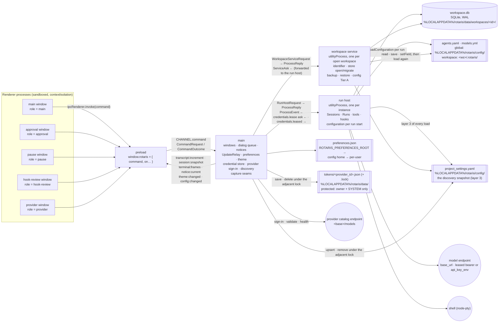

# Process view — five processes and what crosses each boundary

One Electron instance (SR-1; ADR-0055's claim), five kinds of process (ADR-0002). Every message crossing a
boundary is a Zod schema in `packages/contracts/src/` — `commands.ts` (renderer ↔ main), `channels.ts`
(main → renderer, five named channels), `process-protocol.ts` (main ↔ run host, main ↔ workspace service,
and the service's narrow asks back to main).

## What each process owns

| Process | Owns | Never does |
|---|---|---|
| **main** | window lifecycle and the close guard; the per-window approval **dialog queue** and the pause window; the single current notice; the `UpdateRelay` (sequence-preserving fan-out of the run host's publications to subscribed windows); theme and preferences (ADR-0042); the instance claim; forking and shutting down the two child kinds; **the credential store, the provider catalogue, sign-in, discovery and the snapshot** (ADR-0029/0030, `packages/providers`); the verification seams under `ROTARIS_CAPTURE_PNG` | decide a permission, run a tool, read the store, read `agents.yaml`, hand a credential to a renderer |
| **run host** | every session lock this instance holds; the writers, projection owners and runs; the tool gate per session; hooks per run; the configuration resolved per run start (Tier B) with the live state main handed over; the bearers main **leased** for the run; the loop supervisor; the terminal manager | resolve a workspace identifier; migrate the store; write configuration files; read `tokens/` |
| **workspace service** | the workspace identifier; opening and migrating the store (the only process that migrates, W-02); backup and restore with its refusal lease on the run host; configuration Tier A (`config.read` / `config.save` / `config.setField`, each followed by the load again) | run anything; hold a session lock |
| **renderer** (per window) | the replica (a mirror of one session's rows and record, ADR-0043), local shell state (view, guards), the Settings pending state; one role per route | touch a file, a store, a credential |
| **preload** | the one frozen namespace: `command` plus one subscription per channel | anything else |

## Message families

**Renderer → main (`CommandRequestSchema`).** `shell.hello`, `theme.get/set`, `prefs.get/set`,
`session.start/list/resume/prompt/continue/subscribe/unsubscribe/reconcile/pageOlder/control`,
`pause.present/payload`, `approval.payload`, `notice.acknowledge`, `workspace.backup/restore`,
`shell.switchView`, `hooks.summary/review/reviewPayload/reviewDecide/clearDecision/setToggle`,
`playbooks.catalogue`, `config.read/save/setField/liveState`, `providers.list/health/open/save/validate/signOut/
delete/refresh`, `provider.payload/signIn`. Main relays a session or hook command to the run host, a workspace or
config command to the workspace service, and answers preference, theme and **provider** commands itself (the
credential store lives in main). `provider.signIn` is the one command carrying a pasted key inward; no outcome
carries one back — the list shows the display mask. A sign-in that succeeds asks the workspace service
`config.bootstrap` (the starter `agents.yaml` if absent, then the load again) and broadcasts `config:changed`.

**Main → renderer (`CHANNEL`).** `transcript:increment` and `session:snapshot` share one per-session
sequence stamped in the run host and relayed unchanged (REQ-MONITOR-214); `terminal:frames` has its own
per-stream sequence; `notice:current` is the single notice or null; `theme:changed` and `config:changed`
repaint or repopulate every live window.

**Main ↔ run host (`RunHostRequestSchema` / `ProcessReplySchema` / `ProcessEventSchema`).** Requests:
`workspace.opened/closing/refuseRuns/renewLease/closeStore/release`, `session.*` (start, list, resume,
continue, prompt, attach, detach, reconcile, pageOlder, control), `runs.active`, `circuit_breaker.status`,
`config.liveState`, `presenter.register/revoke/pollReply`, `approval.shown`, `hooks.*`, `playbooks.catalogue`,
`shutdown`. Events back: `publish.increment`, `publish.snapshot`, `run.result`, `run.paused`,
`approval.present/close`, `presenter.poll`, `notice.publish`, `log`, `ready`. **The run host's one ask back to main**
(ADR-0030, on the `ServiceAsk` envelope): `credentials.lease {providerIds}`, answered `credentials.leased {bearers, report}` —
the only message in the product that carries a credential value, and it never crosses a renderer boundary.

**Main ↔ workspace service.** Requests: `workspace.open/close/backup/restore.assess/restore.perform`,
`config.read/save/setField/bootstrap`, `shutdown`. The service's narrow asks back to main (`ServiceAskSchema`, ADR-0002
c.7) — `runHost.refuseRuns/renewLease/closeStore/release/reopen` — are forwarded by main to the run host; the two
children never talk directly.

## The control channel (ADR-0010 #1) across the boundaries

A control is `{ op, sessionId, args }` from the renderer, carried unchanged through main to the run host, and
answered `{ ok, value? }`; `value` is populated for exactly `createQueuedPrompt` and `submitSteeringPrompt`.
The twenty-two operations are `contracts/src/control.ts` (REQ-MONITOR-004's enumeration). Nothing in main
decides a control's outcome; main logs it.

## The wire bus (ADR-0010 #2) stays in the run host

Every event is recorded in the store before it is forwarded to any consumer (REQ-SESSION-147); the only
consumer today is the application itself (`run.result` → main's notice). No consumer in another process is
licensed.

## Files and directories on disk

| Path | Written by | Read by |
|---|---|---|
| `%LOCALAPPDATA%/rotaris/data/workspaces/<id>/workspace.db` (+ `sessions/<sid>/summary.md`, `session.log`) | workspace service (migrate), run host (everything else) | run host, workspace service (backup/restore) |
| `<workspace>/.rotaris/workspace-id` | workspace service | workspace service |
| `<workspace>/.rotaris/agents.yaml`, `models.yml`; `%LOCALAPPDATA%/rotaris/config/agents.yaml`, `models.yml` | workspace service (the four writers, ADR-0036) | run host (per run start), workspace service |
| `%LOCALAPPDATA%/rotaris/config/playbooks/`, `intent-tools.yaml`, `hooks-policy` | user (playbooks, mapping); run host (hook policy) | run host |
| `<preferences root>/preferences.json` | main (ADR-0042; the theme write synchronous and flushed) | main |
| `%LOCALAPPDATA%/rotaris/data/tokens/<provider_id>.json` (+ `<provider_id>.lock` while a write is in flight) | main (`CredentialStore`: staged `.tmp` protected before a byte is written, renamed; owner + SYSTEM only, read back; ADR-0029) | main only — the run host is leased the bearer |
| `%LOCALAPPDATA%/rotaris/config/project_settings.yaml` (+ `.lock`) | main (`ProjectSettingsStore`: under the lock, behind the secret screen, mode 0644) | run host and workspace service (layer 3 of every `loadConfiguration`, no lock) |
| the instance claim | main (ADR-0055) | main (a second launch hands over and exits) |
