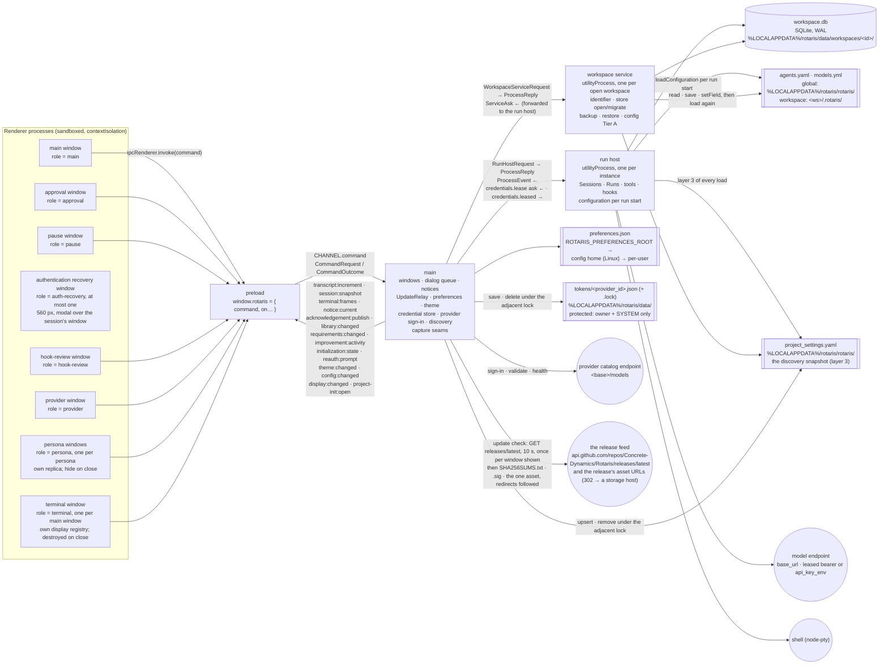

# Process view — five processes and what crosses each boundary

One Electron instance (SR-1; ADR-0055's claim), five kinds of process (ADR-0002). Every message crossing a
boundary is a Zod schema in `packages/contracts/src/` — `commands.ts` (renderer ↔ main), `channels.ts`
(main → renderer, eleven named channels), `process-protocol.ts` (main ↔ run host, main ↔ workspace service,
and the service's narrow asks back to main).

| Read this section when you are | Section |
|---|---|
| asking which process may do a thing at all | [What each process owns](02-process-view/01-what-each-process-owns.md#what-each-process-owns) |
| adding or changing a message, a command or a channel | [Message families](02-process-view/02-message-families.md#message-families) |
| reaching into a live run from outside it | [The control channel](02-process-view/06-the-control-channel-adr-0010-1-across-the.md#the-control-channel-adr-0010-1-across-the-boundaries) |
| touching what the run host publishes internally | [The wire bus](02-process-view/07-the-wire-bus-adr-0010-2-stays-in-the-run-host.md#the-wire-bus-adr-0010-2-stays-in-the-run-host) |
| writing, reading or relocating a file | [Files and directories on disk](02-process-view/08-files-and-directories-on-disk.md#files-and-directories-on-disk) |

The ordered edit path for a new command, channel or message is [`04-seams.md`](04-seams.md); who owns a fact
once it exists is [`05-state-ownership.md`](05-state-ownership.md).

**The runtime's own requests: none (REQ-STARTUP-160, REQ-SHELL-005; 2026-09-28).** Electron and Chromium add no host
of their own to the ones the product reaches, so every host the application reaches is one the product itself asks
for. The diagram draws only some of those — the agent's fetch tool and a remote MCP server, for two, reach hosts it
does not show — so it is not the list of them. Electron's built-in spellchecker would add one — a Hunspell dictionary
from `redirector.gvt1.com`, requested while each session is built — so main registers `app.on('session-created')`
before `app.whenReady()` and empties that session's dictionary list and turns its spellchecker off there
(`main/runtime-requests.ts`; a failure there is logged at `error`, naming REQ-STARTUP-160); no switch and nothing later
prevents the download. `pnpm updater-proof` holds the built application to zero connections at a proxy sink from launch
to first paint and an orderly quit — that interval is measured; later in a session is not. Whether a text field is
spell-checked at all is OQ-93.

**Before main, on the portable alone: the launcher stub (ADR-0054 P4, REQ-STARTUP-165; 2026-10-23).** The Windows
portable is `apps/desktop/launcher`'s stub with the `win-unpacked` tree appended, so its launch is one process more than
an installed launch, and that process runs before any of ours exists. It reads nothing but its own identity token, the
per-user data directory and the marker of `<data>\prepared\<token>\` — `%LOCALAPPDATA%\rotaris\data\prepared\` on
Windows, never the roaming profile and never beside the artifact — and on any doubt places the payload there again
(`.incomplete-…`, committed by displacing a damaged tree to `.stale-…` and renaming). It then starts
`<token>\Rotaris.exe` with every argument it was given and `ROTARIS_PORTABLE_ARTIFACT` naming the artifact, removes
preparations of other tokens that nothing runs from, and **exits**: main is no child of a process that waits, and nothing
holds the artifact, so REQ-STARTUP-125's rename-aside works while the application runs. Where no preparation can be made,
the stub places the payload for that run (`<data>\prepared\.run-…`, else the temporary directory), records
`outcome run-scoped` and the root in that tree's marker, waits for the application and removes the tree — the one case it
stays. The application does not yet read that marker
(`../../defects/a-portable-that-could-make-no-preparation-starts-without-the-notice-req-startup-165-c-requires.md`). Off
Windows the stub (`pnpm portable-proof`) waits for the application in every case and returns its status.

## Parts

Since 2026-10-26 the rest of this document is in [`02-process-view/`](02-process-view/), moved verbatim and in order so that one
part loads without the rest ([the document budget](../../README.md#the-document-budget)). Every anchor kept its text; a link to
one now names its part.

| Part | What it holds |
|---|---|
| [01](02-process-view/01-what-each-process-owns.md) | What each process owns |
| [02](02-process-view/02-message-families.md) | Message families |
| [03](02-process-view/03-message-families-2.md) | Message families *(continued, from "Checkpoints (Part P; ADR-0039's first execution).")* |
| [04](02-process-view/04-message-families-3.md) | Message families *(continued, from "The improvement artifact store (ADR-0061; REQ-LIBRARY-002/036/042..058).")* |
| [05](02-process-view/05-message-families-4.md) | Message families *(continued, from "initialization.*` (Part AS, ADR-0064).")* |
| [06](02-process-view/06-the-control-channel-adr-0010-1-across-the.md) | The control channel (ADR-0010 #1) across the boundaries |
| [07](02-process-view/07-the-wire-bus-adr-0010-2-stays-in-the-run-host.md) | The wire bus (ADR-0010 #2) stays in the run host |
| [08](02-process-view/08-files-and-directories-on-disk.md) | Files and directories on disk |
