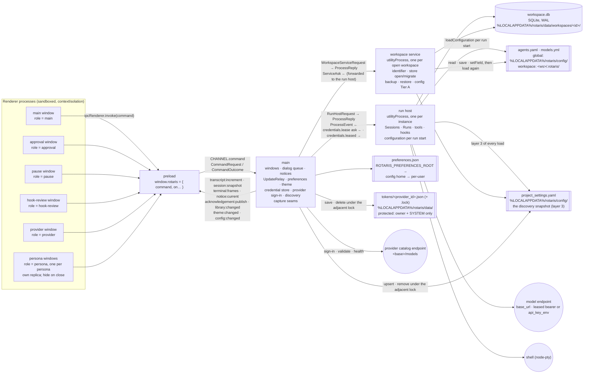

# Process view — five processes and what crosses each boundary

One Electron instance (SR-1; ADR-0055's claim), five kinds of process (ADR-0002). Every message crossing a
boundary is a Zod schema in `packages/contracts/src/` — `commands.ts` (renderer ↔ main), `channels.ts`
(main → renderer, five named channels), `process-protocol.ts` (main ↔ run host, main ↔ workspace service,
and the service's narrow asks back to main).

## What each process owns

| Process | Owns | Never does |
|---|---|---|
| **main** | window lifecycle and the close guard; **application modality across a window family** (ADR-0048, Part W: `setFamilyModal` disables every persona window while the main window holds an application-modal surface, restores them when it closes, creates a new one disabled while one is up, and restores the family on the main renderer's navigation, reload or crash); **the persona-window registry** (ADR-0048, Part R: one window per persona, hidden on close, destroyed with the main window and on a new session; `main/windows.ts`); the per-window approval **dialog queue** and the pause window; the single current notice; the `UpdateRelay` (sequence-preserving fan-out of the run host's publications to subscribed windows); theme and preferences (ADR-0042); the instance claim; forking and shutting down the two child kinds; **the credential store, the provider catalogue, sign-in, discovery and the snapshot** (ADR-0029/0030, `packages/providers`); the verification seams under `ROTARIS_CAPTURE_PNG` | decide a permission, run a tool, read the store, read `agents.yaml`, hand a credential to a renderer |
| **run host** | every session lock this instance holds; the writers, projection owners and runs; the tool gate per session; hooks per run; the checkpoint port per run (the capture at iteration close, the rows and the retention trim — ADR-0039); the configuration resolved per run start (Tier B) with the live state main handed over; the bearers main **leased** for the run; the loop supervisor; the terminal manager; **the MCP holder** (Part S): the discovery memo, the probe path, the per-session connection registries and their stdio children, the session enable-override, the one diagnostic sink | resolve a workspace identifier; migrate the store; write configuration files; read `tokens/`; spawn Git (it asks main, which asks the service) |
| **workspace service** | the workspace identifier; opening and migrating the store (the only process that migrates, W-02); backup and restore with its refusal lease on the run host; configuration Tier A (`config.read` / `config.save` / `config.setField`, each followed by the load again); **every Git invocation** (ADR-0038): the repository and Git-view reads, the worktree writes, and the checkpoint capture, preview, restore and prune through a private index (ADR-0039) | run anything; hold a session lock; write a checkpoint row |
| **renderer** (per window) | the replica (a mirror of one session's rows and record, ADR-0043), local shell state (view, guards), the Settings pending state; one role per route | touch a file, a store, a credential |
| **preload** | the one frozen namespace: `command` plus one subscription per channel | anything else |

## Message families

**Renderer → main (`CommandRequestSchema`).** `shell.hello`, `theme.get/set`, `prefs.get/set` (keys: the theme, the motion preference, the Settings tab, `panels/overview`, `panels/git`, `interface/agentPopOut` — REQ-SHELL-073's "agent pop-out", Part R — and `display/groupTools`, REQ-CHAT-067's tool-grouping switch, default ON, Part Z), `window.openPersona {persona, agentId, focusSteer?}` / `window.personaPayload` (Part R: open or raise the persona window; the window reads its persona, the followed session and the instance to select — answered by main from the registry; a raise is a request, REQ-SHELL-161), `repository.read` (the Overview's card; relayed to the workspace service, waiting for a workspace open in flight),
`session.start/newId/list/resume/prompt/continue/subscribe/unsubscribe/reconcile/pageOlder/control` (`pageOlder`
is wired end to end and, from Part Z, is CALLED: the transcript asks for the next older span when the reader scrolls
toward the top, and the replica's `prependOlder` places it above — REQ-CHAT-165, REQ-SESSION-192),
`git.read`, `worktree.create/remove/chooseAttach/probePath` (Part O — see the Git paragraph below),
`pause.present/payload`, `approval.payload`, `notice.acknowledge {noticeId?}` (Part V: an absent identifier clears
whatever is current, one given is a compare-and-clear — REQ-NOTIFY-026), `workspace.backup/restore`,
`shell.switchView`, `window.modality {active}` (Part W: the main window's application-modal surface — the command
palette, the keyboard help — registering itself open or closed; main's registry disables input in every persona window
of that family for the duration, ADR-0048; a persona window sending it is refused `window.notMain`),
`hooks.summary/review/reviewPayload/reviewDecide/clearDecision/setToggle`,
`playbooks.catalogue`, `config.read/save/setField/liveState`, `providers.list/health/open/save/validate/signOut/
delete/refresh`, `provider.payload/signIn`. Main relays a session or hook command to the run host, a workspace or
config command to the workspace service, and answers preference, theme and **provider** commands itself (the
credential store lives in main). `provider.signIn` is the one command carrying a pasted key inward; no outcome
carries one back — the list shows the display mask. A sign-in that succeeds asks the workspace service
`config.bootstrap` (the starter `agents.yaml` if absent, then the load again) and broadcasts `config:changed`. **`repository.read`
{workspaceRoot}` → `repository.state {gitAvailable, isRepository, branch, base, ahead, behind, touched, uncommitted, failed,
readMs}`** is the workspace service's answer for the Overview's repository card — ADR-0038's helper lives there and
nowhere else; every read bounded at 15 s, every failure an empty value (REQ-GIT-102).

**The Git view and the worktrees (Part O; ADR-0038's second execution).** Renderer → main: `git.read` → the whole
`GitViewState` (header, worktrees with the base tree by common directory, 30 history rows with the local flag; a
`gitAvailable: false` answer raises the fixed-identity notice `git.missing` "Working without Git", REQ-GIT-104);
`worktree.create {branch, path}` (the user's own path, REQ-GIT-115); `worktree.remove {path, force}` (a refusal Git
would lift with `--force` comes back as code `worktree.needs-force`, REQ-GIT-117); `worktree.chooseAttach` (main's
folder chooser, then the service's REQ-GIT-011 check); `worktree.probePath {path}` (answered by main from the
filesystem, for the dialog's live message); `session.newId` (main mints `randomUUID` and holds it for the next
isolated or attached start); and `session.start` gains `isolation {branch}` | `attach {path}` and `sandboxMode`. Main →
workspace service: `git.view {workspaceRoot}` → `git.state`; `worktree.create {workspaceRoot, branch, collisionSafe,
baseRevision?, target: path {path} | session {sessionId, subpath?}}` → `worktree.created {path, branch, baseBranch,
baseRevision}` | `refused` (the Git failure text as the headline); `worktree.remove {workspaceRoot, path, force}` →
`worktree.removed` | `refused {…, needsForce}`; `worktree.checkAttach {workspaceRoot, path}` → `worktree.attachable
{path, branch, baseBranch, baseRevision}` | `refused`. Main → run host: `session.start` gains `sessionId`,
`effectiveRoot`, `worktree` (REQ-GIT-015's binding) and `sandboxMode`; the binding is made BEFORE the run host is
asked, so a binding failure leaves no session behind (REQ-GIT-023 by construction). `SessionListItem` gains `worktree`
and `checkpointCount` (REQ-GIT-018); `SessionRecord` gains `worktreeBranch` for the status strip (REQ-GIT-122).

**Checkpoints (Part P; ADR-0039's first execution).** Renderer → main: `checkpoints.list {sessionId}` (rows only, REQ-GIT-050),
`checkpoints.preview {sessionId, sequence}` and `checkpoints.restore {sessionId, sequence, force}`; main holds ONE desktop
checkpoint operation in flight (REQ-GIT-091) and declines a second with code `checkpoint.busy`, which the view shows as the
toast or, for a listing, retries once after 150 ms against the then-selected session (REQ-GIT-095). Main → run host:
`checkpoint.list {workspaceId, sessionId}` → `checkpoint.list {listing}` (the rows with pre-formatted local-time labels,
`lastRestoredSequence`, REQ-GIT-093's `liveness` verdict, the tree root of REQ-GIT-053, an `unavailable` reason when the
binding's tree is gone, `repaired` when REQ-GIT-094's stale-session repair ran, `includeUntracked`);
`checkpoint.recordSafety {…}` → `checkpoint.recorded {sequence, trimmed}` (the pre-restore row through the writer's one
transaction, its trimmed refs pruned by the run host's own ask, then the event published); `checkpoint.recordRestore {…}` →
`ack` (REQ-GIT-062/068/155). Main → workspace service, where every Git call lives (ADR-0038 c.4): `checkpoint.capture
{workspaceRoot, treeRoot, sessionId, sequence, iteration, childName, checkpointKind, includeUntracked, message}` →
`checkpoint.captured {outcome: recorded | nothing-to-record | unavailable | failed, ref?, commit?, files?, detail?,
invocations, elapsedMs}`; `checkpoint.refs {treeRoot, sessionId}` → `checkpoint.refs {ok, entries}`; `checkpoint.preview
{…, commit, candidates, includeUntracked}` → `checkpoint.previewed {treeState, entries, dirty, blockedReason, text,
invocations, elapsedMs}`; `checkpoint.restore {…, commit, entries}` → `checkpoint.restored {ok, touched, detail?, …}`;
`checkpoint.prune {treeRoot, sessionId, refs}` → `checkpoint.pruned {deleted, failed}`. **The run host's three checkpoint
asks back to main** (`ServiceAsk`, beside `credentials.lease`): `checkpoint.capture`, `checkpoint.refs`, `checkpoint.prune`
— main relays each to the workspace service of `workspaceRoot` and answers the run host with the service's reply; the two
children still never talk directly (ADR-0002 c.4). The service tracks its in-flight checkpoint operations and its `shutdown`
waits for them (REQ-GIT-101); main sends every service `shutdown` after the run host's and awaits it, bounded by REQ-GIT-033's
limits, before it quits.

**The session browser's actions (Part U).** Renderer → main: `session.repair {sessionId?}` (one stale session, or every
stale session when the id is absent — REQ-SESSION-060/182) → `{report: {repaired[{sessionId, from, to: interrupted,
reason}], skipped[], nothingStale}}`; `session.delete {sessionId}` → `{existed, refsDeleted, refsLeft, filesRemoved,
unreadable, elapsedMs}` (a live session refused with its sentence); `session.export {sessionId}` (REQ-SESSION-199's
four records) and `session.exportTrajectory {sessionIds}` (one document, or REQ-EVENTS-144's wrapper in selection
order) — main opens the save dialog first and nothing is written until a path is chosen; `session.openLog {sessionId}`
and `session.revealFiles {sessionId}` (REQ-SESSION-191, answered from main with `shell.openPath` /
`shell.showItemInFolder`, a missing file reported). Main → run host: `session.repair {workspaceId, sessionId?}` →
`session.repaired {report}`; `session.delete {workspaceId, sessionId}` → `session.deleted {…}`; `session.export
{workspaceId, sessionId, destination}` and `session.exportTrajectory {workspaceId, sessionIds, destination}` →
`session.exported {destination, bytes, documents, warnings, elapsedMs}` (the run host writes the file from its one open
connection through ADR-0004's replace under REQ-TRACE-061's ladder); `session.files {workspaceId, sessionId}` →
`session.files {directory, log, summary, artifacts}` (null for a file never written). **The run host's fourth checkpoint
ask** back to main: `checkpoint.deleteNamespace {workspaceRoot, treeRoot, sessionId}`, relayed to the workspace service
as the request of the same name → `checkpoint.namespaceDeleted {deleted, detail?}` (REQ-GIT-069, best-effort).
`SessionListItem` gains `unreadable` (REQ-SESSION-041: the parse detail, or null). Verification seam:
`ROTARIS_CAPTURE_SAVE_PATH` answers the export save dialogs with `;;`-separated paths consumed in order (the backup's
`ROTARIS_CAPTURE_BACKUP_TO` is unchanged).

**The Library's saved prompts and its change channel (Part X; REQ-LIBRARY-105/137/138).** Renderer → main:
`prompts.read`, `prompts.push {list, text}` and `prompts.take {list, index, remove}` — no session id, because the two
lists belong to the workspace and outlive every session; `remove` is a REQUIRED boolean, not a defaulted one
(REQ-LIBRARY-107 makes keeping and removing two deliberate acts), and `index` is the entry's position in the WHOLE
list, newest first, so a filtered view acts on the row the user chose. Main relays each to the run host, which owns
the store, exactly as it relays `timeline.append`: `prompts.read {workspaceId}` → `prompts.state {state}`,
`prompts.push {workspaceId, list, text}` → `prompts.state`, `prompts.take {workspaceId, list, index, remove}` →
`prompts.taken {text, state}`; a store failure comes back `refused` and main raises REQ-LIBRARY-138's persistent
notice "Could not save prompt history" while the window keeps its lists in memory. **A ninth channel,
`library:changed`** (main → every live window), carries `{v, revision}` and nothing else: a counter cannot be
overtaken, so a burst settles with the last write visible (REQ-LIBRARY-105), and a window off the Library sees the
move and re-reads when it is next shown. Main bumps it for exactly the four things REQ-LIBRARY-105 closes a
"library change" to (`LIBRARY_CHANGES` in `contracts/src/library.ts`) — Part X writes the two prompt members and Part Y's `artifacts.save` writes `session-artifacts` — and
`bump` takes a member of that union, so a settings write has no way to reach it. A `prompts.take` that KEPT the
entry writes nothing and bumps nothing. `prefs.set` gains `panels/library` (REQ-SHELL-069, no arrangement suffix).
Verification seam: `ROTARIS_CAPTURE_PROMPTS="history>>text@ms;;stash>>{n}text @ms"` pushes through the real command.

**The session artifact store (Part Y; REQ-LIBRARY-087..101, REQ-ORCH-149).** Renderer → main: `artifacts.list` (the
Library's Artifacts tab), `artifacts.body {ref}` (the inspector's load), `artifacts.save {ref, body}` (REQ-LIBRARY-133's
save, the body ONLY). Main relays each to the run host as `artifacts.list {workspaceId}` → `artifacts.state {state:
{sessionId, artifacts[], warnings[]}}`, `artifacts.body {workspaceId, ref}` → `artifacts.body {id, slug, title, kind_,
status, producer, persona, edited, body, fallback}`, `artifacts.save {workspaceId, ref, body}` → `artifacts.saved {id,
editedAt}`. **No session id crosses**: REQ-LIBRARY-136 scopes the tab to the LOADED session, so the run host answers for
the session it holds and reports none when it holds none, rather than letting a renderer name a session that is not
loaded. A refusal carries REQ-LIBRARY-134's and REQ-LIBRARY-136's own sentences as its headline (`Unknown artifact:
'<id>'`, `Artifact not found in the loaded session.`, the load failure's reason). The bodies themselves never cross a
boundary as files: the run host reads and writes them beside the store (REQ-SESSION-002) and the renderer sees text. The
scripted client's step `artifact:<tool>[:<key>]` calls one of the three artifact tools with arguments from
`ROTARIS_SCRIPT_ARTIFACT_ARGS` (verification only).

**MCP (Part S; ADR-0033/0034's first execution).** Renderer → main: `mcp.list` (every configured server: name, type, the
masked line, origin, enabled, overridden, available, unresolved placeholders, expected env keys), `mcp.probe {name?}` (one
server per request so the category probes sequentially under main's bound), `mcp.setEnabled {name, enabled}` (the session
override, REQ-MCP-094; never on disk), `mcp.secrets {server?}` (the read side: server, key, the `***` mask, scope). Main
relays each to the run host as `mcp.list {workspaceId}` → `mcp.list {listing}`, `mcp.probe {workspaceId, name?}` →
`mcp.probe {results}`, `mcp.setEnabled` → `ack`, `mcp.secrets {workspaceId, server?}` → `mcp.secrets {view}`. The run
host's `notice.publish` event gains `ttlMs` (REQ-MCP-044's 8 s auto-dismiss on the one notice slot). **The MCP child
processes** live under the run host: one per stdio server per session (`SessionConnections`), one transient per discovery
or probe, all through `OwnedStdioTransport` (three piped streams, hidden window, `.cmd`/`.bat` runners through
`cmd.exe`), killed by `terminateTree` (terminate, 5 s, force, the tree). The fixture server the proof and the tests speak
to is `apps/desktop/scripts/fixtures/mcp-fixture-server.mjs`. The scripted client's step `mcp:<server>.<tool>` calls an
MCP tool by its callable name; `ROTARIS_CAPTURE_PROMPT_MS` delays the typed prompt (verification only).

**The bundled code-intelligence runtime (Part T; ADR-0035's first execution).** A `stdio` entry whose command is the
reserved token `builtin:code-intelligence` launches **the application's own executable** with the token first and `--`
second (`Rotaris.exe builtin:code-intelligence -- start-mcp-server --transport stdio --context ide --project <root>`;
in development `electron.exe out/main/index.js` before them): that process is a **sixth process shape**, the
**sentinel** — Electron's main entry whose first module (`main/sentinel.ts`) sees the token, resolves the bundled
interpreter under `process.resourcesPath/code-intelligence/runtime/` (the source tree's `apps/desktop/resources/` in
development), seeds the runtime's per-user home once (`<data>/code-intelligence/`, its interface off), and runs the
runtime **synchronously with the parent's own pipes** (`stdio: 'inherit'`), exiting with the runtime's status — no
window, no instance claim, no store, nothing of main's body evaluated. Under it the runtime (`python.exe`) and, at
first use of a language, the language server it provisions (`npm`/`uvx` children; IC-7, adopted under ESC-32 — the packages declared
in the binding manifest and disclosed on the MCP category, `REQ-MCP-118`; the status carries `provisioning`). It lives under the run host
like every other MCP child: one per session, one transient per discovery or probe, killed by `terminateTree` (the
`/T` reaches the runtime below the sentinel while both live; on stdin's end the runtime exits by itself). The
`--` is Electron's, not ours: a scheme-looking positional followed by another positional exits the binary before any
JavaScript (spike `code-intelligence-branch.md`). The transport tolerates the one CR LF Electron writes to standard
output at start. **`mcp.setup`** — renderer → main `{action: start | cancel | status}`; main → run host
`{workspaceId, action}` → `mcp.setup {status}` (or `refused mcp.setup.running`): REQ-MCP-099's three steps run in the
run host as children of the derived invocation (`Rotaris.exe builtin:code-intelligence -- project create <root>`, then
`project index`, then `memories initialize`), each polled at 0.25 s on the clock port under 300 / 1800 / 120 s, asked to
terminate then tree-killed after 5 s on cancel or timeout; the category polls the status every 500 ms while it runs.
`ROTARIS_SCRIPT_MCP_ARGS` (verification only) hands the scripted client the arguments of an MCP step.

**Main → renderer (`CHANNEL`).** `transcript:increment` and `session:snapshot` share one per-session
sequence stamped in the run host and relayed unchanged (REQ-MONITOR-214); `terminal:frames` has its own
per-stream sequence; `notice:current` is the single notice or null; `acknowledgement:publish` (channel 8, Part V) is a transient for ONE
window's own stack — the stack is per window and is not the notice store (ADR-0049); `library:changed` (channel 9,
Part X) is the library revision, to every live window; `theme:changed` and `config:changed`
repaint or repopulate every live window.

**Main ↔ run host (`RunHostRequestSchema` / `ProcessReplySchema` / `ProcessEventSchema`).** Requests:
`workspace.opened/closing/refuseRuns/renewLease/closeStore/release`, `session.*` (start, list, resume,
continue, prompt, attach, detach, reconcile, pageOlder, control), `runs.active`, `circuit_breaker.status`,
`config.liveState`, `presenter.register/revoke/pollReply`, `approval.shown`, `hooks.*`, `playbooks.catalogue`,
`checkpoint.list/recordSafety/recordRestore` (Part P), `prompts.read/push/take` (Part X, session-less like
`session.list` — REQ-LIBRARY-137/138), `timeline.append` (Part V, REQ-NOTIFY-268; its optional
`severity` is REQ-SESSION-134's vocabulary and `info` where absent, while the entry's `id` is minted by the writer
that records it and never travels on the wire), `shutdown`. Events back: `publish.increment`, `publish.snapshot`,
`run.result`, `run.paused`, `approval.present/close`, `presenter.poll`, `notice.publish` (Part V: the fields
REQ-NOTIFY-023 lists, `sessionId` and `persistent` among them; the `ttlMs` Part S added is gone — REQ-NOTIFY-040
forbids a notice leaving on a timer), `acknowledgement.publish` (REQ-MCP-044's warning, now a transient),
`log`, `ready`. **The run host's
asks back to main** (on the `ServiceAsk` envelope): `credentials.lease {providerIds}` (ADR-0030), answered
`credentials.leased {bearers, report}` — the only message in the product that carries a credential value, and it never
crosses a renderer boundary — and the three checkpoint asks of the paragraph above, relayed to the workspace service.

**Main ↔ workspace service.** Requests: `workspace.open/close/backup/restore.assess/restore.perform`,
`config.read/save/setField/bootstrap`, `repository.read`, `git.view`, `worktree.*`, `checkpoint.capture/refs/preview/
restore/prune` (Part P), `shutdown`. The service's narrow asks back to main (`ServiceAskSchema`, ADR-0002 c.7) —
`runHost.refuseRuns/renewLease/closeStore/release/reopen` — are forwarded by main to the run host; the two children never
talk directly.

**Every window subscribes for itself (Part R).** `session.subscribe` / `session.unsubscribe` bind the relay subscription to the **sender's** webContents id — the persona window's when it asks — not the main window's (the twenty-seventh defect, ADR-0043's note); the run host's `session.attach` then re-delivers the whole-session update and the resident rows to every subscriber of the session. A persona window subscribes on show and unsubscribes on hide (ADR-0048's zero-work rule).

## The control channel (ADR-0010 #1) across the boundaries

A control is `{ op, sessionId, args }` from the renderer, carried unchanged through main to the run host, and
answered `{ ok, value? }`; `value` is populated for exactly `createQueuedPrompt` and `submitSteeringPrompt`.
The twenty-two operations are `contracts/src/control.ts` (REQ-MONITOR-004's enumeration). Nothing in main
decides a control's outcome; main logs it.

## The wire bus (ADR-0010 #2) stays in the run host

Every event is recorded in the store before it is forwarded to any consumer (REQ-SESSION-147); the only
consumer today is the application itself (`run.result` → main's notice). No consumer in another process is
licensed.

## Files and directories on disk

| Path | Written by | Read by |
|---|---|---|
| `%LOCALAPPDATA%/rotaris/data/workspaces/<id>/workspace.db` (+ `sessions/<sid>/summary.md`, `session.log`, and **`artifact-<id>.md`** — Part Y's artifact bodies, one file per artifact, named FLAT beside the other two rather than under a subdirectory, because REQ-SESSION-002 closes that place to three kinds of file and says nothing that makes a directory one of them; the directory removed whole by the session's delete, Part U) | workspace service (migrate), run host (everything else) | run host, workspace service (backup/restore), **a person or another tool — the body is the REQ-LIBRARY-090 rendering so an artifact is readable without this application** |
| an export the user chose through the save dialog — REQ-SESSION-199's four-record document, REQ-SESSION-153's trajectory or REQ-EVENTS-144's batch (Part U) | run host (ADR-0004's replace, REQ-TRACE-061's ladder, parents created) | nothing in the product — a stock parser elsewhere |
| `<tree>/.rotaris/checkpoints/index-<sid>-<pid>-<t>-<n>` — the private Git index of one checkpoint operation (ADR-0039 §1), removed when it ends; `refs/rotaris/checkpoints/<sid>/<n>` in the user's repository | workspace service | workspace service (Git) |
| `<workspace>/.rotaris/workspace-id` | workspace service | workspace service |
| `<workspace>/.rotaris/agents.yaml`, `models.yml`; `%LOCALAPPDATA%/rotaris/config/agents.yaml`, `models.yml` | workspace service (the four writers, ADR-0036) | run host (per run start), workspace service |
| `<workspace>/.mcp.json`, `%APPDATA%/mcp.json` (REQ-MCP-017; user-level skipped when `APPDATA` is unset) | nothing in the product — consumed strictly read-only, byte-identical after any number of loads (REQ-MCP-027) | run host (per run start), workspace service (the configuration read) |
| `<workspace>/.rotaris/secrets.yaml`, `%LOCALAPPDATA%/rotaris/config/secrets.yaml` (REQ-MCP-082) | nothing yet — the write side (REQ-MCP-084/110/111) is owed | run host (per run start; values masked `***` wherever rendered) |
| `%LOCALAPPDATA%/rotaris/config/playbooks/`, `intent-tools.yaml`, `hooks-policy` | user (playbooks, mapping); run host (hook policy) | run host |
| `<preferences root>/preferences.json` | main (ADR-0042; the theme write synchronous and flushed) | main |
| `%LOCALAPPDATA%/rotaris/data/tokens/<provider_id>.json` (+ `<provider_id>.lock` while a write is in flight) | main (`CredentialStore`: staged `.tmp` protected before a byte is written, renamed; owner + SYSTEM only, read back; ADR-0029) | main only — the run host is leased the bearer |
| `%LOCALAPPDATA%/rotaris/config/project_settings.yaml` (+ `.lock`) | main (`ProjectSettingsStore`: under the lock, behind the secret screen, mode 0644) | run host and workspace service (layer 3 of every `loadConfiguration`, no lock) |
| the instance claim | main (ADR-0055) | main (a second launch hands over and exits) |
