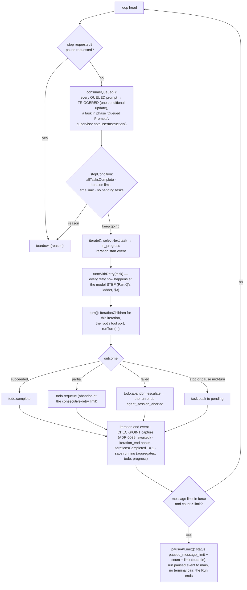

# Runtime view — a run from prompt to terminal result, and everything that reaches into it

The run host owns the run. A prompt from the composer becomes a session, the session's configuration is
resolved from the files with the screen's live state on top, the run iterates the todo, every iteration is a
turn loop of model steps and tool dispatches through the gate, and the run ends in one durable terminal
transaction. Controls, queued prompts, steering, the supervisor and the pause reach into the loop at fixed
points. The store is written by one ordered writer per session (ADR-0008); every event is recorded before it
is forwarded (ADR-0009/0010).

## 1. Start

```mermaid
sequenceDiagram
  participant W as renderer (composer)
  participant M as main
  participant RH as run host (Sessions)
  participant CFG as config (loadConfiguration)
  participant WR as SessionWriter
  participant DB as workspace.db
  participant WS as workspace service (Git)

  W->>M: command session.start {prompt, isolation? {branch}, attach? {path}, sandboxMode?} — the launch dialog's choices ride the composer's next submission (REQ-SHELL-125)
  opt isolation or attach (Part O, REQ-GIT-022)
    M->>WS: worktree.create {target: session {sessionId: the id session.newId minted}} — collision-safe, under <ws>/.rotaris/worktrees/<sid> — or worktree.checkAttach {path}
    WS-->>M: worktree.created {path, branch, baseBranch, baseRevision} | worktree.attachable | refused → "Error: could not create or attach the requested worktree: <detail>"; NO session exists (REQ-GIT-023 by construction)
  end
  M->>RH: session.start {workspaceId, prompt, sessionId?, effectiveRoot?, worktree?, sandboxMode?}
  RH->>CFG: configure(workspaceRoot): load the snapshot (layer 3) and both scopes' four files, overlay live state (Tier B), resolve — from the BASE workspace even for an isolated run (REQ-GIT-019)
  CFG-->>RH: RunSetup {model, runtime, personas, models, authProviders, tier} — or a fatal report / no entry model
  alt refused before it starts (REQ-EVENTS-021, REQ-CONFIG-478, REQ-WORKSPACE-137 "No model configured")
    RH-->>M: refused {headline, detail}
    M-->>W: {ok:false} and a notice; nothing was recorded
  else
    RH->>M: ask credentials.lease {providerIds} (ADR-0030; REQ-PROVIDER-066/067)
    M-->>RH: credentials.leased {bearers, report} — read per request by the resolver OF THE MODEL each call goes to (credentialFor; Part L); an unleased slot is skipped
    alt the entry model's auth_provider is unresolved (REQ-WORKSPACE-137 "Provider authentication required")
      RH-->>M: refused; nothing was recorded
    end
    RH->>WR: SessionWriter.create — session row (with the worktree binding as JSON and the sandbox mode, v8) + lock row (INSERT OR IGNORE) in one transaction; the run's EFFECTIVE root (the tool fence, the terminal's and the hooks' cwd, the child payload's root) is the worktree path, the record stays anchored to the base (REQ-GIT-019)
    RH->>WR: appendRow('user', prompt) — row 0 and its transcript.row event
    RH->>RH: settleStaleChildren (REQ-ORCH-053), SupervisorRegistry, hooks resolved once (ADR-0015)
    RH->>RH: new Run(...) then run.start()
    RH-->>M: session.started {sessionId}
    M-->>W: {ok:true}; the window subscribes → attach → snapshot then the resident rows (REQ-MONITOR-214)
  end
```

`Run.start()` in order (REQ-SESSION-087): save `starting` → the pre-flight (intent classification through the
small slot's rung ladder; the grant; the playbooks; the BUDGET cell) → the launch audit (once per session,
REQ-SESSION-138) → `run_start` timeline entry → hook trust announced → the effective permission posture
(downgrade row if any) → save `running` → `session_start` hooks → the loop.

## 2. The loop and one iteration



**The checkpoint at iteration close (Part P; ADR-0039's first execution).** Exactly once per iteration that closes, after
`iteration.end` is recorded and BEFORE the hooks' `iteration_end` (the checkpoint records the iteration's work as the agent
left it; a hook that later carries the checkpoint — REQ-HOOKS-082 with checkpoints, owed — can only do so if the capture
precedes it), the run awaits `CheckpointPort.capture({ iteration, childName })`, so the attempt finishes before the next
iteration and before teardown (REQ-GIT-051). `childName` is the one child that succeeded in the iteration, `''` when none or
more than one. The port (`run-host/checkpoints.ts`) is built per run from `checkpoints.enabled` against the session's
binding (REQ-GIT-044: unset = isolated only; `false` stays off even when isolated), `include_untracked` and
`max_per_session`; a tree Git cannot manage turns it off on first use with a log line and no issue. One capture: the
sequence = max(the rows' highest, the live refs' highest through the `checkpoint.refs` ask) + 1 (REQ-GIT-046) → the
`checkpoint.capture` ask (main → the workspace service: the private-index staging, the filtered-HEAD comparison, `commit-tree`
under the fixed identity, `update-ref` with the empty old value) → on `recorded`, the writer's `recordCheckpoint` (ONE
transaction: the row, the trim to `max_per_session`, the `checkpoint_created` timeline entry, the `checkpoint.created`
event row) → the trimmed rows' refs deleted through the `checkpoint.prune` ask → only then `publish()` hands the event to
the bus (REQ-GIT-048: rows, then refs, then the event). `nothing-to-record` records nothing; a Git decline records the
`checkpoint` warning issue with REQ-GIT-045's message and never aborts the run. The desktop restore flow (REQ-GIT-096..100)
is main's orchestration over the same three processes and is drawn in the process view.

## 3. Inside a turn (`runTurn`, one agent conversation)

Before every model step, in this order: `shouldPause()` (a graceful pause stops here, the task stays pending) →
pending **steering** injected as a marked user message (`steering_injected`, the supervisor's counter reset) →
the **loop supervisor**'s `check()` (`continue` | `inject` a corrective user message | `escalate` — the turn
fails with `circuit_breaker_escalation`) → the 100-step belt → the model step (streamed into its own `agent`
row). After the step: the supervisor observes the message; each tool call is observed, written as a running
`tool` row, dispatched through the **gate** (policy → approval when needed → executor; hooks in its two slots),
settled with its outcome (and a `diff` row for an edit); the results go back as one tool message; hook feedback
follows as a user message. A reply with no tool call ends the turn — unless a steer is pending, in which case
the agent takes another round; an empty reply with no call is the runtime's stuck report to the supervisor.

The executors a port registers (`run-host/tools.ts`): `read_file`, `write_file`, `haet_read`, `haet_edit`/`haet`, `grep`,
`glob`, `todo`, `terminal` (by shell presence, REQ-TOOLS-104), the three delegation tools when delegation is available,
and **`fetch`** (ADR-0023, Part N). `fetch` is the one executor that **reads configuration per call**: each call loads
the workspace's **saved** files and the discovery snapshot (`egressReader`, no live state — REQ-SANDBOX-038/118,
REQ-TOOLS-089; measured at 1.7–2.5 ms behind the run host, 3–4 ms median in the unit test), maps
`runtime.network_*` to the egress policy and `runtime.tool_call_timeout` to the run-level deadline, classifies the
named host and every redirect target before a connection is opened, and reports one of REQ-TOOLS-092's eight
failure kinds; the `ask` disposition was resolved by the gate's `{mode}:fetch-remote-host` rule before execution.
The entry role's port is the one at **depth 0** (`isEntryPort`): the pre-flight's grant and the `single` override
reach that port and no other.

**The ladder over every model step (Part Q — `run/ladder.ts`, `run/resilience.ts`, `run/waits.ts`; REQ-ORCH-088/090/091/092,
REQ-NOTIFY-081..092/263).** It sits at the step, not the turn, so a retry re-issues the call over the conversation as it stands
and never replays an executed tool call. Each agent (the root for the run, every child) has a **cell**: its current model
choice (the session's override applied through `ResilienceMemory.effective`), its role's fallback (`personas.<role>.fallback_model`,
else the run-level `fallback_model` slot, never its own model), and three once-only marks — the role fallback (shared by the
unresponsive-model route and the hard child timeout, REQ-ORCH-144), the same-tier fallback, the wait attempt. On a failed step,
`classifyFailure` decides in this order: **quota** (structured `insufficient_quota`, "exceeded your current quota", "check your plan
and billing") → **rate limit** (429 or the three substrings) → **context window** (REQ-ORCH-093, left unbuilt: the step fails as
before) → **validation** → **transient** (the port's fact, REQ-NOTIFY-094's phrases) → **fatal**. Transient and validation take
their own budgets (`auto_retries_transient`, `auto_retries_validation`) after min(2, n) s, each attempt a `transient_llm_error` /
`validation_llm_error` issue. A limit never touches those budgets: (a) a quota response marks `provider|model` exhausted — in
memory and as the `model_exhausted` timeline entry; (b) at most one same-tier candidate per agent (`sameTierCandidates` over the
run host's **catalogue**: same recorded role, a different provider identity — `auth_provider` else the family — configured first
then discovered from the snapshot's per-provider picks, exhausted and attempted pairs out) → `model_fallback` timeline entry and
warning issue, the step re-run; (c) else the **suspended wait**: the provider's retry-after (integer seconds, an HTTP date, a
suffixed value, `try again in N <unit>`) else 60·2^(attempt−1) s capped at 300 s, indefinite for an exhausted provider; the
`model_wait` issue and a system row; the session's status **`waiting`** (REQ-SESSION-073's own arm, presented as `running`) and
the record's `wait` published with every snapshot. The wait resolves by the timer (clock port), by `cancel` (the run ends
`user_cancelled` with the condition as its error → main's REQ-NOTIFY-063 notice), or by `setModel` (the pair overridden
session-wide, the `model_override` timeline entry, the agent re-run at once; a key that cannot be applied → `model_override_rejected`
and the header names why, the wait continues). **Unresponsive model:** while a role fallback is untried and `llm_response_timeout`
(≥ 30 s) sits below the agent's bound (the child timeout; the model timeout for the root), a timer on the clock port aborts a call
that produced no event of any kind and the step re-runs on the fallback (`unresponsive_model_fallback`). **Hard child timeout:**
on expiry with a role fallback untried, the child runs once more on it (`child_timeout_fallback`); else it fails with
`Child timed out after <N>s`. Per-model `timeout` / `num_retries` ride the choice (REQ-ORCH-145). On resume the memory is
rehydrated from the timeline (`ResilienceMemory.rehydrate`), so a continuation never returns to an exhausted pair and keeps the
user's choice (REQ-SESSION-196).

**The MCP surface (Part S; ADR-0033/0034).** A port is created synchronously but its MCP surface needs discovery, so the
run start kicks discovery off for every carried, launchable server (`McpHost.prepare`, each bounded by REQ-MCP-053's 35 s
watchdog on the clock port) and the turn awaits the port's `ready()` before reading `specs()` and the prompt section.
`ready()` resolves ONE surface per persona (`surfaceFor`: the drop rules, grants `undefined` ≠ `[]`, denial, rename, the
collision prefix) and from it, in one place, the executors outside the registry (named by callable name, dispatching the
reported name to the session's shared connection under the entry's allowance, 300 s by default), the model's listing and
`## MCP servers` appended to the system prompt (REQ-MCP-101, byte-exact). Under `restricted` or `read_only` the MCP
tools are withheld from the surface (ADR-0016's reading). The session's connections open on first demand under a keyed
single-flight (one process per server per session, shared by every child), a per-call failure is that call's (no retry,
no reconnect; the next call re-establishes; one `mcp_config` warning per server per session), a `tools/list_changed`
recomputes and only narrows (the executor deleted, the prompt untouched). **Their lifetime:** the connections of a
session live until the session's lock is released, which today is the run host's shutdown (`McpHost.closeAll`, after
`Sessions.closeAll`; the discovery children are killed first so no outstanding discovery delays the exit).

**Code intelligence (Part T; ADR-0035).** The shipped `code_intelligence` entry is **enabled** (REQ-CONFIG-181; the
2026-09-05 deviation reverted, its record kept in `config/src/mcp/defaults.ts`), so every run whose persona carries it —
twelve of the thirteen built-in roles — starts one runtime per session through the token. Its arguments come from the
generated manifest (`start-mcp-server`, the transport and the host-integration context); REQ-MCP-034 appends
`--project <root>` at command resolution for the root the run was configured with (an isolated tree's root when the
run is configured with it — not exercised by the proof); the grant is the persona's tier union from the manifest (12 or
19 names; REQ-MCP-014/015). On connection the binding probe calls the memory-listing tool once under 15 s
(REQ-MCP-071; a failure warns through REQ-MCP-044 and withholds nothing); the prompt's `## MCP servers` entry for the
server carries the fixed project-memories block iff both gating names are granted (REQ-MCP-102). Measured cold: the
runtime answers `tools/list` about 4 s after launch, connect about 4.2 s; the first symbol tool on a language provisions
that language's server (minutes; IC-7 adopted under ESC-32 — a declared package at its declared version, disclosed on the
MCP category before any run can trigger it, `REQ-MCP-118`), warm afterwards. **The project setup** (`McpHost.startSetup`): the invocation
derived from the entry (REQ-MCP-036 — a remote or launch-less entry is the non-retryable "not a local launch"
refusal), the contains-code walk once (breadth-first from the root, VCS directories skipped, the root `.gitignore`
honoured, dot-directories walked, no symlink followed, first indexable file stops it), the marker
(`.serena/project.yml`) skipping creation, then the three steps in order with the closed status vocabulary; one run at
a time, re-runnable, cancellable; the status held in the run host for the application's life, never on disk.

## 4. Children (ADR-0012)

`delegate` is a tool call admitted through five checks in order (role known, depth, total, active, dependencies)
into the **ledger** (one row per child, every transition one transaction with its `child.transition` event);
the **scheduler** is a pass to quiescence triggered by a state change, never a timer (cascade `blocked`, admit
on `succeeded` + report stored, promote one held child per freed model slot, claim starts); a child runs its own
turn loop under its persona's tools, model, credential and supervisor; its **report** comes from a bounded summarising pass on `default_summary_model` (REQ-CONFIG-065) or the entry model;
the parent resumes with the report. Every exit from an iteration leaves every child record terminal.

**The record the agent surfaces read (Part R; REQ-MONITOR-044).** Each child's `AgentRecord` carries, beside what Part B
projected, `reasoning` (the persona's configured level, `medium` when none), `contextUsed` (the input count of its latest
model step) and `contextLimit` (REQ-MONITOR-080's default — the run host's setup does not carry a model's own maximum),
`grantedTools` (from `children.granted_tools`), `calledTools` and `activeTools` (kept incrementally by the writer's
`AgentActivity` at `tool.start`/`tool.finish`, seeded once from the ring on load — never recomputed over the transcript,
REQ-MONITOR-038), `delegationSessionId` (null: every child runs in the run's session) and `inheritedContext`. The projection
owner publishes the record after a commit carrying `child.spawn`, `child.transition`, `tool.start` or `tool.finish`, not
only after a save (the twenty-eighth defect, ADR-0043 note), coalesced to one publication per 80 ms tick on the clock port. A non-terminal child of a session whose status is neither
live nor `idle` is presented settled to the run's outcome by the projection (REQ-MONITOR-211/213), though REQ-ORCH-053's
sweep on open settles the row first in this build's routes.

## 5. Controls reaching in (ADR-0010 #1, `Sessions.control`)

| Operation | Reaches | Effect |
|---|---|---|
| `cancel` | `run.stop.request('user_cancelled')` | graceful; the second activation forces; 30 s backstop (ADR-0014) |
| `pause` | `run.pause()` | `pausing` written only after acceptance; the turn stops before its next step; the run ends as `user_cancelled` → status `paused` with its row. **The Mission view refuses a pause for any selection but the run itself client-side, with REQ-MONITOR-276's text, and sends nothing** (Part R); the same `pause` op reaches here for the run-level selection |
| `submitSteeringPrompt` | `run.steer(agentId, text)` | pending per conversation (`root` or a task id); the id is the string value; the persona window's steer card sends it for its instance (Part R, REQ-MONITOR-070/137) |
| `createQueuedPrompt` / `editQueuedPrompt` / `removeQueuedPrompt` | the writer's queue units | QUEUED rows; the snapshot republished; refused once TRIGGERED |
| `editTodo` | `run.editTodo` | add / update / remove by id; a user instruction for the supervisor |
| `setModel` / `setReasoning` | `run.setEntryModel` / `setEntryReasoning` | applied from the next iteration; a system row. **During a provider-limit wait** (Part Q) `setModel` is REQ-NOTIFY-263's *change model*: the parked agent rebuilds and re-runs at once, the override is persisted session-wide (`model_override`); a key that cannot be applied answers `false`, records `model_override_rejected` and the header names why — the wait continues |
| *(keep waiting during a wait)* | — | REQ-NOTIFY-263's first choice is the absence of a decision: no operation exists for it, the header's control acknowledges and changes nothing; *cancel the run* is `cancel` (ADR-0010's note, REQ-MONITOR-004's enumeration stays at twenty-two) |
| `setPermissionMode` | every live tool port's `setMode` | applies from the next tool call; audited |
| `cancelAgent` | the ledger's transition | the reserved run id (`run`) cancels the run; the Mission view, the inspector and a persona window all send this op for a child (confirmed naming it, with the live-descendant count, REQ-MONITOR-055/064) — the descendant of a cancelled child runs on until the iteration closes (REQ-ORCH-133 cancels the one child; observed in Part R's proof) |
| `answerApproval` | the agent's pending approvals | routed by request id across live sessions |
| `announceShutdown` | `run.stop.request('application_shutdown')` | |
| everything else in REQ-MONITOR-004 | — | answers `false` (no mechanism yet) |

A **paused** session has no live run: `session.continue {action}` is a session command — at the message limit
it resolves the pause (continue → `idle`; double → the limit ×2; cancel → `paused`, stop reason
`message_limit_reached`) and, for continue/double and for a manually paused session, launches a **continuation
run** on the same session with no new user row (Part H's route, the previous intent carried over, the
continuation payload built to REQ-SESSION-115's budgets).

## 6. End

`teardown(reason)` runs every step guarded even on exception (REQ-SESSION-094): the stop reason classified to the
terminal result (REQ-MONITOR-301) and the persisted status (REQ-SESSION-093 / REQ-MONITOR-029) →
`session_end` hooks → `run_end` timeline entry → pending publications flushed → **the terminal transaction**
(the token history's last sample — the run samples the cumulative total every 10 s on the clock port while live, each a status save and so a whole-session update — then the system row, the lock release, `session.end` then `result`, the terminal save with aggregates, todo and
progress — one durable transaction) → the bus drained → the hooks advisory → every per-session binding removed.
Main presents `run.result` once as the notice. **Part V:** a starting run first clears the standing notice where it
is unscoped or scoped to that same session and no other (REQ-NOTIFY-029/058), and every `warning` or `error` notice is
written to the session's timeline as a `notice` entry BEFORE it is broadcast (REQ-NOTIFY-268, `timeline.append` to the
run host), so a notice replaced within the same turn is still readable afterwards.

## 6a. The session browser's actions reaching a record no run holds (Part U)

Three actions of REQ-SESSION-182 reach a session's record from OUTSIDE a run, all in the run host, none a control operation
of §5 and none a channel: each is a request answered once.

- **Repair** (REQ-SESSION-060): `Sessions.repairOne` — liveness through the one predicate (`liveness()`, which the listing
  now consumes too; REQ-SESSION-171) → the state read (unreadable = nothing to do) → an active status required → the
  writer's `save('interrupted')` at the stronger durability setting → the `session_marked_interrupted` timeline entry →
  the lock released last (ADR-0005's note: the entry is written under the lock). `repair(all)` walks the listing rows of
  the workspace; `checkpointListing`'s REQ-GIT-094 repair is the same unit. A loaded, idle session repairs through its
  own live writer and its projection republishes.
- **Delete** (REQ-SESSION-166, REQ-GIT-069) in this order: (1) `prepareDelete` loads the row, refuses a live or
  unknowable session with its sentence, finds the tree (the binding's worktree, else the workspace root), notes an
  unreadable state; (2) the refs, best-effort — `checkpoint.deleteNamespace` through main to the service, skipped with a
  warning when the tree is gone; (3) `completeDelete` — a loaded idle session evicted from the registry, then ONE durable
  transaction `DELETE FROM sessions` cascading to the thirteen dependent tables, then `sessions/<sid>/` removed, errors
  ignored; (4) the browser reads the list again; a followed session that was deleted is unfollowed and its persona
  windows destroyed.
- **Export** (REQ-SESSION-199, REQ-SESSION-189): `readRecords` / `readTrajectory` run in a deferred READ transaction
  (`StoreDal.readTransaction`) so a ring's entries and its header figures come from one state; nothing is written to the
  record, no run pauses, a live session exports what it holds at that instant; the file is written afterwards, outside
  the transaction, through `replaceDocument` with REQ-TRACE-061's ladder.

## 7. The store the run writes (`packages/store/src/schema.ts`, v9)

| Table | Holds | Written by |
|---|---|---|
| `sessions` | the session record: status (**`waiting`** while an agent is parked on a provider limit, Part Q — REQ-SESSION-073's arm, presented as `running`; the wait's own fields live on the record's `wait`, not in a column), workspace, run columns (stop reason, iterations, tokens, cost, summary, todo, progress, permission mode, pending approvals, message limit, paused-at count, **`token_samples`** — v7, REQ-MONITOR-166's history the run samples every 10 s and once at the end, 120 kept), truncation facts, **`worktree`** (v8, REQ-GIT-015's binding as JSON; NULL = no worktree, REQ-GIT-017), **`sandbox_mode`** (v8, REQ-SHELL-125's choice; recorded, not honoured — ADR-0022) and **`last_restored_sequence`** (v9, REQ-SESSION-195 / REQ-GIT-155: NULL until a restore succeeds, written in that restore's transaction, untouched by every refusal) | writer's `save`, `endRun`, `pauseAtLimit`, `resolvePause`, `recordRestore`; the binding and the mode at `create` only |
| `checkpoints` (v9) | REQ-GIT-016's record, one row per checkpoint keyed `(session_id, sequence)` — ref, commit, created_at, iteration, child_name, `files` as one JSON list, `kind` from REQ-GIT-067's vocabulary; `checkpoint_count` is a count over these rows, never stored (ADR-0039); the listing is `ORDER BY sequence` under the primary key (a plan the store test asserts) | `recordCheckpoint` (insert + the trim to `max_per_session`, one transaction with the timeline entry and the event) |
| `session_locks` | `(session_id, pid, host, acquired_at)` — the capability token (ADR-0005) | `create`/`open` (INSERT OR IGNORE), `endRun`, release |
| `transcript_rows` | the rows, resident or released to a page (REQ-SESSION-131/192) | `appendRow`, `settleRow` |
| `events` | the wire history: one line per event, ordinal per session, trimmed by the retention cap (ADR-0009) | every unit, in the same transaction as what it records |
| `launch_audits` | one per session, the primary key the one-shot | `recordLaunchAudit` |
| `timeline` | ordered named entries with actor and metadata — including Part Q's session-wide memory, `model_exhausted {provider, model}` and `model_override {provider, model, model_key}`, rehydrated on resume (the wire-event catalogue is closed at 23 kinds, REQ-EVENTS-041, so no event carries them); `model_fallback`, `unresponsive_model_fallback`, `child_timeout_fallback` beside them | `appendTimeline`, the queue/pause/steering units, `recordCheckpoint` (`checkpoint_created`), `recordRestore` (`checkpoint_restored`, or the `issue` entry of the `checkpoint_restore` warning), the REQ-GIT-094 repair (`session_marked_interrupted`), the ladder |
| `permission_audit`, `tool_calls`, `issues` (+ `ring_state`) | the three rings (ADR-0024); audit and issues refuse UPDATE by trigger | the gate's sink through the writer |
| `children`, `model_slot_queue` | the ledger and the held-slot order (ADR-0012); **`granted_mcp`** (Part S, no migration — the existing JSON column) now holds `{ granted: {server: [callable…]}, servers: [{name, transport, origin, fate: connected \| dropped, reason?}] }` written at spawn from the persona's memoised surface, projected as `AgentRecord.grantedMcp` / `mcpServers` (REQ-MCP-065/114) | `spawnChild`, `transitionChild`, `claimChildStart`, `storeChildReport` |
| `queued_prompts` | QUEUED → TRIGGERED → COMPLETED, per session | `queuePrompt`, `editQueuedPrompt`, `removeQueuedPrompt`, `triggerQueuedPrompts` |

## 8. Configuration's three tiers (ADR-0037) as they touch the run

- **Tier A** — Settings Save, the diagnostics toggle, the composer's permission-mode control: the workspace
  service writes through one of the four writers and loads again; main broadcasts `config:changed`.
- **Tier B** — at every run start the run host loads the files — layer 3, the discovery snapshot, folded first
  (REQ-CONFIG-034: an authenticated provider's models as entries keyed by qualified id with `auth_provider`, and its
  slot picks) — and overlays the screen's live state (`config.liveState`, handed over on every pending change), then
  runs the loader's own passes; the run's `RunConfig`, runtime posture, persona resolver, model references, entry
  tier, providers to lease and message limit come from that.
- **Tier C** — everything else is read at the next load; nothing watches a file.
- **The MCP layer (Part S)** — the two `mcp.json` files are layer 2 of the load (defaults → discovered → global → workspace,
  REQ-MCP-025), the merged `mcp_servers` map is resolved at load (origin, command, availability, environment with secrets
  overlaid, the URL, the normalised description) and rides on `LoadedConfiguration.mcp`; Tier B resolves it again over the
  overlaid document. The session enable-override is a third input to the persona surface, held in the run host only.
- **The one per-call read** — the `fetch` tool's egress policy and `tool_call_timeout` are loaded from the saved
  files at every call, without the live state (REQ-SANDBOX-038/118): a saved edit to the host lists reaches the
  next fetch of a running session with no restart, an unsaved settings edit reaches nothing.
