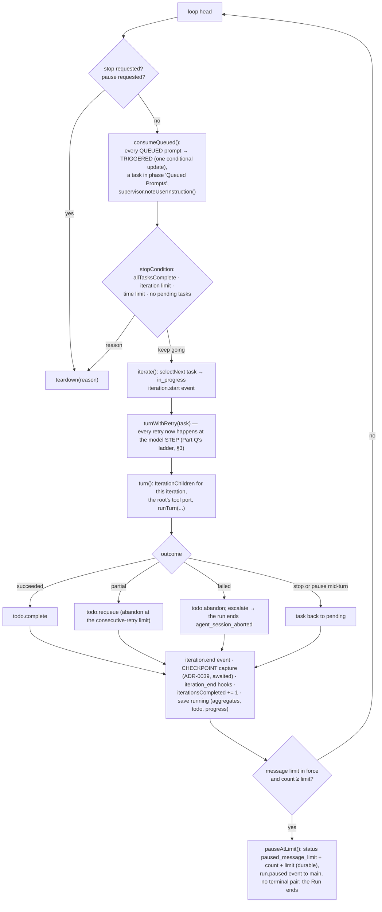

# Runtime view — a run from prompt to terminal result, and everything that reaches into it

The run host owns the run. A prompt from the composer becomes a session, the session's configuration is
resolved from the files with the screen's live state on top, the run iterates the todo, every iteration is a
turn loop of model steps and tool dispatches through the gate, and the run ends in one durable terminal
transaction. Controls, queued prompts, steering, the supervisor and the pause reach into the loop at fixed
points. The store is written by one ordered writer per session (ADR-0008); every event is recorded before it
is forwarded (ADR-0009/0010).

| Read this section when you are | Section |
|---|---|
| changing what happens before the first model call | [§1 Start](#1-start) |
| changing the run loop or an iteration boundary | [§2 The loop and one iteration](#2-the-loop-and-one-iteration) |
| changing a model step, a tool dispatch or a hook slot | [§3 Inside a turn](#3-inside-a-turn-runturn-one-agent-conversation) |
| touching delegation | [§4 Children](#4-children-adr-0012) |
| adding or changing a control operation | [§5 Controls reaching in](#5-controls-reaching-in-adr-0010-1-sessionscontrol) |
| changing teardown, or acting on a session no run holds | [§6 End](#6-end) and [§6a](#6a-the-session-browsers-actions-reaching-a-record-no-run-holds-part-u) |
| adding a table or a column | [§7 The store the run writes](#7-the-store-the-run-writes-packagesstoresrcschemats-v19) |
| adding a configuration key | [§8 Configuration's three tiers](#8-configurations-three-tiers-adr-0037-as-they-touch-the-run) |
| drawing something from a publication | [§9 What a surface does with a publication](#9-what-a-surface-does-with-a-publication-adr-0046-adr-0045-part-z) |

Flows this view does **not** own — startup, approval, the board — are in [`06-sequences.md`](06-sequences.md).

## 1. Start

```mermaid
sequenceDiagram
  participant W as renderer (composer)
  participant M as main
  participant RH as run host (Sessions)
  participant CFG as config (loadConfiguration)
  participant WR as SessionWriter
  participant DB as workspace.db
  participant WS as workspace service (Git)

  W->>M: command session.start {prompt, isolation? {branch}, attach? {path}, sandboxMode?} — the launch dialog's choices ride the composer's next submission (REQ-SHELL-125)
  opt isolation or attach (Part O, REQ-GIT-022)
    M->>WS: worktree.create {target: session {sessionId: the id session.newId minted}} — collision-safe, under <ws>/.rotaris/worktrees/<sid> — or worktree.checkAttach {path}
    WS-->>M: worktree.created {path, branch, baseBranch, baseRevision} | worktree.attachable | refused → "Error: could not create or attach the requested worktree: <detail>"; NO session exists (REQ-GIT-023 by construction)
  end
  M->>RH: session.start {workspaceId, prompt, sessionId?, effectiveRoot?, worktree?, sandboxMode?, boardPermissions?}
  RH->>RH: settleConfinement() — ADR-0022's probe, awaited BEFORE the run does anything else (REQ-SANDBOX-097); one per process, cached, bounded at 5.0 s, cleared only by the settings re-check (REQ-SANDBOX-067, -129). On win32 the platform check settles it and no subprocess is spawned (REQ-SANDBOX-066)
  RH->>CFG: configure(workspaceRoot): load the snapshot (layer 3) and both scopes' four files, overlay live state (Tier B), resolve — from the BASE workspace even for an isolated run (REQ-GIT-019)
  CFG->>CFG: the confinement gate — the effective mode is the layered key with the dialog's override folded in (REQ-SANDBOX-122); a non-off mode whose verdict is not `available` REFUSES here, before the lease, before the session row and before the lock, so nothing is left to clean up (REQ-SANDBOX-094/095)
  CFG-->>RH: RunSetup {model, runtime, personas, models, authProviders, tier} — or a fatal report / no entry model / the availability reason and remediation
  alt refused before it starts (REQ-EVENTS-021, REQ-EVENTS-024, REQ-CONFIG-478, REQ-SANDBOX-126, REQ-WORKSPACE-137 "No model configured")
    RH-->>M: refused {headline, detail}
    M-->>W: {ok:false} and a notice; nothing was recorded
  else
    RH->>M: ask credentials.lease {providerIds} (ADR-0030; REQ-PROVIDER-066/067)
    M-->>RH: credentials.leased {bearers, report} — read per request by the resolver OF THE MODEL each call goes to (credentialFor; Part L); an unleased slot is skipped
    RH->>RH: complete the captured configuration with this launch's lease; Sessions.start consumes its prepared RunSetup
    alt the entry model's auth_provider is unresolved (REQ-WORKSPACE-137 "Provider authentication required")
      RH-->>M: refused; nothing was recorded
    end
    RH->>WR: SessionWriter.create — session row (with the worktree binding as JSON and the sandbox mode, v8) + lock row (INSERT OR IGNORE) in one transaction; the run's EFFECTIVE root (the tool fence, the terminal's and the hooks' cwd, the child payload's root) is the worktree path, the record stays anchored to the base (REQ-GIT-019)
    RH->>WR: appendRow('user', prompt) — row 0 and its transcript.row event
    RH->>RH: settleStaleChildren (REQ-ORCH-053), SupervisorRegistry, hooks resolved once (ADR-0015)
    RH->>RH: new Run(...) then run.start()
    RH-->>M: session.started {sessionId}
    M-->>W: {ok:true}; the window subscribes → attach → snapshot then the resident rows (REQ-MONITOR-214)
  end
```

**What an agent's system prompt is made of (ADR-0063).** At every agent construction — the entry turn and each
child — the role's instructions take its playbook (`withPlaybook`, REQ-ORCH-019) and then the session's
**always-active context units** (`withContextUnits`, REQ-WORKSPACE-060), in that requirement's order: workspace
context → the skill catalog → the force-loaded skill bodies → persona memory. **One of the four is not built**
(persona memory) and is an empty slot in the list rather than a shape a later part must re-cut.
Workspace-context injection (REQ-WORKSPACE-041..048, narrowed and extended by `PD-WORKSPACE-002`) fills the
first: `SkillHost.workspaceContext` calls **`SkillHost.instructionFiles`**, which reads the master switch
`inject_agents_md` and the per-file `instructions.overrides` policy from the **saved** configuration and
discovers the present instruction files over the workspace root and the five further bases; the context then
merges the enabled set into one block
(`mergeInstructionContext` — a source comment per file, one blank line between blocks, both size limits) and
caches it for as long as the session lasts (REQ-WORKSPACE-046), cleared by session creation and by a rescan, the
two events that already clear the catalog.

**The cold path is timed, and it runs after first input.** `workspaceContext` reads the monotonic clock port four
times on a cache miss: before the saved-policy read, after it, after the discovery and after the merge. It then logs
one line, `workspace context: the enabled set of N instruction file(s) merged into B bytes in T ms (policy read …,
discovery …, merge …)`. That line is REQ-WORKSPACE-049's figure as the built app reports it, and `injection-proof`
reads it back. The policy read counts towards the figure because `PD-WORKSPACE-002` made the per-file policy part of
deciding what is merged. Nothing warms the merge at workspace open, as the catalog is warmed. The first read happens
at the first agent built for a session, in the run host, after the typed prompt has been recorded as row 0. It
therefore cannot delay the window's first input, and it never runs in the window's process. The first measurement
(2026-09-27, Linux) is in `first-release-plan.md` §3.2. The machine-wide base's directory is injectable
(`SkillHostDeps.machineDir`, `/etc/codex` when absent). It is a verification seam in the built app and never
widens the platform rule.

**The set is decided in one place because it has two readers.** `instructionFiles` is a method rather than a
step inside the context because the retrospective consumes the same list (`PD-LIBRARY-002` over
REQ-WORKSPACE-041). It used to hold its own copy of the rule — two names at the workspace root, no policy —
so it read files the user had switched off and could propose edits to them; the run host now computes the
set once and hands it to the engine, which owns no policy of its own. Whether a switch stated over what
agents are *given* binds an *analysis* is **OQ-65**, and what the build proceeds under is that it does. **`REQ-WORKSPACE-050` is met on both halves:** the instruction files
are read from the root the run **executes** in — the worktree of an isolated session — while the skill catalog
and the policy stay with the **base** workspace, so persistent workspace metadata stays with the base. The
execution root reaches the run host through `configure`'s context (`Sessions.setupFor`, from the start
argument's binding or, for a continuation, from the stored one), and the merge is cached per base root **and**
per execution root, so two sessions on one base with different trees never answer for each other. The per-file
switches are untouched by this: they key on a stable identity (`workspace:AGENTS.md`), not on a path.
The units arrive as a **getter**, called at construction and never
captured, so a skill invoked between prompts reaches the next agent built while one already running keeps the
context it was built with (REQ-CONFIG-166). Because the list is a property of the session and not of the role,
REQ-WORKSPACE-065's "every agent built for a session sees the same catalog" holds by construction.

`Run.start()` in order (REQ-SESSION-087): save `starting` → the pre-flight (intent classification through the
small slot's rung ladder; the grant; the playbooks; the BUDGET cell) → **the plan gate's hold settled** → the
launch audit (once per session, REQ-SESSION-138) → `run_start` timeline entry → hook trust announced → the
effective permission posture (PD-TOOLS-002: the requested mode, never a downgrade row) → save `running` → `session_start` hooks → **the plan cycle
if the gate holds**, otherwise the loop.

**The plan gate (Part; ADR-0062, REQ-ORCH-152/153/154, PD-ORCH-003).** In `plan` mode a run whose classified
intent is outside REQ-ORCH-021's answer group **and whose session holds no approved release** is a sequence of
**run segments**: one or more plan cycles, then one execution segment. The release clause is PD-ORCH-003's — an
approval reaches the session, so every run after it in that session goes straight to execution until the user
re-arms the gate (`session.planRearm`, sent by the composer's run-start chip) or starts a new session. The hold is settled once, after the pre-flight and before anything it withholds, and never cleared in
place — so a segment's grants are constant and the model's listing and callable set stay one resolution
(REQ-TOOLS-010). A held segment takes **one turn of the entry role** through the ordinary `turn()` path, numbered
**iteration 0** (`root:0`) because a plan cycle is not an iteration, and then `parkAtPlanGate()` mirrors
`pauseAtLimit` exactly: status `awaiting_plan_decision` with the cycle, the cycle's row written in the same
durable transaction with a `plan_gate_opened` entry, **no terminal pair**, and an EMPTY stop reason
(REQ-MONITOR-301's set names no hold). The turn's report text IS the plan, verbatim — and the turn is TOLD so: `planRequestSection` (`run/plan-text.ts`, beside the `planSection` a decided cycle is handed back) prefixes both the task string and the initial content parts, because an initial turn built from `taskContent` never reads the string. Before 2026-09-16 the first cycle's turn received the user's bare prompt and read it as work to do. Both sections name the **product** as their speaker: they are delivered inside a `role: 'user'` payload, and `planSection` opened "The user approved this plan" until the same date — a user-role turn narrating the user. A held segment's turn also carries **no loop supervisor** (`PD-ORCH-001`, which narrows REQ-ORCH-099 and REQ-ORCH-101): `Run` attaches the supervisor per turn, and while the hold stands it attaches none. A run whose write and execute tools are withheld can only grep and read, which is REQ-ORCH-101's repetition trigger read literally; the corrective it injects is an unmarked `role: 'user'` message, so the run reads a user instruction no user gave while waiting for the decision of the actual user. Supervision attaches again on the first turn after the gate resolves, and the classifier keeps no state across the hold.

**What the reader sees while it holds (PD-ORCH-002 revision 2, 2026-09-17).** The gate is its own row of the
workspace grid, above the transcript, in two states the reader moves between in one action: **expanded**, the
state a gate opens in and the state a further cycle returns it to, where the gate's row takes the free space,
the transcript's row is zero and `.transcript` is not drawn at all; and **collapsed**, where the gate is a bar
in an `auto` row and the transcript reads under REQ-CHAT-010's own floor. `WorkspaceView` owns the state — the
GRID is what changes with it, published as `data-plan-gate-collapsed` beside `data-plan-gate` — and `PlanGate`
draws REQ-ORCH-153's three answers in **both** states, so no state and no window size can put the decision out
of reach. Revision 1 gave the transcript a floor of 220 px and capped the gate instead; the owner's capture of
2026-09-17 showed what that costs at the window the product is used at, and the CSS keeps the falsified reason
beside its replacement.

While the hold stands, three places enforce the planning grants of REQ-ORCH-153 — the port's narrowing
(`createToolPort`, which only removes, and which hands the gate the set of names it removed), `Gate.dispatch`
ahead of the permission resolution (so a refused call's tool hooks never fire, REQ-HOOKS-004 — and which refuses
a name that is a tool, letting a name that is no tool reach REQ-TOOLS-032's unknown-tool answer instead of a
promise no approval can keep), and child admission (`IterationChildren.delegate`) — and the hook engine
starts no process, emitting one `hook.finish` with `skip_reason: 'plan_gate'` per withheld invocation
(REQ-HOOKS-126). The check suite is unreachable rather than guarded: a held segment never enters the loop.

**Launch ownership (2026-09-13, REQ-TRACE-470/471).** `run-host/launch.ts` owns configuration capture,
credential preparation and pre-start refusal mapping. The board coordinator sends its authorized
`boardPermissions: permissive` on one start request. The run host applies autonomous mode and the
unsandboxed opt-in together to the captured runtime. Settings files and live state retain their values.
The configuration is loaded and validated before the credential wait; completing it builds the model
setup and authenticated catalogue from those captured inputs. Active tool ports, preflight, checkpoints
and supervision resolve their configuration by session identifier. A refused prompt for an active run
returns before another configuration load. Launch audits record effective permission and the complete
effective configuration snapshot: slots, redacted models, personas with prompt files resolved inline,
runtime and every other typed section, plus redacted MCP server declarations.

**The continuation lease (2026-09-14, REQ-PROVIDER-066).** The three run-launching continuation commands —
`session.continue`, `session.prompt`, `session.planDecision` — re-ask main for the credential lease
(`leaseForContinuation`) before the engine resolves the run's setup, and publish the fresh bearers under
the session's workspace root (`sessionRoots`, recorded at `session.start` and `session.resume`). Before the
repair, a resumed session's continuation read the previous launch's lease — empty after an application
restart — and its first model call went out with **no `Authorization` header** (the 401 recorded in
a defect note, removed once repaired). The refresh is invisible when main answers;
an entry provider main cannot resolve refuses with REQ-WORKSPACE-137's sentence, exactly as a launch does.
A session this process never started or resumed leases nothing — the engine's own `not-live` / `no-session`
refusals answer it.

## 2. The loop and one iteration



**The checkpoint at iteration close (Part P; ADR-0039's first execution).** Exactly once per iteration that closes, after
`iteration.end` is recorded and BEFORE the hooks' `iteration_end` (the checkpoint records the iteration's work as the agent
left it; a hook that later carries the checkpoint — REQ-HOOKS-082 with checkpoints, owed — can only do so if the capture
precedes it), the run awaits `CheckpointPort.capture({ iteration, childName })`, so the attempt finishes before the next
iteration and before teardown (REQ-GIT-051). `childName` is the one child that succeeded in the iteration, `''` when none or
more than one. The port (`run-host/checkpoints.ts`) is built per run from `checkpoints.enabled` against the session's
binding (REQ-GIT-044: unset = isolated only; `false` stays off even when isolated), `include_untracked` and
`max_per_session`; a tree Git cannot manage turns it off on first use with a log line and no issue. One capture: the
sequence = max(the rows' highest, the live refs' highest through the `checkpoint.refs` ask) + 1 (REQ-GIT-046) → the
`checkpoint.capture` ask (main → the workspace service: the private-index staging, the filtered-HEAD comparison, `commit-tree`
under the fixed identity, `update-ref` with the empty old value) → on `recorded`, the writer's `recordCheckpoint` (ONE
transaction: the row, the trim to `max_per_session`, the `checkpoint_created` timeline entry, the `checkpoint.created`
event row) → the trimmed rows' refs deleted through the `checkpoint.prune` ask → only then `publish()` hands the event to
the bus (REQ-GIT-048: rows, then refs, then the event). `nothing-to-record` records nothing; a Git decline records the
`checkpoint` warning issue with REQ-GIT-045's message and never aborts the run. The desktop restore flow (REQ-GIT-096..100)
is main's orchestration over the same three processes and is drawn in the process view.

## 3. Inside a turn (`runTurn`, one agent conversation)

Before every model step, in this order: `shouldPause()` (a graceful pause stops here, the task stays pending) →
pending **steering** injected as a marked user message (`steering_injected`, the supervisor's counter reset) →
the **loop supervisor**'s `check()` (`continue` | `inject` a corrective user message | `escalate` — the turn
fails with `circuit_breaker_escalation`; no supervisor is attached at all for the turn a plan-gate hold covers,
`PD-ORCH-001`) → the 100-step belt → **context compression when the agent has reached
its threshold** (Part AH, below) → the model step (streamed into its own `agent`
row, and — from Part Z — into a **`thinking` row** for anything the provider marks as deliberation; the sink
discarded every reasoning delta before that, so no streamed-reasoning row had ever existed, REQ-CHAT-163).
Both rows are written through `upsertMessageRow` under one stable key per response **segment**, which is what
makes a replayed event persist once and a ladder retry update the row in place rather than append a second
(REQ-CHAT-054). A step also arms a **stall detector** on the clock port: ten seconds with no output of any kind
marks the live row `stalledSince`, the next output clears it, and neither publishes anything into the record
(REQ-CHAT-164's detection half; the drawing half is the renderer's). After the step: the supervisor observes the
message; each tool call is observed, written as a running `tool` row, dispatched through the **gate** (policy →
approval when needed → executor; hooks in its two slots), settled with its outcome (and a `diff` row for an
edit); the results go back as one tool message; hook feedback follows as a user message. A reply with no tool call ends the turn — unless a steer is pending, in which case
the agent takes another round; an empty reply with no call is the runtime's stuck report to the supervisor.

**What a step costs (PD-MONITOR-001 revision 2; `model/reported-cost.ts`, `kernel/money.ts`, `run/pricing.ts`,
`run/aggregates.ts`).** A completed provider request carries its tokens and, where the endpoint's protocol defines a
field for it, the cost that provider computed for that request. The ask is a body field the endpoint owns, sent only
to endpoints that define one (`COST_REPORTING_HOSTS`, today OpenRouter's `usage.include`), because a strict
OpenAI-shaped API answers an unrecognised body key with a 400. The reading is the SDK's `metadataExtractor`, which
sees the raw chunk before the SDK's usage mapping keeps the token fields and drops the rest; the figure leaves the
adapter on the port's own `usage` part. **The request is priced at the ladder cell** (`resilientStep`), the one
place the model it was sent to is known — after a fallback, the fallback's: `priceRequest` keeps a reported figure;
otherwise, where that model's catalogue entry carries both configured prices (`CatalogueEntry.pricing`, filled from
`effectivePricing` in `run-host/configuration.ts`), it multiplies input and output tokens by them exactly
(`multiplyAmount`); otherwise the request is unpriced. A request that counted no tokens and reported no figure is
none of the three. `Aggregates.addRequest` adds the figure to the run's total in exact decimal arithmetic on
`bigint` in `kernel/money.ts` — the one module where arithmetic on an amount lives, which
`rotaris/money-only-in-money-ts` enforces (ADR-0031) — and folds the request's pricing into the qualifier:
`unknown` (no figure), `incomplete` (some requests without one), `reported` (every figure the provider's) or
`configured` (every request priced, at least one at configured rates). The qualifier is persisted with the total
(`sessions.cost_qualifier`, v21) and rebuilt on a continuation from it and the token totals. The total reaches
`usage.update` and `session.end` in the payload's existing `cost.total`; the label is `costLabelOf(cost,
qualifier)`, rendered half-up to two places or four below one hundredth and with no currency symbol, because no
figure names a currency and the product picks none. A configured price reaches the entry exact because the loader
reads it from the YAML scalar's source text (`config/prices.ts`, `exactPrices`) before the plain value's double is
used — the discovery snapshot's prices likewise. **Every agent's requests are counted**: the entry agent's turn
and every delegated child's turn, at any depth, hand each completed request to the one `Run.onRequestUsage`
(`ChildrenDeps.onRequestUsage`), so the run's tokens, its cost and each `usage.update` cover the whole tree
(REQ-EVENTS-053). Until 2026-09-23 a child's turn was built without it and the totals were the entry agent's
alone. **So are the run's requests that belong to no agent's turn** (`run/metered.ts`): compression, the
child-report summariser, the pre-flight's intent classifier and the loop supervisor's classifier each call a
backend `meteredBackend` wraps, which hands every completed request, a failed one included, to `Run.countUsage`
with the model it was sent to; `countUsage` prices it at that model's catalogue rates (`priceRequest`, as the ladder
does) and passes it to `onRequestUsage`. `Sessions` wraps the compressor's and the summariser's backends itself and
hands its `countUsage` to the run host's two classifiers, through `PreflightContext.countUsage` and the
`supervisor` factory's third argument, which wrap their own. The improvement analyst runs after the run has ended
and has no run totals to join. Until 2026-09-27 these four calls discarded their usage.

What the model is handed for each of them is `toolSpec` (`run-host/tools.ts`): an MCP tool's own input schema where
ADR-0034 supplies one, otherwise the zod schema converted **as an input** (`io: 'input'`) — the shape of a call about to
be made, in which a field carrying a `.default()` is optional as the parser treats it. Converted as an output, which was
the default until 2026-09-16, such a field is advertised as required and the product states a contract it does not
enforce.

The executors a port registers (`run-host/tools.ts`): `read_file`, `write_file`, `haet_read`, `haet_edit`/`haet`, `grep`,
`glob`, `todo`, `terminal` (by shell presence, REQ-TOOLS-104), the three delegation tools when delegation is available,
**`ask_questions`** (Part AC — its `userPromptChannel` prerequisite is now attendedness, REQ-TOOLS-053/069, and the
orchestrator is the one built-in persona declaring it, REQ-CHAT-094's one conversation), the three artifact tools when
the session has an artifact store, and **`fetch`** (ADR-0023, Part N). `grep` and `read_file`'s `grep` filter share one
pattern dialect (`compileSearchPattern`, `tools/search.ts`): the accelerator's, not the host engine's — leading
`(?flags)` groups are read off and translated, because REQ-STARTUP-058 pins ripgrep and REQ-TOOLS-141 holds results
identical whether or not it is present. `fetch` is the one executor that **reads configuration per call**: each call loads
the workspace's **saved** files and the discovery snapshot (`egressReader`, no live state — REQ-SANDBOX-038/118,
REQ-TOOLS-089; measured at 1.7–2.5 ms behind the run host, 3–4 ms median in the unit test), maps
`runtime.network_*` to the egress policy and `runtime.tool_call_timeout` to the run-level deadline, classifies the
named host and every redirect target before a connection is opened, and reports one of REQ-TOOLS-092's eight
failure kinds; the `ask` disposition was resolved by the gate's `{mode}:fetch-remote-host` rule before execution.
The entry role's port is the one at **depth 0** (`isEntryPort`): the pre-flight's grant and the `single` override
reach that port and no other.

**The ladder over every model step (Part Q — `run/ladder.ts`, `run/resilience.ts`, `run/waits.ts`; REQ-ORCH-088/090/091/092,
REQ-NOTIFY-081..092/263).** It sits at the step, not the turn, so a retry re-issues the call over the conversation as it stands
and never replays an executed tool call. Each agent (the root for the run, every child) has a **cell**: its current model
choice (the session's override applied through `ResilienceMemory.effective`), its role's fallback (`personas.<role>.fallback_model`,
else the run-level `fallback_model` slot, never its own model), and three once-only marks — the role fallback (shared by the
unresponsive-model route and the hard child timeout, REQ-ORCH-144), the same-tier fallback, the wait attempt. On a failed step,
`classifyFailure` decides in this order: **quota** (structured `insufficient_quota`, "exceeded your current quota", "check your plan
and billing") → **rate limit** (429 or the three substrings) → **context window** (REQ-ORCH-093: condense and retry, below) → **validation** → **transient** (the port's fact, REQ-NOTIFY-094's phrases) → **fatal**. Transient and validation take
their own budgets (`auto_retries_transient`, `auto_retries_validation`) after min(2, n) s, each attempt a `transient_llm_error` /
`validation_llm_error` issue. A limit never touches those budgets: (a) a quota response marks `provider|model` exhausted — in
memory and as the `model_exhausted` timeline entry; (b) at most one same-tier candidate per agent (`sameTierCandidates` over the
run host's **catalogue**: same recorded role, a different provider identity — `auth_provider` else the family — configured first
then discovered from the snapshot's per-provider picks, exhausted and attempted pairs out) → `model_fallback` timeline entry and
warning issue, the step re-run; (c) else the **suspended wait**: the provider's retry-after (integer seconds, an HTTP date, a
suffixed value, `try again in N <unit>`) else 60·2^(attempt−1) s capped at 300 s, indefinite for an exhausted provider; the
`model_wait` issue and a system row; the session's status **`waiting`** (REQ-SESSION-073's own arm, presented as `running`) and
the record's `wait` published with every snapshot. The wait resolves by the timer (clock port), by `cancel` (the run ends
`user_cancelled` with the condition as its error → main's REQ-NOTIFY-063 notice), or by `setModel` (the pair overridden
session-wide, the `model_override` timeline entry, the agent re-run at once; a key that cannot be applied → `model_override_rejected`
and the header names why, the wait continues). **Unresponsive model:** while a role fallback is untried and `llm_response_timeout`
(≥ 30 s) sits below the agent's bound (the child timeout; the model timeout for the root), a timer on the clock port aborts a call
that produced no event of any kind and the step re-runs on the fallback (`unresponsive_model_fallback`). **Child timeout:**
expiry does not cut the child off — it **asks the child to land** (REQ-ORCH-088), by raising the same per-child flag
`runTurn` reads for REQ-MONITOR-123's pause, so the turn stops before its next model step with the step in flight
finished and its text intact. A hard-abort **backstop** is armed `STOP_GRACE` (30 s, `run/grace.ts`, ADR-0014 rule 1's
one allowance) behind it, for the child that cannot land inside the window; REQ-CONFIG-113's ceiling therefore still
bounds the child. Then, with a role fallback untried, the child runs once more on it (`child_timeout_fallback`); else
it fails with `Child timed out after <N>s` and a report carrying what the child last **said** — the last assistant
message with text, not the last assistant message, which is usually the one that opened a tool call and spoke
nothing. Those words reach `last_response`; `final_response` stays empty, because REQ-ORCH-110's final response is
text no further tool activity followed. **A child cut off while making progress (PD-ORCH-004):** at the
expiry instant — not at the backstop — the child's `ProgressLog` answers whether it completed a tool call within the
final stall window (the role's `stall_timeout`, else `runtime.child_stall_timeout`, 90 s by default; the bound is
inclusive). If it did, and the child then ends failed on that timeout, the stored report gains `cut_off`: the statement,
the workspace paths its own `write_file`/`haet_edit`/`haet` calls changed with `ok` (the name matched in lower case, as the
gate's fallback dispatches it; resolved lexically against the root; both attempts, in the order first changed, each once), and — unless the child is itself a continuation — the offer naming `continuation_of`. The report block and
`background_output` render it after the result text; nothing resumes the child. See §4 for the continuation.
Per-model `timeout` / `num_retries` ride the choice (REQ-ORCH-145). On resume the memory is
rehydrated from the timeline (`ResilienceMemory.rehydrate`), so a continuation never returns to an exhausted pair and keeps the
user's choice (REQ-SESSION-196).

**Context compression (Part AH — ADR-0060; `run/conversation.ts`, `run/compression.ts`; REQ-ORCH-093,
REQ-MONITOR-076..086, REQ-CONFIG-132..135).** The turn's history is a **`Conversation`** whose array is *swapped*,
never spliced: `snapshot()` hands the live array to a step, `replace()` installs a new one, so a request in flight
keeps what it was given. Two triggers reach the same mechanism. **Automatic** (REQ-MONITOR-076), between steps
where the supervisor's `check()` sits: the count is the provider's own last-prompt reading when the history still
matches it, else a character estimate at `chars_per_token`, and it is compared with `compressionTrigger()`'s
resolution of REQ-CONFIG-134 — capacity from the model's `context_compression_threshold`, else min(its
`max_input_tokens`, `compressor.default_threshold`), else the default — times `threshold_percentage`.
**Recovery** (REQ-ORCH-093), in the ladder's `context_window` arm: condense and retry, **at most twice for one
call**, the original rejection surfaced unchanged when the condensation itself fails; the issue is
`llm_bad_request`, or `parent_resume_bad_request` on the first call of a turn resumed with child reports. A
compression asks the `compressor.model` (else the agent's own, REQ-MONITOR-080) for a summary of **only** the slice
between the original request and the preserved turns (REQ-MONITOR-082 forbids sending the three survivors), then
rebuilds the conversation as REQ-MONITOR-084's five parts: the original request, the summary (clamped to 300 lines
and nothing else is, REQ-MONITOR-083), the todo items one for one, and the most recent `preserve_recent_turns`
turns verbatim — a **turn boundary being any message that is not a `tool` message**, so a cut can never orphan a
tool result from the call that named it. The system prompt and the tool definitions are part (1) and are not in
the conversation at all: they travel on every request. Each completion writes a **`context_compressed` timeline
entry** carrying REQ-CONFIG-135's four inputs and the trigger token number as separate fields beside
`count_source`, the before/after token and message counts and the latency; one `system` transcript row is rendered
from those fields; the log takes the same figures. That venue is **OQ-53** — the wire catalogue is closed at 23
kinds (REQ-EVENTS-041) and none reports a compression. `AgentActivity` counts completions and a session opened
again seeds the count by counting those entries, so REQ-MONITOR-086's "never counted a second time" holds by the
shape of the record. While a pass runs, `SessionRecord.compression` names the agent and is **published at once**
(`owner.reconcile()`), because a compressing pass writes nothing and a derived field is otherwise invisible
(REQ-MONITOR-085). A trigger that fires with **nothing between the original request and the preserved turns**
is a no-op, not a failure: it is logged once per agent and records no issue, because the trigger is evaluated
before every step and the condition persists (ADR-0060's second execution). **The trigger is also latched off**
for an agent once a compression is measured not to help — where the provider's count less the conversation's own
estimate (the system prompt and the tool definitions, which REQ-MONITOR-082 keeps whole) already reaches the
threshold, no compression can bring the count under it, and the reason is stated once with both figures. The
REQ-ORCH-093 recovery path is never latched. **`SessionRecord.entryContext`**
carries the entry role's latest prompt reading and its model's advertised limit (REQ-MONITOR-089): the entry
role has no `children` row, so this is the only route by which the synthetic root agent's meter gets a figure —
before it, a run that spawned no child drew zero however much it had spent.

**The MCP surface (Part S; ADR-0033/0034).** A port is created synchronously but its MCP surface needs discovery, so the
run start kicks discovery off for every carried, launchable server (`McpHost.prepare`, each bounded by REQ-MCP-053's 35 s
watchdog on the clock port) and the turn awaits the port's `ready()` before reading `specs()` and the prompt section.
`ready()` resolves ONE surface per persona (`surfaceFor`: the drop rules, grants `undefined` ≠ `[]`, denial, rename, the
collision prefix) and from it, in one place, the executors outside the registry (named by callable name, dispatching the
reported name to the session's shared connection under the entry's allowance, 300 s by default), the model's listing and
`## MCP servers` appended to the system prompt (REQ-MCP-101, byte-exact). Under `restricted` or `read_only` the MCP
tools are withheld from the surface (ADR-0016's reading). The session's connections open on first demand under a keyed
single-flight (one process per server per session, shared by every child), a per-call failure is that call's (no retry,
no reconnect; the next call re-establishes; one `mcp_config` warning per server per session), a `tools/list_changed`
recomputes and only narrows (the executor deleted, the prompt untouched). **Their lifetime:** the connections of a
session live until the session's lock is released, which today is the run host's shutdown (`McpHost.closeAll`, after
`Sessions.closeAll`; the discovery children are killed first so no outstanding discovery delays the exit). **Who the
client says it is:** every handshake on all three paths names `rotaris` at the product version the run host read from
the application manifest (`McpHost`'s `productVersion`, required as `clientVersion` by `ToolDiscovery`, `HealthProbe`,
`SessionConnections` and `openClient`), never a literal (REQ-STARTUP-158; a literal `0.1.0` until 2026-09-27).

**Code intelligence (Part T; ADR-0035).** The shipped `code_intelligence` entry is **enabled** (REQ-CONFIG-181; the
2026-09-05 deviation reverted, its record kept in `config/src/mcp/defaults.ts`), so every run whose persona carries it —
twelve of the thirteen built-in roles — starts one runtime per session through the token. Its arguments come from the
generated manifest (`start-mcp-server`, the transport and the host-integration context); REQ-MCP-034 appends
`--project <root>` at command resolution for the root the run was configured with (an isolated tree's root when the
run is configured with it — not exercised by the proof); the grant is the persona's tier union from the manifest (12 or
19 names; REQ-MCP-014/015). On connection the binding probe calls the memory-listing tool once under 15 s
(REQ-MCP-071; a failure warns through REQ-MCP-044 and withholds nothing); the prompt's `## MCP servers` entry for the
server carries the fixed project-memories block iff both gating names are granted (REQ-MCP-102). Measured cold: the
runtime answers `tools/list` about 4 s after launch, connect about 4.2 s; the first symbol tool on a language provisions
that language's server (minutes; IC-7 adopted under ESC-32 — a declared package at its declared version, disclosed on the
MCP category before any run can trigger it, `REQ-MCP-118`), warm afterwards. **The project setup** (`McpHost.startSetup`): the invocation
derived from the entry (REQ-MCP-036 — a remote or launch-less entry is the non-retryable "not a local launch"
refusal), the contains-code walk once (breadth-first from the root, VCS directories skipped, the root `.gitignore`
honoured, dot-directories walked, no symlink followed, first indexable file stops it), the marker
(`.serena/project.yml`) skipping creation, then the three steps in order with the closed status vocabulary; one run at
a time, re-runnable, cancellable; the status held in the run host for the application's life, never on disk.

**The manual arm (Part AO — REQ-CHAT-078..081, REQ-MONITOR-090..097; `run/conversations.ts`).** `runTurn` registers its `Conversation` on the run's `ConversationRegistry` for exactly the span of the turn — the handle carries the agent's name and one operation, compress now through this agent's own `CompressionRunner` — and unregisters on every exit, so a handle never outlives its turn. `Run.forceCompression()` compresses every registered conversation at once and settles once all have; a manual pass replaces the array under whatever call is in flight (the swap rule above) and marks the history condensed so the next count falls back to the estimate until the next step reports a real prompt figure, exactly as an automatic pass does. `REQ-MONITOR-085`'s live field became a map, because several agents compress at once and one name could not say so; the record names them all, comma-joined, from the earliest start. §5 has the control's row.

## 4. Children (ADR-0012)

`delegate` is a tool call admitted through five checks in order (role known, depth, total, active, dependencies)
into the **ledger** (one row per child, every transition one transaction with its `child.transition` event);
the **scheduler** is a pass to quiescence triggered by a state change, never a timer (cascade `blocked`, admit
on `succeeded` + report stored, promote one held child per freed model slot, claim starts); a child runs its own
turn loop under its persona's tools, model, credential and supervisor; its **report** comes from a bounded summarising pass on `default_summary_model` (REQ-CONFIG-065) or the entry model;
the parent resumes with the report. Every exit from an iteration leaves every child record terminal.

**Write scopes (PD-TOOLS-006; `children/write-scope.ts`).** A `delegate` call may carry `write_scope`, path
patterns in the `glob` tool's dialect (the one compiler, `kernel/glob.ts`). `IterationChildren.delegate` validates
them before admission (an empty, absolute or root-escaping pattern is a `rejected` delegation with no record) and,
once the ledger has accepted the child, records its **claim** in `WriteClaims` — in memory, in acceptance order,
never persisted — together with the child's **disclosure**: its own scope and the live scopes of the others as they
stand at that moment. The disclosure is rendered as a block immediately after the workspace-root line of the child's
payload (`childPayload`). A claim is live while its child's ledger state is non-terminal, read at every query, so
it lapses on every terminal path without a hook of its own. The refusal is the **gate's**: each agent's
`ToolPortContext.writeClaimFor` is bound to that agent's task id and reaches `Run.writeClaimFor` →
`IterationChildren.writeClaimFor`, which answers with the earliest live claim matching the path unless the caller
is that claim's child or one of its descendants (a walk up the ledger's parent links). `Gate.dispatch` asks it for
`write_file` and `haet_edit`/`haet` after the schema parse and ahead of the permission resolution, with the path
resolved by the fence, so a claimed write settles `blocked` (`failure_kind: write_scope_claimed`) without costing
the user an approval. `terminal`, `git_commit`, MCP and plugin tools are not fenced: that is the directive's stated
cost.

**Continuations (PD-ORCH-004; `children/cut-off.ts`).** The pure half: `ProgressLog` (fed by the turn's
`onToolCompleted`, one per child execution), `cutOffReport` and `cutOffLines`, and `continuationRefusal`. A `delegate`
call may carry `continuation_of`, a task id. `IterationChildren.delegate` admits it before the spawn, beside the
write-scope refusal, and refuses it with no record when the named task is not the caller's own child (REQ-TOOLS-155's
ownership, the predicate `backgroundOutput` shares), when that child's stored report carries no offer — so a
continuation, which is never offered one, cannot be continued in turn — or when a child of the session already
records it as `continuation_of`. An admitted continuation is an ordinary child whose row carries `continuation_of`;
its payload is assembled as any child's is, with nothing of the timed-out child injected. Ownership is tested against
the current iteration's root task, so a continuation can be taken up only within the iteration whose child was cut off.
The field itself is not in REQ-TOOLS-152, which the directive does not name: **OQ-66**.

**Inherited context (REQ-TOOLS-152, REQ-TOOLS-154 item (5), REQ-ORCH-032; `children/ledger.ts`, `notify.ts`).** A
`delegate` call may carry `inherited_context`, task ids of siblings whose reports the child is to read without waiting on
them. `ChildLedger.spawn` resolves each after REQ-ORCH-046's dependency checks and before its cycle check. Existence is
asked of the session's child records and the root execution record, which shares their namespace (REQ-ORCH-072): an id no
task has refuses the call with no record and no id, reported as REQ-TOOLS-153's `rejected`; an id naming a task that exists
and has not completed — the root, the caller's own task, any task that failed, was cancelled, has not finished, or
succeeded without its report stored — is ignored; the caller's own children `succeeded` with a report stored are returned on
`Spawned.inherited`, once each in the caller's order; a completed task that is not the caller's own child is refused for
ownership, naming its parent as the `depends_on` refusal does, never as nonexistent (**OQ-76**). `IterationChildren.delegate` renders them at once — a heading saying
the reports are context and not a dependency, then one REQ-ORCH-060 `reportBlock` per sibling, the same block the parent
reads on a resume — and keeps the text per task id in memory for the life of the run, exactly as the attachment list is
kept. `childPayload`'s sixth argument places it as item (5), after the artifact blocks and immediately before the task;
`execute` passes what was remembered and nothing else of it changed. The ids stay on `children.inherited_context` for the
agent surfaces (REQ-MONITOR-074); the run holds no other record of which of them counted.

**The record the agent surfaces read (Part R; REQ-MONITOR-044).** Each child's `AgentRecord` carries, beside what Part B
projected, `reasoning` (the persona's configured level, `medium` when none), `contextUsed` (the input count of its latest
model step) and `contextLimit` — **from Part AH the model's own `max_input_tokens`** where the configuration states one
(`contextLimitsOf` → `contextLimitFor`), REQ-MONITOR-080's default otherwise; Part R declared that lookup and recorded it
unfilled, and REQ-MONITOR-078's capacity ladder needed the same figure — plus **`compressions`** (REQ-MONITOR-281, Part AH),
`grantedTools` (from `children.granted_tools`), `calledTools` and `activeTools` (kept incrementally by the writer's
`AgentActivity` at `tool.start`/`tool.finish`, seeded once from the ring on load — never recomputed over the transcript,
REQ-MONITOR-038), `delegationSessionId` (null: every child runs in the run's session) and `inheritedContext`. The projection
owner publishes the record after a commit carrying `child.spawn`, `child.transition`, `tool.start` or `tool.finish`, not
only after a save (the twenty-eighth defect, ADR-0043 note), coalesced to one publication per 80 ms tick on the clock port. A non-terminal child of a session whose status is neither
live nor `idle` is presented settled to the run's outcome by the projection (REQ-MONITOR-211/213), though REQ-ORCH-053's
sweep on open settles the row first in this build's routes.

## 5. Controls reaching in (ADR-0010 #1, `Sessions.control`)

| Operation | Reaches | Effect |
|---|---|---|
| `cancel` | `run.stop.request('user_cancelled')` | graceful; the second activation forces; 30 s backstop (ADR-0014) |
| `pause` | `run.pause()` | `pausing` written only after acceptance; the turn stops before its next step; the run ends as `user_cancelled` → status `paused` with its row. **The Mission view refuses a pause for any selection but the run itself client-side, with REQ-MONITOR-276's text, and sends nothing** (Part R); the same `pause` op reaches here for the run-level selection |
| `submitSteeringPrompt` | `run.steer(agentId, text)` | pending per conversation (`root` or a task id); the id is the string value; the persona window's steer card sends it for its instance (Part R, REQ-MONITOR-070/137) |
| `createQueuedPrompt` / `editQueuedPrompt` / `removeQueuedPrompt` | the writer's queue units | QUEUED rows; the snapshot republished; refused once TRIGGERED. **Part AB (REQ-CHAT-039):** `createQueuedPrompt` also takes an optional `context` snapshot (a one-level record, or its JSON text) and resolves ownership before the row exists — the control channel's addressing IS the explicit session id, a snapshot naming another session is REFUSED rather than re-scoped, and an unscoped prompt is refused naming OQ-51. Ownership is the primary key's first column, so edit and trigger cannot move it |
| `editTodo` | `run.editTodo` while live; stored-document editor while paused/completed | REQ-CHAT-085..091: add / update / remove follows the plan's projected source (`child` > `agent` > `planner`); accepted edits persist and count as a user instruction for the supervisor. Planner and root-agent documents share the existing `sessions.todo` TEXT column through a version-2 JSON envelope; child plans stay on child rows |
| `setModel` / `setReasoning` | `run.setEntryModel` / `setEntryReasoning` | applied from the next iteration; a system row. **During a provider-limit wait** (Part Q) `setModel` is REQ-NOTIFY-263's *change model*: the parked agent rebuilds and re-runs at once, the override is persisted session-wide (`model_override`); a key that cannot be applied answers `false`, records `model_override_rejected` and the header names why — the wait continues |
| *(keep waiting during a wait)* | — | REQ-NOTIFY-263's first choice is the absence of a decision: no operation exists for it, the header's control acknowledges and changes nothing; *cancel the run* is `cancel` (ADR-0010's note, REQ-MONITOR-004's enumeration stays at twenty-two) |
| `setPermissionMode` | every live tool port's `setMode`, **and the session's mode override** | applies from the next tool call; audited. **Two halves (REQ-TOOLS-073):** the live ports take the new preset, and the run's override holder records the requested name so every agent built AFTERWARDS — each delegated child — is constructed with it (`Sessions`' `modeOverride`, one holder per run, which is what discards it at run end, REQ-TOOLS-075). The port SELECTS at construction through `selectRequestedMode` — the persona's `permission_mode` pin, then the override, then `runtime.permission_mode` (REQ-TOOLS-048) — and under PD-TOOLS-002 the selected name is the effective one. **REQ-TOOLS-074:** a change that would loosen a pinned agent does not reach it; the port names its persona, and the run lists those names in `skipped_personas`, in the log line and in the transcript row |
| `cancelAgent` | the ledger's transition | the reserved run id (`run`) cancels the run; the Mission view, the inspector and a persona window all send this op for a child (confirmed naming it, with the live-descendant count, REQ-MONITOR-055/064) — the descendant of a cancelled child runs on until the iteration closes (REQ-ORCH-133 cancels the one child; observed in Part R's proof) |
| `answerApproval` | the agent's pending approvals | routed by request id across live sessions |
| `answerQuestion` | the agent's pending question prompts (`PendingQuestions`, one registry per tool port, which is one conversation — REQ-CHAT-094) | routed by request id across live sessions; **the answers cross as two flat maps** keyed by step id (`selected`, `freeform`) because REQ-CHAT-095's `{step_id: {…}}` is a record of records and `ControlRequestSchema`'s value space is not (REQ-MONITOR-013), recombined in `Sessions.control`; a stale id answers `false`, which is what keeps REQ-CHAT-102's modal open instead of reporting success (Part AC) |
| `cancelQuestions` | the same registry | releases the waiting call at once; the stepper emits it exactly once, whatever route dismissed it (REQ-CHAT-101). Run stop, shutdown and host teardown release every pending prompt on the existing `cancelPending` sweep beside the approvals (REQ-TOOLS-054/177, REQ-CHAT-096) |
| `announceShutdown` | `run.stop.request('application_shutdown')` | |
| `forceCompression` | `run.forceCompression()` → the run's **`ConversationRegistry`** (`run/conversations.ts`, ADR-0060 decision 1's second reader) → each live turn's `CompressionRunner.manual` | **Part AO** (REQ-CHAT-078..081, REQ-MONITOR-090..096): every conversation live inside `runTurn` — the root's and each child's, registered for the span of the turn and unregistered on every exit — compresses CONCURRENTLY and the answer settles once ALL have; unconditional (neither the threshold nor the futility latch is read; the `context_compressed` entry carries `trigger: manual` and NO threshold field); one pass per conversation at a time, shared with the automatic trigger (a pass in flight is joined, `due()` answers false meanwhile); refused `no_run` ("No run is active.") or `no_active_conversations` ("No active agent contexts are available to compress."); the run host raises the count toast or the persistent "Context compression incomplete" with each failing agent and reason in the detail block. **The one asynchronous control:** `Sessions.controlAsync` is its entry and the run host awaits it; the synchronous `control` answers the `no_run` refusal |
| `clearTranscript` | `SessionWriter.clearTranscript()` — the run's own writer, or the loaded idle session's | **Part AO** (REQ-CHAT-082..084, both routes): every transcript row, resident or released to a page, deleted in ONE transaction with the **`transcript_cleared`** timeline entry, so a reader sees the old rows or none; the writer's resident count and open response rows reset so the run's next write cannot resurrect a row, the row index counter NOT reset (the `events` history keeps REQ-EVENTS-052's contiguity, the next row takes the next index); the commit hand-off carries `clear` and the projection owner drops every held row, cancels a pending growth tick and republishes — an increment from 0 with no rows, then the record. Failures: the persistent "Could not clear transcript" with the store's reason as detail; "Transcript is busy and could not be cleared." is a toast whose condition the store's synchronous transactions make unreachable in this build (stated in `sessions.ts`) |
| everything else in REQ-MONITOR-004 | — | answers `false` (no mechanism yet) |

A session **waiting at the plan gate** likewise has no live run. `session.planEdit {text}` records the user's own
text and moves nothing else; `session.planDecision {decision, changes?}` carries one of exactly three answers
(REQ-ORCH-153) and, in one durable act, decides the cycle, clears `sessions.plan_cycle` and writes
`plan_gate_resolved`. **approve** sets `plan_released = 1` and launches the execution segment with the approved
text (the edit where one exists); **revise** launches a further plan cycle with the plan as it stands and the
changes stated, without limit; **cancel** comes to rest with stop reason `user_cancelled`, writes the summary REQ-ORCH-082's first arm gives
(the same `summarise` the run's teardown calls, in the same transaction) and launches nothing.
`plan_released` is read at every launch. **PD-ORCH-003** makes it the **session's** flag rather than the run's: a
fresh prompt no longer clears it, so every later run of an approved session launches released and the follow-up
that used to re-open the gate runs straight through. It is cleared by exactly one thing, `session.planRearm
{sessionId}` — a third session command, refused while a run is active and a successful no-op on a session that
already holds no release — which the composer's run-start chip sends when the user chooses `plan` on a released
session. A new session holds no release and is held exactly as REQ-ORCH-152 and REQ-ORCH-153 require.

A **paused** session has no live run: `session.continue {action}` is a session command — at the message limit
it resolves the pause (continue → `idle`; double → the limit ×2; cancel → `paused`, stop reason
`message_limit_reached`) and, for continue/double and for a manually paused session, launches a **continuation
run** on the same session with no new user row (Part H's route, the previous intent carried over, the
continuation payload built to REQ-SESSION-115's budgets).

## 6. End

`teardown(reason)` runs every step guarded even on exception (REQ-SESSION-094): the stop reason classified to the
terminal result (REQ-MONITOR-301) and the persisted status (REQ-SESSION-093 / REQ-MONITOR-029) →
`session_end` hooks → `run_end` timeline entry → pending publications flushed → **the terminal transaction**
(the token history's last sample — the run samples the cumulative total every 10 s on the clock port while live, each a status save and so a whole-session update — then the system row, `session.end` then `result`, the terminal save with aggregates, todo and
progress — one durable transaction, **the session lock held throughout**) → the bus drained → the hooks advisory →
**guaranteed cleanup: the sink detached, every per-session binding removed, then the lock released.** *A3 moved
the release out of the terminal transaction and to the end of cleanup: `REQ-EVENTS-098` makes the right to write a
session's history exactly the right to hold its lock, so releasing it before `session.end` and `result` would have
recorded both after writing authority ended. This paragraph said “the lock release” inside the transaction until
2026-09-13; the code has not done that since A3 was applied.*
Main presents `run.result` once as the notice — **except where that result carries `persistence: {confirmed: false}`**,
the run host having already published the one failure notice `REQ-EVENTS-088` allows, with the last durable ordinal
and the reopen action on it (OQ-42). **Part V:** a starting run first clears the standing notice where it
is unscoped or scoped to that same session and no other (REQ-NOTIFY-029/058), and every `warning` or `error` notice is
written to the session's timeline as a `notice` entry BEFORE it is broadcast (REQ-NOTIFY-268, `timeline.append` to the
run host), so a notice replaced within the same turn is still readable afterwards.

## 6a. The session browser's actions reaching a record no run holds (Part U)

Three actions of REQ-SESSION-182 reach a session's record from OUTSIDE a run, all in the run host, none a control operation
of §5 and none a channel: each is a request answered once.

- **Repair** (REQ-SESSION-060): `Sessions.repairOne` — liveness through the one predicate (`liveness()`, which the listing
  now consumes too; REQ-SESSION-171) → the state read (unreadable = nothing to do) → an active status required → the
  writer's `save('interrupted')` at the stronger durability setting → the `session.interrupted_recovered` timeline entry (REQ-SESSION-062 exactly: `warning`, actor `rotaris`, `{previous_execution_status, execution_status, reason}`) →
  the lock released last (ADR-0005's note: the entry is written under the lock). `repair(all)` walks the listing rows of
  the workspace; `checkpointListing`'s REQ-GIT-094 repair is the same unit. A loaded, idle session repairs through its
  own live writer and its projection republishes.
- **Delete** (REQ-SESSION-166, REQ-GIT-069) in this order: (1) `prepareDelete` loads the row, refuses a live or
  unknowable session with its sentence, finds the tree (the binding's worktree, else the workspace root), notes an
  unreadable state; (2) the refs, best-effort — `checkpoint.deleteNamespace` through main to the service, skipped with a
  warning when the tree is gone; (3) `completeDelete` — a loaded idle session evicted from the registry, then ONE durable
  transaction `DELETE FROM sessions` cascading to the fifteen dependent tables, then `sessions/<sid>/` removed, errors
  ignored; (4) the browser reads the list again; a followed session that was deleted is unfollowed and its persona
  windows destroyed.
- **Export** (REQ-SESSION-199, REQ-SESSION-189): `readRecords` / `readTrajectory` run in a deferred READ transaction
  (`StoreDal.readTransaction`) so a ring's entries and its header figures come from one state; nothing is written to the
  record, no run pauses, a live session exports what it holds at that instant; the file is written afterwards, outside
  the transaction, through `replaceDocument` with REQ-TRACE-061's ladder.

## 7. The store the run writes (`packages/store/src/schema.ts`, v22)

| Table | Holds | Written by |
|---|---|---|
| `sessions` | the session record: status (**`waiting`** while an agent is parked on a provider limit, Part Q — REQ-SESSION-073's arm, presented as `running`; the wait's own fields live on the record's `wait`, not in a column; **pending question prompts likewise live on the record's `pendingQuestions`**, derived from the live run at every snapshot — Part AC, so REQ-SESSION-025's persistence limb is owed), workspace, run columns (stop reason, iterations, tokens, cost and **`cost_qualifier`** — v21, PD-MONITOR-001 revision 2's qualifier recorded with the total, backfilled `reported` for a non-zero total written before it — summary, todo, progress, permission mode, pending approvals, message limit, paused-at count, **`token_samples`** — v7, REQ-MONITOR-166's history the run samples every 10 s and once at the end, 120 kept), truncation facts, **`worktree`** (v8, REQ-GIT-015's binding as JSON; NULL = no worktree, REQ-GIT-017), **`sandbox_mode`** (v8, REQ-SHELL-125's choice; honoured since Part AR — ADR-0022: the mode gates the run at start and wraps every new command string, and the recorded `sandboxed`/`sandbox_backend` always agree with the verdict that governed whether the run was allowed to start, REQ-SANDBOX-094) and **`last_restored_sequence`** (v9, REQ-SESSION-195 / REQ-GIT-155: NULL until a restore succeeds, written in that restore's transaction, untouched by every refusal), and **`plan_cycle` / `plan_released`** (v17, REQ-ORCH-153/154: the cycle awaiting an answer, NULL when none, and approval's one-way release, cleared only by the next user prompt) | writer's `save`, `endRun`, `pauseAtLimit`, `resolvePause`, `recordRestore`, **`openPlanGate`/`resolvePlanGate`**; the binding and the mode at `create` only |
| `plan_cycles` (**v17**, REQ-ORCH-154; cascade **v20**) | one row per plan cycle: `opened_at`, the role's `plan` VERBATIM (never rewritten after the insert), the classified `intent`, the `todo` the plan implies, the `changes` the user stated when choosing revise into it, the user's `edited` text (NULL until they edit � which is what makes "editing alone never approves it" structural), and the `decision` with `decided_at`. Keyed `(session_id, cycle)`, so an answer is recorded once and a second answer for the same cycle changes nothing. `session_id` carries `REFERENCES sessions(session_id) ON DELETE CASCADE` since v20 (REQ-SESSION-166: the VERBATIM plan text leaves with the session; rows already orphaned are dropped by the migration, which is the delete the user asked for) | `openPlanGate` (one durable transaction with the status and the `plan_gate_opened` entry), `recordPlanEdit`, `resolvePlanGate` |
| `checkpoints` (v9) | REQ-GIT-016's record, one row per checkpoint keyed `(session_id, sequence)` — ref, commit, created_at, iteration, child_name, `files` as one JSON list, `kind` from REQ-GIT-067's vocabulary; `checkpoint_count` is a count over these rows, never stored (ADR-0039); the listing is `ORDER BY sequence` under the primary key (a plan the store test asserts) | `recordCheckpoint` (insert + the trim to `max_per_session`, one transaction with the timeline entry and the event) |
| `session_locks` | `(session_id, pid, host, acquired_at)` — the capability token (ADR-0005) | `create`/`open` (INSERT OR IGNORE), `endRun`, release |
| `transcript_rows` | the rows, resident or released to a page (REQ-SESSION-131/192). Part Z added derived `chars` and transient `streamId`. Part AE adds ordered image metadata in `attachments` (v14): original name, content-derived media type, size, session-relative path and SHA-256 digest; bytes remain under the session files directory and reopen verifies availability and digest (REQ-CHAT-046/153/173). **REQ-CHAT-162's `/skills` listing (2026-09-27) is one `system` row whose body is the listing** — the text `contracts/skills.ts` fixes and the row renderer reads back — appended outside any run through the loaded session's writer (`run-host/skills.ts`'s `writeSkillListing`), so it is saved, recorded as a `transcript.row` event and exported like any row; no column and no migration | `appendRow`, `settleRow`, `upsertMessageRow` |
| `events` | the wire history: one line per event, ordinal per session, trimmed by the retention cap (ADR-0009) | every unit, in the same transaction as what it records |
| `launch_audits` | one per session, the primary key the one-shot | `recordLaunchAudit` |
| `timeline` | ordered named entries with actor and metadata, each carrying **`id`** (12 hex) and **`severity`** (`debug` \| `info` \| `warning` \| `error`, default `info`) as their own columns since **v10** — REQ-SESSION-134's shape, which the table held neither of until the repair of Part U's thirty-second defect; a row written before v10 keeps an empty id and the export omits the field rather than minting one (REQ-SESSION-199) — including Part Q's session-wide memory, `model_exhausted {provider, model}` and `model_override {provider, model, model_key}`, rehydrated on resume, and Part AH's **`context_compressed`** (REQ-CONFIG-135's four inputs and the trigger token number as separate fields, the count source, the before/after token and message counts, the latency) which a session opened again counts to seed REQ-MONITOR-086's per-agent figure (the wire-event catalogue is closed at 23 kinds, REQ-EVENTS-041, so no event carries them); `model_fallback`, `unresponsive_model_fallback`, `child_timeout_fallback` beside them; **Part AO's `transcript_cleared`** (`removed`, `next_index`) written in the clear's own transaction, and its `context_compressed` entries with `trigger: manual`, which carry the counts and the latency but NO threshold field because none was read (REQ-CHAT-081) | `appendTimeline`, the queue/pause/steering units, `recordCheckpoint` (`checkpoint_created`), `recordRestore` (`checkpoint_restored`, or the `issue` entry of the `checkpoint_restore` warning), the REQ-GIT-094 repair (`session.interrupted_recovered`), the ladder |
| `permission_audit`, `tool_calls`, `issues` (+ `ring_state`) | the three rings (ADR-0024); audit and issues refuse UPDATE by trigger | the gate's sink through the writer |
| `children`, `model_slot_queue` | the ledger and the held-slot order (ADR-0012); **`granted_mcp`** (Part S, no migration — the existing JSON column) now holds `{ granted: {server: [callable…]}, servers: [{name, transport, origin, fate: connected \| dropped, reason?}] }` written at spawn from the persona's memoised surface, projected as `AgentRecord.grantedMcp` / `mcpServers` (REQ-MCP-065/114); **`continuation_of`** (**v22**, PD-ORCH-004: the task id of the child this one was delegated to continue, NULL for every other child and for every row written before v22), written once at spawn; a stored `report` may carry a runner-owned **`cut_off`** object (no migration — the existing JSON column) | `spawnChild`, `transitionChild`, `claimChildStart`, `storeChildReport` |
| `queued_prompts` | QUEUED → TRIGGERED → COMPLETED, per session, plus **`context_snapshot`** (**v13**, Part AB): REQ-CHAT-038's optional snapshot as one JSON text, NULL when none was supplied. It is stored and **never published** — the panel of REQ-CHAT-036 never shows it and REQ-CHAT-153 keeps the panel's own content out of anything a model reads. The owner is `session_id`, the primary key's first column, and NO statement names it as a target, which is how REQ-CHAT-039's "ownership MUST be preserved across edit and trigger" is a property of the table rather than of a caller. REQ-CHAT-038's `QUEUED → TRIGGERED` move is ONE conditional UPDATE whose row count is the claim, so exactly one caller of any number wins (measured across two connections by `pnpm composer-proof`). An **unscoped** prompt cannot be represented and is not built: `session_id` is NOT NULL, and OQ-51 asks the owner whether one still exists | `queuePrompt`, `editQueuedPrompt`, `removeQueuedPrompt`, `triggerQueuedPrompts` |
| `prompt_history`, `prompt_stash` (v11, Part X) | the saved prompts (REQ-LIBRARY-137/138/139): **one row per entry**, `(seq AUTOINCREMENT, text, at)`, newest by highest `seq`. The first tables here that are **workspace-scoped and not session-scoped** — saved prompts outlive every session, neither references `sessions`, and REQ-SESSION-166's delete and its cascade do not touch them. One row per entry because REQ-LIBRARY-138 says "persisting one entry MUST NOT require rewriting the others"; ADR-0042's file form (`.rotaris/rotaris-prompts.json`, byte-exact) is falsified and kept beside the replacement. REQ-LIBRARY-139's caps (200 and 100) are enforced **on load as well as on save**, silently, and the load half is a write, so a blank or over-cap row is deleted rather than skipped. NO index: both readers are `ORDER BY seq DESC LIMIT <cap>` under the INTEGER PRIMARY KEY, read in reverse with no sort (a plan the store test asserts) | `StoreDal.pushPrompt` / `popPrompt` / `removePrompt` / `readPrompts`, answering the run host's `prompts.read` / `prompts.push` / `prompts.take` — never through a run, and never through the session writer |
| `artifacts` (**v12**, Part Y; `commands` **v16**, PD-LIBRARY-001) | REQ-LIBRARY-088's record, one row per artifact keyed `(session_id, id)` with `slug` UNIQUE per session (REQ-LIBRARY-088's `-2`, `-3` enforced by the store rather than by a caller): kind, status (REQ-ORCH-112's vocabulary plus `published`, derived and never restated), the source ids, summary and key findings, the four list-valued columns as JSON, tags, both supersession links, consumers, `timeline_event_id`, `conversation_id`, the DERIVED `importance`, the timestamps, and `body_file` — the NAME of the Markdown document, never its content (REQ-LIBRARY-087). The declared index `artifacts_by_created (session_id, created_at, id)` IS REQ-LIBRARY-087's "metadata entry in an index ordered by creation time", maintained in the same transaction as the insert, which is the whole of "written together as one indivisible step" on rows | `ArtifactStore.publish` / `materialiseChildReport` (one transaction: the row, the links and the document), `editBody` (the body and `edited_at` and nothing else), `supersede`, `markConsumed` |
| `delivery`, `delivery_history`, `delivery_audit`, `delivery_runs`, `delivery_worktrees`, `delivery_blockers`, `delivery_tombstones` (**v15**, Part AK; ADR-0041's first execution) | the delivery store (REQ-CONFIG-192, REQ-TRACE-382..405, 446, 464, 476): one `delivery` row per requirement — the delivery state, `return_to` (the origin a blocked requirement goes back to, REQ-TRACE-233), the accepted and snapshot hashes REQ-TRACE-387/402 compare, `transitions_ever` (a monotonic count incremented in the transition's own transaction, so REQ-TRACE-405's "how many were dropped" is the counter minus the retained rows), and the RECORD's own `schema_version` beside ONE opaque `body` — ADR-0041 §"Forward-tolerant records": no NOT NULL, DEFAULT or CHECK on the version, the body decoded only once the version is supported, no write on read anywhere, so a record a later build wrote is stored, reported and untouched; `delivery_history` per requirement, pruned to REQ-CONFIG-192's 200 by a DELETE in the same transaction; `delivery_audit`, one series per workspace ordered by its own rowid, append-only by trigger on `permission_audit`'s terms (REQ-TRACE-401/405); `delivery_runs` keyed `(req_id, unit)` — session id, worktree ref, permissions granted, status, stage, outcome, the two timestamps; `delivery_worktrees` keyed by ref with path, branch and `kept`; `delivery_blockers` per requirement and seq (REQ-TRACE-446's kinds, the options, the blocking ids, the answer); `delivery_tombstones` (the retired id and its last hash). **Every table is workspace-scoped and references `sessions` in no column**: a delivery record outlives every session, and `delivery_runs.session_id` names its session as a fact about the run, not as a foreign key a session delete may cascade through (REQ-TRACE-476 — "its worktree, its branch and its partial output SHALL all be kept"; `delivery.test.ts` and, since the merge-1 proof pass, `sessions-proof` prove the row survives the delete — the sixtieth defect was that proof's fifteen-table pin). No new index: every reader names `req_id`, the first column of every composite key, and `delivery.test.ts` asserts the plans (spike 8's rule). No queue table: REQ-TRACE-480's two persisted controls are workspace configuration (`requirements.scheduling.*`, REQ-CONFIG-196, Part AP's) | `DeliveryDal` in `packages/store/src/delivery/dal.ts` behind the workspace package's two handles — `transition` (one transaction: the state, the history entry, the prune, the audit row, the counter; persist-before-publish), `recordRunStarted` / `recordRunEnded` / `setRunStage`, `upsertWorktree`, `raiseBlocker` / `answerBlocker`; `DeliveryReader` is constructed from the store handle and `DeliveryWriter` from the reader plus the transition function, never the other way (REQ-TRACE-399/402/403) |
| `improvement_artifacts`, `improvement_artifact_versions` (**v18**, ADR-0061; **v19**, Part AT — `PD-LIBRARY-002`) | one current artifact row with `versions_due` and `versions_pruned`, plus immutable full-state versions keyed by artifact and monotonic version. `sessions.run_type` and `sessions.improvement_artifact_ids` carry REQ-SESSION-021 and REQ-LIBRARY-036's durable association. **v19 adds `source_kind` (`post_run` | `retrospective`, DEFAULT `post_run`) and relaxes `source_session_id` to nullable** — a retrospective pass reads the workspace and starts no session, so it has no source session to name (ADR-0065 decision 2). SQLite cannot drop a NOT NULL in place, so v19 is a table REBUILD inside the migration's own transaction, recreating both declared indexes with it; the relaxation is enforced above the column by the contract's `superRefine` (a `post_run` artifact still cannot omit its session), because a nullable column cannot state "null only for one kind". What a retrospective read is in `considered_session_ids`, which was already there and needed no widening | workspace service's `ImprovementWriter`: current state and due count in one durable transaction, then version append, retention and pruned count in a second best-effort durable transaction; `ImprovementReader` exposes queries only |

## 8. Configuration's three tiers (ADR-0037) as they touch the run

- **Tier A** — Settings Save, the diagnostics toggle, the composer's permission-mode control: the workspace
  service writes through one of the four writers and loads again; main broadcasts `config:changed`.
- **Tier B** — at every run start the run host loads the files — layer 3, the discovery snapshot, folded first
  (REQ-CONFIG-034: an authenticated provider's models as entries keyed by qualified id with `auth_provider`, and its
  slot picks) — and overlays the screen's live state (`config.liveState`, handed over on every pending change), then
  runs the loader's own passes; the run's `RunConfig`, runtime posture, persona resolver, model references, entry
  tier, providers to lease and message limit come from that. Initial starts capture this once before
  credential preparation and pass the completed setup into `Sessions.start`. The authorized board grant
  is a separate per-launch input carrying both fields required by REQ-TRACE-470.
- **Tier C** — everything else is read at the next load; nothing watches a file. **The `display:` section** —
  REQ-CHAT-166's four transcript caps, the reader `SECTION_KEYS` declared and nothing stood behind until Part Z —
  is Tier C: it is read by `loadConfiguration`, carried on the configuration snapshot, and reaches every window over
  `config:changed`, where a change re-projects the resident window once (which is a settings change, not transcript
  update content, so it sits outside what REQ-MONITOR-223 measures). REQ-CHAT-067's grouping switch is **not** here:
  it is a desktop preference (`display/groupTools`, REQ-CONFIG-405), which is why the two live in different stores.
  **Part AG added the surface over it** (REQ-CONFIG-472): the four fields join destination 1's pending state and are
  committed by Save through Tier A, spelled in the file as REQ-CONFIG-172 fixes them (`tool_result_max_lines`,
  `tool_input_max_lines`, unlimited written as `0`) and read back into the same view field names. They are **not** in
  Tier B's live state — they change what is drawn, never what a run does — and the renderer publishes its pending
  values to the transcript so what is drawn follows the screen rather than the file. What that last clause can be
  observed to do is narrowed by the shell itself: Settings replaces the Workspace among REQ-SHELL-023's seven views,
  and REQ-CONFIG-286's guard will not let a dirty form be left, so pending and file cannot be seen to disagree over a
  visible transcript in the main window.
- **The Instructions inventory rides the same snapshot** (REQ-CONFIG-277, Part AG; narrowed by `PD-WORKSPACE-002`):
  `readSnapshot` adds a presence check over the workspace root's `AGENTS`/`CLAUDE` pairs and over the five further
  bases — the global configuration directory, `~/.agents`, `~/.config/opencode`, `~/.openhands` and, off Windows,
  `/etc/codex` — so the settings screen reads one shape and no new message crosses the boundary for it. It is a
  presence check and never a read of what those files say. The per-file `instructions.overrides` policy rides the
  same snapshot on a second field (`instructionsPolicy`), because the inventory says what exists and the policy says
  what is switched on, and the screen holds the second pending while the first is a fact about the disk. The
  discovery is **pure over an injected home and platform** (`ROTARIS_CAPTURE_INSTRUCTIONS_HOME` in the workspace
  service), the same seam the skills proof uses and for the same reason: overriding `HOME` kills Electron on Windows.
  The machine-wide base's directory is injected too (`ROTARIS_CAPTURE_INSTRUCTIONS_MACHINE`, read by the workspace
  service and the run host alike, compiled out of a packaged build), so a proof can place a file at every base
  without writing into the machine's own `/etc`.
- **The MCP layer (Part S)** — the two `mcp.json` files are layer 2 of the load (defaults → discovered → global → workspace,
  REQ-MCP-025), the merged `mcp_servers` map is resolved at load (origin, command, availability, environment with secrets
  overlaid, the URL, the normalised description) and rides on `LoadedConfiguration.mcp`; Tier B resolves it again over the
  overlaid document. The session enable-override is a third input to the persona surface, held in the run host only.
- **The `requirements:` block (Part AP)** — registered for the first time (`packages/config/src/sections/requirements.ts`)
  and read at load onto `LoadedConfiguration.requirements`. It is **Tier C with one Tier A writer**: the delivery queue's
  two persisted controls (`scheduling.mode` and `scheduling.max_concurrent_units`, REQ-TRACE-480) are written by the
  workspace service through `commitConfigFields(…, 'workspace', …)`, which loads again at once, so a change takes effect
  without a restart; the queue's stop is persisted nowhere, by requirement. REQ-CONFIG-183 makes every unknown key under
  `requirements:` a **hard load failure** — the opposite of the top level's silent drop — with one exception:
  `execution.worktree_subpath`, which REQ-CONFIG-194 names as not a key of this domain and which is reported and ignored
  so the workspace still opens. `evidence`, `delivery` and `board` are accepted as mappings and carried opaque until the
  part that consumes them validates them. `execution.branch_template` is checked at load against REQ-GIT-138's two
  forbidden namespaces on a **rendered** example rather than a literal prefix, so a template that would collide by
  construction is refused before anything is created from it.
- **The `skills:` block (ADR-0063)** — registered for the first time (`packages/config/src/sections/skills.ts`)
  and read at load onto `LoadedConfiguration.skills`. It is **Tier C with one Tier A writer** (the Settings Skills
  tab's Save), but the thing it governs has a lifetime of its own: the **catalog** is the run host's, cached per
  resolved workspace root and cleared at **session creation** (REQ-WORKSPACE-058), which is neither Tier B's
  per-run-start nor Tier C's next-load. `skills.enabled` is read from the SAVED files at each force-load gesture
  rather than from a run's captured snapshot, on the `fetch` tool's precedent below, because REQ-WORKSPACE-073
  gates a gesture happening now and not a run that started earlier.
- **The `initialization:` and `project_init:` blocks (ADR-0064)** — registered for the first time, and the one
  pair in the file that is **not read through the layered merge at all**. REQ-WORKSPACE-078 names
  `<workspace>/.rotaris/agents.yaml` and only that file, so `readInitializationState` opens it directly: read
  through the merge, a *global* `agents.yaml` could declare one machine's marker for every workspace on it. That
  is also what lets REQ-WORKSPACE-115's refresh promise to show "the values the persisted section holds at that
  moment" while disturbing nothing else — it is one file, read on its own, on demand. Writes go the ordinary
  Tier A way (`config.setField` → `writeConfigFields`), and `overlaySection` replaces both id lists wholesale
  (REQ-CONFIG-050) while every other top-level key stays put. Because the lists are replaced wholesale, the
  execution re-reads the section immediately before each recording: a skip answered while a background task ran
  was otherwise erased by that task's own outcome, which is the second defect ADR-0064's first execution found.
  `project_init.source_extensions` is read from the same file and decides classification (REQ-WORKSPACE-099).
- **The one per-call read** — the `fetch` tool's egress policy and `tool_call_timeout` are loaded from the saved
  files at every call, without the live state (REQ-SANDBOX-038/118): a saved edit to the host lists reaches the
  next fetch of a running session with no restart, an unsaved settings edit reaches nothing.

### Post-run improvement state

The run host retains only the captured job's configured model context while it waits in main's application-wide FIFO.
Main holds the ordered queue and one active marker in memory; neither belongs to a session lock or delays the terminal
result. `improvement:activity` mirrors the queue shape to every renderer. The workspace service remains the single writer:
analysis output becomes visible only after `save-collected` commits and a canonical `get` rereads it. Workspace close and
application shutdown cancel both queued and active contexts. The durable state remains the v19
`improvement_artifacts` / `improvement_artifact_versions` pair and the session association described above.

**The retrospective pass adds no run state (Part AT; `PD-LIBRARY-002`, ADR-0065).** It has no run to retain: the run
host resolves the workspace's configuration and credentials per capture and holds nothing between them, and main's
queue, active marker and cancel are the same objects the post-run pass uses. Two additions are visible here. The
activity publication carries `pass`, which is what the two indicators (REQ-LIBRARY-125/126) label — built in this part,
after being specified and drawn by nothing since Part AF. And the configuration surface is exactly three keys, per
`PD-LIBRARY-002` (the sibling's rule at REQ-LIBRARY-165): `models.retrospective_model` and its
`retrospective_model_thinking` (editable slots, falling back to the medium tier by REQ-LIBRARY-040's rule) and
`runtime.retrospective_timeout` (integer seconds, default 120, minimum 1). The evidence bounds are constants in
`packages/engine/src/improvements/retrospective.ts`, not settings, on the same rule.

## 9. What a surface does with a publication (ADR-0046, ADR-0045; Part Z)

The run host publishes; this is the other end of the same numbered stream, in the renderer, and it is where the
reader's place is kept. Six steps, in order, on every publication:

| step | where | what it does |
|---|---|---|
| 0 sequence check | `ui-core/replica.ts` | the number equals the one expected, or the surface has missed a publication: **`refused`**, apply nothing, stop consuming, request a whole read with **no timer**. An expectation is created by a whole-session update and by nothing else; a number at or below it is a superseded publication, discarded uncounted |
| 1 applicability | `replica.ts` | an earliest-changed index before the oldest row held is **declined** — one further whole read, the rows on display unchanged (REQ-SESSION-161) |
| 2 reset | `replica.ts` | a whole-session update sets the expectation and classifies **`reset`** |
| 3 row classification | `replica.ts` (`classifyRows`) | one `insert` per row added, one `remove` per row removed, one `update` per changed retained row; **one `noop` and no row counters** when nothing changed. Six cumulative counters, pure, byte-identical across two replays (REQ-UIBENCH-064/083) |
| 4 projection | `ui/transcript/project.ts` | role-to-kind mapping, duplicate-reasoning and dead-session hygiene, edit-diff placement, folding, display caps, then the computed trailer rows — **one question trailer** reading `pendingQuestions[0]`'s own steps ("N step(s) — first title", the wording written once here, REQ-CHAT-168) and one per approval. **Bounded by what changed**: from the earliest-changed index back to the nearest group boundary, never over the resident window |
| 5 present | `ui/transcript/TranscriptPane.tsx` | the displayed array, the preserved anchor and the expansion map to ADR-0045's recycler |

**During a recovery episode** the surface is *reconciling* and the subscription handler **drops** further
publications for that session rather than queueing them, so exactly one `refused` and one `reset` are counted per
episode however many arrive — an arrival-timing dependency would break the benchmark's determinism claim outright.

**What paints it (ADR-0045).** A scroll container of **154 absolutely positioned slots** — `ceil(H_max ÷ 30 px) + 10`
with `H_max` a declared product constant of 4,320 px — allocated at window construction, never added to or removed
from, **emptied rather than unmounted**, and rendered whether or not the transcript holds any rows. The slot index is
the framework key, never the row identity. Heights are **measured** by a `ResizeObserver` into a bounded cache and fed
to a prefix-sum offset table, which is what makes the anchor of REQ-CHAT-071 exact: the identity and viewport offset
of the top visible row, restored by finding that row again, never by re-applying a stored pixel offset. A retained
rendering is reused only while identity, content, laid-out width and expansion state are all unchanged; a live row is
redrawn on every repaint. Expansion state lives in the pane, keyed by stable identity, because a slot rebind would
otherwise carry one row's state onto another.

**Older rows** are fetched by `session.pageOlder` when the reader scrolls toward the top and placed above by the
replica's `prependOlder`, off the interface thread, with the anchor holding the reader still; a failed load says so
and is re-attemptable, and reaching the oldest recorded row is a different state from a failure (REQ-CHAT-165).
