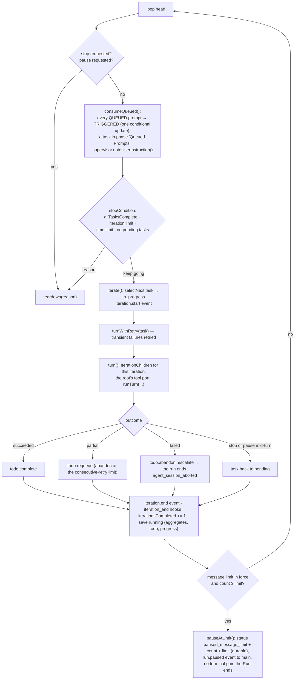

# Runtime view — a run from prompt to terminal result, and everything that reaches into it

The run host owns the run. A prompt from the composer becomes a session, the session's configuration is
resolved from the files with the screen's live state on top, the run iterates the todo, every iteration is a
turn loop of model steps and tool dispatches through the gate, and the run ends in one durable terminal
transaction. Controls, queued prompts, steering, the supervisor and the pause reach into the loop at fixed
points. The store is written by one ordered writer per session (ADR-0008); every event is recorded before it
is forwarded (ADR-0009/0010).

## 1. Start

```mermaid
sequenceDiagram
  participant W as renderer (composer)
  participant M as main
  participant RH as run host (Sessions)
  participant CFG as config (loadConfiguration)
  participant WR as SessionWriter
  participant DB as workspace.db

  W->>M: command session.start {prompt}
  M->>RH: session.start {workspaceId, prompt}
  RH->>CFG: configure(workspaceRoot): load the snapshot (layer 3) and both scopes' four files, overlay live state (Tier B), resolve
  CFG-->>RH: RunSetup {model, runtime, personas, models, authProviders, tier} — or a fatal report / no entry model
  alt refused before it starts (REQ-EVENTS-021, REQ-CONFIG-478, REQ-WORKSPACE-137 "No model configured")
    RH-->>M: refused {headline, detail}
    M-->>W: {ok:false} and a notice; nothing was recorded
  else
    RH->>M: ask credentials.lease {providerIds} (ADR-0030; REQ-PROVIDER-066/067)
    M-->>RH: credentials.leased {bearers, report} — read per request by the resolver OF THE MODEL each call goes to (credentialFor; Part L); an unleased slot is skipped
    alt the entry model's auth_provider is unresolved (REQ-WORKSPACE-137 "Provider authentication required")
      RH-->>M: refused; nothing was recorded
    end
    RH->>WR: SessionWriter.create — session row + lock row (INSERT OR IGNORE) in one transaction
    RH->>WR: appendRow('user', prompt) — row 0 and its transcript.row event
    RH->>RH: settleStaleChildren (REQ-ORCH-053), SupervisorRegistry, hooks resolved once (ADR-0015)
    RH->>RH: new Run(...) then run.start()
    RH-->>M: session.started {sessionId}
    M-->>W: {ok:true}; the window subscribes → attach → snapshot then the resident rows (REQ-MONITOR-214)
  end
```

`Run.start()` in order (REQ-SESSION-087): save `starting` → the pre-flight (intent classification through the
small slot's rung ladder; the grant; the playbooks; the BUDGET cell) → the launch audit (once per session,
REQ-SESSION-138) → `run_start` timeline entry → hook trust announced → the effective permission posture
(downgrade row if any) → save `running` → `session_start` hooks → the loop.

## 2. The loop and one iteration



## 3. Inside a turn (`runTurn`, one agent conversation)

Before every model step, in this order: `shouldPause()` (a graceful pause stops here, the task stays pending) →
pending **steering** injected as a marked user message (`steering_injected`, the supervisor's counter reset) →
the **loop supervisor**'s `check()` (`continue` | `inject` a corrective user message | `escalate` — the turn
fails with `circuit_breaker_escalation`) → the 100-step belt → the model step (streamed into its own `agent`
row). After the step: the supervisor observes the message; each tool call is observed, written as a running
`tool` row, dispatched through the **gate** (policy → approval when needed → executor; hooks in its two slots),
settled with its outcome (and a `diff` row for an edit); the results go back as one tool message; hook feedback
follows as a user message. A reply with no tool call ends the turn — unless a steer is pending, in which case
the agent takes another round; an empty reply with no call is the runtime's stuck report to the supervisor.

The executors a port registers (`run-host/tools.ts`): `read_file`, `write_file`, `haet_read`, `haet_edit`/`haet`, `grep`,
`glob`, `todo`, `terminal` (by shell presence, REQ-TOOLS-104), the three delegation tools when delegation is available,
and **`fetch`** (ADR-0023, Part N). `fetch` is the one executor that **reads configuration per call**: each call loads
the workspace's **saved** files and the discovery snapshot (`egressReader`, no live state — REQ-SANDBOX-038/118,
REQ-TOOLS-089; measured at 1.7–2.5 ms behind the run host, 3–4 ms median in the unit test), maps
`runtime.network_*` to the egress policy and `runtime.tool_call_timeout` to the run-level deadline, classifies the
named host and every redirect target before a connection is opened, and reports one of REQ-TOOLS-092's eight
failure kinds; the `ask` disposition was resolved by the gate's `{mode}:fetch-remote-host` rule before execution.
The entry role's port is the one at **depth 0** (`isEntryPort`): the pre-flight's grant and the `single` override
reach that port and no other.

## 4. Children (ADR-0012)

`delegate` is a tool call admitted through five checks in order (role known, depth, total, active, dependencies)
into the **ledger** (one row per child, every transition one transaction with its `child.transition` event);
the **scheduler** is a pass to quiescence triggered by a state change, never a timer (cascade `blocked`, admit
on `succeeded` + report stored, promote one held child per freed model slot, claim starts); a child runs its own
turn loop under its persona's tools, model, credential and supervisor; its **report** comes from a bounded summarising pass on `default_summary_model` (REQ-CONFIG-065) or the entry model;
the parent resumes with the report. Every exit from an iteration leaves every child record terminal.

## 5. Controls reaching in (ADR-0010 #1, `Sessions.control`)

| Operation | Reaches | Effect |
|---|---|---|
| `cancel` | `run.stop.request('user_cancelled')` | graceful; the second activation forces; 30 s backstop (ADR-0014) |
| `pause` | `run.pause()` | `pausing` written only after acceptance; the turn stops before its next step; the run ends as `user_cancelled` → status `paused` with its row |
| `submitSteeringPrompt` | `run.steer(agentId, text)` | pending per conversation (`root` or a task id); the id is the string value |
| `createQueuedPrompt` / `editQueuedPrompt` / `removeQueuedPrompt` | the writer's queue units | QUEUED rows; the snapshot republished; refused once TRIGGERED |
| `editTodo` | `run.editTodo` | add / update / remove by id; a user instruction for the supervisor |
| `setModel` / `setReasoning` | `run.setEntryModel` / `setEntryReasoning` | applied from the next iteration; a system row |
| `setPermissionMode` | every live tool port's `setMode` | applies from the next tool call; audited |
| `cancelAgent` | the ledger's transition | the reserved run id cancels the run |
| `answerApproval` | the agent's pending approvals | routed by request id across live sessions |
| `announceShutdown` | `run.stop.request('application_shutdown')` | |
| everything else in REQ-MONITOR-004 | — | answers `false` (no mechanism yet) |

A **paused** session has no live run: `session.continue {action}` is a session command — at the message limit
it resolves the pause (continue → `idle`; double → the limit ×2; cancel → `paused`, stop reason
`message_limit_reached`) and, for continue/double and for a manually paused session, launches a **continuation
run** on the same session with no new user row (Part H's route, the previous intent carried over, the
continuation payload built to REQ-SESSION-115's budgets).

## 6. End

`teardown(reason)` runs every step guarded even on exception (REQ-SESSION-094): the stop reason classified to the
terminal result (REQ-MONITOR-301) and the persisted status (REQ-SESSION-093 / REQ-MONITOR-029) →
`session_end` hooks → `run_end` timeline entry → pending publications flushed → **the terminal transaction**
(the token history's last sample — the run samples the cumulative total every 10 s on the clock port while live, each a status save and so a whole-session update — then the system row, the lock release, `session.end` then `result`, the terminal save with aggregates, todo and
progress — one durable transaction) → the bus drained → the hooks advisory → every per-session binding removed.
Main presents `run.result` once as the notice.

## 7. The store the run writes (`packages/store/src/schema.ts`, v6)

| Table | Holds | Written by |
|---|---|---|
| `sessions` | the session record: status, workspace, run columns (stop reason, iterations, tokens, cost, summary, todo, progress, permission mode, pending approvals, message limit, paused-at count, **`token_samples`** — v7, REQ-MONITOR-166's history the run samples every 10 s and once at the end, 120 kept), truncation facts | writer's `save`, `endRun`, `pauseAtLimit`, `resolvePause` |
| `session_locks` | `(session_id, pid, host, acquired_at)` — the capability token (ADR-0005) | `create`/`open` (INSERT OR IGNORE), `endRun`, release |
| `transcript_rows` | the rows, resident or released to a page (REQ-SESSION-131/192) | `appendRow`, `settleRow` |
| `events` | the wire history: one line per event, ordinal per session, trimmed by the retention cap (ADR-0009) | every unit, in the same transaction as what it records |
| `launch_audits` | one per session, the primary key the one-shot | `recordLaunchAudit` |
| `timeline` | ordered named entries with actor and metadata | `appendTimeline`, the queue/pause/steering units |
| `permission_audit`, `tool_calls`, `issues` (+ `ring_state`) | the three rings (ADR-0024); audit and issues refuse UPDATE by trigger | the gate's sink through the writer |
| `children`, `model_slot_queue` | the ledger and the held-slot order (ADR-0012) | `spawnChild`, `transitionChild`, `claimChildStart`, `storeChildReport` |
| `queued_prompts` | QUEUED → TRIGGERED → COMPLETED, per session | `queuePrompt`, `editQueuedPrompt`, `removeQueuedPrompt`, `triggerQueuedPrompts` |

## 8. Configuration's three tiers (ADR-0037) as they touch the run

- **Tier A** — Settings Save, the diagnostics toggle, the composer's permission-mode control: the workspace
  service writes through one of the four writers and loads again; main broadcasts `config:changed`.
- **Tier B** — at every run start the run host loads the files — layer 3, the discovery snapshot, folded first
  (REQ-CONFIG-034: an authenticated provider's models as entries keyed by qualified id with `auth_provider`, and its
  slot picks) — and overlays the screen's live state (`config.liveState`, handed over on every pending change), then
  runs the loader's own passes; the run's `RunConfig`, runtime posture, persona resolver, model references, entry
  tier, providers to lease and message limit come from that.
- **Tier C** — everything else is read at the next load; nothing watches a file.
- **The one per-call read** — the `fetch` tool's egress policy and `tool_call_timeout` are loaded from the saved
  files at every call, without the live state (REQ-SANDBOX-038/118): a saved edit to the host lists reaches the
  next fetch of a running session with no restart, an unsaved settings edit reaches nothing.
