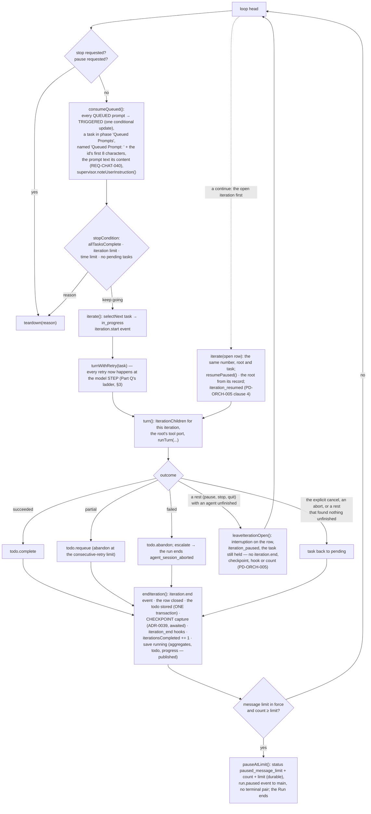

# Runtime view — a run from prompt to terminal result, and everything that reaches into it

The run host owns the run. A prompt from the composer becomes a session, the session's configuration is
resolved from the files with the screen's live state on top, the run iterates the todo, every iteration is a
turn loop of model steps and tool dispatches through the gate, and the run ends in one durable terminal
transaction. Controls, queued prompts, steering, the supervisor and the pause reach into the loop at fixed
points. The store is written by one ordered writer per session (ADR-0008); every event is recorded before it
is forwarded (ADR-0009/0010).

| Read this section when you are | Section |
|---|---|
| changing what happens before the first model call | [§1 Start](#1-start) |
| changing the run loop or an iteration boundary | [§2 The loop and one iteration](#2-the-loop-and-one-iteration) |
| changing a model step, a tool dispatch or a hook slot | [§3 Inside a turn](#3-inside-a-turn-runturn-one-agent-conversation) |
| touching delegation | [§4 Children](#4-children-adr-0012) |
| adding or changing a control operation | [§5 Controls reaching in](#5-controls-reaching-in-adr-0010-1-sessionscontrol) |
| changing teardown, or acting on a session no run holds | [§6 End](#6-end) and [§6a](#6a-the-session-browsers-actions-reaching-a-record-no-run-holds-part-u) |
| adding a table or a column | [§7 The store the run writes](#7-the-store-the-run-writes-packagesstoresrcschemats-v30) |
| adding a configuration key | [§8 Configuration's three tiers](#8-configurations-three-tiers-adr-0037-as-they-touch-the-run) |
| drawing something from a publication | [§9 What a surface does with a publication](#9-what-a-surface-does-with-a-publication-adr-0046-adr-0045-part-z) |

Flows this view does **not** own — startup, approval, the board — are in [`06-sequences.md`](06-sequences.md).

## 1. Start

```mermaid
sequenceDiagram
  participant W as renderer (composer)
  participant M as main
  participant RH as run host (Sessions)
  participant CFG as config (loadConfiguration)
  participant WR as SessionWriter
  participant DB as workspace.db
  participant WS as workspace service (Git)

  W->>M: command session.start {prompt, isolation? {branch}, attach? {path}, sandboxMode?} — the launch dialog's choices ride the composer's next submission (REQ-SHELL-125)
  opt isolation or attach (Part O, REQ-GIT-022)
    M->>WS: worktree.create {target: session {sessionId: the id session.newId minted}} — collision-safe, under <ws>/.rotaris/worktrees/<sid> — or worktree.checkAttach {path}
    WS-->>M: worktree.created {path, branch, baseBranch, baseRevision} | worktree.attachable | refused → "Error: could not create or attach the requested worktree: <detail>"; NO session exists (REQ-GIT-023 by construction)
  end
  M->>RH: session.start {workspaceId, prompt, sessionId?, effectiveRoot?, worktree?, sandboxMode?, boardPermissions?}
  RH->>RH: settleConfinement() — ADR-0022's probe, awaited BEFORE the run does anything else (REQ-SANDBOX-097); one per process, cached, bounded at 5.0 s, cleared only by the settings re-check (REQ-SANDBOX-067, -129). On win32 the platform check settles it and no subprocess is spawned (REQ-SANDBOX-066)
  RH->>CFG: configure(workspaceRoot): load the snapshot (layer 3) and both scopes' four files, overlay live state (Tier B), resolve — from the BASE workspace even for an isolated run (REQ-GIT-019)
  CFG->>CFG: the confinement gate — the effective mode is the layered key with the dialog's override folded in (REQ-SANDBOX-122); a non-off mode whose verdict is not `available` REFUSES here, before the lease, before the session row and before the lock, so nothing is left to clean up (REQ-SANDBOX-094/095)
  CFG-->>RH: RunSetup {model, runtime, personas, models, authProviders, tier} — or a fatal report / no entry model / the availability reason and remediation
  alt refused before it starts (REQ-EVENTS-021, REQ-EVENTS-024, REQ-CONFIG-478, REQ-SANDBOX-126, REQ-WORKSPACE-137 "No model configured")
    RH-->>M: refused {headline, detail}
    M-->>W: {ok:false} and a notice; nothing was recorded
  else
    RH->>M: ask credentials.lease {providerIds} (ADR-0030; REQ-PROVIDER-066/067)
    M-->>RH: credentials.leased {bearers, report} — read per request by the resolver OF THE MODEL each call goes to (credentialFor; Part L); an unleased slot is skipped
    RH->>RH: complete the captured configuration with this launch's lease; Sessions.start consumes its prepared RunSetup
    alt the entry model's auth_provider is unresolved (REQ-WORKSPACE-137 "Provider authentication required")
      RH-->>M: refused; nothing was recorded
    end
    RH->>WR: SessionWriter.create — session row (with the worktree binding as JSON and the sandbox mode, v8) + lock row (INSERT OR IGNORE) in one transaction; the run's EFFECTIVE root (the tool fence, the terminal's and the hooks' cwd, the child payload's root) is the worktree path, the record stays anchored to the base (REQ-GIT-019)
    RH->>WR: appendRow('user', prompt) — row 0 and its transcript.row event
    RH->>RH: settleStaleChildren (REQ-ORCH-053; each report materialised as an artifact, REQ-LIBRARY-092), SupervisorRegistry, hooks resolved once (ADR-0015)
    RH->>RH: new Run(...) then run.start()
    RH-->>M: session.started {sessionId}
    M-->>W: {ok:true}; the window subscribes → attach → snapshot then the resident rows (REQ-MONITOR-214)
  end
```

**What an agent's system prompt is made of (ADR-0063).** At every agent construction — the entry turn and each
child — the role's instructions take its playbook (`withPlaybook`, REQ-ORCH-019) and then the session's
**always-active context units** (`withContextUnits`, REQ-WORKSPACE-060), in that requirement's order: workspace
context → the skill catalog → the force-loaded skill bodies → persona memory. **One of the four is not built**
(persona memory) and is an empty slot in the list rather than a shape a later part must re-cut.
Workspace-context injection (REQ-WORKSPACE-041..048, narrowed and extended by `PD-WORKSPACE-002`) fills the
first: `SkillHost.workspaceContext` calls **`SkillHost.instructionFiles`**, which reads the master switch
`inject_agents_md` and the per-file `instructions.overrides` policy from the **saved** configuration and
discovers the present instruction files over the workspace root and the five further bases; the context then
merges the enabled set into one block
(`mergeInstructionContext` — a source comment per file, one blank line between blocks, both size limits) and
caches it for as long as the session lasts (REQ-WORKSPACE-046), cleared by session creation and by a rescan, the
two events that already clear the catalog.

**The cold path is timed, and it runs after first input.** `workspaceContext` reads the monotonic clock port four
times on a cache miss: before the saved-policy read, after it, after the discovery and after the merge. It then logs
one line, `workspace context: the enabled set of N instruction file(s) merged into B bytes in T ms (policy read …,
discovery …, merge …)`. That line is REQ-WORKSPACE-049's figure as the built app reports it, and `injection-proof`
reads it back. The policy read counts towards the figure because `PD-WORKSPACE-002` made the per-file policy part of
deciding what is merged. Nothing warms the merge at workspace open, as the catalog is warmed. The first read happens
at the first agent built for a session, in the run host, after the typed prompt has been recorded as row 0. It
therefore cannot delay the window's first input, and it never runs in the window's process. The first measurement
(2026-09-27, Linux) is in `first-release-plan.md` §3.2. The machine-wide directory is injectable
(`SkillHostDeps.machineDir`, `/etc/codex` when absent) and, since 2026-09-28, moves both discoveries at once: the
instruction base is the directory itself and REQ-WORKSPACE-051's fourth user-scope skill root is its `skills` child
(`SkillRootsEnv.machineDir`, `machineCodexDir` in `config/src/skills/roots.ts`, the one place the literal lives). It is
a verification seam in the built app (`ROTARIS_CAPTURE_SKILLS_MACHINE ?? ROTARIS_CAPTURE_INSTRUCTIONS_MACHINE`, compiled
out of a packaged build) and never widens the platform rule. The port every read goes through
(`NODE_DISCOVERY_PORTS.readFile`) decodes strictly since the same day: a file that is not UTF-8 throws, and the throw
reaches the arm each walk already had for an unreadable file — REQ-WORKSPACE-045's warning naming the path and the
error for an instruction file, REQ-WORKSPACE-053's skip with a reason for a `SKILL.md` (OQ-79), REQ-WORKSPACE-062's
"no block" for a force-loaded body, the disable manifest's unreadable arm, and REQ-WORKSPACE-057's "SKILL.md not found"
with the decoder's reason for a `SKILL.md` loaded by hand (`loadManualSkill`) — where the lenient decode had merged
replacement characters with no warning.

**The set is decided in one place because it has two readers.** `instructionFiles` is a method rather than a
step inside the context because the retrospective consumes the same list (`PD-LIBRARY-002` over
REQ-WORKSPACE-041). It used to hold its own copy of the rule — two names at the workspace root, no policy —
so it read files the user had switched off and could propose edits to them; the run host now computes the
set once and hands it to the engine, which owns no policy of its own. Whether a switch stated over what
agents are *given* binds an *analysis* is **OQ-65**, and what the build proceeds under is that it does. **`REQ-WORKSPACE-050` is met on both halves:** the instruction files
are read from the root the run **executes** in — the worktree of an isolated session — while the skill catalog
and the policy stay with the **base** workspace, so persistent workspace metadata stays with the base. The
execution root reaches the run host through `configure`'s context (`Sessions.setupFor`, from the start
argument's binding or, for a continuation, from the stored one), and the merge is cached per base root **and**
per execution root, so two sessions on one base with different trees never answer for each other. The per-file
switches are untouched by this: they key on a stable identity (`workspace:AGENTS.md`), not on a path.
The units arrive as a **getter**, called at construction and never
captured, so a skill invoked between prompts reaches the next agent built while one already running keeps the
context it was built with (REQ-CONFIG-166). Because the list is a property of the session and not of the role,
REQ-WORKSPACE-065's "every agent built for a session sees the same catalog" holds by construction.

`Run.start()` in order (REQ-SESSION-087): save `starting` → the pre-flight (intent classification through the
small slot's rung ladder; the grant; the playbooks; the BUDGET cell) → **the plan gate's hold settled** → the
launch audit (once per session, REQ-SESSION-138) → `run_start` timeline entry → hook trust announced → the
effective permission posture (PD-TOOLS-002: the requested mode, never a downgrade row) → save `running` → `session_start` hooks → **the plan cycle
if the gate holds**, otherwise the loop — for a run that resumes an open iteration, the loop, holding before its
first new iteration if the gate would hold (PD-ORCH-003 revision 2).

**The plan gate (Part; ADR-0062, REQ-ORCH-152/153/154, PD-ORCH-003).** In `plan` mode a run whose classified
intent is outside REQ-ORCH-021's answer group **and whose session holds no approved release** is a sequence of
**run segments**: one or more plan cycles, then one execution segment. The release clause is PD-ORCH-003's — an
approval reaches the session, so every run after it in that session goes straight to execution until the user
re-arms the gate (`session.planRearm`, sent by the composer's run-start chip) or starts a new session. The hold is settled once, after the pre-flight and before anything it withholds, and never cleared in
place — so a segment's grants are constant and the model's listing and callable set stay one resolution
(REQ-TOOLS-010). **A run that resumes an open iteration (PD-ORCH-003 revision 2; OQ-104)** runs that iteration unheld,
whatever the mode and the release; when the gate would hold the run, the loop holds once the resumed iteration has
closed and the stop conditions found work left — after the pause, the stop and the message limit have had their say,
and before the first new iteration — and parks there (`parkAtPlanGate(resumed)`), its plan cycle told the tasks still
pending ahead of the launch content (`resumedWorkSection`), which it is told the resumed iteration carried out only
when that iteration closed the continue's message as done (`done`, `pending` or `none`: PD-ORCH-005 clause 17). The
launch content after it is the payload the continue built before that iteration ran, so its handoff predates the close
(OQ-104, "The handoff after the preamble is the continue's", which the repair of
`every-iteration-is-sent-the-prompt-the-run-was-launched-with.md` left as it reads). A message-limit pause that wins there leaves
nothing open and the continue's message `complete`, and its resolution appends that message again, as the Continue
action does on the other routes to that state (OQ-103). A plan
decision relaunches with `RunDeps.appendsTask: false`:
the held run's stored todo already carries the gated work, and the last user row is not a new task. A held segment takes **one turn of the entry role** through the ordinary `turn()` path, numbered
**iteration 0** (`root:0`) because a plan cycle is not an iteration, and then `parkAtPlanGate()` mirrors
`pauseAtLimit` exactly: status `awaiting_plan_decision` with the cycle, the cycle's row written in the same
durable transaction with a `plan_gate_opened` entry, **no terminal pair**, and an EMPTY stop reason
(REQ-MONITOR-301's set names no hold). The turn's report text IS the plan, verbatim — and the turn is TOLD so: `planRequestSection` (`run/plan-text.ts`, beside the `planSection` a decided cycle is handed back) prefixes both the task string and the initial content parts, because an initial turn built from `taskContent` never reads the string. Before 2026-09-16 the first cycle's turn received the user's bare prompt and read it as work to do. Both sections name the **product** as their speaker: they are delivered inside a `role: 'user'` payload, and `planSection` opened "The user approved this plan" until the same date — a user-role turn narrating the user. A held segment's turn also carries **no loop supervisor** (`PD-ORCH-001`, which narrows REQ-ORCH-099 and REQ-ORCH-101): `Run` attaches the supervisor per turn, and while the hold stands it attaches none. A run whose write and execute tools are withheld can only grep and read, which is REQ-ORCH-101's repetition trigger read literally; the corrective it injects is an unmarked `role: 'user'` message, so the run reads a user instruction no user gave while waiting for the decision of the actual user. Supervision attaches again on the first turn after the gate resolves, and the classifier keeps no state across the hold.

**What the reader sees while it holds (PD-ORCH-002 revision 2, 2026-09-17).** The gate is its own row of the
workspace grid, above the transcript, in two states the reader moves between in one action: **expanded**, the
state a gate opens in and the state a further cycle returns it to, where the gate's row takes the free space,
the transcript's row is zero and `.transcript` is not drawn at all; and **collapsed**, where the gate is a bar
in an `auto` row and the transcript reads under REQ-CHAT-010's own floor. `WorkspaceView` owns the state — the
GRID is what changes with it, published as `data-plan-gate-collapsed` beside `data-plan-gate` — and `PlanGate`
draws REQ-ORCH-153's three answers in **both** states, so no state and no window size can put the decision out
of reach. Revision 1 gave the transcript a floor of 220 px and capped the gate instead; the owner's capture of
2026-09-17 showed what that costs at the window the product is used at, and the CSS keeps the falsified reason
beside its replacement.

While the hold stands, three places enforce the planning grants of REQ-ORCH-153 — the port's narrowing
(`createToolPort`, which only removes, and which hands the gate the set of names it removed), `Gate.dispatch`
ahead of the permission resolution (so a refused call's tool hooks never fire, REQ-HOOKS-004 — and which refuses
a name that is a tool, letting a name that is no tool reach REQ-TOOLS-032's unknown-tool answer instead of a
promise no approval can keep), and child admission (`IterationChildren.delegate`, which reads the role an alias names
through `personaOf` — `resolveRole` on the built-in table's path since 2026-09-30, as the ledger does) — and the hook engine
starts no process, emitting one `hook.finish` with `skip_reason: 'plan_gate'` per withheld invocation
(REQ-HOOKS-126). The check suite is unreachable rather than guarded: a held segment never enters the loop.

**Launch ownership (2026-09-13, REQ-TRACE-470/471).** `run-host/launch.ts` owns configuration capture,
credential preparation and pre-start refusal mapping. The board coordinator sends its authorized
`boardPermissions: permissive` on one start request. The run host applies autonomous mode and the
unsandboxed opt-in together to the captured runtime. Settings files and live state retain their values.
The configuration is loaded and validated before the credential wait; completing it builds the model
setup and authenticated catalogue from those captured inputs. Active tool ports, preflight, checkpoints
and supervision resolve their configuration by session identifier. A refused prompt for an active run
returns before another configuration load. Launch audits record effective permission and the complete
effective configuration snapshot: slots, redacted models, personas with prompt files resolved inline,
runtime and every other typed section, plus redacted MCP server declarations.

**The continuation lease (2026-09-14, REQ-PROVIDER-066).** The three run-launching continuation commands —
`session.continue`, `session.prompt`, `session.planDecision` — re-ask main for the credential lease
(`leaseForContinuation`) before the engine resolves the run's setup, and publish the fresh bearers under
the session's workspace root (`sessionRoots`, recorded at `session.start` and `session.resume`). Before the
repair, a resumed session's continuation read the previous launch's lease — empty after an application
restart — and its first model call went out with **no `Authorization` header** (the 401 recorded in
a defect note, removed once repaired). The refresh is invisible when main answers;
an entry provider main cannot resolve refuses with REQ-WORKSPACE-137's sentence, exactly as a launch does.
A session this process never started or resumed leases nothing — the engine's own `not-live` / `no-session`
refusals answer it.

## 2. The loop and one iteration



**Coming to rest (PD-ORCH-005 clauses 2, 3, 9, 10, 11; `Run.restCause`).** A run comes to rest by a pause, a stop (the
`cancel` operation, graceful or forced) or a quit (`application_shutdown`); `restCause` names which, and is null for the
explicit cancel (the reserved run id: `StopRequest.final`), for a stop the run raised itself (`agent_session_aborted`)
and while the plan gate holds (**PD-ORCH-005 clause 15**: a stop or a quit during a plan cycle ends its agents and
records no interruption; a forced stop is a stop). What waits on a person is released by `waitsWithdrawnBy`, which reads
the stop request alone and never the plan hold: a stop withdraws an approval or a question by `stop` and a quit by `quit`,
whether or not the run comes to rest (clause 15's last bullet, PD-CHAT-002 revision 2; OQ-108); only the explicit cancel
and a stop the run raised itself cancel them (REQ-TOOLS-052). A **pause** is refused while the gate holds (clause 11); accepted, it
withdraws every approval and question at once (clause 9: each waiting call settles interrupted and never run, never
denied — `approval_withdrawn`, no audit decision), arms REQ-ORCH-134's tool deadline on the clock port
(`runtime.graceful_pause_tool_deadline`, 30 s by default) whose expiry cuts every call still in flight, and stops the
scheduler (`IterationChildren.beginRest`: no child is admitted, promoted or started; every parent waiting on children is
woken). A **stop or quit** withdraws the same way, rests the scheduler, and aborts the run signal as REQ-SESSION-092
always has. Every agent then stops before its next model call: the turn checks the rest at the top of its loop, after
supervision and after compression, and the resilience ladder (`TurnResilience.resting`) lets the step's report stand —
no retry, fallback, condensation or wait follows it; a pause also releases every provider-limit wait at once
(`WaitRegistry.releaseForRest`), the manual compression is refused (`run_coming_to_rest`), and every save reads
`pausing` until the run rests (REQ-MONITOR-124). The step in flight finishes, and a call it asks for never starts; a
child's summarising call in flight finishes too, but makes no second attempt (`produceReport`'s `halted`), and a pass a
stop aborts or a pause cuts short leaves the child `paused` to summarise when it resumes. When the turn returns with the root stopped mid-way, a
child unfinished, or a child finished whose report its parent has not received (`runWithChildren` returns `paused`),
`turn()` waits for every child execution to come to rest — a pause without a bound, a stop or a quit within the
hard-cancel budget — and leaves each unfinished child `paused` where it stood (`IterationChildren.rest`, the writer's
`restChild`: the state, the interruption, the state it resumes into, `child_paused`, one transaction), the root
execution record `paused`, and the iteration open (above). A child whose `child_timeout` expired during the rest ends
`failed` as it would have without one, unsummarised; one whose execution raised is left `paused`, as the root is
(**OQ-96**). An execution a stop's grace gave up on is **detached**: when it returns it writes nothing — no row, no
record, no report (REQ-SESSION-094). Its model step writes nothing either: while `TurnDeps.detached` reads true the
step streams no row, settles none and counts no usage (2026-09-29), and teardown closes its tool port (§6), so its gate
writes nothing when its call returns. **The root is bounded the same way (REQ-SESSION-092 / REQ-MONITOR-129, 2026-09-29):**
`turn()` awaits the root's turn no longer than `stopGraceSpent`, which settles `STOP_GRACE` after the first stop
request, forced or not. A root still in a call then is detached like a child — its turn's `detached` reads true, so it
writes nothing when the call returns — and the rest that follows is given what is left of the grace, counted from the
same first request (`Run.stopGraceLeft` → `IterationChildren.rest(cause, grace)`: none after a root given up on, so what
still executes is detached at once), so a stop ends within the one 30 s. The root is left `paused` by a stop or a quit,
its open call answered as interrupted; under the explicit cancel its open call is answered as cut off, naming no rest. The
explicit cancel rests nothing: it drains the active background children (REQ-ORCH-080, bounded by the drain's own
timeout, whether the root returned or was given up on — **OQ-121**), settles every child record (`finalize`), then
awaits what still executes within what is left of the grace and detaches it (`IterationChildren.outlast`: none is left
after a root given up on), so a child's step that ignored the cancel writes nothing when it returns. So does any stop that
rests nothing (one the run raises itself, a plan cycle's). The repair of `a-root-call-that-ignores-the-stop-holds-the-run-open.md`. Every agent the rest leaves paused, the root included, has any call it never
returned from or raised out of answered in its record as interrupted, its row settled (`answerOpenCalls`, which the crash
record uses for a dead run's agents too), so a resume sends a conversation whose every call has its result; a call of
that step that completed keeps what it returned, read back from its settled row. A child the stop's grace gave up on
(`IterationChildren.outlast` keeps which, `givenUpOn`) returns without its count, so once its calls are answered the rest
counts the calls its record shows beyond its `children.tool_calls` into the session's total, with that count, in one
transaction (`countGivenUpOn` → `SessionWriter.countToolCalls`, REQ-MONITOR-102), as the root given up on is counted — so
a continue that declines it loses none of them and one that resumes it credits none twice (the repair of
`a-child-the-stops-grace-gave-up-on-and-the-continue-declined-never-counts-its-calls.md`, 2026-09-30). So is one the
grace gave up on while the explicit cancel arrived during the rest: the rest pauses nothing then, but first answers that
child's open calls as cut off, naming no rest (OQ-96), and counts it, before `Run.turn` ends it `cancelled` (found by the
repair's verifier). Two children given up on are still not counted
(`a-child-the-explicit-cancel-gave-up-on-never-counts-its-calls.md`, open): one the explicit cancel's own `outlast` gives
up on — the cancel that brings the iteration to no rest, so it ends `cancelled` with no rest to count it — and one
already terminal when the grace gave up on it, which the user had cancelled on its own. A rest that finds nothing unfinished closes the iteration as before. The cause is
read again once the rest is done: the explicit cancel that arrived meanwhile ends every agent the rest paused
`cancelled` and closes the iteration; one that arrives later, during teardown, closes the iteration this run holds —
the one it left open, or the one a continue resumes or declines, which it holds from its start, so a cancel during the
pre-flight closes it too — the same way before the run's result is built, and one after that is refused. The explicit cancel does not abort a
child's summarising pass: REQ-ORCH-080's drain lets it finish, as before. At teardown a run records what became of its agents' background sessions (clause 10:
`restTerminals` — a pause leaves them running, a stop, a quit and the explicit cancel record their end and then end
them). The explicit cancel keeps REQ-ORCH-080's drain and REQ-ORCH-052's finalize.

**A crash (clause 3; `run/crash.ts`).** A run host that died wrote none of that, so `recordCrash` writes it from the
store when the session is next repaired (`repairOne`) or continued (`launchContinuation`, before the stale-child settle,
which now leaves a `paused` agent alone): the open iteration's interruption `crash`, its unfinished agents `paused`, an
unanswered last `assistant` message answered (`answerOpenCalls`: a call whose row settled keeps its result, one whose
row is `running` is answered as interrupted and its row settles, and one with no row, which never started, is answered
as not run — the root's rows found by the persona its iteration was opened with, `iterations.root_persona`, which a root
resumed as the entry role keeps as its rows' name, OQ-97), then the calls the dead run's agents made that no count held
joined to the session's total (`countCrashedCalls`, REQ-MONITOR-102: what the root's record holds beyond its iteration's
`root_tool_calls`, and each unfinished child's beyond its `children.tool_calls`, written with those counts in one
transaction by `SessionWriter.countToolCalls`, so a second recording and a resumed child's own credit add nothing more; a
root whose count is NULL — an iteration opened before v26 — adds nothing), then a plan cycle's root the session still
records as under way (`sessions.plan_root_task_id`, **v29**: a plan cycle has no iteration row, REQ-ORCH-153) answered the
same way under the plan cycle's 0 and its calls joined to the total in the transaction that releases it
(`recordPlanRootCrash`; `Run.turn` records the root when a plan cycle starts and releases it as its calls join the total —
its turn's return, or the stop's grace giving up on it — or with none counted when its turn raises), every `tool_calls` ring
row still `running` settled `failed` with the crash's statement and a NULL duration, its `tool.finish` with it
(`settleDeadToolCalls`, REQ-SESSION-129 with ADR-0024: an orderly end settles them when the run's ports close, and a crash
closes none — except at a continue after a run of this process that parked without closing its ports, the message-limit
pause or the plan gate, `!Run.closedItsPorts`, when a row still `running` may be its call still under way and is left to
that call's own settle), the stored approvals withdrawn, and the background
sessions still recorded running and not held by this process ended by the crash. Loading a session records and
settles nothing (clause 8), and neither does the user's cancel of one crash-left child while the session rests: it
cancels that child and its descendants from where they stood, answers their own calls the crash cut off (no later crash
record reaches a cancelled agent), and leaves the rest of the crash to the next repair or continue (OQ-101). A session a
store failure left busy is not one a crash left (OQ-103).

**An explicit cancel the host died before carrying out (clause 3, OQ-103's last question ruled under R-067).** The
reserved run id's `cancelAgent` marks the iteration open in the store the moment it is accepted
(`SessionWriter.recordCancelAccepted` → `iterations.cancel_accepted_at`, v27, at the stronger durability setting), and a
run that opens an iteration after the cancel was accepted marks it as it opens. The run's own close keeps the mark as
history. An OPEN iteration that carries it is one whose cancel was never carried out, and every reader of a crash reads it
first: `recordCrash` carries the cancel out in place of the crash (`recordAcceptedCancel`) — the cut calls answered and
counted as for a crash, every agent not terminal (`paused` ones included, where the cancel overtook a rest) ended
`cancelled` with its report stored and materialised, the iteration closed `cancelled` with its task back to `pending` in
the same transaction by the vocabulary's `iteration.end`, `iterations_completed` moved past it, the close warned to the
session log and no timeline word minted for it (REQ-ORCH-139) — then withdraws the stored approvals and ends the background sessions as for any dead run. No checkpoint is captured there (OQ-130).
`crashLeftOf` names none of its agents, `cancelLeftOf` names every one while no run carries the cancel out, and the
projection presents those `cancelled` and ended with the run (`AgentFacts.cancelLeft`); `resumableOf` states nothing to
resume, and a continue is set up as the entry role (`resumedPersona`), so clause 18's Continue action and a continue by
message resume none of them and go on as a new iteration.

**Resuming the open iteration (PD-ORCH-005 clauses 4, 5, 7, 10; OQ-97).** A continue by a new message and the Continue
action resume an iteration a rest or a crash left open before anything else runs (`RunDeps.openIteration`, set by
`Sessions.launchContinuation` once the crash record and the settle are done); "continue without them" declines it
instead (clause 6), and a plan decision finds none open, the resumed iteration having closed before the gate held
(PD-ORCH-003 revision 2, clause 11). That continue is set up as the
persona the open iteration's root ran as (`configure`'s `entryPersona` → the run host's `prepareRun`, in place of
`default_persona`, or the entry role with a warning when that persona is gone), and what the root is told — the notice
of its background sessions, then its new message with its images — is recorded in the root's conversation there and
then, so no early end of the run loses it and the user's message is the last the root reads. The run holds the open iteration from its construction, so the explicit cancel during its
pre-flight closes it (OQ-96). The resumed iteration is not held at the plan gate (PD-ORCH-003 revision 2: a gate
that would hold the run holds before its first new iteration — the plan gate paragraph above),
and the loop's first iteration is the open one (`iterate(openRow)`): its number, its root's task id and canonical name,
and its todo task, with no second `iteration.start`, the row's interruption cleared and `iteration_resumed` recorded.
`turn()` builds the iteration's children over the same root, `IterationChildren.resumePaused` moves each `paused` child
back to the state it resumes into (the writer's `resumeChild`, `child_resumed`) — `running` instead of `summarizing` for
one told of its background sessions, which takes a step to read the notice — re-claims its stored write scope in
acceptance order (PD-TOOLS-006 revision 2), and restarts the executions of those that were `running` or `summarizing`
from their records (`execute(row, resume)`, a fresh `child_timeout`, the tool-call count carried on from the row or the
record, whichever holds more) through the scheduler's own wrapper, so each resumed child's end is a scheduler pass. The
waiting ones are left to the scheduler. The root carries on from its own record. Clause 10's notice of a child's
background sessions (`run/resume.ts`'s `resumeNoticeOf`) joins its conversation as its next message, recorded, at its
resume; the root's was recorded at the continue.
An agent whose record ends on its own answer resumes into waiting (`resumedStart`); any other takes a model step,
compressed first when the conversation is too long, as any is. A resumed iteration closes like any other, and it can
rest and be resumed again (clause 7).

**A continue's message is also a task (PD-ORCH-005 clause 17; OQ-102).** A continue by message that resumes an open
iteration (`RunDeps.openIteration.delivered`, set by `launchContinuation` when the continue delivered a message) appends
the message to the planner todo's `Continued Prompts` phase as a task the resumed iteration **holds** (`Todo.appendHeld`:
`in_progress`, with `heldBy` the iteration's number, stored in the todo document itself), so no selection takes it while
the iteration is open. It closes with that iteration (`Todo.releaseHeld`): `complete` when the iteration succeeds, before
the stop conditions are judged, and back to `pending` — with no consecutive retry counted, and marked `nextUp`, so the
next selection takes it before every other pending task (`Todo.selectNext`; begun, it is an ordinary task again) — on
every other close: partial, failed, raised, cancelled by the explicit cancel or by a pause that found nothing
unfinished, and the closes `closeOpenIteration` makes (the decline, of an iteration a rest or a crash left open, and the
explicit cancel after a rest or during the pre-flight). A rest keeps it held. A task held by an iteration that is no longer open closes when the
next run is built as the record says that iteration closed (`Todo.releaseStale`): `complete` when its row reads
`succeeded`, `pending` and `nextUp` otherwise. The todo is saved with `starting`, so a death during the pre-flight keeps
the task as the root's record keeps the message. The Continue action and a plan decision deliver no message and append
no task for it. A continue that delivers no message — the Continue action, "continue without them", the message-limit
resolution's 'continue' and 'double' (REQ-SESSION-110) — restates the last request, so `launchContinuation` passes `appendsTask: false` while the todo still holds that request unfinished
(`Todo.holdsUnfinished`: a task of that text pending, or in progress and held by the open iteration — its own task or
a message it holds), and the run takes that task up as it stands; a task in progress that no iteration holds does
not count, since no selection would take it up. The todo is judged as the run will read it: what a death between an
iteration's close and the save of its todo left is settled first (`settleClosedIterations`, which the run's constructor
calls too) — a message a closed iteration still holds (`Todo.releaseStale` against `succeededIterationsOf`), and an
iteration's own task left in progress (`Todo.settleStranded`, as the latest row naming it closed) — so one the run
returns to pending is not appended a second time. A continue by message always
appends its task, even beside a pending task of the same text: it states a request (REQ-ORCH-004, OQ-102). The plan cycle held after a resumed iteration is told what became of
every message that iteration held (`Todo.heldIds`, read when the run is built): this continue's, or an earlier one's a
Continue action resumed it with. A message is marked as one for good (`Task.message`), so the iteration that takes it up
is told it in clause 17's words.

**Every iteration is sent its own task (REQ-CHAT-040, REQ-ORCH-004 / REQ-ORCH-135; the repair of
`every-iteration-is-sent-the-prompt-the-run-was-launched-with.md`, 2026-09-29).** The launch content — the prompt and its
attachments, or a continuation's handoff payload, with a plan decision's `planSection` — is the base of every
execution iteration's first message. `iterate()` records the task it selected (`Run.takenUp`) when that task is not the
run's own (`RunDeps.taskId`) and its text is not the launch content's request (`taskLabel ?? task`) — a queued prompt,
a task a pause, a stop or a death put back, an earlier request, an improvement run's proposal, a continue's message — and
`Run.firstMessage` adds it as a text part after the launch content and before the offers list, naming it the task to
work on (`takenUpText`; a continue's message in clause 17's words). The run's own task, and a task whose text is the
launch content's request (the Continue action restating a pending request, a plan decision's gated request), are told
nothing more. Never a plan cycle's root, which is not an iteration, including the one held after a resumed iteration
whose own task was a message. The launch content is not rebuilt per iteration: a later iteration of a continuation is
re-sent the handoff as it was read at the continue (OQ-106, "The handoff is read once"; OQ-104 for the plan cycle held
after a resumed iteration).

**An iteration a previous run left open, declined (PD-ORCH-005 clause 6; the repair of the crashed-iteration defect).**
Every execution iteration has an `iterations` row from the moment its root is minted, and `iteration.end` and the row's
close commit in one transaction (`endIteration`) — with the session's todo, its task and held messages already closed
in it, so a death while the capture or the `iteration_end` hooks run leaves no task in progress with nothing open to
hold it (the repair of `an-iterations-own-task-is-left-in-progress-by-a-death-before-the-todo-save.md`, 2026-09-29;
until then the todo was saved only after them; the close takes no save generation and publishes nothing, so the
renderer sees the closed task with the save that follows the hooks). A rest or a dead run host leaves that row open. **Declined** —
`continueSession(…, { withoutPaused: true })`, "continue without them" — before its first iteration a run ends every
`paused` agent of the open iteration `cancelled` with a report saying so (`cancelPausedAgents`), closes the row `cancelled`
(`closeLeftOpenIteration`, REQ-ORCH-135) — its `iteration.end` summary names the decline and what left the agents paused,
a crash on clause 18's route included; every run that closes one was told to decline it —
and attempts that iteration's one
checkpoint capture (REQ-GIT-051, no child credited; its hooks' `iteration_end` is not fired — the hooks that saw it
begin were the dead run's): the task it held goes back to `pending` (`Todo.reopen`) in the close's transaction, and the count moves past it, so
the run's own first iteration takes the next number rather than the dead one's. The count is also never below the
highest iteration recorded closed, and a continuation's appended task id is numbered past the count, the highest row
and every id the todo holds (`continuedTaskId`). The ledger
holds its own root's tree, walked from the root through the parent links, rather than every child with its iteration's
number — every plan cycle is numbered 0. Root and child task ids are minted against every child's, every recorded
root's and every recorded conversation's id in the session (`takenTaskIds`), since the record is keyed by task id
session-wide.

**The checkpoint at iteration close (Part P; ADR-0039's first execution).** Exactly once per iteration that closes, after
`iteration.end` is recorded and BEFORE the hooks' `iteration_end` (the checkpoint records the iteration's work as the agent
left it; a hook that later carries the checkpoint — REQ-HOOKS-082 with checkpoints, owed — can only do so if the capture
precedes it), the run awaits `CheckpointPort.capture({ iteration, childName })`, so the attempt finishes before the next
iteration and before teardown (REQ-GIT-051). `childName` is the one child that succeeded in the iteration, `''` when none or
more than one. The port (`run-host/checkpoints.ts`) is built per run from `checkpoints.enabled` against the session's
binding (REQ-GIT-044: unset = isolated only; `false` stays off even when isolated), `include_untracked` and
`max_per_session`; a tree Git cannot manage turns it off on first use with a log line and no issue. One capture: the
sequence = max(the rows' highest, the live refs' highest through the `checkpoint.refs` ask) + 1 (REQ-GIT-046) → the
`checkpoint.capture` ask (main → the workspace service: the private-index staging, the filtered-HEAD comparison, `commit-tree`
under the fixed identity, `update-ref` with the empty old value) → on `recorded`, the writer's `recordCheckpoint` (ONE
transaction: the row, the trim to `max_per_session`, the `checkpoint_created` timeline entry, the `checkpoint.created`
event row) → the trimmed rows' refs deleted through the `checkpoint.prune` ask → only then `publish()` hands the event to
the bus (REQ-GIT-048: rows, then refs, then the event). `nothing-to-record` records nothing; a Git decline records the
`checkpoint` warning issue with REQ-GIT-045's message and never aborts the run. The desktop restore flow (REQ-GIT-096..100)
is main's orchestration over the same three processes and is drawn in the process view.

## 3. Inside a turn (`runTurn`, one agent conversation)

Before every model step, in this order: `shouldPause()` (a rest, a landing or REQ-MONITOR-123's pause stops here) →
pending **steering** injected as a marked user message (`steering_injected`, the supervisor's counter reset) →
the **loop supervisor**'s `check()` (`continue` | `inject` a corrective user message | `escalate` — the turn
fails with `circuit_breaker_escalation`; no supervisor is attached at all for the turn a plan-gate hold covers,
`PD-ORCH-001`) → the 100-step belt → **context compression when the agent has reached
its threshold** (Part AH, below) → the model step (streamed into its own `agent`
row, and — from Part Z — into a **`thinking` row** for anything the provider marks as deliberation; the sink
discarded every reasoning delta before that, so no streamed-reasoning row had ever existed, REQ-CHAT-163).
Both rows are written through `upsertMessageRow` under one stable key per response **segment**, which is what
makes a replayed event persist once and a ladder retry update the row in place rather than append a second
(REQ-CHAT-054). A step also arms a **stall detector** on the clock port: ten seconds with no output of any kind
marks the live row `stalledSince`, the next output clears it, and neither publishes anything into the record
(REQ-CHAT-164's detection half; the drawing half is the renderer's). After the step: the supervisor observes the
message; each tool call is observed, written as a running `tool` row, dispatched through the **gate** (policy →
approval when needed — resolved at once under the headless policy while the run treats the user as **away**,
`PD-TOOLS-005`, §5 → executor; hooks in its two slots), settled with its outcome (and a `diff` row for an
edit); the results go back as one tool message; hook feedback follows as a user message. A reply with no tool call ends the turn — unless a steer is pending, in which case
the agent takes another round; an empty reply with no call is the runtime's stuck report to the supervisor.

**The conversation record (PD-ORCH-005 clause 1; `run/record.ts`).** Every agent's `Conversation` carries a
recorder, so every `push` — the task or the resume message, a steer, a supervisor correction, the assistant message
with its tool calls, the tool results, hook feedback — is one `agent_messages` entry under the agent's task id, written
the moment it joins the conversation, and every `replace` (a compression, ADR-0060) is one `replacement` entry holding
the whole conversation that took its place (clause 12). The root's recorder is keyed by the iteration's root task id,
a child's by its own; REQ-ORCH-088's fallback retry writes an empty replacement before the second attempt, since that
attempt starts the child's conversation again from its payload. A summarising pass, the compressor and the classifiers
are no agent's conversation and record nothing. What the record holds is the conversation: the system prompt and the tool
definitions are rebuilt from the persona whenever the agent is built, and streamed reasoning is drawn but never sent back,
so neither is recorded (OQ-95). Beside it the record keeps **each agent's fingerprint** (PD-ORCH-005 revision 4 clause
14; `agent_fingerprints`, v24): the SHA-256 of the system prompt and of the tool definitions (in name order, keys
sorted) that the agent's first model request carried, taken by `runTurn` just before a step goes out
(`TurnDeps.fingerprint`, after the MCP section is appended and the port is ready). The check is built once per
execution — `turn()` for the root, `execute()` for a child (`ConversationRecord.fingerprint`) — so only an execution's
first step acts and REQ-ORCH-088's retry compares nothing. An agent with none recorded has it recorded, the first kept;
one that has one is being resumed, and when either digest differs the run states it as a warning naming the agent: a
`resumed_under_changed_instructions` issue (warning severity, its timeline entry) and one `system` transcript row
(OQ-105). A turn **closes** its `Conversation` on every exit, so a manual compression (Part AO)
that finishes after its turn ended replaces and records nothing and reports that it failed. `runTurn` takes a `null` task
to continue a history as it stands, and `ConversationRecord.load` reads an agent's conversation back from its last
replacement forward (`conversationOf`); neither has a caller until the resume lands. Until the interruption lands, a
stop that aborts a step mid-dispatch still leaves that agent's record ending on calls with no results.

**What a step costs (PD-MONITOR-001 revision 2; `model/reported-cost.ts`, `kernel/money.ts`, `run/pricing.ts`,
`run/aggregates.ts`).** A completed provider request carries its tokens and, where the endpoint's protocol defines a
field for it, the cost that provider computed for that request. The ask is a body field the endpoint owns, sent only
to endpoints that define one (`COST_REPORTING_HOSTS`, today OpenRouter's `usage.include`), because a strict
OpenAI-shaped API answers an unrecognised body key with a 400. The reading is the SDK's `metadataExtractor`, which
sees the raw chunk before the SDK's usage mapping keeps the token fields and drops the rest; the figure leaves the
adapter on the port's own `usage` part. **The request is priced at the ladder cell** (`resilientStep`), the one
place the model it was sent to is known — after a fallback, the fallback's: `priceRequest` keeps a reported figure;
otherwise, where that model's catalogue entry carries both configured prices (`CatalogueEntry.pricing`, filled from
`effectivePricing` in `run-host/configuration.ts`), it multiplies input and output tokens by them exactly
(`multiplyAmount`); otherwise the request is unpriced. A request that counted no tokens and reported no figure is
none of the three. `Aggregates.addRequest` adds the figure to the run's total in exact decimal arithmetic on
`bigint` in `kernel/money.ts` — the one module where arithmetic on an amount lives, which
`rotaris/money-only-in-money-ts` enforces (ADR-0031) — and folds the request's pricing into the qualifier:
`unknown` (no figure), `incomplete` (some requests without one), `reported` (every figure the provider's) or
`configured` (every request priced, at least one at configured rates). The qualifier is persisted with the total
(`sessions.cost_qualifier`, v21) and rebuilt on a continuation from it and the token totals. The total reaches
`usage.update` and `session.end` in the payload's existing `cost.total`; the label is `costLabelOf(cost,
qualifier)`, rendered half-up to two places or four below one hundredth — and, for an amount greater than zero that
this rounding would bring to zero, as the floor `< 0.0001` (`formatAmount`'s `AMOUNT_FLOOR`; ESC-42, REQ-PROVIDER-121 as
amended), zero itself reading `0.00` — and with no currency symbol, because no figure names a currency and the product
picks none. The floor is rendering only; the persisted total stays exact. A configured price reaches the entry exact because the loader
reads it from the YAML scalar's source text (`config/prices.ts`, `exactPrices`) before the plain value's double is
used — the discovery snapshot's prices likewise. **Every agent's requests are counted**: the entry agent's turn
and every delegated child's turn, at any depth, hand each completed request to the one `Run.onRequestUsage`
(`ChildrenDeps.onRequestUsage`), so the run's tokens, its cost and each `usage.update` cover the whole tree
(REQ-EVENTS-053). Until 2026-09-23 a child's turn was built without it and the totals were the entry agent's
alone. **So are the run's requests that belong to no agent's turn** (`run/metered.ts`): compression, the
child-report summariser, the pre-flight's intent classifier and the loop supervisor's classifier each call a
backend `meteredBackend` wraps, which hands every completed request, a failed one included, to `Run.countUsage`
with the model it was sent to; `countUsage` prices it at that model's catalogue rates (`priceRequest`, as the ladder
does) and passes it to `onRequestUsage`. `Sessions` wraps the compressor's and the summariser's backends itself and
hands its `countUsage` to the run host's two classifiers, through `PreflightContext.countUsage` and the
`supervisor` factory's third argument, which wrap their own. The improvement analyst runs after the run has ended
and has no run totals to join. Until 2026-09-27 these four calls discarded their usage.

What the model is handed for each of them is `toolSpec` (`run-host/tools.ts`): an MCP tool's own input schema where
ADR-0034 supplies one, otherwise the zod schema converted **as an input** (`io: 'input'`) — the shape of a call about to
be made, in which a field carrying a `.default()` is optional as the parser treats it. Converted as an output, which was
the default until 2026-09-16, such a field is advertised as required and the product states a contract it does not
enforce.

The executors a port registers (`run-host/tools.ts`): `read_file`, `write_file`, `haet_read`, `haet_edit`/`haet`, `grep`,
`glob`, `todo`, `terminal` (by shell presence, REQ-TOOLS-104), the three delegation tools when delegation is available,
**`ask_questions`** (Part AC — its `userPromptChannel` prerequisite is now attendedness, REQ-TOOLS-053/069, and the
orchestrator is the one built-in persona declaring it, REQ-CHAT-094's one conversation), the three artifact tools when
the session has an artifact store, and **`fetch`** (ADR-0023, Part N). `grep` and `read_file`'s `grep` filter share one
pattern dialect (`compileSearchPattern`, `tools/search.ts`): the accelerator's, not the host engine's — leading
`(?flags)` groups are read off and translated, because REQ-STARTUP-058 pins ripgrep and REQ-TOOLS-141 holds results
identical whether or not it is present. `fetch` is the one executor that **reads configuration per call**: each call loads
the workspace's **saved** files and the discovery snapshot (`egressReader`, no live state — REQ-SANDBOX-038/118,
REQ-TOOLS-089; measured at 1.7–2.5 ms behind the run host, 3–4 ms median in the unit test), maps
`runtime.network_*` to the egress policy and `runtime.tool_call_timeout` to the run-level deadline, classifies the
named host and every redirect target before a connection is opened, and reports one of REQ-TOOLS-092's eight
failure kinds; the `ask` disposition was resolved by the gate's `{mode}:fetch-remote-host` rule before execution.
The entry role's port is the one at **depth 0** (`isEntryPort`): the pre-flight's grant and the `single` override
reach that port and no other.

**The ladder over every model step (Part Q — `run/ladder.ts`, `run/resilience.ts`, `run/waits.ts`; REQ-ORCH-088/090/091/092,
REQ-NOTIFY-081..092/263).** It sits at the step, not the turn, so a retry re-issues the call over the conversation as it stands
and never replays an executed tool call. Each agent (the root for the run, every child) has a **cell**: its current model
choice (the session's override applied through `ResilienceMemory.effective`), its role's fallback (`personas.<role>.fallback_model`,
else the run-level `fallback_model` slot, never its own model), and three once-only marks — the role fallback (shared by the
unresponsive-model route and the hard child timeout, REQ-ORCH-144), the same-tier fallback, the wait attempt. On a failed step,
`classifyFailure` decides in this order: **quota** (structured `insufficient_quota`, "exceeded your current quota", "check your plan
and billing") → **rate limit** (429 or the three substrings) → **context window** (REQ-ORCH-093: condense and retry, below) → **validation** → **transient** (the port's fact, REQ-NOTIFY-094's phrases) → **fatal**. Transient and validation take
their own budgets (`auto_retries_transient`, `auto_retries_validation`) after min(2, n) s, each attempt a `transient_llm_error` /
`validation_llm_error` issue. A limit never touches those budgets: (a) a quota response marks `provider|model` exhausted — in
memory and as the `model_exhausted` timeline entry; (b) at most one same-tier candidate per agent (`sameTierCandidates` over the
run host's **catalogue**: same recorded role, a different provider identity — `auth_provider` else the family — configured first
then discovered from the snapshot's per-provider picks, exhausted and attempted pairs out) → the `quota_fallback_model` timeline entry and
`quota_fallback` warning issue — REQ-ORCH-139's words, under a rate limit as under exhaustion (`model_fallback` before A29's repair) — the step re-run; (c) else the **suspended wait**: the provider's retry-after (integer seconds, an HTTP date, a
suffixed value, `try again in N <unit>`) else 60·2^(attempt−1) s capped at 300 s, indefinite for an exhausted provider; the
`model_wait` issue and a system row; the session's status **`waiting`** (REQ-SESSION-073's own arm, presented as `running`) and
the record's `wait` published with every snapshot. The wait resolves by the timer (clock port), by `cancel` (the run ends
`user_cancelled` with the condition as its error → main's REQ-NOTIFY-063 notice), or by `setModel` (the pair overridden
session-wide, the `model_override` timeline entry, the agent re-run at once; a key that cannot be applied → `model_override_rejected`
and the header names why, the wait continues). **Unresponsive model:** while a role fallback is untried and `llm_response_timeout`
(≥ 30 s) sits below the agent's bound (the child timeout; the model timeout for the root), a timer on the clock port aborts a call
that produced no event of any kind and the step re-runs on the fallback (the `llm_unresponsive` timeline entry and issue — REQ-ORCH-139's word; `unresponsive_model_fallback` / `unresponsive_model` before A29's repair). **Child timeout:**
expiry does not cut the child off — it **asks the child to land** (REQ-ORCH-088), by raising the same per-child flag
`runTurn` reads for REQ-MONITOR-123's pause, so the turn stops before its next model step with the step in flight
finished and its text intact. A hard-abort **backstop** is armed `STOP_GRACE` (30 s, `run/grace.ts`, ADR-0014 rule 1's
one allowance) behind it, for the child that cannot land inside the window; REQ-CONFIG-113's ceiling therefore still
bounds the child. Then, with a role fallback untried, the child runs once more on it (the `fallback_model` timeline entry and `timeout_fallback` issue — REQ-ORCH-139's words; `child_timeout_fallback` for both before A29's repair); else
it fails with `Child timed out after <N>s` and a report carrying what the child last **said** — the last assistant
message with text, not the last assistant message, which is usually the one that opened a tool call and spoke
nothing. Those words reach `last_response`; `final_response` stays empty, because REQ-ORCH-110's final response is
text no further tool activity followed. **A child cut off while making progress (PD-ORCH-004):** at the
expiry instant — not at the backstop — the child's `ProgressLog` answers whether it completed a tool call within the
final stall window (the role's `stall_timeout`, else `runtime.child_stall_timeout`, 90 s by default; the bound is
inclusive). If it did, and the child then ends failed on that timeout, the stored report gains `cut_off`: the statement,
the workspace paths its own `write_file`/`haet_edit`/`haet` calls changed with `ok` (the name matched in lower case, as the
gate's fallback dispatches it; resolved lexically against the root; both attempts, in the order first changed, each once), and — unless the child is itself a continuation — the offer naming `continuation_of`. The report block and
`background_output` render it after the result text; nothing resumes the child. See §4 for the continuation.
Per-model `timeout` / `num_retries` ride the choice (REQ-ORCH-145). **`num_retries` is the dispatch layer's, not the
ladder's** (REQ-CONFIG-086, default 5; OQ-110): the model client hands it to the SDK as `maxRetries`, so a 429, a 5xx or a
connection failure is retried inside the call, with the SDK's own backoff, before any rung above sees it, and the ladder
takes over only when those retries are exhausted. Each retry absorbed there is reported as it is sent — the decorated
fetch sees a request follow a failed attempt of the same call, and calls `ModelRequest.onRetry` with the status met and the
delay waited on the monotonic clock; `DefaultAgentBackend` forwards it to `TurnSink.retried`, and the turn writes it through
the run's `warn` to the session log at WARNING (`dispatchRetryLine`, REQ-SESSION-142) — no issue and no timeline entry,
because the ladder was not reached. An exhausted budget is handed on as the **last attempt's** error (the SDK's
`RetryError` unwrapped in `fromError`), so its status and `retry-after` reach the ladder's classification. On resume the memory is
rehydrated from the timeline (`ResilienceMemory.rehydrate`), so a continuation never returns to an exhausted pair and keeps the
user's choice (REQ-SESSION-196).

**Context compression (Part AH — ADR-0060; `run/conversation.ts`, `run/compression.ts`; REQ-ORCH-093,
REQ-MONITOR-076..086, REQ-CONFIG-132..135).** The turn's history is a **`Conversation`** whose array is *swapped*,
never spliced: `snapshot()` hands the live array to a step, `replace()` installs a new one, so a request in flight
keeps what it was given. Two triggers reach the same mechanism. **Automatic** (REQ-MONITOR-076), between steps
where the supervisor's `check()` sits: the count is the provider's own last-prompt reading when the history still
matches it, else a character estimate at `chars_per_token`, and it is compared with `compressionTrigger()`'s
resolution of REQ-CONFIG-134 — capacity from the model's `context_compression_threshold`, else min(its
`max_input_tokens`, `compressor.default_threshold`), else the default — times `threshold_percentage`.
**Recovery** (REQ-ORCH-093), in the ladder's `context_window` arm: condense and retry, **at most twice for one
call**, the original rejection surfaced unchanged when the condensation itself fails; the issue is
`llm_bad_request`, or `parent_resume_bad_request` on the first call of a turn resumed with child reports. A
compression asks the `compressor.model` (else the agent's own, REQ-MONITOR-080) for a summary of **only** the slice
between the original request and the preserved turns (REQ-MONITOR-082 forbids sending the three survivors) — read by
`compressorTranscript`, each event whole and the slice whole up to the compressing model's own threshold at
`chars_per_token` (`CompressorDeps.inputTokens`, which `Run.compressionFor` resolves through `triggerFor`), past which it
keeps the start and the most recent part with the omission marked (OQ-156; the report pass's 12,000-character head cut
it once shared is gone) — then
rebuilds the conversation as REQ-MONITOR-084's five parts: the original request, the summary (clamped to 300 lines
and nothing else is, REQ-MONITOR-083), the todo items one for one, and the most recent `preserve_recent_turns`
turns verbatim — a **turn boundary being any message that is not a `tool` message**, so a cut can never orphan a
tool result from the call that named it. The system prompt and the tool definitions are part (1) and are not in
the conversation at all: they travel on every request. Each completion writes a **`context_compressed` timeline
entry** carrying REQ-CONFIG-135's four inputs and the trigger token number as separate fields beside
`count_source`, the before/after token and message counts and the latency; one `system` transcript row is rendered
from those fields; the log takes the same figures. That venue is **OQ-53** — the wire catalogue is closed at 23
kinds (REQ-EVENTS-041) and none reports a compression. `AgentActivity` counts completions and a session opened
again seeds the count by counting those entries, so REQ-MONITOR-086's "never counted a second time" holds by the
shape of the record. While a pass runs, `SessionRecord.compression` names the agent and is **published at once**
(`owner.reconcile()`), because a compressing pass writes nothing and a derived field is otherwise invisible
(REQ-MONITOR-085). A trigger that fires with **nothing between the original request and the preserved turns**
is a no-op, not a failure: it is logged once per agent and records no issue, because the trigger is evaluated
before every step and the condition persists (ADR-0060's second execution). **The trigger is also latched off**
for an agent once a compression is measured not to help — where the provider's count less the conversation's own
estimate (the system prompt and the tool definitions, which REQ-MONITOR-082 keeps whole) already reaches the
threshold, no compression can bring the count under it, and the reason is stated once with both figures. The
REQ-ORCH-093 recovery path is never latched. **`SessionRecord.entryContext`**
carries the entry role's latest prompt reading and its model's advertised limit (REQ-MONITOR-089): the entry
role has no `children` row, so this is the only route by which the synthetic root agent's meter gets a figure —
before it, a run that spawned no child drew zero however much it had spent. **`SessionRecord.entryTools`** (live-run
finding K1, 2026-09-29) is the same route for its tools: `resolved` is the native set the live run's root port kept
(`ToolPort.resolvedTools`, the one resolution's names the callable map kept, so a coordinator's withheld tools are absent —
REQ-MONITOR-061), `called`
and `active` the tracker's under the name the root dispatches as (`Run.entryTools`, `rootName`: a root resumed as the
entry role keeps the persona its iteration was opened with, OQ-97); with no run live nothing is
resolved, the history is read under the latest iteration's `root_persona` (`entryToolsOf`) — or, before any iteration,
under every name the tracker holds that is no child's, which can only be a plan cycle's root's, since a plan cycle has no
iteration row (REQ-ORCH-153; `AgentActivity.calledToolsWhere`, acceptance A21, 2026-09-29) — and the surface lets the
role's declared tools stand in (REQ-MONITOR-060; the snapshot's `declaredTools`). **`SessionRecord.entryStalledSeconds`**
(2026-09-30, OQ-153) is the same route for the root's stall watch's figure. **`SessionRecord.entryToolCalls`** (2026-10-01,
acceptance A20) is the run-level agent's tool-call count (REQ-MONITOR-044/052): the roots' share of the persisted total — the
total less every child's persisted `children.tool_calls` — plus the calls the live root has started in its running execution
that the total does not hold yet (`entryToolCallsOf`, `Run.entryUncountedToolCalls`: the tracker's count under `rootName`
less its count when the execution began, zero once its calls join the total). Null on a stored record, where the surface
derives it as the total less the children's (`runLevelAgent`). A root's calls join the total only when its turn returns
(REQ-ORCH-097's cadence, OQ-116), so before this the meta line read `0 tool calls` while the root's turn ran. It is the
agent's own count (REQ-MONITOR-044/052), not REQ-MONITOR-101's aggregate run count for the synthetic root; which of the two
the run-level agent shows is **OQ-159**, open, and the figure stays the agent's own until it is ruled. A LIVE run-level agent whose root port
has not resolved yet — the pre-flight, before `Run.iterate` sets the port — lists nothing (`runLevelGrant`), never the
declared set (REQ-MONITOR-061). **`SessionRecord.artifacts`** is the
session's artifacts not superseded, with producer, ready flag and consumers (`artifactLinksOf`, one body-free read through
`artifacts_by_created` per snapshot) — what the inspector's and the persona window's artifact links read (REQ-MONITOR-052/068/069).
**`SessionRecord.entryRoots`** names the entry role's roots, each once, by the name its rows and calls carry and its
canonical name: every iteration's (`root_persona`, `root_canonical_name`); then every plan cycle's, from the record its
turn's start wrote (`plan_roots`, **v30**, `StoreDal.planRootsOf`) — a plan cycle has no iteration row (REQ-ORCH-153); then
each root no row records that published — a plan cycle's from before v30 — by its publish's persona and `created_by`
(`StoreDal.rootPublishersOf`, a publish whose conversation is no child's and no iteration root's task id, through
`artifacts_by_created` per snapshot); then the live run's current root (`entryRootsOf`, `Run.currentRoot`). The session
lets go of a run once `start()` settles, a park at the plan gate included; *until v30 a plan cycle's root that published
nothing was therefore named only while its run was live, and what it read was no agent's received link at the gate
(`docs/defects/fixed/a-plan-cycles-root-that-publishes-nothing-is-named-only-while-its-run-is-live.md`, repaired under
R-067).* The surfaces know the run-level
agent by the entry persona and by these: it owns a named row carrying either (`ownRow`, which `rowsOf`, `scopedRows` and
`followedAgent` share; never by a named row's persona, which a child of the entry persona shares), and its artifact
links match either or a root's canonical name, which its publishes and reads record (REQ-LIBRARY-093). Before this, a
root whose name was not the entry persona fell outside it
(`docs/defects/fixed/the-run-level-agent-is-known-by-its-entry-persona-alone.md`).

**The MCP surface (Part S; ADR-0033/0034).** A port is created synchronously but its MCP surface needs discovery, so the
run start kicks discovery off for every carried, launchable server (`McpHost.prepare`, each bounded by REQ-MCP-053's 35 s
watchdog on the clock port) and the turn awaits the port's `ready()` before reading `specs()` and the prompt section.
`ready()` resolves ONE surface per persona (`surfaceFor`: the drop rules, grants `undefined` ≠ `[]`, denial, rename, the
collision prefix; memoised on the versions of its inputs and the names the port reserves — its native tools — while the
spawn evidence of REQ-MCP-065 (`evidenceFor`) resolves with none reserved, so a first spawn resolves twice and the second
writes only a line the first did not: the surface line and REQ-MCP-059's grant count once per persona, a second surface
line only where a collision prefix made it differ — live-run finding D7, 2026-09-29) and from it, in one place, the executors outside the registry (named by callable name, dispatching the
reported name to the session's shared connection under the entry's allowance, 300 s by default), the model's listing and
`## MCP servers` appended to the system prompt (REQ-MCP-101, byte-exact). Under `restricted` or `read_only` the MCP
tools are withheld from the surface (ADR-0016's reading), and while the plan gate holds every server executor is withheld by identity — `withheldUnderPlanGate(name, false)` — rather than by the registry's answer for its name, which a server's tool offered under a free public name such as `read_file` would otherwise borrow (REQ-ORCH-153; the gate refuses the same call on dispatch through its `publicTool` predicate and the port's withheld set). The session's connections open on first demand under a keyed
single-flight (one process per server per session, shared by every child), a per-call failure is that call's (no retry,
no reconnect; the next call re-establishes; one `mcp_config` warning per server per session), a `tools/list_changed`
recomputes and only narrows (the executor deleted, the prompt untouched). **Their lifetime:** the connections of a
session live until the session's lock is released, which today is the run host's shutdown (`McpHost.closeAll`, after
`Sessions.closeAll`; the discovery children are killed first so no outstanding discovery delays the exit). **Who the
client says it is:** every handshake on all three paths names `rotaris` at the product version the run host read from
the application manifest (`McpHost`'s `productVersion`, required as `clientVersion` by `ToolDiscovery`, `HealthProbe`,
`SessionConnections` and `openClient`), never a literal (REQ-STARTUP-158; a literal `0.1.0` until 2026-09-27).

**Code intelligence (Part T; ADR-0035).** The shipped `code_intelligence` entry is **enabled** (REQ-CONFIG-181; the
2026-09-05 deviation reverted, its record kept in `config/src/mcp/defaults.ts`), so every run whose persona carries it —
twelve of the thirteen built-in roles — starts one runtime per session through the token. Its arguments come from the
generated manifest (`start-mcp-server`, the transport and the host-integration context); REQ-MCP-034 appends
`--project <root>` at command resolution for the root the run was configured with (an isolated tree's root when the
run is configured with it — not exercised by the proof); the grant is the persona's tier union from the manifest (12 or
19 names; REQ-MCP-014/015). On connection the binding probe calls the memory-listing tool once under 15 s
(REQ-MCP-071; a failure warns through REQ-MCP-044 and withholds nothing); the prompt's `## MCP servers` entry for the
server carries the fixed project-memories block iff both gating names are granted (REQ-MCP-102). Measured cold: the
runtime answers `tools/list` about 4 s after launch, connect about 4.2 s; the first symbol tool on a language provisions
that language's server (minutes; IC-7 adopted under ESC-32 — a declared package at its declared version, disclosed on the
MCP category before any run can trigger it, `REQ-MCP-118`), warm afterwards. **The project setup** (`McpHost.startSetup`): the invocation
derived from the entry (REQ-MCP-036 — a remote or launch-less entry is the non-retryable "not a local launch"
refusal), the contains-code walk once (breadth-first from the root, VCS directories skipped, the root `.gitignore`
honoured, dot-directories walked, no symlink followed, first indexable file stops it), the marker
(`.serena/project.yml`) skipping creation, then the three steps in order with the closed status vocabulary; one run at
a time, re-runnable, cancellable; the status held in the run host for the application's life, never on disk.

**The manual arm (Part AO — REQ-CHAT-078..081, REQ-MONITOR-090..097; `run/conversations.ts`).** `runTurn` registers its `Conversation` on the run's `ConversationRegistry` for exactly the span of the turn — the handle carries the agent's name and one operation, compress now through this agent's own `CompressionRunner` — and unregisters on every exit, so a handle never outlives its turn. `Run.forceCompression()` compresses every registered conversation at once and settles once all have; a manual pass replaces the array under whatever call is in flight (the swap rule above) and marks the history condensed so the next count falls back to the estimate until the next step reports a real prompt figure, exactly as an automatic pass does. `REQ-MONITOR-085`'s live field became a map, because several agents compress at once and one name could not say so; the record names them all, comma-joined, from the earliest start. §5 has the control's row.

## 4. Children (ADR-0012)

`delegate` is a tool call admitted through five checks in order (role known, depth, total, active, dependencies)
into the **ledger** (one row per child, every transition one transaction with its `child.transition` event);
the **scheduler** is a pass to quiescence triggered by a state change, never a timer (cascade `blocked`, admit
on `succeeded` + report stored, promote one held child per freed model slot, claim starts); a child runs its own
turn loop under its persona's tools, model, credential and supervisor; its **report** comes from a bounded summarising pass on `default_summary_model` (REQ-CONFIG-065) or the entry model,
which reads the task as given (the ledger row's, the payload's blocks ahead of it marked omitted) and the most recent
part of the transcript within 12,000 characters, the omission marked between them, beside the report's deterministic
facts — edited files (a write the record answers as refused, or cut before it started, is not one; a write cut off
while under way is), commands and exit codes (OQ-111; OQ-119 and OQ-120 ask its two bounds);
the parent resumes with the report. Every exit from an iteration leaves every child record terminal — except a rest
(PD-ORCH-005), which leaves every unfinished child `paused`.

**The per-model count is the process's (REQ-CONFIG-094, acceptance A13, 2026-09-30).** A ledger sees one iteration of one
session, and the run host runs every live session at once, so the cap a spawn and a promotion are judged against is
`ChildLedger.slotsInUse` — this iteration's children that hold a slot (`slotsInUseHere`) plus the slots every other
session holds on that key (`slotsHeldElsewhere`). A child holds a slot from `starting` through `running` and
`summarizing`, and while it is `paused` out of `running` or `summarizing`: PD-ORCH-005 clause 4's resumed agent "keeps the
place in every child limit it already held" (`holdsModelSlot`, **OQ-149**). `Sessions` holds one `ModelSlots`
(`children/model-slots.ts`, in memory) that a **session** joins when a run of it starts or continues and stays in while
the run is under way or while it rests with a paused child keeping its place; it answers from its store (every child of
the session that holds a slot), and it leaves when neither is true, or when it is evicted or deleted. A child's terminal
state, a run's end, a decline (clause 6) and a cancel at rest (clause 16) wake every other session's run for one scheduler
pass (`Run.wakeForFreedSlot`), so a child another session holds `waiting_on_model_slot` is promoted when the slot frees
rather than when its own run next changes. The held-child queue stays each session's (`model_slot_queue`); the release
order across sessions is **OQ-148**, and the key is the string alone whichever workspace defines it (**OQ-150**). Each
`slotFree` check reads every other joined session's children from its store — one query per session per scheduling
decision.

**A child's name is never a root's (REQ-ORCH-044 with OQ-158, acceptance A23, 2026-10-01).** `ChildLedger.spawn` names a
child under REQ-ORCH-044's rule against a set that holds, beside its parent's children's canonical names, its root's
canonical name and the entry persona it runs as, and the persona and canonical name of every root the session has recorded
(`recordedRootNames`, `children/naming.ts`: each iteration's, and each publishing root no iteration records — the sources
`entryRootsOf` reads), at every depth. The surfaces give the run-level agent every row and artifact carrying a root's name
(§3, `SessionRecord.entryRoots`), so a child carrying one was drawn as both; until this only the root's direct children were
kept off its canonical name
([`a-child-named-like-a-root-is-presented-as-the-run-level-agent-too.md`](../../defects/fixed/a-child-named-like-a-root-is-presented-as-the-run-level-agent-too.md)).
A root named like an earlier child is still drawn as both
([`a-root-named-like-an-earlier-child-is-presented-as-that-child-too.md`](../../defects/a-root-named-like-an-earlier-child-is-presented-as-that-child-too.md)).

**The eleventh state (PD-ORCH-005).** `CHILD_TRANSITIONS` admits `paused` from every non-terminal state and leaves it
for exactly the state the child resumes into (`RESUME_STATES`, `resumeStateFor`: where it waited, `queued` again for a
child claimed but not started, `running`, `summarizing`); either settling path still ends it. It presents as `paused`,
a presentation state of its own (`presentationChildState`; PD-ORCH-005 clause 13 narrows REQ-MONITOR-046), and
`toAgentRecord` never settles a `paused` child to the run's outcome for presentation (clause 13 narrows REQ-MONITOR-211/213
and REQ-SESSION-078/180), keeps its activity, shows it no active tool and carries its `interruption`. The agents a crash
left unfinished present the same before the crash is recorded — `crashLeftOf`, read once per projection from the store
and the one liveness predicate, names them, never for a session a store failure left busy (`Sessions.restingOf`,
OQ-103) — so every surface agrees with the Continue action's count; this departs from clause 13's last sentence, which
settles every unfinished agent not `paused` as before (**OQ-100**).
A rest moves it there (`IterationChildren.rest`, and `execute` for a child that was running: it resumes `summarizing`
only when its turn truly finished, else `running`), and so does the crash record. A continue moves it back
(`resumePaused`, §2); the continue that declines it ends it `cancelled`.

**Cancelling one child (REQ-ORCH-133 / REQ-MONITOR-128; the repair of `cancelling-one-child-does-not-stop-it.md`).**
Each child execution holds its own `AbortController`. `IterationChildren.cancel` settles the child and every live
descendant `cancelled`, stores each report and `child_user_cancelled`, and aborts each execution; an execution that
finds its record terminal writes nothing further, so the cancellation's report stays.

**A child settled without its turn (REQ-ORCH-048 / REQ-ORCH-052 / REQ-ORCH-108; repaired 2026-09-29).** The cascade
stores each blocked child's `blocked` report (`blockedReport`, naming the dependency and how it ended) with its
artifact before the terminal callbacks resume its parent. Both start paths run a child through
`IterationChildren.executeSettling`: the scheduler's `runChild`, and `resumePaused`, whose record load is guarded the
same way and whose settle is tracked as `runChild`'s execution is, so a rest waits for it. A raise that `execute`'s own `try` did not catch goes to `settleRaised`. That covers the stretch that builds
the turn's persona, tool port, compression and fingerprint, the settle after the turn, and a resumed record that does
not decode. The child ends `failed` with a `child_exception` issue and a report naming the raise, and the teardown the
settle in `execute` writes (REQ-ORCH-098): `child_end`, `child_result`, `child_conversation_closed` and
`child_completed`. So no child is left `running` with no execution behind it.
Since 2026-09-30 a child the scheduler settles without an execution — one the cascade blocks, or one the finalize sweep
cancels, started or not — is torn down too: `SchedulerDeps.teardown` writes the same three entries through
`writeTeardown`, after its report and before the terminal callbacks (REQ-ORCH-098; OQ-152; the repair of
[`a-child-that-never-started-gets-no-teardown-timeline-entries.md`](../../defects/fixed/a-child-that-never-started-gets-no-teardown-timeline-entries.md)).
A child cancelled by any other path still gets none
([`a-child-cancelled-outside-its-execution-gets-no-teardown-timeline-entries.md`](../../defects/a-child-cancelled-outside-its-execution-gets-no-teardown-timeline-entries.md)).

**A settle's hook runs in line (REQ-HOOKS-076 / REQ-HOOKS-080; repaired 2026-09-29).** Both settles, the one at the end
of `execute` and `settleRaised`, make the terminal move and write the teardown. Then they run the `child_completed` hook
before they tell the scheduler (`scheduler.settled`), which wakes a parent waiting on the child. From the hook's start
until that call, the child is held in `IterationChildren.settles`. A parent that finds the child ended on its own first
waits until none of those children is settling (`settlesOf`):
- in `runWithChildren`, before it takes its newly ended children;
- in `wait_for_tasks`, before it checks its set, and again after the wait.

`settlesOf` looks again whenever the settles it waits on end, because another child can end meanwhile and start its
own hook. A child settles once, so the wait ends. An agent whose loop ends while a child of its own is still settling
waits the same way before it returns. This happens, for example, when its turn failed. A rest and a stop await the
settles as executions. So the hook finishes before the parent is given the report, and before `iteration_end` and
`session_end`. Before this repair, a normal end did not wait for a settle: a parent took a child's report as soon as it
found the child ended. The repair's first form waited only on the settles running when each wait began, so a second
child that ended during the wait was taken while its hook ran (found by the verifier's fifth round). Both are recorded
in [`a-child-completed-hook-can-finish-after-its-iteration-ends.md`](../../defects/fixed/a-child-completed-hook-can-finish-after-its-iteration-ends.md).

**A child settled outside its execution fires the hook too (REQ-HOOKS-003 / REQ-ORCH-048 / REQ-ORCH-052 / REQ-ORCH-053 /
REQ-ORCH-133 / PD-ORCH-005 clause 6; repaired 2026-09-30).** `IterationChildren` listens to every terminal move the
scheduler is told of; one its own settle did not make — the cascade, the finalize sweep, the user's `cancel` of one
child — fires `child_completed` through `completedOutside`, one hook after another in the order the children settled,
each child held in `settles` until its hook is done, and tracked as an execution. Its fields are taken as the scheduler is
told and carried to the hook, so a hook queued behind another sends the end that queued it even when a follow-up (clause
22) has moved the record on meanwhile — the first form read the record when the hook started and sent the follow-up's
state, found by the second verification. The listener tells a settle's own terminal move by `tellingOwnSettle`, not by a
`settles` entry, which a queued outside hook holds too. The run waits for all of them after the
finalize sweep (`completionsSettled`), before `iteration_end`. The stale settle's children are handed to the run
(`RunDeps.settledBeforeStart`) and fired after its `session_start`; the decline fires one for each agent it cancels, after
the continuing run's `session_start`. A child ended where no run's hooks are live — cancelled at rest (clause 16), by the
explicit cancel's close after `session_end`, or by the record of an accepted cancel — fires none, nor does a stale-settled
child whose run ends before its `session_start` (OQ-154). A settle
ends only its own `settles` entry (`beginSettle`), ~~so a child followed up while an earlier end's hook still runs (clause
22) fires the hook once for each end~~ so a child followed up while an earlier end's hook still runs (clause 22) is still
settling, to a parent's `settlesOf`, until the later end's hook is done — the parent in the resume loop or in
`wait_for_tasks` takes it as ended only then (REQ-HOOKS-080). *(Corrected 2026-09-30, the third verification: firing
once per end now comes from `tellingOwnSettle`, not from this guard.)* An outside hook holds its child as settling the
same way, so a parent the cancel, the cascade or the sweep wakes waits for that hook before its next model step. ~~At a stop or a quit these hooks are awaited as executions within what is left of
the 30 s grace and then given up on with them, as a settle's own hook is (REQ-SESSION-092), bounded by the per-hook
timeout.~~ *(Corrected 2026-09-30, the fourth verification: a rest waited on a snapshot of the executions, so a hook the
user's cancel queued while it waited ended after `session_end`.)* A rest waits for these hooks as executions, looking
again until none is left (`IterationChildren.drained`): a pause for as long as each hook's own timeout allows, a stop or
a quit within what is left of the 30 s grace, after which they are given up on with the executions, as a settle's own
hook is (REQ-SESSION-092). Before `session_end` the run waits again for every one the last iteration's children queued
(`Run.childCompletionsSettled`) — within what is left of the grace after a stop — so a paused child cancelled once the
rest is recorded has its hook end first. The explicit cancel's sweep is awaited (`completionsSettled`) before `outlast`,
bounded only by each hook's timeout. The note is
[`a-child-settled-outside-its-execution-fires-no-child-completed-hook.md`](../../defects/fixed/a-child-settled-outside-its-execution-fires-no-child-completed-hook.md).
Since 2026-09-30 both settles end through one tail, `IterationChildren.afterTerminal`, which tells the scheduler in a
`finally`: a raise out of the teardown or the hook port no longer leaves a parent waiting on a child that has ended
(REQ-ORCH-048, REQ-TOOLS-156). A raise out of the hook port reduces to a warning and the settle goes on (REQ-HOOKS-079);
one out of the teardown is re-raised after the scheduler is told, and `settleRaised`, finding the child terminal, only
warns. Recorded in
[`a-raise-after-a-childs-terminal-transition-never-releases-its-parent.md`](../../defects/fixed/a-raise-after-a-childs-terminal-transition-never-releases-its-parent.md).

**The stall watch and the corrective message (REQ-ORCH-089, REQ-MONITOR-117..120, REQ-NOTIFY-111/112;
`children/stall.ts`; OQ-127).** Each attempt of a child's execution runs a `StallWatch` on the clock port. Its
threshold is the role's `stall_timeout`, else `runtime.child_stall_timeout`, 90 s by default, and it is the same window
as the progress rule's. It evaluates every `max(1, min(threshold/6, 5))` seconds and never cancels anything. It is fed:
- every streamed part (`TurnSink.event`, then `TurnDeps.onModelEvent`);
- each tool call's start and end (`onToolStarted`, `onToolCompleted`);
- every turn the run starts for the child (the `turn` closure in `execute`): its payload or record, its children's
  reports, a re-prompt, the corrective message — so a wait on its own children is not counted in the silence
  REQ-NOTIFY-112's recovery reads (`quietFor`);
- the end of each of those turns (`betweenTurns`, when the turn's promise settles): until the run starts the next, the
  child is waiting on its own children or ending, and an evaluation counts no silence — no stall, no wait on tools, the
  callback *not stalled* — so a wait on its own children is not reported as its stall (OQ-155; the repair of
  [`a-child-waiting-on-its-own-children-is-reported-stalled.md`](../../defects/fixed/a-child-waiting-on-its-own-children-is-reported-stalled.md)).
  Each child it waits on is watched by its own watch;
- the start of an execution resumed into waiting (PD-ORCH-005 clause 4, `execute`, as the watch is armed): the child
  takes no step until a child of its own reports, so it is between its turns from the start. (Corrected 2026-09-30: the
  bullet above was first read as covering this path too, but no turn settles before such a wait, so it was counted as
  silence.)

What it writes:
- a silence of the threshold with no call in flight: a `stall` issue at every evaluation (REQ-MONITOR-119), and a
  warning at entry and then every `max(threshold, 30)` s (REQ-MONITOR-120);
- the same silence with calls in flight: a `child waiting on tools: …` line (REQ-MONITOR-118);
- activity resuming after a stall: a `child stall recovered: …` line (REQ-MONITOR-120) — only when the agent was active
  after the evaluation that last found it stalled (a model event that is not an error, or something the run gave it). A
  stall that ends otherwise — a cancel, a stop, a pause, a hard timeout, a failed turn, at the watch's `stop` or at an
  evaluation between its turns — clears the figure with no line (`StallWatch.endStall`, OQ-153).

Those lines, and the `child corrective message: …` line below, go to the session log through the run's `warn`, as
OQ-76's do: REQ-ORCH-139's closed timeline vocabulary has no word for them and none is minted (OQ-127).

Its per-evaluation callback reaches the host (REQ-ORCH-089, REQ-MONITOR-119/120/122; OQ-153; the repair of
[`a-stalled-child-is-never-shown-stalled.md`](../../defects/fixed/a-stalled-child-is-never-shown-stalled.md), 2026-09-30):
`IterationChildren.stallEvaluated` keeps the silence of a stalled evaluation, else null, beside the agent's tool activity
(`AgentActivity.stalled`), and `ProjectionOwner.refreshRecord` republishes the record whenever the figure changes — at every
evaluation of a stall, and once at its recovery. The figure is `AgentRecord.stalledSeconds`, which the agent trees, the
Mission table and the persona window draw as a `tag-wait` badge (`stalled Ns`) and the inspector's meta line ends with. The
same evaluation serves REQ-MONITOR-135: an agent waiting between its turns on its own children with a steer pending
(`ChildrenDeps.steeringPending`, a read that takes nothing) is woken (`wakeForSteering`), and the step `runWithChildren` then
starts for it injects the steer; every delivered steer restarts the watch's silence (`refreshing`). **The root is watched
too**: `Run.turn` arms a `StallWatch` over the root's whole execution, against its role's `stall_timeout`, else
`runtime.child_stall_timeout`, else 90 s, fed as a child's is, with no silence counted between its turns
(`betweenTurns`) — a root resumed into waiting (PD-ORCH-005 clause 4) is between its turns from the start. It writes the same warning, `stall` issue and log lines naming `agent`, and its figure is
`SessionRecord.entryStalledSeconds` (`Run.entryStalledSeconds`), which the run-level agent carries. It gets no corrective
message. A child's turn can end `failed` after no output for the whole window,
with no call in flight. Unless the outcome is one REQ-NOTIFY-112 excludes, that child is given one corrective message:
the next user message of the conversation the failed turn left, run through the resume loop. It is given once per
child task: across the fallback retry, and across PD-ORCH-005's resume, whose execution reads the task's whole
conversation record (`ConversationRecord.everRecorded`) for a message it was already given. That read skips a row that
does not decode, so it never fails a resume that `load`, which reads from the last replacement on, allows.

**Write scopes (PD-TOOLS-006; `children/write-scope.ts`).** A `delegate` call may carry `write_scope`, path
patterns in the `glob` tool's dialect (the one compiler, `kernel/glob.ts`). `IterationChildren.delegate` validates
them before admission (an empty, absolute or root-escaping pattern is a `rejected` delegation with no record; so,
since revision 3, is a scope for a known persona, or an alias of one, that cannot write files — `writesFiles`:
`write_file`, `haet_edit` or `haet` surviving `coordinator_only`, `read_only` and the `tool_restrictions` lists the
persona's own map and the delegating persona's map give its name (OQ-145) — whose reason names the catalogue's
writers that caller's map lets write, `fileWriters`) and,
once the ledger has accepted the child, records its **claim** in `WriteClaims` — in memory, in acceptance order —
together with the child's **disclosure**: its own scope and the live scopes of the others as they
stand at that moment. The disclosure is rendered as a block immediately after the workspace-root line of the child's
payload (`childPayload`). A claim is live while its child's ledger state is non-terminal, read at every query, so
it lapses on every terminal path without a hook of its own. The refusal is the **gate's**: each agent's
`ToolPortContext.writeClaimFor` is bound to that agent's task id and reaches `Run.writeClaimFor` →
`IterationChildren.writeClaimFor`, which answers with the earliest live claim matching the path unless the caller
is that claim's child or one of its descendants (a walk up the ledger's parent links). `Gate.dispatch` asks it for
`write_file` and `haet_edit`/`haet` after the schema parse and ahead of the permission resolution, with the path
resolved by the fence, so a claimed write settles `blocked` (`failure_kind: write_scope_claimed`) without costing
the user an approval. `terminal`, `git_commit`, MCP and plugin tools are not fenced: that is the directive's stated
cost. Since PD-TOOLS-006 revision 2 the declared patterns are also stored with the child's record
(`children.write_scope`, v23, written at spawn), so a child resumed under PD-ORCH-005 can claim them again; the claim
itself stays in memory and belongs to one run.

**Continuations (PD-ORCH-004; `children/cut-off.ts`).** The pure half: `ProgressLog` (fed by the turn's
`onToolCompleted`, one per child execution), `cutOffReport` and `cutOffLines`, and `continuationRefusal`. A `delegate`
call may carry `continuation_of`, a task id. `IterationChildren.delegate` admits it before the spawn, beside the
write-scope refusal, and refuses it with no record when the named task is not the caller's own child (REQ-TOOLS-155's
ownership, the predicate `backgroundOutput` shares), when that child's stored report carries no offer — so a
continuation, which is never offered one, cannot be continued in turn — or when a child of the session already
records it as `continuation_of`. An admitted continuation is an ordinary child whose row carries `continuation_of`;
its payload is assembled as any child's is, with nothing of the timed-out child injected. Ownership is tested against
the current iteration's root task, so within that iteration only the agent that delegated the cut-off child takes its
offer up. **Revision 3, an offer outlives its run:** the root of a later iteration or a later run of the session takes
up an offer the session left before — the named child found in the store with a lower iteration number, at any depth,
or, for a resumed iteration, one of its own children that had ended before this run took it up (`endedInEarlierRun`,
fixed when `IterationChildren` is built) — and a child of that later iteration cannot (the refusal names both routes
to the root; a plan cycle's root takes up none, OQ-99). The field itself is not in REQ-TOOLS-152, which the directive
does not name: **OQ-66**.

**Follow-ups (PD-ORCH-005 clause 22, PD-TOOLS-006 revision 3, OQ-131; `children/orchestration.ts`).** A `delegate` call
may carry `session_id`, the task id of a settled child of the caller. `IterationChildren.delegate` hands such a call to
`followUp`, which creates no record.

`followUpRefusalFor` refuses, as `rejected` with no id:
- an id that is not the caller's own child's (REQ-TOOLS-155, as for `background_output`);
- a child that has not ended;
- a child its `child_timeout` cut off, which keeps `continuation_of`.

A child whose execution still winds down — one the user cancelled — is waited for first (`executionOf`).

Then:
1. The stored write scope is claimed again.
2. A call the record left open is answered as cut off (`answerOpenCalls`).
3. The writer's `followUpChild`, in one transaction, moves the child out of its terminal state to `queued` (the one
   such move, `isLegalFollowUp`), clears its completion time, report and observation (`reopenChild`), appends the
   call's `task` to its record as a user message, and writes `child.transition` and a `child_resumed` entry
   (`follow_up: true`). A child that never started gets its payload recorded first (`startingPayload`).
4. The scheduler starts it as any queued child: REQ-ORCH-050's cap and REQ-ORCH-046's active limit apply, and
   REQ-ORCH-048's cascade leaves a queued child whose record holds a conversation (`hasConversation`).
5. `execute`, finding a conversation in the record of a child it claimed, carries on from it (`resumedStart`) as a
   resumed agent does.
6. The child ends, reports and notifies its parent again. A rest before it starts pauses it `queued`, and the continue
   starts it from the record.

**Inherited context (REQ-TOOLS-152, REQ-TOOLS-154 item (5), REQ-ORCH-032; `children/ledger.ts`, `notify.ts`).** A
`delegate` call may carry `inherited_context`, task ids of siblings whose reports the child is to read without waiting on
them. `ChildLedger.spawn` resolves each after REQ-ORCH-046's dependency checks and before its cycle check. Existence is
asked of the session's child records and the root execution record, which shares their namespace (REQ-ORCH-072): an id no
task has refuses the call with no record and no id, reported as REQ-TOOLS-153's `rejected`; an id naming a task that exists
and has not completed — the root, the caller's own task, any task that failed, was cancelled, has not finished, or
succeeded without its report stored — is ignored; the caller's own children `succeeded` with a report stored are returned on
`Spawned.inherited`, once each in the caller's order; a completed task that is not the caller's own child is refused for
ownership, naming its parent as the `depends_on` refusal does, never as nonexistent (**OQ-81**). `IterationChildren.delegate` renders them at once — a heading saying
the reports are context and not a dependency, then one REQ-ORCH-060 `reportBlock` per sibling, the same block the parent
reads on a resume — and `ChildLedger.spawn` stores the rendered text with the child (`children.inherited_context_block`,
**v28**), beside the call's `attach_artifacts` (`children.attach_artifacts`, v28). Until 2026-09-30 both were kept per task
id in memory for the life of the run, so a child PD-ORCH-005 resumed in a later run lost both at REQ-ORCH-088's retry
(`docs/defects/fixed/a-resumed-childs-retry-payload-loses-its-attachments-and-inherited-context.md`). `childPayload`'s sixth
argument places it as item (5), after the artifact blocks and immediately before the task; `execute` and `startingPayload`
read it from the row. A resumed child's retry also carries REQ-ORCH-047's prior-agent-context block again, rendered from its
dependencies' rows, as a retry within the first run does. The ids stay on `children.inherited_context` for the agent
surfaces (REQ-MONITOR-074); which of them counted is the rendered block, not recoverable from the ids, since a sibling
ignored as unfinished may complete later.

**The sibling-artifact index can be suppressed (REQ-TOOLS-152, REQ-TOOLS-154 item (3), REQ-CONFIG-107; repaired
2026-09-29 under R-067).** A `delegate` call carrying `suppress_auto_context: true` forwards it as
`DelegateRequest.suppressAutoContext`; `ChildLedger.spawn` stores it on the child (`children.suppress_auto_context`, v25).
`IterationChildren.artifactContext` omits REQ-LIBRARY-097's `PRIOR SIBLING ARTIFACT INDEX` when the row carries it or the
child's role has `skip_auto_sibling_context` (the run host's persona resolver maps it to `Persona.skipAutoSiblingContext`),
and keeps the attached artifacts, which the caller named; the `context_selection` diagnostic records
`sibling_index_suppressed`. Because the flag is on the row, REQ-ORCH-088's retry and a resumed child's retry omit it too;
the attached references are read from the row (`children.attach_artifacts`, v28) on the same terms.

**The record the agent surfaces read (Part R; REQ-MONITOR-044).** Each child's `AgentRecord` carries, beside what Part B
projected, `reasoning` (the persona's configured level, `medium` when none), `contextUsed` (the input count of its latest
model step) and `contextLimit` — **from Part AH the model's own `max_input_tokens`** where the configuration states one
(`contextLimitsOf` → `contextLimitFor`), REQ-MONITOR-080's default otherwise; Part R declared that lookup and recorded it
unfilled, and REQ-MONITOR-078's capacity ladder needed the same figure. The lookup is by `children.model_key`, which is
**the `models:` key of the model the child runs on** (`childModelKey`: the role's `Persona.modelKey`, a synthetic copy
mapped to the key the loader recorded it was copied from (`LoadedConfiguration.syntheticOrigins`, `syntheticOriginOf`), else the run's `RunConfig.modelKey`, the model id only where no configuration names a key) — the
same key `modelCapFor` reads `max_parallel` under (REQ-CONFIG-094, REQ-MONITOR-020); it was the bare model id until
live-run finding D5, so neither lookup ever matched a qualified key (repaired 2026-09-29 under R-067) — plus **`compressions`** (REQ-MONITOR-281, Part AH),
`grantedTools` (from `children.granted_tools`), `calledTools` and `activeTools` (kept incrementally by the writer's
`AgentActivity` at `tool.start`/`tool.finish`, seeded once from the ring on load — never recomputed over the transcript,
REQ-MONITOR-038), `delegationSessionId` (null: every child runs in the run's session) and `inheritedContext`. The projection
owner publishes the record after a commit carrying `child.spawn`, `child.transition`, `tool.start` or `tool.finish`, not
only after a save (the twenty-eighth defect, ADR-0043 note), coalesced to one publication per 80 ms tick on the clock port. A non-terminal child of a session whose status is neither
live nor `idle` is presented settled to the run's outcome by the projection (REQ-MONITOR-211/213), though REQ-ORCH-053's
sweep on open settles the row first in this build's routes — **except a `paused` child** (PD-ORCH-005 clause 13), which is
presented `paused` with its `interruption`, the record's one PD-ORCH-005 field, as is an agent `crashLeftOf` names (OQ-100).
The run-level agent the surfaces synthesise (`runLevelAgent`) presents `paused` too while its session rests with an
iteration open — `paused`, `interrupted`, or in REQ-CHAT-008's recovery state, which its caller passes — since the root
resumes with its agents (clause 19). In the recovery state with nothing to resume — a crash between iterations, or an
explicit cancel accepted and never carried out (OQ-103) — it presents `cancelled` and not live, as the repair's
`interrupted` will leave it, so no surface draws a dead run live or offers it Steer or Cancel.

## 5. Controls reaching in (ADR-0010 #1, `Sessions.control`)

| Operation | Reaches | Effect |
|---|---|---|
| `cancel` | `run.stop.request('user_cancelled')` | REQ-SESSION-186's stop: graceful; the second activation forces; 30 s backstop (ADR-0014). **PD-ORCH-005:** a stop, forced or not, comes to rest — every unfinished agent `paused` by `stop`, the iteration open (clause 15) — and the next continue resumes it (§2). Sent by the composer's stop control, unconfirmed (renderer `stopRun`), and by `/stop`, offered as "Stop the active run" (clause 15) |
| `pause` | `run.pause()` | refused while the plan gate holds (PD-ORCH-005 clause 11); `pausing` written only after acceptance; approvals and questions withdrawn, the tool deadline armed, the scheduler held; every agent stops before its next step; the run ends as `user_cancelled` → status `paused` with its row, its unfinished agents `paused` and the iteration open. **The Mission view refuses a pause for any selection but the run itself client-side, with REQ-MONITOR-276's text, and sends nothing** (Part R); the same `pause` op reaches here for the run-level selection |
| `submitSteeringPrompt` | `run.steer(agentId, text)` | pending per conversation (`root` or a task id); the id is the string value; the persona window's steer card sends it for its instance (Part R, REQ-MONITOR-070/137). A prompt still pending when the iteration comes to rest is delivered into the record of the `paused` agent it names, after the answers to its cut calls, marked injected once (`Run.deliverSteeringAtRest`); a child resumed `summarizing` whose record ends on one resumes `running`. Steering closes once no agent of the run takes another step — when the rest is recorded, when teardown begins, at the message-limit pause (`pauseAtLimit`) or at the plan-gate park (`parkAtPlanGate`, only on the path that parks: a plan cycle stopped, quit or failed ends in teardown) — and a steer after that is refused. What no step injected and no rest delivered — an agent that never started, ended or was cancelled, a root prompt pending at an iteration boundary — is recorded as not delivered at that close (`steering_not_delivered` and a transcript line naming the end, `Run.closeSteering`), under the name it was announced with. A root steer is announced under the root that will take it (`Run.rootSteerName`): the current root while it can still step — `rootName`, which a root resumed as the entry role keeps as its iteration's persona (OQ-97) — and the run's persona once that root's execution is over and no rest left it `paused` (REQ-MONITOR-133/134, PD-ORCH-005 clause 4, OQ-128) |
| `createQueuedPrompt` / `editQueuedPrompt` / `removeQueuedPrompt` | the writer's queue units | QUEUED rows; the snapshot republished; refused once TRIGGERED. **Part AB (REQ-CHAT-039):** `createQueuedPrompt` also takes an optional `context` snapshot (a one-level record, or its JSON text) and resolves ownership before the row exists — the control channel's addressing IS the explicit session id, a snapshot naming another session is REFUSED rather than re-scoped, and an unscoped prompt is refused naming OQ-51. Ownership is the primary key's first column, so edit and trigger cannot move it |
| `editTodo` | `run.editTodo` while live; stored-document editor while paused/completed | REQ-CHAT-085..091: add / update / remove follows the plan's projected source (`child` > `agent` > `planner`); accepted edits persist and count as a user instruction for the supervisor. Planner and root-agent documents share the existing `sessions.todo` TEXT column through a version-2 JSON envelope; child plans stay on child rows |
| `setModel` / `setReasoning` | `run.setEntryModel` / `setEntryReasoning` | applied from the next iteration; a system row. **During a provider-limit wait** (Part Q) `setModel` is REQ-NOTIFY-263's *change model*: the parked agent rebuilds and re-runs at once, the override is persisted session-wide (`model_override`); a key that cannot be applied answers `false`, records `model_override_rejected` and the header names why — the wait continues |
| *(keep waiting during a wait)* | — | REQ-NOTIFY-263's first choice is the absence of a decision: no operation exists for it, the header's control acknowledges and changes nothing; *cancel the run* is `cancelAgent` with the reserved run id, confirmed, the final cancel (PD-ORCH-005 clauses 3 and 15; ADR-0010's note, REQ-MONITOR-004's enumeration stays at twenty-two) |
| `setPermissionMode` | every live tool port's `setMode`, **and the session's mode override** | applies from the next tool call; audited. **Two halves (REQ-TOOLS-073):** the live ports take the new preset, and the run's override holder records the requested name so every agent built AFTERWARDS — each delegated child — is constructed with it (`Sessions`' `modeOverride`, one holder per run, which is what discards it at run end, REQ-TOOLS-075). The port SELECTS at construction through `selectRequestedMode` — the persona's `permission_mode` pin, then the override, then `runtime.permission_mode` (REQ-TOOLS-048) — and under PD-TOOLS-002 the selected name is the effective one. **REQ-TOOLS-074:** a change that would loosen a pinned agent does not reach it; the port names its persona, and the run lists those names in `skipped_personas`, in the log line and in the transcript row |
| `cancelAgent` | `IterationChildren.cancel`, or the run's final stop; with no run, `Sessions.cancelPausedAtRest` | the reserved run id (`run`) is REQ-MONITOR-126's explicit cancel: a final stop that ends every agent `cancelled` and closes the iteration (PD-ORCH-005 clause 3). Every confirmed "Cancel the run?" sends it — the inspector's run-level cancel, the Mission view's run row, the wait header and a persona window's Cancel on the run's own instance (renderer `cancelRun`, clause 15). The Mission view, the inspector and a persona window all send this op for a child (confirmed naming it and one line per descendant cancelled with it — live and, since clause 13, paused (`cancelCascade`, OQ-100), REQ-MONITOR-055/064/128): the child and every descendant not terminal are settled `cancelled` and their executions aborted (the repair of `cancelling-one-child-does-not-stop-it.md`). **With no run behind the session (PD-ORCH-005 clause 16, OQ-101)**, a `paused` child of the open iteration is cancelled from the store: it and each `paused` descendant end `cancelled` with the live cancel's report, `child_user_cancelled` entry and artifact; the iteration stays open, the rest resume with it, and the republished `resumable` counts fewer. Unlike the live cancel it runs no scheduler pass, so an agent whose `depends_on` names a cancelled child stays where it stood and counted, and the resumed run's first pass blocks it (REQ-ORCH-048, OQ-101). A child a crash not yet recorded left unfinished (`crashLeftOf`), and each such descendant, is cancelled the same way from the state it is stored in, its own calls the crash cut off answered as interrupted (`answerOpenCalls`); no crash record is written — the iteration's interruption, the other crash-left agents, the stored approvals and the running background sessions are the next repair's or continue's to record (clauses 3 and 8). Refused under a store failure, as every continue is (OQ-103). It is written under the session's lock (ADR-0005), which a paused session does not otherwise hold — a run releases it at its teardown: taken for the write and given back, kept when this process holds it, a dead local holder reaped (`claimLockReaping`, the rule `SessionWriter.open` claims by), and refused while another live process holds it (`lockForWrite`). The refusals that say nothing of the agent carry a `ControlRefusal` whose message the renderer's `cancelAgent` states in place of its "no longer cancellable" fallback (REQ-MONITOR-128's words since 2026-09-29; "not cancellable (unknown, or already finished)" before): `session_locked` for that holder, and `store_failed` for a store failure, a lock the store could not read or take (no other process is involved), and a chosen child's move the store could not write. The run itself, the root, an agent neither paused nor left by a crash, and a child whose own move is illegal are refused — the first three judged before the lock is taken, so they neither claim nor reap it; a refused child's descendants are not touched, and a descendant whose own move fails stays where it stood while the chosen child's cancel stands. Both cancels write their report and entry through one `userCancellation` (`children/ledger.ts`). The surfaces offer it by `cancelOffered` (a paused child while its session rests; a persona window always, REQ-SHELL-075(g); never the resting run) and confirm naming the child and every unfinished descendant its cancel ends (`cancelCascade`: paused at rest, and live ones too in a `pausing` run). **Shown before the answer (REQ-MONITOR-128/296, OQ-129).** The renderer's `cancelAgent` lays an overlay (`ui/src/cancel-overlay.ts`) over that window's record before it sends the op. The overlay shows the child and that same set `cancelled`, each with an activity line saying the user cancelled it, and drops the Continue count by the paused ones. A refusal removes the overlay, and an acceptance leaves it to the next whole-session update the replica takes (records are numbered as the replica takes them, so a persona window's coalesced copy of an earlier one keeps the overlay); the replica is never written |
| `answerApproval` | the agent's pending approvals | routed by request id across live sessions |
| `answerQuestion` | the agent's pending question prompts (`PendingQuestions`, one registry per tool port, which is one conversation — REQ-CHAT-094) | routed by request id across live sessions; **the answers cross as two flat maps** keyed by step id (`selected`, `freeform`) because REQ-CHAT-095's `{step_id: {…}}` is a record of records and `ControlRequestSchema`'s value space is not (REQ-MONITOR-013), recombined in `Sessions.control`; a stale id answers `false`, which is what keeps REQ-CHAT-102's modal open instead of reporting success (Part AC) |
| `cancelQuestions` | the same registry | releases the waiting call at once; the stepper emits it exactly once, whatever route dismissed it (REQ-CHAT-101). The explicit cancel and host teardown release every pending prompt on the existing `cancelPending` sweep beside the approvals (REQ-TOOLS-054/177, REQ-CHAT-096); a rest — a pause, a stop, a quit — and a stop or a quit during a plan cycle **withdraw** them instead (`withdrawPending`, PD-ORCH-005 clauses 9 and 15, OQ-108), and the calls are recorded as interrupted, never as cancelled or denied |
| `announceShutdown` | `run.stop.request('application_shutdown')` | a quit comes to rest: every unfinished agent `paused` by `quit` (PD-ORCH-005 clause 3). `Sessions.closeAll` also records a paused session's background sessions this process holds as ended by the quit |
| `forceCompression` | `run.forceCompression()` → the run's **`ConversationRegistry`** (`run/conversations.ts`, ADR-0060 decision 1's second reader) → each live turn's `CompressionRunner.manual` | **Part AO** (REQ-CHAT-078..081, REQ-MONITOR-090..096): every conversation live inside `runTurn` — the root's and each child's, registered for the span of the turn and unregistered on every exit — compresses CONCURRENTLY and the answer settles once ALL have; unconditional (neither the threshold nor the futility latch is read; the `context_compressed` entry carries `trigger: manual` and NO threshold field); one pass per conversation at a time, shared with the automatic trigger (a pass in flight is joined, `due()` answers false meanwhile); refused `no_run` ("No run is active.") or `no_active_conversations` ("No active agent contexts are available to compress."); the run host raises the count toast or the persistent "Context compression incomplete" with each failing agent and reason in the detail block. **The one asynchronous control:** `Sessions.controlAsync` is its entry and the run host awaits it; the synchronous `control` answers the `no_run` refusal |
| `clearTranscript` | `SessionWriter.clearTranscript()` — the run's own writer, or the loaded idle session's | **Part AO** (REQ-CHAT-082..084, both routes): every transcript row, resident or released to a page, deleted in ONE transaction with the **`transcript_cleared`** timeline entry, so a reader sees the old rows or none; the writer's resident count and open response rows reset so the run's next write cannot resurrect a row, the row index counter NOT reset (the `events` history keeps REQ-EVENTS-052's contiguity, the next row takes the next index); the commit hand-off carries `clear` and the projection owner drops every held row, cancels a pending growth tick and republishes — an increment from 0 with no rows, then the record. Failures: the persistent "Could not clear transcript" with the store's reason as detail; "Transcript is busy and could not be cleared." is a toast whose condition the store's synchronous transactions make unreachable in this build (stated in `sessions.ts`) |
| everything else in REQ-MONITOR-004 | — | answers `false` (no mechanism yet) |

**Every operation above but `announceShutdown` is the user's input to the run, and the first of them after an approval
wait expired unanswered *returns* the user (`PD-TOOLS-005`).** The run's away state is one holder per run,
`UserPresence` (`engine/run/presence.ts`), installed by `start` and every continuation beside the mode override and
handed to every agent's port through `ToolPortContext.presence` — a delegated child's included. The gate marks it when a
brokered wait ends by timeout (the first ask still pays the full `runtime.approval_timeout_seconds`; a timeout of 0
never marks it) and, while it is marked, resolves every ask that would prompt at once under
`runtime.headless_approval_policy`, source `headless-policy`, with a reason naming the timeout that expired and never
"no approval UI"; a session that has genuinely lost its presenter is still reported with REQ-TOOLS-065's own reason,
checked first. The return is one line at the top of `control` — before the operation is judged, so a message the
operation then refuses still returns the user — plus the `clearTranscript` branch, which `control` answers ahead of that
line for both of REQ-CHAT-084's routes and which returns the user only when a run is live, `controlAsync`'s
`forceCompression` and the id-routed `answerApproval` / `answerQuestions` / `cancelQuestions`, which return the user of
the session that held the id. The terminal-stream operations (keystrokes, resize, interrupt, kill) reach
`run-host/terminal.ts` by stream id and never `Sessions`, so they do not return the user — a reading, stated in the
directive's note. A new run installs a fresh holder, so no run starts away. Both transitions are session-log lines at `WARNING`
(REQ-SESSION-142); the timeline vocabulary has no word for them (REQ-ORCH-139, **OQ-76**). Questions (REQ-TOOLS-158)
still prompt and wait where the call is permitted; under the `ask` preset the question tool's own dispatch is an
approval ask, which the away state resolves (**OQ-77**).

A session **waiting at the plan gate** likewise has no live run. `session.planEdit {text}` records the user's own
text and moves nothing else; `session.planDecision {decision, changes?}` carries one of exactly three answers
(REQ-ORCH-153) and, in one durable act, decides the cycle, clears `sessions.plan_cycle` and writes
`plan_gate_resolved`. **approve** sets `plan_released = 1` and launches the execution segment with the approved
text (the edit where one exists); **revise** launches a further plan cycle with the plan as it stands and the
changes stated, without limit; **cancel** comes to rest with stop reason `user_cancelled`, writes the summary REQ-ORCH-082's first arm gives
(the same `summarise` the run's teardown calls, in the same transaction) and launches nothing.
`plan_released` is read at every launch. **PD-ORCH-003** makes it the **session's** flag rather than the run's: a
fresh prompt no longer clears it, so every later run of an approved session launches released and the follow-up
that used to re-open the gate runs straight through. It is cleared by exactly one thing, `session.planRearm
{sessionId}` — a third session command, refused while a run is active and a successful no-op on a session that
already holds no release — which the composer's run-start chip sends when the user chooses `plan` on a released
session. The Settings Runtime category's run-start selector sends none: it defers to Save, and its hint
(`runStartModeHint`, fed `SessionRecord.planReleased` of the followed session) states the release and names the chip that
re-arms it (OQ-137). A new session holds no release and is held exactly as REQ-ORCH-152 and REQ-ORCH-153 require.

A **paused** session has no live run: `session.continue {action}` is a session command — at the message limit
it resolves the pause (continue → `idle`; double → the limit ×2; cancel → `paused`, stop reason
`message_limit_reached`) and, for continue/double and for a manually paused session, launches a **continuation
run** on the same session with no new user row (Part H's route, the previous intent carried over, the
continuation payload built to REQ-SESSION-115's budgets, its artifact the latest one the most recent iteration's root
published that nothing supersedes — known by its root task id as the artifact's `conversation_id`, and none when a
plan cycle opened its gate after that iteration opened — else the latest of any kind that nothing supersedes
(PD-ORCH-005 clause 20, OQ-106), id first and cut to 6,000 characters —
`latestArtifactText`, read once at the continue, so a later iteration of that run, and the plan cycle held after a
resumed iteration, are re-sent it as it stood then —
and its progress context listing the continuation offers
no child has taken up, the newest ten — `openOffersText` (`run/offers.ts`), which a continue that resumes an open
iteration records for its root instead, OQ-99; and which `Run.turn()` adds to the first message of every execution
iteration's root as a text part after the launch content, naming only the offers that content does not already hold
and the offers open when its handoff was built, named or left out (`RunDeps.handoffOffers`, `openOfferIds` at the
continue) —
so a continuation's first iteration, which reads them in its handoff, is told nothing more, each later iteration of
the same run is told those raised since, whichever child raised them, and a plan cycle is told none; the continue
that resumes a root tells it only the offers its record does not hold (`offersHeldIn`: those it names, and those a
list it holds left out and the record shows raised no later than that list was recorded): `PD-ORCH-004` revision 4,
OQ-107). **PD-ORCH-005:** where the last run left an iteration open,
that run resumes it first (§2), and `session.continue`'s `withoutPaused` declines it instead — clause 6's "continue
without them" (renderer `continueSession(action, {withoutPaused})` → main → run host → `Sessions.continueSession`). The
Continue action states what it resumes from `SessionRecord.resumable` (`resumableOf`: the open iteration, and its root
plus every agent of it not in a terminal state — the paused ones after a rest, and the ones a crash not yet recorded
left, which its record will pause — read from the store as `planGate` is) — the count in the composer's notices row,
describing every continue that resumes them, on a `paused` session, on one a crash left `interrupted` and on one in
REQ-CHAT-008's recovery state, and "Continue without them" beside it, behind a confirmation. A session a crash left —
`interrupted`, or in the recovery state (`not-live` by REQ-GIT-093's predicate) — offers both continues and the decline
as a `paused` one does, and `Sessions.continueSession` accepts it, refusing a busy session whose process may still be
running it (`run-active`) and, first of all, one whose store has failed (`store-failed`, as `prompt` and `planDecision`
refuse it: a run ended on a recording failure reads `not-live` too, but did not crash, OQ-42); either choice records the
crash first, in `launchContinuation` (PD-ORCH-005 clause 18, OQ-103). The strip
keeps its one band, its two continues showing short labels as the send pill does — `Continue` and `Send`, named
`Continue run` and `Continue with a message` (`PD-CHAT-001` revision 4) — and draws them in the send pill's place on a
crash-left session too, which that revision prescribes only on a paused one (OQ-103's reading).

## 6. End

`teardown(reason)` runs every step guarded even on exception (REQ-SESSION-094): **every tool port this run built closed
first** (`Run.closePorts` → `ToolPort.close(cutOff)`, 2026-09-29): a call a port still has open — only one the stop's
grace detached can be — settles at once in the tool-call ring and with its `tool.finish`, as failed with the rest's
interrupted statement, and from then on nothing the port's gate writes reaches the session (`writerSink` in
`run-host/tools.ts`) and no `post_tool` hook fires for its call, so a straggler writes nothing into the finished session
or a later run of it; the pause's tool deadline cancelled; for a
run at rest, its agents' background sessions recorded and, for a stop or a quit, ended (PD-ORCH-005 clause 10) → the stop reason classified to the
terminal result (REQ-MONITOR-301) and the persisted status (REQ-SESSION-093 / REQ-MONITOR-029) →
`session_end` hooks → `run_end` timeline entry → pending publications flushed → **the terminal transaction**
(the token history's last sample — the run samples the cumulative total every 10 s on the clock port while live, each a status save and so a whole-session update — then the system row, `session.end` then `result`, the terminal save with aggregates, todo and
progress — one durable transaction, **the session lock held throughout**) → the bus drained → the hooks advisory →
**guaranteed cleanup: the sink detached, every per-session binding removed, then the lock released.** *A3 moved
the release out of the terminal transaction and to the end of cleanup: `REQ-EVENTS-098` makes the right to write a
session's history exactly the right to hold its lock, so releasing it before `session.end` and `result` would have
recorded both after writing authority ended. This paragraph said “the lock release” inside the transaction until
2026-09-13; the code has not done that since A3 was applied.*
Main presents `run.result` once as the notice — **except where that result carries `persistence: {confirmed: false}`**,
the run host having already published the one failure notice `REQ-EVENTS-088` allows, with the last durable ordinal
and the reopen action on it (OQ-42). **Part V:** a starting run first clears the standing notice where it
is unscoped or scoped to that same session and no other (REQ-NOTIFY-029/058), and every `warning` or `error` notice is
written to the session's timeline as a `notice` entry BEFORE it is broadcast (REQ-NOTIFY-268, `timeline.append` to the
run host), so a notice replaced within the same turn is still readable afterwards.

**The application's end, and the locks the run host holds (ADR-0014 "Main is gone only after the run host",
2026-09-28).** A run's teardown releases its lock at the end of cleanup; the application's end reaches the same point
from outside. The orderly quit (`window-all-closed`, `main/index.ts`) asks the run host to `shutdown` — every run asked
to stop before any is waited on, then `Sessions.closeAll` releases every lock a finished session still holds — and races
that request against the run host's exit (`shutdownAtQuit`); then the workspace services the same way; then
**`endBeforeMain`** (`main/exit.ts`) waits at most `RUN_HOST_END_BOUND_MS` (2 000 ms) for the run host to exit by
itself, ends it (`utilityProcess.kill()`) if it has not, and waits the bound again before `app.quit()`. An immediate
exit (`exitCleanly`: the capture seam once what it waited for has happened, the driver's `quit` when it names the
immediate exit) asks the run host nothing, ends it at once and waits the bound before `app.exit`. The driver's default
`quit` and a capture whose wait timed out take the orderly quit instead (2026-09-29), so a run they find live comes to
rest with the stop reason `application_shutdown` rather than being left `running` for a repair. So main is gone only after the run host is: a lock left by a run host that was ended names a
pid that is gone, the case REQ-SESSION-047 reaps on the next claim, and no launch meets a session "held by another run
in this application" by a run host still exiting. The lock is never released early from inside a stopping run host and
the liveness probe is unchanged (REQ-SESSION-049/050/056).

**A continue in the process that ran the session takes the lock back (ADR-0005, REQ-SESSION-047/048/083, 2026-09-29,
R-067).** A run's teardown releases the lock while the session stays live in `Sessions.live`, so every continue claims
it again before its first write: the continue by message (`prompt`), the Continue action and the message-limit
resolution (`continueSession`) and the plan decision (`planDecision`) each call `holdForContinue` once their refusals
that write nothing have answered. It keeps a lock this process already holds (a session loaded here, or one held at the
plan gate, whose park does not release it), claims through `claimLockReaping` otherwise — REQ-SESSION-047's one reap of
a dead local holder, the rule `SessionWriter.open` and the at-rest cancel's `lockForWrite` claim by (`claimHold`, the
one claim of a live session's lock outside a load) — and refuses, with `resume`'s REQ-SESSION-048 words
(`lock-held-local` naming the pid, `lock-held-foreign` naming the machine) and nothing written, while another live
process holds it. The run the continue launches holds the lock until its own teardown releases it; a continue that
launches no run (the resolution's `cancel`, the plan's `cancel`, a refusal after the claim) gives back what it took.
Before this, `prompt`'s re-claim went through `resume`, which answers at once for a live session and claimed nothing,
and the other two claimed nothing at all, so every run after a process's first ran with no lock row
(`docs/defects/fixed/a-continuation-in-the-process-that-ran-the-session-holds-no-lock.md`; `part-j-proof` samples the
store through a pause and its Continue and fails on a continued run with no holder).

**A write through a loaded session from outside a run holds the lock too (ADR-0005, REQ-EVENTS-098, 2026-09-29, R-067).**
`Sessions.withWriter` carries the writes §6a's repair and the restore make from outside a run — `repairOne`
(REQ-SESSION-060, REQ-GIT-094), `recordSafetyCheckpoint` (REQ-GIT-058 gate 5) and `recordRestore` (REQ-GIT-062). For a
session live in this process it writes through the live writer only under the lock `claimHold` gives — kept when this
process holds it, taken with the one reap and given back after the write otherwise — and answers `lock-held` (naming
the holder's pid and machine) with nothing written while another live process holds it, the refusal the not-loaded
branch's `SessionWriter.open` already gave. Before this the live branch wrote at once, so after a process's first run
on a session these writes had no lock row behind them
(`docs/defects/fixed/a-write-through-a-loaded-sessions-writer-outside-a-run-claims-no-lock.md`; `checkpoint-proof`'s
`loaded-restore` launch plants a second holder after a loaded session's run and fails on a restore that writes under it).

## 6a. The session browser's actions reaching a record no run holds (Part U)

Three actions of REQ-SESSION-182 reach a session's record from OUTSIDE a run, all in the run host, none a control operation
of §5 and none a channel: each is a request answered once.

- **Repair** (REQ-SESSION-060): `Sessions.repairOne` — liveness through the one predicate (`liveness()`, which the listing
  now consumes too; REQ-SESSION-171) → the state read (unreadable = nothing to do) → an active status required → the
  writer's `save('interrupted')` at the stronger durability setting → the `session.interrupted_recovered` timeline entry (REQ-SESSION-062 exactly: `warning`, actor `rotaris`, `{previous_execution_status, execution_status, reason}`) →
  the crash record (PD-ORCH-005 clause 3, `run/crash.ts`; §2) →
  the lock released last (ADR-0005's note: the entry is written under the lock). `repair(all)` walks the listing rows of
  the workspace; `checkpointListing`'s REQ-GIT-094 repair is the same unit. A loaded, idle session repairs through its
  own live writer and its projection republishes — under the lock `withWriter` claims for it (below).
- **Delete** (REQ-SESSION-166, REQ-GIT-069) in this order: (1) `prepareDelete` loads the row, refuses a live or
  unknowable session with its sentence, finds the tree (the binding's worktree, else the workspace root), notes an
  unreadable state; (2) the refs, best-effort — `checkpoint.deleteNamespace` through main to the service, skipped with a
  warning when the tree is gone; (3) `completeDelete` — a loaded idle session evicted from the registry, then ONE durable
  transaction `DELETE FROM sessions` cascading to every table whose `session_id` references `sessions` `ON DELETE
  CASCADE` — nineteen since v24, `plan_cycles` (v20) and PD-ORCH-005's agent record (`iterations`, `agent_messages`,
  `agent_terminals` in v23, `agent_fingerprints` in v24; its clause 12) among them; `delivery_runs` names the session as a
  fact and keeps its row (REQ-TRACE-476) — then `sessions/<sid>/` removed, errors ignored. This line said "the fifteen
  dependent tables" until 2026-09-29, a count the migrations since had outgrown; `sessions-proof` checks the shape from
  the schema, never a count (`apps/desktop/scripts/lib/session-cascade.mjs`); (4) the browser reads the list again; a
  followed session that was deleted is unfollowed and its persona windows destroyed.
- **Export** (REQ-SESSION-199, REQ-SESSION-189): `readRecords` / `readTrajectory` run in a deferred READ transaction
  (`StoreDal.readTransaction`) so a ring's entries and its header figures come from one state; nothing is written to the
  record, no run pauses, a live session exports what it holds at that instant; the file is written afterwards, outside
  the transaction, through `replaceDocument` with REQ-TRACE-061's ladder.

## 7. The store the run writes (`packages/store/src/schema.ts`, v30)

| Table | Holds | Written by |
|---|---|---|
| `sessions` | the session record: status (**`waiting`** while an agent is parked on a provider limit, Part Q — REQ-SESSION-073's arm, presented as `running`; the wait's own fields live on the record's `wait`, not in a column; **pending question prompts likewise live on the record's `pendingQuestions`**, derived from the live run at every snapshot — Part AC, so REQ-SESSION-025's persistence limb is owed), workspace, run columns (stop reason, iterations, tokens, cost and **`cost_qualifier`** — v21, PD-MONITOR-001 revision 2's qualifier recorded with the total, backfilled `reported` for a non-zero total written before it — summary, todo, progress, permission mode, pending approvals, message limit, paused-at count, **`token_samples`** — v7, REQ-MONITOR-166's history the run samples every 10 s and once at the end, 120 kept), truncation facts, **`worktree`** (v8, REQ-GIT-015's binding as JSON; NULL = no worktree, REQ-GIT-017), **`sandbox_mode`** (v8, REQ-SHELL-125's choice; honoured since Part AR — ADR-0022: the mode gates the run at start and wraps every new command string, and the recorded `sandboxed`/`sandbox_backend` always agree with the verdict that governed whether the run was allowed to start, REQ-SANDBOX-094) and **`last_restored_sequence`** (v9, REQ-SESSION-195 / REQ-GIT-155: NULL until a restore succeeds, written in that restore's transaction, untouched by every refusal), and **`plan_cycle` / `plan_released`** (v17, REQ-ORCH-153/154: the cycle awaiting an answer, NULL when none, and approval's one-way release, cleared only by the next user prompt), and **`plan_root_task_id` / `plan_root_persona`** (v29,
REQ-MONITOR-102 with REQ-ORCH-153: the plan cycle's root while its turn runs and none of its calls is counted, and the name its
rows carry; NULL otherwise — one still set after its process died is a crash during that plan cycle, which the crash record
counts and clears) | writer's `save`, `endRun`, `pauseAtLimit`, `resolvePause`, `recordRestore`, **`openPlanGate`/`resolvePlanGate`**, **`openPlanRoot`** and `countToolCalls`'s `planRoot` release, **`endIteration`** (the todo only, in the transaction that records `iteration.end` and closes the iteration's row; no save generation, so the renderer sees it with the next save); the binding and the mode at `create` only |
| `plan_cycles` (**v17**, REQ-ORCH-154; cascade **v20**) | one row per plan cycle: `opened_at`, the role's `plan` VERBATIM (never rewritten after the insert), the classified `intent`, the `todo` the plan implies, the `changes` the user stated when choosing revise into it, the user's `edited` text (NULL until they edit � which is what makes "editing alone never approves it" structural), and the `decision` with `decided_at`. Keyed `(session_id, cycle)`, so an answer is recorded once and a second answer for the same cycle changes nothing. `session_id` carries `REFERENCES sessions(session_id) ON DELETE CASCADE` since v20 (REQ-SESSION-166: the VERBATIM plan text leaves with the session; rows already orphaned are dropped by the migration, which is the delete the user asked for) | `openPlanGate` (one durable transaction with the status and the `plan_gate_opened` entry), `recordPlanEdit`, `resolvePlanGate` |
| `checkpoints` (v9) | REQ-GIT-016's record, one row per checkpoint keyed `(session_id, sequence)` — ref, commit, created_at, iteration, child_name, `files` as one JSON list, `kind` from REQ-GIT-067's vocabulary; `checkpoint_count` is a count over these rows, never stored (ADR-0039); the listing is `ORDER BY sequence` under the primary key (a plan the store test asserts) | `recordCheckpoint` (insert + the trim to `max_per_session`, one transaction with the timeline entry and the event) |
| `session_locks` | `(session_id, pid, host, acquired_at)` — the capability token (ADR-0005) | `create`/`open` (INSERT OR IGNORE), a continue's `holdForContinue`, the at-rest cancel's `lockForWrite` and a loaded session's write outside a run (`withWriter`) (all through `claimHold` → `claimLockReaping`), `endRun`, release |
| `transcript_rows` | the rows, resident or released to a page (REQ-SESSION-131/192). Part Z added derived `chars` and transient `streamId`. Part AE adds ordered image metadata in `attachments` (v14): original name, content-derived media type, size, session-relative path and SHA-256 digest; bytes remain under the session files directory and reopen verifies availability and digest (REQ-CHAT-046/153/173). **REQ-CHAT-162's `/skills` listing (2026-09-27) is one `system` row whose body is the listing** — the text `contracts/skills.ts` fixes and the row renderer reads back — appended outside any run through the loaded session's writer (`run-host/skills.ts`'s `writeSkillListing`), so it is saved, recorded as a `transcript.row` event and exported like any row; no column and no migration | `appendRow`, `settleRow`, `upsertMessageRow` |
| `events` | the wire history: one line per event, ordinal per session, trimmed by the retention cap (ADR-0009) | every unit, in the same transaction as what it records |
| `launch_audits` | one per session, the primary key the one-shot | `recordLaunchAudit` |
| `timeline` | ordered named entries with actor and metadata, each carrying **`id`** (12 hex) and **`severity`** (`debug` \| `info` \| `warning` \| `error`, default `info`) as their own columns since **v10** — REQ-SESSION-134's shape, which the table held neither of until the repair of Part U's thirty-second defect; a row written before v10 keeps an empty id and the export omits the field rather than minting one (REQ-SESSION-199) — including Part Q's session-wide memory, `model_exhausted {provider, model}` and `model_override {provider, model, model_key}`, rehydrated on resume, and Part AH's **`context_compressed`** (REQ-CONFIG-135's four inputs and the trigger token number as separate fields, the count source, the before/after token and message counts, the latency) which a session opened again counts to seed REQ-MONITOR-086's per-agent figure (the wire-event catalogue is closed at 23 kinds, REQ-EVENTS-041, so no event carries them); `quota_fallback_model`, `llm_unresponsive`, `fallback_model` beside them (REQ-ORCH-139's words since A29's repair; every name the product writes is checked against the vocabularies by `tools/check-timeline-vocabulary.mjs` in `pnpm lint`, and the names no vocabulary has are held there by OQ-157 — Part Q's two, Part AH's and Part AO's among them); **Part AO's `transcript_cleared`** (`removed`, `next_index`) written in the clear's own transaction, and its `context_compressed` entries with `trigger: manual`, which carry the counts and the latency but NO threshold field because none was read (REQ-CHAT-081) | `appendTimeline`, the queue/pause/steering units, `recordCheckpoint` (`checkpoint_created`), `recordRestore` (`checkpoint_restored`, or the `issue` entry of the `checkpoint_restore` warning), the REQ-GIT-094 repair (`session.interrupted_recovered`), the ladder; PD-ORCH-005's **`child_paused`** (`task_id, interruption, from_state, resume_state`, in `restChild`'s transaction), **`iteration_paused`** (`iteration, interruption, paused_agents`), **`approval_withdrawn`** (`request_id, tool, persona, interruption`), **`question_withdrawn`** (`tool, persona, interruption`, the gate's) and **`run_pause_refused`** (a pause accepted in the pre-flight, refused once the plan hold is known) |
| `permission_audit`, `tool_calls`, `issues` (+ `ring_state`) | the three rings (ADR-0024); audit and issues refuse UPDATE by trigger | the gate's sink through the writer; a `tool_calls` row a crash left `running` is settled by the crash record (`settleDeadToolCalls`) |
| `children`, `model_slot_queue` | the ledger and the held-slot order (ADR-0012); **`granted_mcp`** (Part S, no migration — the existing JSON column) now holds `{ granted: {server: [callable…]}, servers: [{name, transport, origin, fate: connected \| dropped, reason?}] }` written at spawn from the persona's memoised surface, projected as `AgentRecord.grantedMcp` / `mcpServers` (REQ-MCP-065/114); **`continuation_of`** (**v22**, PD-ORCH-004: the task id of the child this one was delegated to continue, NULL for every other child and for every row written before v22), written once at spawn; a stored `report` may carry a runner-owned **`cut_off`** object (no migration — the existing JSON column); **`write_scope`** (**v23**, PD-TOOLS-006 revision 2: the declared patterns as JSON, `'[]'` when none and for every row written before v23), written once at spawn; **`interruption`** and **`resume_state`** (**v23**, PD-ORCH-005: what left the child `paused` and the state it resumes into; set when it is paused, cleared when it resumes, and kept when a paused child is ended `cancelled` instead — declined, cancelled while the run came to rest, or cancelled on its own while its session rests (`Sessions.cancelPausedAtRest`, PD-ORCH-005 clause 16) — so a terminal row may still carry both; NULL on a child never paused; CHECKed to `pause \| stop \| quit \| crash` and to the five resume states); **`suppress_auto_context`** (**v25**, REQ-TOOLS-152, R-067: `1` when the `delegate` call set it, CHECKed to `0 \| 1`, `0` for every row written before v25), written once at spawn and read at every assembly of the child's payload — its first, REQ-ORCH-088's retry, a resumed child's retry — which then omits the sibling-artifact index; the role's `skip_auto_sibling_context` (REQ-CONFIG-107) forces the same omission from configuration and is not copied here; **`attach_artifacts`** and **`inherited_context_block`** (**v28**, REQ-LIBRARY-098, REQ-TOOLS-152, R-067: the call's attached ids or slugs as JSON, `'[]'` when none, and the inherited-context block as rendered at the call, `''` when nothing was carried; both so on every row written before v28), written once at spawn and read at every assembly of the payload on the same terms; **`tool_calls`** (REQ-MONITOR-102) is the child's calls the session's `tool_calls` holds, raised only with that total in one transaction | `spawnChild`, `transitionChild`, `claimChildStart`, `storeChildReport`; **`followUpChild`** (PD-ORCH-005 clause 22: a settled child back to `queued`, `completed_at`, `report`, `report_stored` and `observed` cleared by `reopenChild`, with the follow-up's `agent_messages` entry, in one transaction); the rest columns by **`restChild`** (a rest, and the crash record) and cleared by **`resumeChild`**; `tool_calls` by **`countToolCalls`** — a resumed child's credit from its record, its execution's end (settle or rest), a rest's count of a child the stop's grace gave up on from its record (`countGivenUpOn`), and the crash record (`countCrashedCalls`) — and at a rest by `restChild` (never lowered) |
| `iterations` (**v23**, PD-ORCH-005; **v27** `cancel_accepted_at`) | one row per EXECUTION iteration keyed `(session_id, iteration)`, `iteration >= 1` by CHECK (a plan cycle is not an iteration, REQ-ORCH-153's ruling, and has no row — it runs while the plan gate holds, where clause 11 refuses a pause and has a stop or a quit record no interruption and end the cycle's agents as before; a crash during one leaves no row open, OQ-96): the root's task id, canonical name and persona (clause 1: "the root's task id is recorded with its iteration"), the todo item it works on (`todo_task_id`) and the text the root was given, `state` `open \| closed`, the closing `outcome` (the run loop's five iteration outcomes, REQ-ORCH-073/135's among them, CHECKed), the last `interruption` while open (cleared on resume), and the two instants. At most one row per session is open — the partial unique index `iterations_one_open` enforces it. **A pause, a stop, a quit and a crash leave it open with their interruption** (`recordIterationInterruption` at the rest; the crash record at the next repair or continue). **The next continue resumes it** — the same row, its interruption cleared — **unless the user declines**, when its paused agents end `cancelled` and the row closes `cancelled` before that run's first iteration (`closeLeftOpenIteration`, §2). **`root_tool_calls`** (**v26**, REQ-MONITOR-102, R-067): the calls of the root the session's `tool_calls` holds — `0` for a row opened from v26, NULL (not known) for one written before — raised with the total in one transaction when the root's turn returns (REQ-ORCH-097's cadence, unchanged), from the root's record when the stop's grace gave up on it or its turn raised (the repair of `a-root-whose-turn-raises-never-counts-its-calls.md`), and by the crash record, which adds what the root's record shows beyond it (a NULL count adds nothing). **`cancel_accepted_at`** (**v27**, PD-ORCH-005 clause 3, OQ-103 ruled under R-067): the instant the explicit cancel was accepted while the row was open, NULL when none was and on every row written before v27, the first acceptance kept; an OPEN row carrying it is a cancel its run never carried out, which the next repair or continue closes `cancelled` with its unfinished agents instead of recording a crash (§2, "An explicit cancel the host died before carrying out") | `openIteration` when the root is minted for an execution iteration (refusing, with a warning and no store failure, a number already taken or a second open row); `endIteration` — `iteration.end`, the close and the session's todo in ONE transaction — at every iteration's end and for one a previous run left open; `recordIterationInterruption` at a rest and in the crash record (at a repair or a continue); `countToolCalls` for `root_tool_calls`; **`recordCancelAccepted`** (`Run.cancelAgent` for the reserved run id, and `Run.turn` when it opens an iteration after the cancel was accepted) for `cancel_accepted_at` |
| `agent_messages` (**v23**, PD-ORCH-005 clauses 1 and 12) | every agent's conversation keyed `(session_id, task_id, seq)` — `seq` per agent, taken inside the insert — each entry a `message` (one `ChatMessage` as JSON) or a `replacement` (a compression: the whole conversation that replaced the one before, as a JSON array), with the `iteration` it belongs to. A resume reads from the agent's last replacement forward (`agentConversation`); the full history stays. The transcript clear deletes the entries of every iteration that is not open (`clearClosedAgentMessages`, in the clear's own transaction, its count in `transcript_cleared`'s `records_removed`); a plan cycle's entries (iteration 0) are never open. No index: every read is a primary-key prefix (asserted) | `recordAgentMessage`, one transaction per entry, fed by each agent's `Conversation` (§3); `followUpChild`, a follow-up's message (and a never-started child's payload) in the follow-up's own transaction (PD-ORCH-005 clause 22) |
| `agent_fingerprints` (**v24**, PD-ORCH-005 revision 4 clause 14) | one row per agent keyed `(session_id, task_id)` as its conversation is: the `iteration`, the SHA-256 (hex) of the system prompt (`instructions`) and of the tool definitions (`tools`) its first model request carried, and when. The first is kept (`INSERT OR IGNORE`); a resume compares against it and never replaces it. An agent recorded before v24 has none, and its resume records one and states nothing. The transcript clear deletes closed iterations' rows with their records (`clearClosedAgentFingerprints`, its count in `transcript_cleared`'s `fingerprints_removed`). The read is the primary key (asserted) | `recordAgentFingerprint`, one transaction, from `ConversationRecord.fingerprint` at an execution's first model step |
| `plan_roots` (**v30**, REQ-MONITOR-044 with REQ-ORCH-153 and REQ-LIBRARY-093, R-067) | one row per plan cycle's root keyed `(session_id, root_task_id)`: its canonical instance name (`root_canonical_name`, what its reads and publishes record — REQ-LIBRARY-099/093), the name its rows carry (`root_persona`) and when its turn started. A plan cycle is not an iteration and has no `iterations` row; this is what names its root once its run has parked at the gate or ended, whether or not it published (`entryRootsOf`). Written once and never changed (`INSERT OR IGNORE`) — unlike v29's `sessions.plan_root_task_id`, it is not released when the root's calls are counted. Not cleared by the transcript clear: like an `iterations` row it is who an agent was, not its conversation. A session written before v30 has none (its plan cycles' roots that published are still named by their publishes). The read is the primary key's prefix | `SessionWriter.openPlanRoot`, in the transaction that records the plan cycle's root under way (v29), from `Run.turn` when a plan cycle's root starts |
| `agent_terminals` (**v23**, PD-ORCH-005 clause 10) | the background terminal sessions an agent started, keyed `(session_id, terminal_id)`: the starting agent's task id, the command, `state` (REQ-TOOLS-109's `running \| completed \| failed \| killed \| timeout`, or the rest that ended it, `stop \| quit \| crash`), the exit code, the last recorded output and when it was recorded; an upsert moves one row, never appends a second, refuses an id that names another agent's command, and records an end once (it moves only a `running` row) | `recordAgentTerminal`: the run host's terminal attribution at a session's start and at an end it reaches by itself; the run's `restTerminals` at a rest (before a stop's kill); `Sessions.closeAll` at a quit; the crash record (a repair or a continue) |
| `queued_prompts` | QUEUED → TRIGGERED → COMPLETED, per session, plus **`context_snapshot`** (**v13**, Part AB): REQ-CHAT-038's optional snapshot as one JSON text, NULL when none was supplied. It is stored and **never published** — the panel of REQ-CHAT-036 never shows it and REQ-CHAT-153 keeps the panel's own content out of anything a model reads. The owner is `session_id`, the primary key's first column, and NO statement names it as a target, which is how REQ-CHAT-039's "ownership MUST be preserved across edit and trigger" is a property of the table rather than of a caller. REQ-CHAT-038's `QUEUED → TRIGGERED` move is ONE conditional UPDATE whose row count is the claim, so exactly one caller of any number wins (measured across two connections by `pnpm composer-proof`). An **unscoped** prompt cannot be represented and is not built: `session_id` is NOT NULL, and OQ-51 asks the owner whether one still exists | `queuePrompt`, `editQueuedPrompt`, `removeQueuedPrompt`, `triggerQueuedPrompts` |
| `prompt_history`, `prompt_stash` (v11, Part X) | the saved prompts (REQ-LIBRARY-137/138/139): **one row per entry**, `(seq AUTOINCREMENT, text, at)`, newest by highest `seq`. The first tables here that are **workspace-scoped and not session-scoped** — saved prompts outlive every session, neither references `sessions`, and REQ-SESSION-166's delete and its cascade do not touch them. One row per entry because REQ-LIBRARY-138 says "persisting one entry MUST NOT require rewriting the others"; ADR-0042's file form (`.rotaris/rotaris-prompts.json`, byte-exact) is falsified and kept beside the replacement. REQ-LIBRARY-139's caps (200 and 100) are enforced **on load as well as on save**, silently, and the load half is a write, so a blank or over-cap row is deleted rather than skipped. NO index: both readers are `ORDER BY seq DESC LIMIT <cap>` under the INTEGER PRIMARY KEY, read in reverse with no sort (a plan the store test asserts) | `StoreDal.pushPrompt` / `popPrompt` / `removePrompt` / `readPrompts`, answering the run host's `prompts.read` / `prompts.push` / `prompts.take` — never through a run, and never through the session writer |
| `artifacts` (**v12**, Part Y; `commands` **v16**, PD-LIBRARY-001) | REQ-LIBRARY-088's record, one row per artifact keyed `(session_id, id)` with `slug` UNIQUE per session (REQ-LIBRARY-088's `-2`, `-3` enforced by the store rather than by a caller): kind, status (REQ-ORCH-112's vocabulary plus `published`, derived and never restated), the source ids, summary and key findings, the four list-valued columns as JSON, tags, both supersession links, consumers, `timeline_event_id`, `conversation_id`, the DERIVED `importance`, the timestamps, and `body_file` — the NAME of the Markdown document, never its content (REQ-LIBRARY-087). The declared index `artifacts_by_created (session_id, created_at, id)` IS REQ-LIBRARY-087's "metadata entry in an index ordered by creation time", maintained in the same transaction as the insert, which is the whole of "written together as one indivisible step" on rows | `ArtifactStore.publish` / `materialiseChildReport` (one transaction: the row, the links and the document), `editBody` (the body and `edited_at` and nothing else), `supersede`, `markConsumed` |
| `delivery`, `delivery_history`, `delivery_audit`, `delivery_runs`, `delivery_worktrees`, `delivery_blockers`, `delivery_tombstones` (**v15**, Part AK; ADR-0041's first execution) | the delivery store (REQ-CONFIG-192, REQ-TRACE-382..405, 446, 464, 476): one `delivery` row per requirement — the delivery state, `return_to` (the origin a blocked requirement goes back to, REQ-TRACE-233), the accepted and snapshot hashes REQ-TRACE-387/402 compare, `transitions_ever` (a monotonic count incremented in the transition's own transaction, so REQ-TRACE-405's "how many were dropped" is the counter minus the retained rows), and the RECORD's own `schema_version` beside ONE opaque `body` — ADR-0041 §"Forward-tolerant records": no NOT NULL, DEFAULT or CHECK on the version, the body decoded only once the version is supported, no write on read anywhere, so a record a later build wrote is stored, reported and untouched; `delivery_history` per requirement, pruned to REQ-CONFIG-192's 200 by a DELETE in the same transaction; `delivery_audit`, one series per workspace ordered by its own rowid, append-only by trigger on `permission_audit`'s terms (REQ-TRACE-401/405); `delivery_runs` keyed `(req_id, unit)` — session id, worktree ref, permissions granted, status, stage, outcome, the two timestamps; `delivery_worktrees` keyed by ref with path, branch and `kept`; `delivery_blockers` per requirement and seq (REQ-TRACE-446's kinds, the options, the blocking ids, the answer); `delivery_tombstones` (the retired id and its last hash). **Every table is workspace-scoped and references `sessions` in no column**: a delivery record outlives every session, and `delivery_runs.session_id` names its session as a fact about the run, not as a foreign key a session delete may cascade through (REQ-TRACE-476 — "its worktree, its branch and its partial output SHALL all be kept"; `delivery.test.ts` and, since the merge-1 proof pass, `sessions-proof` prove the row survives the delete — the sixtieth defect was that proof's fifteen-table pin). No new index: every reader names `req_id`, the first column of every composite key, and `delivery.test.ts` asserts the plans (spike 8's rule). No queue table: REQ-TRACE-480's two persisted controls are workspace configuration (`requirements.scheduling.*`, REQ-CONFIG-196, Part AP's) | `DeliveryDal` in `packages/store/src/delivery/dal.ts` behind the workspace package's two handles — `transition` (one transaction: the state, the history entry, the prune, the audit row, the counter; persist-before-publish), `recordRunStarted` / `recordRunEnded` / `setRunStage`, `upsertWorktree`, `raiseBlocker` / `answerBlocker`; `DeliveryReader` is constructed from the store handle and `DeliveryWriter` from the reader plus the transition function, never the other way (REQ-TRACE-399/402/403) |
| `improvement_artifacts`, `improvement_artifact_versions` (**v18**, ADR-0061; **v19**, Part AT — `PD-LIBRARY-002`) | one current artifact row with `versions_due` and `versions_pruned`, plus immutable full-state versions keyed by artifact and monotonic version. `sessions.run_type` and `sessions.improvement_artifact_ids` carry REQ-SESSION-021 and REQ-LIBRARY-036's durable association. **v19 adds `source_kind` (`post_run` | `retrospective`, DEFAULT `post_run`) and relaxes `source_session_id` to nullable** — a retrospective pass reads the workspace and starts no session, so it has no source session to name (ADR-0065 decision 2). SQLite cannot drop a NOT NULL in place, so v19 is a table REBUILD inside the migration's own transaction, recreating both declared indexes with it; the relaxation is enforced above the column by the contract's `superRefine` (a `post_run` artifact still cannot omit its session), because a nullable column cannot state "null only for one kind". What a retrospective read is in `considered_session_ids`, which was already there and needed no widening | workspace service's `ImprovementWriter`: current state and due count in one durable transaction, then version append, retention and pruned count in a second best-effort durable transaction; `ImprovementReader` exposes queries only |

## 8. Configuration's three tiers (ADR-0037) as they touch the run

- **What no tier reaches — the update check (REQ-STARTUP-111, the updater of 2026-09-28).** Whether, when and
  where a supported standalone build checks for an update is decided by no configuration value in any tier, no
  preference, no environment variable and no control: the endpoint is a constant of `main/updater/feed.ts`, the
  once-per-window trigger is `MainWindows`' post-show activation, and the one preference the updater reads,
  `updates/dismissedVersion`, silences one version's offer and touches the check itself not at all. REQ-STARTUP-111's
  acceptance criterion is a property of the four closed enumerations — this section's keys among them — carrying no
  entry that names update checking, an endpoint, a release source or a channel; none does.
- **Tier A** — Settings Save, the diagnostics toggle, the composer's permission-mode control: the workspace
  service writes through one of the four writers and loads again; main broadcasts `config:changed`.
- **Tier B** — at every run start the run host loads the files — layer 3, the discovery snapshot, folded first
  (REQ-CONFIG-034: an authenticated provider's models as entries keyed by qualified id with `auth_provider`, and its
  slot picks) — and overlays the screen's live state (`config.liveState`, handed over on every pending change), then
  runs the loader's own passes; the run's `RunConfig`, runtime posture, persona resolver, model references, entry
  tier, providers to lease and message limit come from that. Initial starts capture this once before
  credential preparation and pass the completed setup into `Sessions.start`. The authorized board grant
  is a separate per-launch input carrying both fields required by REQ-TRACE-470.
- **Tier C** — everything else is read at the next load; nothing watches a file. **The `display:` section** —
  REQ-CHAT-166's four transcript caps, the reader `SECTION_KEYS` declared and nothing stood behind until Part Z —
  is Tier C: it is read by `loadConfiguration`, carried on the configuration snapshot, and reaches every window over
  `config:changed`, where a change re-projects the resident window once (which is a settings change, not transcript
  update content, so it sits outside what REQ-MONITOR-223 measures). REQ-CHAT-067's grouping switch is **not** here:
  it is a desktop preference (`display/groupTools`, REQ-CONFIG-405), which is why the two live in different stores.
  **Part AG added the surface over it** (REQ-CONFIG-472): the four fields join destination 1's pending state and are
  committed by Save through Tier A, spelled in the file as REQ-CONFIG-172 fixes them (`tool_result_max_lines`,
  `tool_input_max_lines`, unlimited written as `0`) and read back into the same view field names. They are **not** in
  Tier B's live state — they change what is drawn, never what a run does — and the renderer publishes its pending
  values to the transcript so what is drawn follows the screen rather than the file. What that last clause can be
  observed to do is narrowed by the shell itself: Settings replaces the Workspace among REQ-SHELL-023's seven views,
  and REQ-CONFIG-286's guard will not let a dirty form be left, so pending and file cannot be seen to disagree over a
  visible transcript in the main window.
- **The Instructions inventory rides the same snapshot** (REQ-CONFIG-277, Part AG; narrowed by `PD-WORKSPACE-002`):
  `readSnapshot` adds a presence check over the workspace root's `AGENTS`/`CLAUDE` pairs and over the five further
  bases — the global configuration directory, `~/.agents`, `~/.config/opencode`, `~/.openhands` and, off Windows,
  `/etc/codex` — so the settings screen reads one shape and no new message crosses the boundary for it. It is a
  presence check and never a read of what those files say. The per-file `instructions.overrides` policy rides the
  same snapshot on a second field (`instructionsPolicy`), because the inventory says what exists and the policy says
  what is switched on, and the screen holds the second pending while the first is a fact about the disk. The
  discovery is **pure over an injected home and platform** (`ROTARIS_CAPTURE_INSTRUCTIONS_HOME` in the workspace
  service), the same seam the skills proof uses and for the same reason: overriding `HOME` kills Electron on Windows.
  The machine-wide base's directory is injected too (`ROTARIS_CAPTURE_INSTRUCTIONS_MACHINE`, read by the workspace
  service and the run host alike, compiled out of a packaged build), so a proof can place a file at every base
  without writing into the machine's own `/etc`; in the run host the same value moves the skill search's
  `/etc/codex/skills` as well (`ROTARIS_CAPTURE_SKILLS_MACHINE` is read first there, as `ROTARIS_CAPTURE_SKILLS_HOME` is
  for the home), so a driven run reads no skill of the operator's machine either.
- **The MCP layer (Part S)** — the two `mcp.json` files are layer 2 of the load (defaults → discovered → global → workspace,
  REQ-MCP-025), the merged `mcp_servers` map is resolved at load (origin, command, availability, environment with secrets
  overlaid, the URL, the normalised description) and rides on `LoadedConfiguration.mcp`; Tier B resolves it again over the
  overlaid document. The session enable-override is a third input to the persona surface, held in the run host only.
- **The `requirements:` block (Part AP)** — registered for the first time (`packages/config/src/sections/requirements.ts`)
  and read at load onto `LoadedConfiguration.requirements`. It is **Tier C with one Tier A writer**: the delivery queue's
  two persisted controls (`scheduling.mode` and `scheduling.max_concurrent_units`, REQ-TRACE-480) are written by the
  workspace service through `commitConfigFields(…, 'workspace', …)`, which loads again at once, so a change takes effect
  without a restart; the queue's stop is persisted nowhere, by requirement. REQ-CONFIG-183 makes every unknown key under
  `requirements:` a **hard load failure** — the opposite of the top level's silent drop — with one exception:
  `execution.worktree_subpath`, which REQ-CONFIG-194 names as not a key of this domain and which is reported and ignored
  so the workspace still opens. `evidence`, `delivery` and `board` are accepted as mappings and carried opaque until the
  part that consumes them validates them. `execution.branch_template` is checked at load against REQ-GIT-138's two
  forbidden namespaces on a **rendered** example rather than a literal prefix, so a template that would collide by
  construction is refused before anything is created from it.
- **The `skills:` block (ADR-0063)** — registered for the first time (`packages/config/src/sections/skills.ts`)
  and read at load onto `LoadedConfiguration.skills`. It is **Tier C with one Tier A writer** (the Settings Skills
  tab's Save), but the thing it governs has a lifetime of its own: the **catalog** is the run host's, cached per
  resolved workspace root and cleared at **session creation** (REQ-WORKSPACE-058), which is neither Tier B's
  per-run-start nor Tier C's next-load. `skills.enabled` is read from the SAVED files at each force-load gesture
  rather than from a run's captured snapshot, on the `fetch` tool's precedent below, because REQ-WORKSPACE-073
  gates a gesture happening now and not a run that started earlier.
- **The `initialization:` and `project_init:` blocks (ADR-0064)** — registered for the first time, and the one
  pair in the file that is **not read through the layered merge at all**. REQ-WORKSPACE-078 names
  `<workspace>/.rotaris/agents.yaml` and only that file, so `readInitializationState` opens it directly: read
  through the merge, a *global* `agents.yaml` could declare one machine's marker for every workspace on it. That
  is also what lets REQ-WORKSPACE-115's refresh promise to show "the values the persisted section holds at that
  moment" while disturbing nothing else — it is one file, read on its own, on demand. Writes go the ordinary
  Tier A way (`config.setField` → `writeConfigFields`), and `overlaySection` replaces both id lists wholesale
  (REQ-CONFIG-050) while every other top-level key stays put. Because the lists are replaced wholesale, main's
  coordinator makes every marker write through a queue, one per workspace root (`InitializationCoordinator.marker`),
  one write at a time in the order asked, and builds each patch — a skip's, each of a run's recordings through
  `ExecuteDeps.commit`, the silent stamp — inside its turn from the file as the previous write left it; a skip
  decides which ids it leaves out in that turn too (ADR-0064, "Fourth round" and "Fifth round", 2026-09-29). A run of
  a workspace no window holds any more has its recordings refused inside their turn, so a close that lands while one
  waits still stops it (REQ-WORKSPACE-013, OQ-141; ADR-0064, "Sixth round").
  *Superseded 2026-09-29:* "the execution re-reads the section immediately before each recording: a skip answered
  while a background task ran was otherwise erased by that task's own outcome, which is the second defect ADR-0064's
  first execution found." The erasure was real; the re-read (`ExecuteDeps.reread`, now removed) did not end it,
  because a read taken before the write, outside the order the writes land in, still missed a skip whose write was in
  flight, and the skip built its own patch from the in-memory state the run's write had not reached yet.
  `project_init.source_extensions` is read from the same file and decides classification (REQ-WORKSPACE-099).
- **The one per-call read** — the `fetch` tool's egress policy and `tool_call_timeout` are loaded from the saved
  files at every call, without the live state (REQ-SANDBOX-038/118): a saved edit to the host lists reaches the
  next fetch of a running session with no restart, an unsaved settings edit reaches nothing.

### Post-run improvement state

The run host retains only the captured job's configured model context while it waits in main's application-wide FIFO.
Main holds the ordered queue and one active marker in memory; neither belongs to a session lock or delays the terminal
result. `improvement:activity` mirrors the queue shape to every renderer. The workspace service remains the single writer:
analysis output becomes visible only after `save-collected` commits and a canonical `get` rereads it. Workspace close and
application shutdown cancel both queued and active contexts. The durable state remains the v19
`improvement_artifacts` / `improvement_artifact_versions` pair and the session association described above.

**The retrospective pass adds no run state (Part AT; `PD-LIBRARY-002`, ADR-0065).** It has no run to retain: the run
host resolves the workspace's configuration and credentials per capture and holds nothing between them, and main's
queue, active marker and cancel are the same objects the post-run pass uses. Two additions are visible here. The
activity publication carries `pass`, which is what the two indicators (REQ-LIBRARY-125/126) label — built in this part,
after being specified and drawn by nothing since Part AF. And the configuration surface is exactly three keys, per
`PD-LIBRARY-002` (the sibling's rule at REQ-LIBRARY-165): `models.retrospective_model` and its
`retrospective_model_thinking` (editable slots, falling back to the medium tier by REQ-LIBRARY-040's rule) and
`runtime.retrospective_timeout` (integer seconds, default 120, minimum 1). The evidence bounds are constants in
`packages/engine/src/improvements/retrospective.ts`, not settings, on the same rule.

## 9. What a surface does with a publication (ADR-0046, ADR-0045; Part Z)

The run host publishes; this is the other end of the same numbered stream, in the renderer, and it is where the
reader's place is kept. Six steps, in order, on every publication:

| step | where | what it does |
|---|---|---|
| 0 sequence check | `ui-core/replica.ts` | the number equals the one expected, or the surface has missed a publication: **`refused`**, apply nothing, stop consuming, request a whole read with **no timer**. An expectation is created by a whole-session update and by nothing else; a number at or below it is a superseded publication, discarded uncounted |
| 1 applicability | `replica.ts` | an earliest-changed index before the oldest row held is **declined** — one further whole read, the rows on display unchanged (REQ-SESSION-161) |
| 2 reset | `replica.ts` | a whole-session update sets the expectation and classifies **`reset`** |
| 3 row classification | `replica.ts` (`classifyRows`) | one `insert` per row added, one `remove` per row removed, one `update` per changed retained row; **one `noop` and no row counters** when nothing changed. Six cumulative counters, pure, byte-identical across two replays (REQ-UIBENCH-064/083) |
| 4 projection | `ui/transcript/project.ts`, through `ui/transcript/projector.ts` | role-to-kind mapping, duplicate-reasoning and dead-session hygiene, edit-diff placement, folding, display caps, then the computed trailer rows — **one question trailer** reading `pendingQuestions[0]`'s own steps ("N step(s) — first title", the wording written once here, REQ-CHAT-168) and one per approval. **Bounded by what changed**: from the earliest-changed index back to the nearest group boundary, never over the resident window. **Run once per change of its inputs, not once per render** (2026-09-28, the R-048 measurement round): the pane holds one projector, keyed on every input step 4 reads, so the three or four renders one increment causes — its own, the measurement pass's, the tail pin's scroll event, a whole-session update's — project the window once; the bounded form is taken only for an append or a row replaced at its own index (a removal, an insertion — REQ-CHAT-069's scope switched — or a run member that no longer joins its run projects the window: R-062's fix round 1), and its clean cut reads runs on the rows hygiene keeps — REQ-CHAT-048's dropped reasoning skipped, REQ-CHAT-049's settle applied — with the reused prefix never reaching past the changed index (fix round 2). REQ-CHAT-048 compares an unstamped thinking row with **its own agent's** immediately previous thinking row (2026-09-28, OQ-91's reading): the walk keeps one per agent, and the bounded form looks an agent's up below the cut only when that agent's unstamped reasoning is in the suffix. **No pass over the window an increment** (2026-09-29, the CPU-profile round of R-048's order, REQ-CHAT-055): the reusable prefix is found by bisection over the previous display's *reach* (the highest row index any displayed row up to a position covers), carried forward by each bounded projection; a run beginning or ending (`running`) is bounded from the first row that settles with it (`settlesWithRunning`) rather than projecting the window; and the places REQ-CHAT-057/067 draw from (`placementsFrom`) ride with the projection, built from the previous one's |
| 5 present | `ui/transcript/TranscriptPane.tsx` | the displayed array, the preserved anchor and the expansion map to ADR-0045's recycler; the offset table is rebuilt only where it changed (`pool.ts`'s `reuseOffsets`, 2026-09-29) — a row that is the same object at the same position, and whose identity the measurement pass has not re-measured since the committed table (the pane's `MeasureLedger`, which the two measurement caches also tell of their evictions), keeps its height and its offset — and the update shape compares keys only past the rows both arrays share, reading one row's content besides — the last row before the update, which tells REQ-CHAT-053's `extend` from `append` where the keys agree (2026-09-29) |

**During a recovery episode** the surface is *reconciling* and the subscription handler **drops** further
publications for that session rather than queueing them, so exactly one `refused` and one `reset` are counted per
episode however many arrive — an arrival-timing dependency would break the benchmark's determinism claim outright.

**What paints it (ADR-0045).** A scroll container of **226 absolutely positioned slots** — `ceil(H_max ÷ 20 px) + 10`
with `H_max` a declared product constant of 4,320 px and 20 px the shortest a row's slot holds (`SHORTEST_ROW_HEIGHT`:
the 4 px row gap, the border and the 14 px continuation bar; 30 px until 2026-10-01, taller than a row PD-CHAT-003 draws)
— allocated at window construction, never added to or removed from, **emptied rather than unmounted**, and rendered whether or not the transcript holds any rows. The slot index is
the framework key, never the row identity. Heights are **measured** by a `ResizeObserver` into a bounded cache and fed
to a prefix-sum offset table — rebuilt from the first height that changed, not from the top (REQ-CHAT-055) — which is
what makes the anchor of REQ-CHAT-071 exact. A row not yet measured is positioned by `estimateHeight`, built from
the parts of its box the stylesheet draws — the 4 px row gap or 12 px block gap (the pane reads the row's block start
from `places` at its position, `readHeight`), the border, a user row's padding, a Markdown body's block margins, one
19.5 px line per drawn line — so that for every row kind measured it is not short of what the row draws, because a row
appended at the tail while the pane follows is inside the viewport for the frames before its first measurement. A slot
a scroll rebinds is observed again (`observeAgain`), since an observer reports only a size that changed. And a bound
slot whose key has no measurement yet — a row first bound, or one whose content changed — is read at the commit, before
the paint (`measureAtCommit`), the pane rendering again inside the commit when it draws other than what placed it; until
2026-10-01 a row that grew was painted through the row beneath it for the frame before the observer's delivery rendered. A span wider
than the pool sheds its overscan, below and then above, before it cuts a visible row (`visibleRange`). The anchor is
the identity and viewport offset
of the top visible row, restored by finding that row again, never by re-applying a stored pixel offset. A retained
rendering is reused only while identity, content, laid-out width and expansion state are all unchanged; a live row is
redrawn on every repaint. Expansion state lives in the pane, keyed by stable identity, because a slot rebind would
otherwise carry one row's state onto another.

**Older rows** are fetched by `session.pageOlder` when the reader scrolls toward the top and placed above by the
replica's `prependOlder`, off the interface thread, with the anchor holding the reader still; a failed load says so
and is re-attemptable, and reaching the oldest recorded row is a different state from a failure (REQ-CHAT-165).
