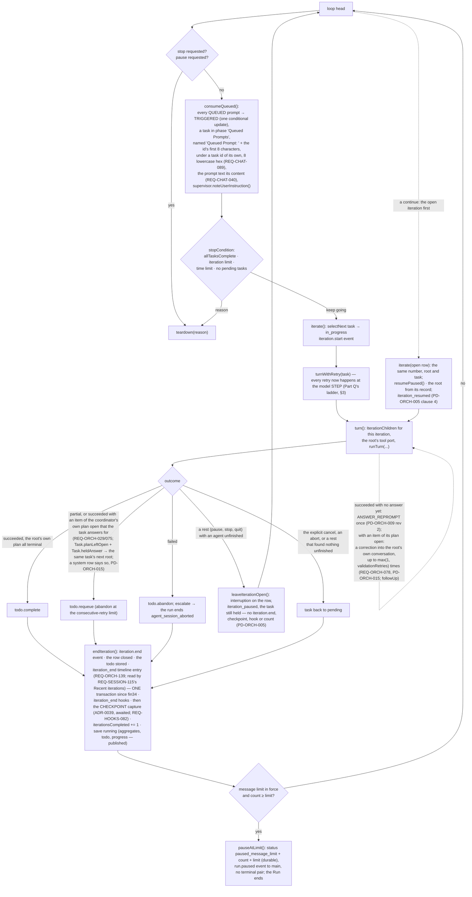

# Runtime view — a run from prompt to terminal result, and everything that reaches into it — 2. The loop and one iteration

Part 2 of 16 of [the runtime view](../03-runtime-view.md), which indexes every part.

## 2. The loop and one iteration

**An entry role that wrote no answer is asked once more (PD-ORCH-009, OQ-199 as ruled; since 2026-10-06).** The same
`followUp` first asks whether the root's turn returned `succeeded` with empty text — its last step wrote nothing, and a
step with a tool call never ends a turn — while the run is not stopping, pausing or coming to rest (`correctionDue`); if so
it sends `ANSWER_REPROMPT` once per execution of the root, before any plan correction — and since PD-ORCH-009 revision 2
(OQ-225, 2026-10-07) only while no turn of that execution has written an answer (the closure's `answer`), so a correction's
silent turn after an answer is never asked for a second copy. When the turn the re-prompt led to
is still silent, and the root's turn returns so, the iteration closes as it would have and the run keeps it as
`Run.unanswered`; `tellUnanswered` then writes a `system` row and an `incomplete_execution` warning issue where what follows
is known — "Iteration <n> ended without an answer: …" before the loop takes up another iteration, parks at the plan gate or
pauses at the message limit, and at the teardown either "The run ended without an answer: …" or, for a run only paused or
cancelled (`interrupted`), the iteration's row. A plan cycle's root is not asked. With no children (no tool port's delegation) the same loop runs
around `firstTurn`. The scripted client's verification-only step `silent` (since fin42) is such a turn —
a call ending `stop` with neither text nor a tool call — which `part-h-proof`'s `answerless` and `answer-when-asked` launches
take, since fin44 its `silent-correction` and `silent-child` launches (`PD-ORCH-009` revision 4, §3), and since fin45 its
`silent-wait` launch (`PD-ORCH-009` revision 5: three background delegations each followed by a silent root turn).

**The coordinator's own plan and the task's completion (REQ-ORCH-029, REQ-ORCH-075, REQ-ORCH-078; since 2026-10-06,
live-run finding G5).** A root that answers `succeeded` while its own plan (`Run.agentTodo`, REQ-TOOLS-144's states) holds an
item that is neither `COMPLETED` nor `ABANDONED` (`openPlanItems` in `stop-conditions.ts`) is first sent a correction into its
own conversation (`planCorrectionText`), up to `max(1, RunConfig.validationRetries)` times (REQ-ORCH-078 narrowed by
PD-ORCH-015, OQ-225, since 2026-10-07; before it the default of 0 sent none, and live-run finding P1's fresh root redid a task
already answered): `turn()` hands `IterationChildren.runWithChildren` a `followUp`, asked where the root would otherwise be
left idle, so a delegation the correction leads to is waited for as any turn's is. The correction says the answer has been
shown where a turn of the execution wrote one, and asks for each item's true state (`COMPLETED` or `ABANDONED`); the
execution's answer (the longest text a turn of it wrote) stays its report's text when the correction's own turn writes less,
so the iteration's summary and a held answer are the answer the person saw. Once the corrections are spent it does not
complete its planner task:
REQ-ORCH-069 and REQ-ORCH-082 read success off the planner's tasks, so the task is returned to the pending queue
(`todo.requeue`, abandoned at the consecutive-retry limit, when `lastFailure` names the open items and the session reads
failed), `iteration.end` carries `planNotDoneSummary`, a `system` row says the task was returned to the queue or given up on
(`planHeldRowText`, PD-ORCH-015), and the same task's next fresh root is told REQ-ORCH-075's marker after its task, with the
held answer cut to 6,000 characters beside it (`Task.planLeftOpen` and `Task.heldAnswer` → `planCarry` and `planCarryAnswer`
→ `planCarryText` in `firstMessage`). The plan is the session's, so a task answers
only for the items that were not already open when it was first taken up (`Task.planExcused`, OQ-203). The first take-up is
the plan cycle that planned the task (`Run.planCycleTakeUp`, before the cycle's turn, for each pending task with no record
yet), else the iteration that takes it up with no record and no row naming it (`Run.takeUp`); a revise cycle keeps the record
the first cycle wrote. An item a given-up task or an earlier run left open is neither carried to nor held against a later
task, and one the task's plan cycle wrote or its own iteration left open always holds it. Both records live on the planner task
in the stored todo, so the iteration a continue resumes, and a fresh iteration of a re-queued task in a later run, read them
back; both are removed when the task completes or is given up on, as is `heldAnswer`. Under a `single` override (`RuntimePosture.runOverride`,
`RunDeps.coordinating: false`) the entry role is the worker and nothing of this applies (REQ-ORCH-025).

**The coordinator's todo list on multi-step work (REQ-ORCH-029, REQ-ORCH-059; OQ-213, ruled 2026-10-07 under R-072,
live-run finding K2).** The list REQ-ORCH-029 holds the coordinator to is its own plan (`Run.agentTodo`), never the planner
plan the run writes itself. While the entry role coordinates, the call that would start the current task's **second work
item** is refused at dispatch until the entry role has written a todo list of its own for that task. A work item is a
`delegate` call, or on a direct-work grant a call of a public tool the registry declares as writing workspace files or
running commands (`isWorkItem`, `packages/agent-tools/src/todo-list-gate.ts`). Two facts live on the planner task beside
`planExcused`, so a continue and a later run read them back, and both are removed when the task completes or is given up on:
`workItems`, counted by `Run.workItemStarted` when a work item reaches execution, and `listWritten`, set by
`Run.replaceAgentTodo` for the root when an accepted write leaves the plan holding at least one task (for the current
iteration's task; in a plan cycle, for every task it plans). A person's edit (`editTodo`) never sets it. `Run.todoListOwed`
answers the refusal (`TODO_LIST_OWED_TEXT`) and logs `iteration N: <root> began the task's second work item with no todo
list of its own; the call was refused (REQ-ORCH-029)`. It answers nothing under `single`, in a plan cycle (whose calls neither
count nor are refused), or outside an iteration. The check reaches the gate as the depth-0 context's `todoList` (both
`toolsFor` closures in `sessions.ts`) and the entry port's `GateDeps.todoList` (`run-host/tools.ts`), and only where the
entry role's resolved set holds `todo`; otherwise `Run.todoListUnavailable` warns once per run and nothing is refused.
`Gate.dispatch` refuses after the plan-gate check and before the schema parse: `blocked`, `failure_kind: todo_list_owed`,
no `tool_error` issue. A step's calls dispatch in order, so a `todo` write earlier in the step satisfies the check.
REQ-ORCH-059's open-todo reminder lines: `completionNotification` appends up to five of the parent's open plan items
(`IterationChildren`'s `openTodoFor` → `Run.openTodoFor`: the root's are those its task answers for, `openRootPlan`; a child
parent's, its own todo's).

**Coming to rest (PD-ORCH-005 clauses 2, 3, 9, 10, 11; `Run.restCause`).** A run comes to rest by a pause, a stop (the
`cancel` operation, graceful or forced, and since 2026-10-07 the close of one of several main windows, which applies the
graceful stop to its workspace's active runs through `Sessions.stopActiveIn` — PD-SHELL-009) or a quit (`application_shutdown`); `restCause` names which, and is null for the
explicit cancel (the reserved run id: `StopRequest.final`), for a stop the run raised itself (`agent_session_aborted`)
and while the plan gate holds (**PD-ORCH-005 clause 15**: a stop or a quit during a plan cycle ends its agents and
records no interruption; a forced stop is a stop). What waits on a person is released by `waitsWithdrawnBy`, which reads
the stop request alone and never the plan hold: a stop withdraws an approval or a question by `stop` and a quit by `quit`,
whether or not the run comes to rest (clause 15's last bullet, PD-CHAT-002 revision 2; OQ-108); only the explicit cancel
and a stop the run raised itself cancel them (REQ-TOOLS-052). A **pause** is refused while the gate holds (clause 11); accepted, it
withdraws every approval and question at once (clause 9: each waiting call settles interrupted and never run, never
denied — `approval_withdrawn`, no audit decision), arms REQ-ORCH-134's tool deadline on the clock port
(`runtime.graceful_pause_tool_deadline`, 30 s by default) whose expiry cuts every call still in flight, and stops the
scheduler (`IterationChildren.beginRest`: no child is admitted, promoted or started; every parent waiting on children is
woken). A **stop or quit** withdraws the same way, rests the scheduler, and aborts the run signal as REQ-SESSION-092
always has. Every agent then stops before its next model call: the turn checks the rest at the top of its loop, after
supervision and after compression, and the resilience ladder (`TurnResilience.resting`) lets the step's report stand —
no retry, fallback, condensation or wait follows it; a pause also releases every provider-limit wait at once
(`WaitRegistry.releaseForRest`), the manual compression is refused (`run_coming_to_rest`), and every save reads
`pausing` until the run rests (REQ-MONITOR-124). The step in flight finishes, and a call it asks for never starts; a
child's summarising call in flight finishes too, but makes no second attempt (`produceReport`'s `halted`), and a pass a
stop aborts or a pause cuts short leaves the child `paused` to summarise when it resumes. When the turn returns with the root stopped mid-way, a
child unfinished, or a child finished whose report its parent has not received (`runWithChildren` returns `paused`),
`turn()` waits for every child execution to come to rest — a pause without a bound, a stop or a quit within the
hard-cancel budget — and leaves each unfinished child `paused` where it stood (`IterationChildren.rest`, the writer's
`restChild`: the state, the interruption, the state it resumes into, `child_paused`, one transaction), the root
execution record `paused`, and the iteration open (above). A child whose `child_timeout` expired during the rest ends
`failed` as it would have without one, unsummarised; one whose execution raised is left `paused`, as the root is
(**OQ-96**). An execution a stop's grace gave up on is **detached**: when it returns it writes nothing — no row, no
record, no report (REQ-SESSION-094). Its model step writes nothing either: while `TurnDeps.detached` reads true the
step streams no row, settles none and counts no usage (2026-09-29), and teardown closes its tool port (§6), so its gate
writes nothing when its call returns. **The root is bounded the same way (REQ-SESSION-092 / REQ-MONITOR-129, 2026-09-29):**
`turn()` awaits the root's turn no longer than `stopGraceSpent`, which settles `STOP_GRACE` after the first stop
request, forced or not. A root still in a call then is detached like a child — its turn's `detached` reads true, so it
writes nothing when the call returns — and the rest that follows is given what is left of the grace, counted from the
same first request (`Run.stopGraceLeft` → `IterationChildren.rest(cause, grace)`: none after a root given up on, so what
still executes is detached at once), so a stop ends within the one 30 s. The root is left `paused` by a stop or a quit,
its open call answered as interrupted; under the explicit cancel its open call is answered as cut off, naming no rest. The
explicit cancel rests nothing: it drains the active background children (REQ-ORCH-080, bounded by the drain's own
timeout, whether the root returned or was given up on — **OQ-121**), settles every child record (`finalize`), then
awaits what still executes within what is left of the grace and detaches it (`IterationChildren.outlast`: none is left
after a root given up on), so a child's step that ignored the cancel writes nothing when it returns. So does any stop that
rests nothing (one the run raises itself, a plan cycle's). The repair of `a-root-call-that-ignores-the-stop-holds-the-run-open.md`. Every agent the rest leaves paused, the root included, has any call it never
returned from or raised out of answered in its record as interrupted, its row settled (`answerOpenCalls`, which the crash
record uses for a dead run's agents too), so a resume sends a conversation whose every call has its result; a call of
that step that completed keeps what it returned, read back from its settled row. A foreground `terminal` call the cut
lands in reports the cancel itself (PD-TOOLS-013, OQ-226; 2026-10-07): `ForegroundSession.run` ends the tree, restarts the
session with PD-TOOLS-001's snapshot and returns `cancelled` with no exit code, and `terminal/index.ts` records it
`interrupted` / `warning`, `InterruptedError`, a detail that the run cancelled it, so the gate marks it interrupted and
files no issue — until then it read as REQ-TOOLS-099's hard timeout (124, `terminal_timeout`). Every other call the cut
lands in reads the same since PD-TOOLS-013 revision 2 (OQ-238; 2026-10-13): the gate's catch records an executor's throw
under an aborted signal as `interrupted` ("The '<tool>' call was cancelled by the run before it completed."), where it wrote
`cancelled`; fetch's `transportFailure` records the abort as `interrupted` / `InterruptedError` after its deadline test,
where it wrote `network_error`; and the MCP executor's catch records it as `interrupted` after its allowance test, where it
wrote `execution_error` — each then marked interrupted by the gate's existing branch, with no `tool_error` issue. A child the stop's grace gave up on
(`IterationChildren.outlast` keeps which, `givenUpOn`) returns without its count, so once its calls are answered the rest
counts the calls its record shows beyond its `children.tool_calls` into the session's total, with that count, in one
transaction (`countGivenUpOn` → `SessionWriter.countToolCalls`, REQ-MONITOR-102), as the root given up on is counted — so
a continue that declines it loses none of them and one that resumes it credits none twice (the repair of
`a-child-the-stops-grace-gave-up-on-and-the-continue-declined-never-counts-its-calls.md`, 2026-09-30). So is one the
grace gave up on while the explicit cancel arrived during the rest: the rest pauses nothing then, but first answers that
child's open calls as cut off, naming no rest (OQ-96), and counts it, before `Run.turn` ends it `cancelled` (found by the
repair's verifier). So, since 2026-10-01, is every other child given up on that no rest leaves `paused`
(`IterationChildren.closeGivenUpOn`, the repair of `a-child-the-explicit-cancel-gave-up-on-never-counts-its-calls.md`):
one the explicit cancel's own `outlast` gives up on — `Run.turn` calls it right after that `outlast`, so the child,
already ended `cancelled` by `finalize`, has its open calls answered as cut off, naming no rest (OQ-96), and is counted —
and one already terminal when a rest's grace gave up on it, which the user had cancelled on its own while its call
ignored the abort (`rest` calls it last). Its execution, if it ever returns, returns through `execute`'s detached
return, before its count; both writes are idempotent. Once the teardown is over — finalized or rested — `Run.turn` closes the
iteration's scheduler (`IterationChildren.close` → `Scheduler.close`, 2026-10-03): the pass that follows a child's end — a
fresh child's (`startOne`) or a resumed one's (`resumePaused`) — runs in an unawaited `.finally` through `Scheduler.passAfter`,
which then returns at once, and any raise of it is warned instead of rejecting, so a child settling
after the run's end reads no store the run host may have closed meanwhile (`workspace.closeStore`, `workspace.closing`; the
repair of `a-childs-closing-scheduler-pass-can-outlive-the-run-that-awaited-it.md`). A rest that finds nothing unfinished closes the iteration as before. The cause is
read again once the rest is done: the explicit cancel that arrived meanwhile ends every agent the rest paused
`cancelled` and closes the iteration; one that arrives later, during teardown, closes the iteration this run holds —
the one it left open, or the one a continue resumes or declines, which it holds from its start, so a cancel during the
pre-flight closes it too — the same way before the run's result is built, and one after that is refused. The explicit cancel does not abort a
child's summarising pass: REQ-ORCH-080's drain lets it finish, as before. At teardown a run records what became of its agents' background sessions (clause 10:
`restTerminals` — a pause leaves them running, a stop, a quit and the explicit cancel record their end and then end
them). The explicit cancel keeps REQ-ORCH-080's drain and REQ-ORCH-052's finalize.

**A crash (clause 3; `run/crash.ts`).** A run host that died wrote none of that, so `recordCrash` writes it from the
store when the session is next repaired (`repairOne`) or continued (`launchContinuation`, before the stale-child settle,
which now leaves a `paused` agent alone): the open iteration's interruption `crash`, its unfinished agents `paused`, an
unanswered last `assistant` message answered (`answerOpenCalls`: a call whose row settled keeps its result, one whose
row is `running` is answered as interrupted and its row settles, and one with no row, which never started, is answered
as not run — the root's rows found by the persona its iteration was opened with, `iterations.root_persona`, which a root
resumed as the entry role keeps as its rows' name, OQ-97), then the calls the dead run's agents made that no count held
joined to the session's total (`countCrashedCalls`, REQ-MONITOR-102: what the root's record holds beyond its iteration's
`root_tool_calls`, and each unfinished child's beyond its `children.tool_calls`, written with those counts in one
transaction by `SessionWriter.countToolCalls`, so a second recording and a resumed child's own credit add nothing more; a
root whose count is NULL — an iteration opened before v26 — adds nothing), then a plan cycle's root the session still
records as under way (`sessions.plan_root_task_id`, **v29**: a plan cycle has no iteration row, REQ-ORCH-153) answered the
same way under the plan cycle's 0 and its calls joined to the total in the transaction that releases it
(`recordPlanRootCrash`; `Run.turn` records the root when a plan cycle starts and releases it as its calls join the total —
its turn's return, or the stop's grace giving up on it — or with none counted when its turn raises), and each unfinished
child of that plan cycle answered and counted the same way (`recordCutChild`, since 2026-10-01: no record pauses it, and
the stale-child settle that ends it runs only at a continue), every `tool_calls` ring
row still `running` settled `failed` with the crash's statement and a NULL duration, its `tool.finish` with it
(`settleDeadToolCalls`, REQ-SESSION-129 with ADR-0024: an orderly end settles them when the run's ports close, and a crash
closes none — except at a continue while any run of this process on the session parked without closing its ports, the
message-limit pause or the plan gate, `!Run.closedItsPorts` over every run in `Live.portsOpen` and not only the last, when
a row still `running` may be its call still under way and is left to that call's own settle; ~~which of a parked run's ports
a park or a continue should close is OQ-170's~~ *since OQ-170's ruling (2026-10-06, R-071) both parks close their run's
ports as the teardown does — `Run.closePorts` in `pauseAtLimit` and at the plan gate, every open call settled `failed`
through the gate sink's `close` — so a parked run holds no such skip and the exception is left with no park to arise
from*), the stored approvals withdrawn, and the background
sessions still recorded running and not held by this process ended by the crash. Loading a session records and
settles nothing (clause 8), and neither does the user's cancel of one crash-left child while the session rests: it
cancels that child and its descendants from where they stood, answers their own calls the crash cut off (no later crash
record reaches a cancelled agent), and leaves the rest of the crash to the next repair or continue (OQ-101). A session a
store failure left busy is not one a crash left (OQ-103).

**An explicit cancel the host died before carrying out (clause 3, OQ-103's last question ruled under R-067).** The
reserved run id's `cancelAgent` marks the iteration open in the store the moment it is accepted
(`SessionWriter.recordCancelAccepted` → `iterations.cancel_accepted_at`, v27, at the stronger durability setting), and a
run that opens an iteration after the cancel was accepted marks it as it opens. The run's own close keeps the mark as
history. An OPEN iteration that carries it is one whose cancel was never carried out, and every reader of a crash reads it
first: `recordCrash` carries the cancel out in place of the crash (`recordAcceptedCancel`) — the cut calls answered and
counted as for a crash, every agent not terminal (`paused` ones included, where the cancel overtook a rest) ended
`cancelled` with its report stored and materialised, the iteration closed `cancelled` with its task back to `pending` in
the same transaction by the vocabulary's `iteration.end`, `iterations_completed` moved past it, the close warned to the
session log and no timeline word minted for it (REQ-ORCH-139) — then withdraws the stored approvals and ends the background sessions as for any dead run. No checkpoint is captured there (OQ-130).
`crashLeftOf` names none of its agents, `cancelLeftOf` names every one while no run carries the cancel out, and the
projection presents those `cancelled` and ended with the run (`AgentFacts.cancelLeft`); `resumableOf` states nothing to
resume, and a continue is set up as the entry role (`resumedPersona`), so clause 18's Continue action and a continue by
message resume none of them and go on as a new iteration.

**Resuming the open iteration (PD-ORCH-005 clauses 4, 5, 7, 10; OQ-97).** A continue by a new message and the Continue
action resume an iteration a rest or a crash left open before anything else runs (`RunDeps.openIteration`, set by
`Sessions.launchContinuation` once the crash record and the settle are done); "continue without them" declines it
instead (clause 6), and a plan decision finds none open, the resumed iteration having closed before the gate held
(PD-ORCH-003 revision 2, clause 11). That continue is set up as the
persona the open iteration's root ran as (`configure`'s `entryPersona` → the run host's `prepareRun`, in place of
`default_persona`, or the entry role with a warning when that persona is gone), and what the root is told — the notice
of its background sessions, then its new message with its images — is recorded in the root's conversation there and
then, so no early end of the run loses it and the user's message is the last the root reads. The run holds the open iteration from its construction, so the explicit cancel during its
pre-flight closes it (OQ-96). The resumed iteration is not held at the plan gate (PD-ORCH-003 revision 2: a gate
that would hold the run holds before its first new iteration — the plan gate paragraph above),
and the loop's first iteration is the open one (`iterate(openRow)`): its number, its root's task id and canonical name,
and its todo task, with no second `iteration.start`, the row's interruption cleared and `iteration_resumed` recorded.
`turn()` builds the iteration's children over the same root, `IterationChildren.resumePaused` moves each `paused` child
back to the state it resumes into (the writer's `resumeChild`, `child_resumed`) — `running` instead of `summarizing` for
one told of its background sessions, which takes a step to read the notice — re-claims its stored write scope in
acceptance order (PD-TOOLS-006 revision 2), and restarts the executions of those that were `running` or `summarizing`
from their records (`execute(row, resume)`, a fresh `child_timeout`, the tool-call count carried on from the row or the
record, whichever holds more) through the scheduler's own wrapper, so each resumed child's end is a scheduler pass. The
waiting ones are left to the scheduler. The root carries on from its own record. Clause 10's notice of a child's
background sessions (`run/resume.ts`'s `resumeNoticeOf`) joins its conversation as its next message, recorded, at its
resume; the root's was recorded at the continue.
An agent whose record ends on its own answer resumes into waiting (`resumedStart`); any other takes a model step,
compressed first when the conversation is too long, as any is. A resumed iteration closes like any other, and it can
rest and be resumed again (clause 7).
