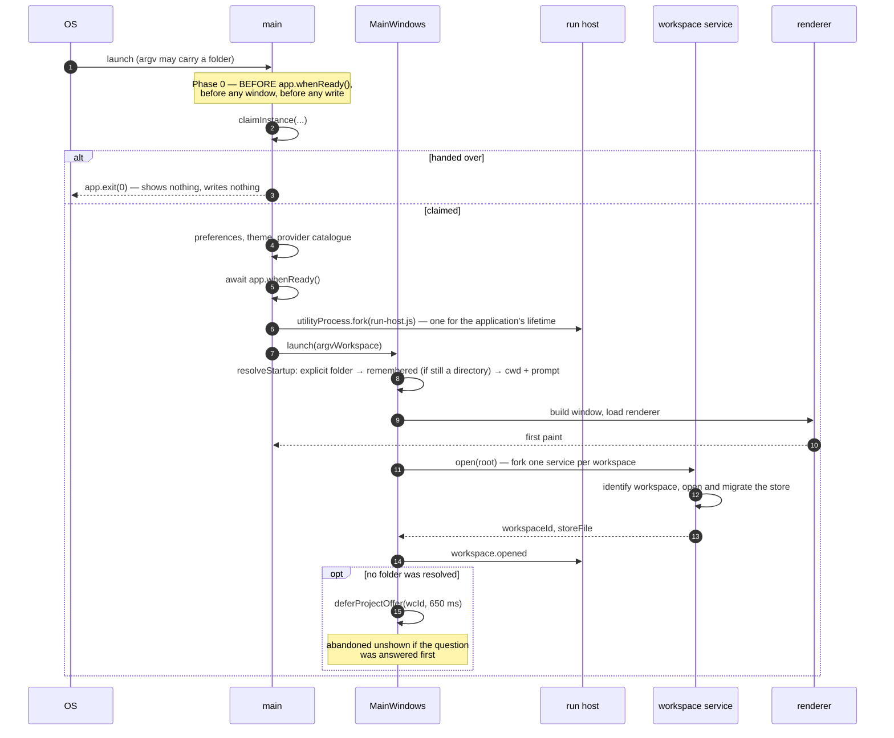
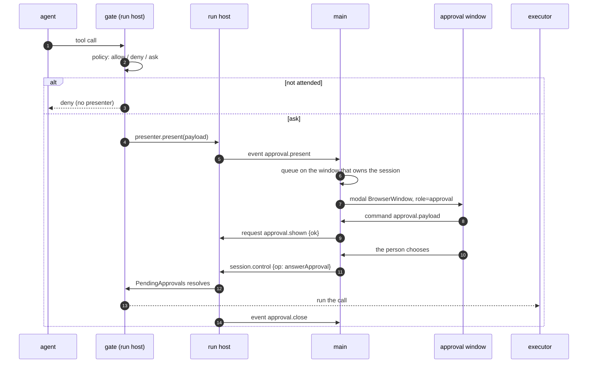
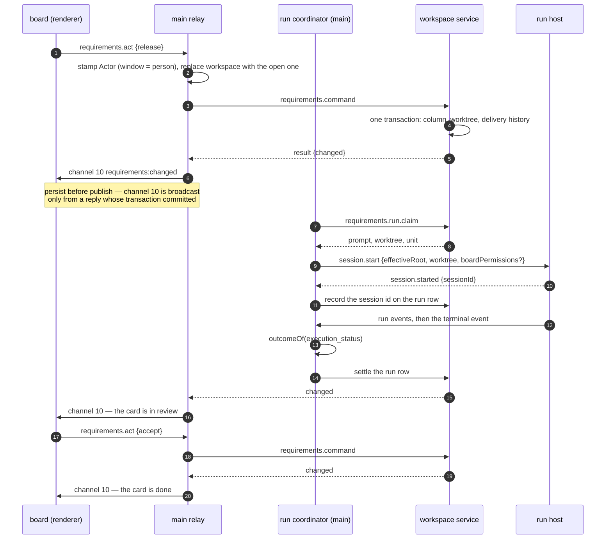

# Sequences — the flows the runtime view does not own

[`03-runtime-view.md`](03-runtime-view.md) owns **the run**: start, loop, turn, children, controls, end. Three
other flows cross every process, are asked about constantly, and had no home. They are here, with a fourth that
crosses the run's own agents: how a run comes to rest.

Each is drawn from the code and names the functions in it. One is added when a part first touches a flow that
needs one — not in advance, because a diagram nobody maintains is worse than no diagram.

| Flow | Answers | Section |
|---|---|---|
| Startup to a painted window | what happens before anything else can, and why a view's first read may find no workspace | [§1](#1-launch-to-a-painted-main-window) |
| A permission approval | how a tool call becomes a modal and comes back a decision | [§2](#2-a-permission-approval-end-to-end) |
| The requirements board | how a card becomes a run and a run becomes a card again | [§3](#3-the-requirements-board-release--run--review--accept) |
| A run comes to rest | what a pause, a stop, a quit and a crash leave behind, and when each is written (PD-ORCH-005) | [§4](#4-a-run-comes-to-rest-pd-orch-005) |

---

## 1. Launch to a painted main window

`apps/desktop/src/main/index.ts` (`main()`) and `apps/desktop/src/main/main-windows.ts` (`launch`,
`resolveStartup`, `open`).



**The window paints before the workspace opens.** A view's start-time read — the Overview's session list, the
repository card — therefore arrives while no workspace exists yet. Those reads **wait, bounded**
(`awaitWorkspace`, 30 s) rather than being refused; getting this wrong was a first-execution defect of the
Overview.

### Opening another project, from inside

`MainWindows.choose` decides between four endings, in this order:

| Condition | Ending |
|---|---|
| `newWindow` (palette entry, or the chip with the platform's secondary-activation modifier) | `#addWindow` — no gate evaluated, nothing closed |
| the chooser was dismissed | a transient notice, nothing changes |
| the folder is already open **in this window** | a transient offering "Start a new session" |
| the folder is already open **in another window** | that window is surfaced; nothing is built |
| otherwise | `#replace` |

`#replace` is ordered and the order is the requirement: **build the replacement, open its service, show it,
await the outgoing window's own close, and only then persist.** A vetoed close discards the replacement and
changes nothing.

Before a replacement is even attempted, `#workspaceOpenGates` runs two gates: the unsaved-settings close guard,
then the active-run count. A gate that declines answers `{cancelled: true}` — not a failure.

---

## 2. A permission approval, end to end

`packages/agent-tools/src/gate.ts` → `approvals.ts` (`PresenterRegistry`, `PendingApprovals`) →
`apps/desktop/src/run-host/index.ts` → `apps/desktop/src/main/index.ts` (`presentNext`).



The parts that are easy to get wrong:

- **Attendedness is a boolean the run host maintains**, not a question it asks. Main polls alive every 250 ms;
  3,000 ms without a reply is a lapse, and a lapse **cancels every waiting approval** — they resolve
  `cancelled`, and the application is unattended until main answers again (`ADR-0019`).
- **Closing the dialog answers Deny** while the application stays: the user closed the dialog, or one main window
  of several. A request already answered or cancelled asks nothing more. A dialog that the application's quit closes
  answers nothing, and the quit's `shutdown` withdraws the approval instead (PD-ORCH-005 clause 9). *Until phase 7 the
  quit's close sent a Deny first, and the agent stepped on it:
  `docs/defects/fixed/a-quit-denies-the-approval-it-should-withdraw.md`.*
- Presentation order is **oldest first by the published sequence**, and that sequence orders presentation
  *across* windows, not within one.
- A dialog that cannot be shown is not a hang: `approval.shown {ok: false}` comes back, the pending request is
  discarded, and the call is denied with source `presenter-error`.
- Only an **answer, a cancellation or a withdrawal** releases the wait. A wait with no limit is still released —
  the explicit cancel cancels whatever is blocked on a person as its first act, and a rest (a pause, a stop, a quit)
  **withdraws** it: the call settles blocked and interrupted, `approval_withdrawn` (or `question_withdrawn` for a
  question) names the interruption, no decision is audited, and no `tool_error` issue is filed (PD-ORCH-005 clause 9;
  §4).
- **Approve for the session adds a grant to the agent's `PolicyContext`**, matched before any policy rule on
  every later call (`policy.ts`, REQ-TOOLS-023/024). A grant for the public `write_file` or `haet_edit` (`haet`
  folded in) covers a path, not an argument set (`PD-TOOLS-004`): the gate hands `grant` the workspace root, the
  resolver and the run host's `publicTool` predicate (an MCP tool offered under either name is not the public one),
  the grant stores the set of paths its REQ-TOOLS-018 path arguments resolved to, and a later call of that tool
  from that persona is allowed without a dialog when its own set is exactly that one — a retried edit with a new
  `old_string` included. Every other tool's grant, an MCP tool's under a public name among them, still needs the
  identical command facet or argument set.

---

## 3. The requirements board: release → run → review → accept

`packages/ui/src/requirements/` → `apps/desktop/src/main/requirements.ts` (the relay) and
`requirements-runs.ts` (the run coordinator) → `apps/desktop/src/workspace-service/delivery.ts`.



- **A renderer never sends an actor.** The command schema has no field for one; the relay stamps it from where
  the command arrived — a window's `webContents` is a person under the account main runs as, anything else is
  the system. The workspace is likewise replaced with the one this instance has open, so a board cannot act on
  another workspace.
- **One claim is one `session.start`.** The row is written the moment the run host answers, or the launch is
  abandoned with a reason.
- The elevated grant (`boardPermissions: 'permissive'`) travels **on the `session.start` of that launch** and
  applies to the configuration captured for it. It is not a mode anything stays in.
- A board read is bounded at 120 s because it may run the engine's three passes; everything else is a store
  read or one transaction, bounded at 30 s.
- If the run host exits holding board runs, the coordinator **reaps with an empty live set** rather than
  leaving rows that claim to be running.

---

## 4. A run comes to rest (PD-ORCH-005)

`packages/engine/src/run/run.ts` (`pause`, the stop listener, `turn`'s `finally`, `leaveIterationOpen`, `teardown`) →
`children/orchestration.ts` (`beginRest`, `execute`, `rest`) → `children/scheduler.ts` (`hold`) →
`run/turn.ts` → `session-writer.ts` (`restChild`, `recordIterationInterruption`, `recordAgentTerminal`). A pause is
drawn; a stop and a quit differ where marked.

```mermaid
sequenceDiagram
  autonumber
  participant U as person (main)
  participant S as Sessions
  participant R as Run
  participant P as tool ports
  participant IC as IterationChildren
  participant C as a child's execution
  participant W as SessionWriter

  U->>S: session.control {op: pause}
  S->>R: pause()
  alt the plan gate holds
    R-->>S: false (clause 11)
  else accepted
    R->>W: save('pausing'), run_pause_requested
    R->>P: withdrawPending('pause') — each waiting call: blocked, interrupted
    R->>R: release every provider-limit wait; arm the tool deadline (clock port)
    R->>IC: beginRest() — scheduler held, waiting parents woken
    Note over R,C: a stop or a quit: the same withdrawal and beginRest from the stop listener, then the run signal aborts
    C->>C: the step in flight finishes; calls not started are recorded "not run"; no retry, fallback or summarising call
    C->>W: restChild(task, 'pause', resume state) — paused, child_paused
    R->>IC: rest('pause') — waits for every execution (a stop or a quit: within 30 s, then detaches the rest), pauses the unstarted where they stood
    R->>R: read the cause again — the explicit cancel meanwhile: every agent cancelled, the iteration closed
    R->>W: recordIterationInterruption, iteration_paused — the iteration stays open
    R->>W: teardown: agent_terminals (a pause leaves them running; a stop or a quit records its end, then ends them)
    R->>W: endRun('paused') — the lock released
  end
```

- **What does not happen.** No `iteration.end`, checkpoint, `iteration_end` hook or count for the open iteration; no
  summary, report or terminal state for a paused child; no model call after the pause beyond the step in flight.
- **A crash writes none of this.** The next repair or continue does (`run/crash.ts`): the interruption `crash` on the
  open row, its unfinished agents paused, a dead run's unanswered calls answered, its approvals withdrawn, its
  background sessions ended. Loading the session writes nothing.
- **The explicit cancel is not a rest.** The reserved run id's final stop cancels the waits, drains and finalizes as
  before: every agent `cancelled`, the iteration closed — including when it arrives while a pause or a stop is still
  coming to rest, or later while teardown runs (the iteration this run left open then closes before the run's result is
  built; a cancel after that is refused). It ends the agents' background sessions as a stop does, and lets a child
  summarising during REQ-ORCH-080's drain finish (OQ-69).
- **The next continue resumes it** (`03-runtime-view.md` §2): the open iteration first, the same root and task, every
  paused agent moved back and carrying on from its record, told of its background sessions, the root handed a new
  message as its next. Declined ("continue without them"), its paused agents end `cancelled` and it closes before the
  new run's first iteration (`closeLeftOpenIteration`).
