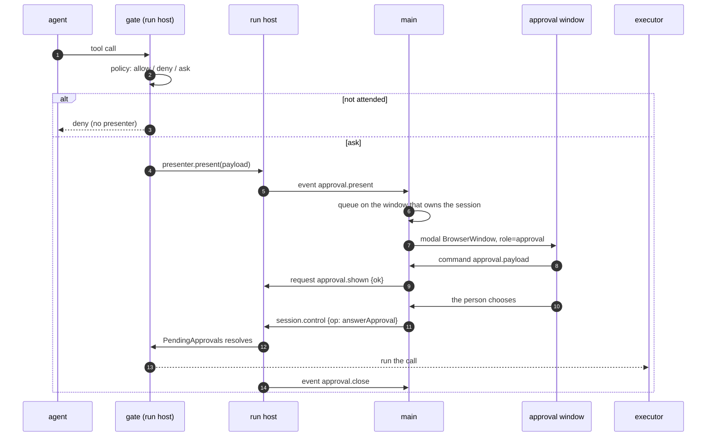
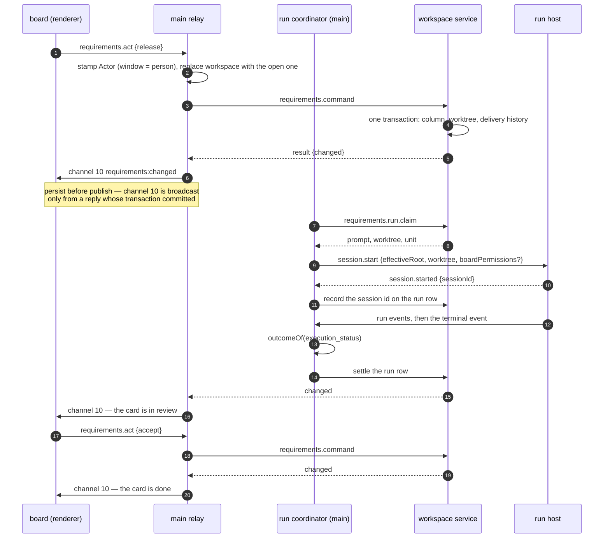

# Sequences — the flows the runtime view does not own

[`03-runtime-view.md`](03-runtime-view.md) owns **the run**: start, loop, turn, children, controls, end. Three
other flows cross every process, are asked about constantly, and had no home. They are here.

Each is drawn from the code and names the functions in it. One is added when a part first touches a flow that
needs one — not in advance, because a diagram nobody maintains is worse than no diagram.

| Flow | Answers | Section |
|---|---|---|
| Startup to a painted window | what happens before anything else can, and why a view's first read may find no workspace | [§1](#1-launch-to-a-painted-main-window) |
| A permission approval | how a tool call becomes a modal and comes back a decision | [§2](#2-a-permission-approval-end-to-end) |
| The requirements board | how a card becomes a run and a run becomes a card again | [§3](#3-the-requirements-board-release--run--review--accept) |

---

## 1. Launch to a painted main window

`apps/desktop/src/main/index.ts` (`main()`) and `apps/desktop/src/main/main-windows.ts` (`launch`,
`resolveStartup`, `open`).

```mermaid
sequenceDiagram
  autonumber
  participant OS
  participant M as main
  participant MW as MainWindows
  participant RH as run host
  participant WS as workspace service
  participant R as renderer

  OS->>M: launch (argv may carry a folder)
  Note over M: Phase 0 — BEFORE app.whenReady(),<br/>before any window, before any write
  M->>M: claimInstance(...)
  alt handed over
    M-->>OS: app.exit(0) — shows nothing, writes nothing
  else claimed
    M->>M: preferences, theme, provider catalogue
    M->>M: await app.whenReady()
    M->>RH: utilityProcess.fork(run-host.js) — one for the application's lifetime
    M->>MW: launch(argvWorkspace)
    MW->>MW: resolveStartup: explicit folder → remembered (if still a directory) → cwd + prompt
    MW->>R: build window, load renderer
    R-->>M: first paint
    MW->>M: postShowActivation(window) — once, on the window's own show event, never during construction
    M->>M: updater.activate(window) — REQ-STARTUP-043/114
    alt not updatable (a source-tree or development launch, a payload run without its launcher) or a demo window
      M->>M: one application-log line at info; NO request (REQ-STARTUP-106/057/150)
    else a released artifact, no operation in flight
      M->>M: first check of the launch only — delete a portable's leftover <name>.old (REQ-STARTUP-115)
      M-->>M: GET the one endpoint, 10 s, Accept header (REQ-STARTUP-105)
      Note over M: a strictly newer release carrying this flavour's exact asset<br/>and not the waved-off version → the offer notice (REQ-STARTUP-107/108/109/116);<br/>an update already installed or handed off in this process is not offered again (REQ-STARTUP-119);<br/>every failure one log line, never a surface (REQ-STARTUP-110)
    end
    MW->>WS: open(root) — fork one service per workspace
    WS->>WS: identify workspace, open and migrate the store
    WS-->>MW: workspaceId, storeFile
    MW->>RH: workspace.opened
    opt no folder was resolved
      MW->>MW: deferProjectOffer(wcId, 650 ms)
      Note over MW: abandoned unshown if the question<br/>was answered first
    end
  end
```

**The window paints before the workspace opens.** A view's start-time read — the Overview's session list, the
repository card — therefore arrives while no workspace exists yet. Those reads **wait, bounded**
(`awaitWorkspace`, 30 s) rather than being refused; getting this wrong was a first-execution defect of the
Overview.

**The update check rides the post-show activation, and so does every window built later.** `MainWindows` fires
`postShowActivation` once per window on the window's own show event — the launch's window, a replacement's
(REQ-STARTUP-047's "fresh update check for that window"), an added one's, a hand-over's — and the updater answers each
with one check or one log line, one operation in flight at a time (REQ-STARTUP-114). Phase 0 has a second entrance
since 2026-09-28: a launch carrying `builtin:update-successor -- <endpoint>` is the successor an update restart
started, performs no claim and no hand-over attempt, and inherits the record instead (`inheritInstance`; below).

### `Update now`, and `Restart now` — the offer to the successor

`apps/desktop/src/main/updater/updater.ts` (`install`, `restart`), `install.ts`, `strategies.ts`;
`packages/platform/src/instance.ts` (`passRecord`, `inheritInstance`). ADR-0054 decided the sequence, ADR-0055 the
hand-over of the record.

```mermaid
sequenceDiagram
  autonumber
  participant R as renderer
  participant M as main (updater)
  participant F as the release feed
  participant S as the successor
  R->>M: update.install (Update now / Try again)
  M->>M: the offer notice becomes "Downloading Rotaris {v}" IN PLACE, action disabled (REQ-STARTUP-118, REQ-SHELL-118)
  M->>F: GET SHA256SUMS.txt, then SHA256SUMS.txt.sig
  M->>M: verify the signature against the compiled-in key set — BEFORE parsing (REQ-STARTUP-122/167); empty set → refused, nothing downloaded
  M->>M: parse the manifest (REQ-STARTUP-113)
  M->>F: GET the one asset, redirects followed, into <temp>/rotaris-update-…/ in 1 MiB chunks; progress repainted per whole percent
  M->>M: digest verified, case-insensitively, with REQ-STARTUP-123's sentences
  alt portable: rename aside, move in (REQ-STARTUP-125)
    M->>M: "Update installed" + Restart now (REQ-STARTUP-119)
    R->>M: update.restart
    M->>S: spawn <artifact> builtin:update-successor -- <this endpoint>, detached
    S->>S: no claim; open its own endpoint (inheritInstance)
    S->>M: {"successor": {pid, host, acquired_at, endpoint}}
    M->>M: only while this restart waits (acceptSuccessor) — replace the record file atomically with the successor's fields (passRecord)
    M-->>S: {"ok":true,"record":"passed"}
    M->>M: destroy the windows; the ordinary quit; close leaves a record that no longer names it
  else installer: spawn the setup, detached (REQ-STARTUP-125)
    M->>M: "Finish the update", no action; the window closes after ONE 1200 ms delay (REQ-STARTUP-119)
  else any failure
    M->>M: the notice becomes "Update not installed" in place, the sentence as detail, Try again (REQ-STARTUP-120)
  end
```

A successor that cannot be started surfaces through `Update not installed` and nothing closes; one that never
signals leaves this instance holding its record and its window, with no timeout (REQ-STARTUP-121, ADR-0055). A
successor announcement that arrives while no restart is waiting — a sentinel launch nobody started — is answered
`{"ok":false}`, the record is unchanged, and that launch ends; the instance stays the only one (REQ-STARTUP-161).
Nothing of the installation is moved or modified before the replacement is fetched whole and verified
(REQ-STARTUP-126). The apply strategies and the restart are decided by unit tests over fakes; their run against a real
Windows artifact is owed to the next Windows package (IC-3) — ADR-0054's "The updater" note says what was executed.

### Opening another project, from inside

`MainWindows.choose` decides between four endings, in this order:

| Condition | Ending |
|---|---|
| `newWindow` (palette entry, or the chip with the platform's secondary-activation modifier) | `#addWindow` — no gate evaluated, nothing closed |
| the chooser was dismissed | a transient notice, nothing changes |
| the folder is already open **in this window** | a transient offering "Start a new session" |
| the folder is already open **in another window** | that window is surfaced; nothing is built |
| otherwise | `#replace` |

`#replace` is ordered and the order is the requirement: **build the replacement, open its service, show it,
await the outgoing window's own close, and only then persist.** A vetoed close discards the replacement and
changes nothing.

Before a replacement is even attempted, `#workspaceOpenGates` runs two gates: the unsaved-settings close guard,
then the active-run count. A gate that declines answers `{cancelled: true}` — not a failure.

---

## 2. A permission approval, end to end

`packages/agent-tools/src/gate.ts` → `approvals.ts` (`PresenterRegistry`, `PendingApprovals`) →
`apps/desktop/src/run-host/index.ts` → `apps/desktop/src/main/index.ts` (`presentNext`).



The parts that are easy to get wrong:

- **Attendedness is a boolean the run host maintains**, not a question it asks. Main polls alive every 250 ms;
  3,000 ms without a reply is a lapse, and a lapse **cancels every waiting approval** — they resolve
  `cancelled`, and the application is unattended until main answers again (`ADR-0019`).
- **Closing the dialog answers Deny.** A request already answered or cancelled asks nothing more.
- Presentation order is **oldest first by the published sequence**, and that sequence orders presentation
  *across* windows, not within one.
- A dialog that cannot be shown is not a hang: `approval.shown {ok: false}` comes back, the pending request is
  discarded, and the call is denied with source `presenter-error`.
- Only an **answer or a cancellation** releases the wait. A wait with no limit is still cancellable — `run.stop`
  cancels whatever is blocked on a person as its first act.
- **Approve for the session adds a grant to the agent's `PolicyContext`**, matched before any policy rule on
  every later call (`policy.ts`, REQ-TOOLS-023/024). A grant for the public `write_file` or `haet_edit` (`haet`
  folded in) covers a path, not an argument set (`PD-TOOLS-004`): the gate hands `grant` the workspace root, the
  resolver and the run host's `publicTool` predicate (an MCP tool offered under either name is not the public one),
  the grant stores the set of paths its REQ-TOOLS-018 path arguments resolved to, and a later call of that tool
  from that persona is allowed without a dialog when its own set is exactly that one — a retried edit with a new
  `old_string` included. Every other tool's grant, an MCP tool's under a public name among them, still needs the
  identical command facet or argument set.

---

## 3. The requirements board: release → run → review → accept

`packages/ui/src/requirements/` → `apps/desktop/src/main/requirements.ts` (the relay) and
`requirements-runs.ts` (the run coordinator) → `apps/desktop/src/workspace-service/delivery.ts`.



- **A renderer never sends an actor.** The command schema has no field for one; the relay stamps it from where
  the command arrived — a window's `webContents` is a person under the account main runs as, anything else is
  the system. The workspace is likewise replaced with the one this instance has open, so a board cannot act on
  another workspace.
- **One claim is one `session.start`.** The row is written the moment the run host answers, or the launch is
  abandoned with a reason.
- The elevated grant (`boardPermissions: 'permissive'`) travels **on the `session.start` of that launch** and
  applies to the configuration captured for it. It is not a mode anything stays in.
- A board read is bounded at 120 s because it may run the engine's three passes; everything else is a store
  read or one transaction, bounded at 30 s.
- If the run host exits holding board runs, the coordinator **reaps with an empty live set** rather than
  leaving rows that claim to be running.
