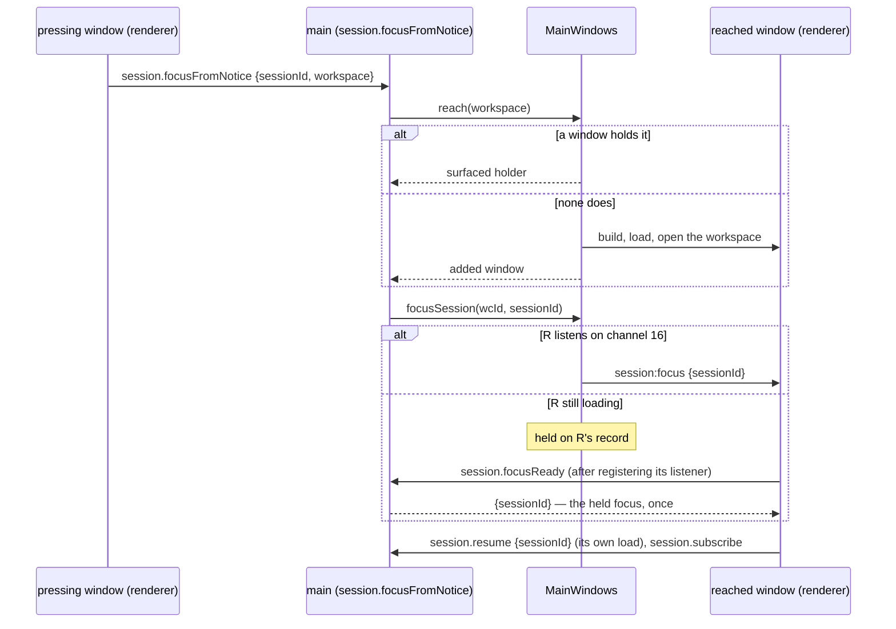
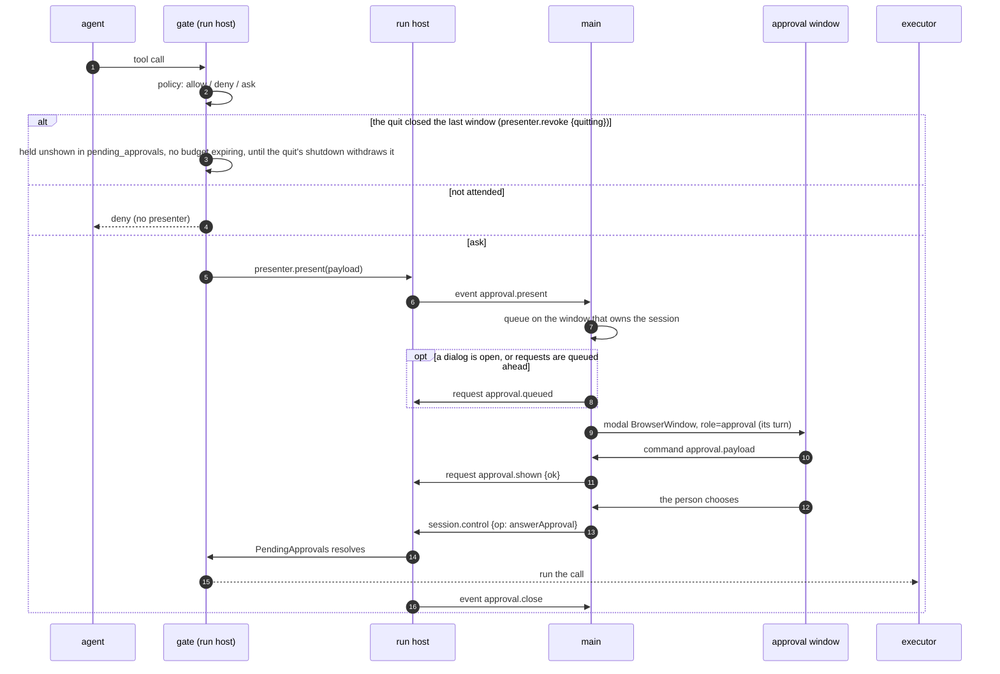
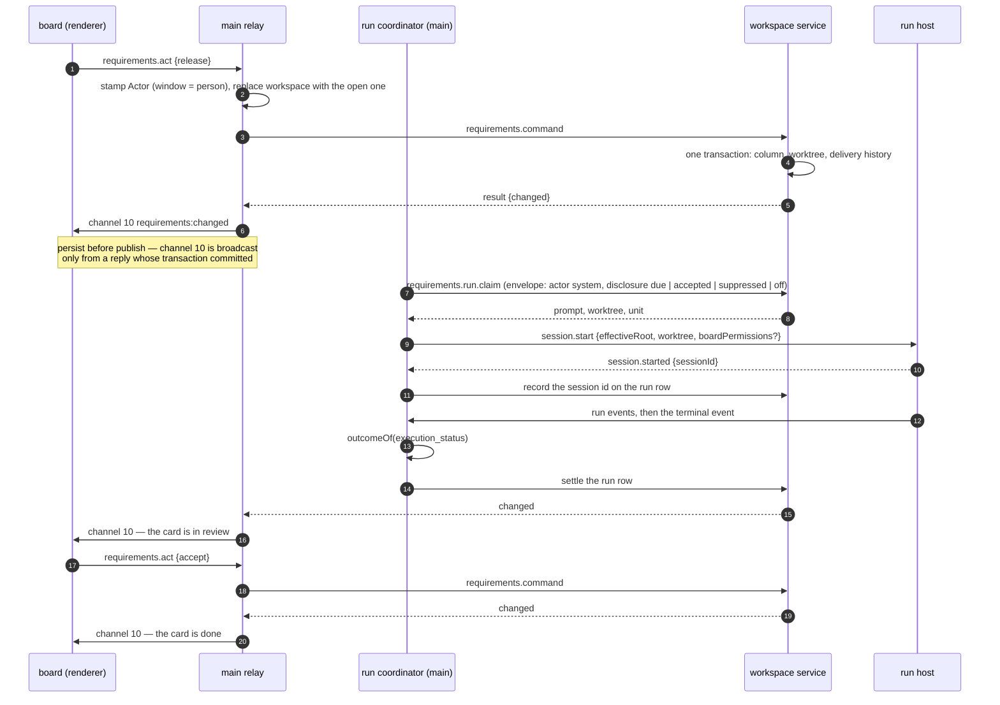

# Sequences — the flows the runtime view does not own

[`03-runtime-view.md`](03-runtime-view.md) owns **the run**: start, loop, turn, children, controls, end. Three
other flows cross every process, are asked about constantly, and had no home. They are here, with a fourth that
crosses the run's own agents: how a run comes to rest.

Each is drawn from the code and names the functions in it. One is added when a part first touches a flow that
needs one — not in advance, because a diagram nobody maintains is worse than no diagram.

| Flow | Answers | Section |
|---|---|---|
| Startup to a painted window | what happens before anything else can, and why a view's first read may find no workspace | [§1](#1-launch-to-a-painted-main-window) |
| A permission approval | how a tool call becomes a modal and comes back a decision | [§2](#2-a-permission-approval-end-to-end) |
| The requirements board | how a card becomes a run and a run becomes a card again | [§3](#3-the-requirements-board-release--run--review--accept) |
| A run comes to rest | what a pause, a stop, a quit and a crash leave behind, and when each is written (PD-ORCH-005) | [§4](#4-a-run-comes-to-rest-pd-orch-005) |

---

## 1. Launch to a painted main window

`apps/desktop/src/main/index.ts` (`main()`) and `apps/desktop/src/main/main-windows.ts` (`launch`,
`resolveStartup`, `open`).

```mermaid
sequenceDiagram
  autonumber
  participant OS
  participant M as main
  participant MW as MainWindows
  participant RH as run host
  participant WS as workspace service
  participant R as renderer

  OS->>M: launch (argv may carry a folder)
  Note over M: Phase 0 — BEFORE app.whenReady(),<br/>before any window, before any write
  M->>M: claimInstance(...) — the endpoint listens first, then the record naming it is written (ADR-0055)
  alt handed over
    M-->>OS: app.exit(0) — shows nothing, leaves nothing behind: its endpoint (opened first) and its per-attempt directory removed (OQ-248)
  else refused (both claims lost, or no directory could hold the endpoint — no record written)
    M-->>OS: one error line, app.exit(2)
  else claimed
    M->>M: preferences, theme, provider catalogue
    M->>M: await app.whenReady()
    M->>RH: utilityProcess.fork(run-host.js) — one for the application's lifetime
    M->>MW: launch(argvWorkspace)
    MW->>MW: resolveStartup: explicit folder → remembered (if still a directory) → cwd + prompt
    MW->>R: build window, load renderer
    R-->>M: first paint
    MW->>M: postShowActivation(window) — once, on the window's own show event, never during construction
    M->>M: updater.activate(window) — REQ-STARTUP-043/114
    alt not updatable (a source-tree or development launch, a payload run without its launcher) or a demo window
      M->>M: one application-log line at info; NO request (REQ-STARTUP-106/057/150)
    else a released artifact, no operation in flight
      M->>M: first check of the launch only — delete a portable's leftover <name>.old (REQ-STARTUP-115)
      M-->>M: GET the one endpoint, 10 s, Accept header (REQ-STARTUP-105)
      Note over M: a strictly newer release carrying this flavour's exact asset<br/>and not the waved-off version → the offer notice (REQ-STARTUP-107/108/109/116);<br/>an update already installed or handed off in this process is not offered again (REQ-STARTUP-119);<br/>every failure one log line, never a surface (REQ-STARTUP-110)
    end
    MW->>WS: open(root) — fork one service per workspace
    WS->>WS: identify workspace, open and migrate the store
    WS->>WS: starter agents.yaml if absent or blank (REQ-CONFIG-025/028), never over a file
    WS-->>MW: workspaceId, storeFile
    MW->>RH: workspace.opened
    Note over M: 800 ms later, the open's slot (REQ-WORKSPACE-141): initialization resolution, the board's queue,<br/>hooks.summary → the hook-review or no-provider notice, and config.read → under a fatal load<br/>"The workspace configuration did not load", raised last so it stands (OQ-279)
    opt no folder was resolved
      MW->>MW: deferProjectOffer(wcId, 650 ms)
      Note over MW: abandoned unshown if the question<br/>was answered first
    end
  end
```

**The window paints before the workspace opens.** A view's start-time read — the Overview's session list, the
repository card — therefore arrives while no workspace exists yet. Those reads **wait, bounded**
(`awaitWorkspace`, 30 s) rather than being refused; getting this wrong was a first-execution defect of the
Overview. The readiness they wait on is pending from `MainWindows.build` and settles when the window's first open settles
(or the window is forgotten), so the wait also covers a read that arrives between the window's load and its open; and a
notice action's `reach` that meets a window still opening the workspace it names waits on the same readiness before acting
on it (2026-10-14, `../../defects/fixed/a-notice-action-reaching-a-window-still-opening-its-workspace-is-refused.md`). After
that wait only a window that is gone is refused; one that stands with no workspace open (its store refused, OQ-281) is
reached, and the action's surface answers in it (2026-10-14,
`../../defects/fixed/a-notice-action-reaching-a-window-whose-store-was-refused-answers-an-unreported-failure.md`).

**The update check rides the post-show activation, and so does every window built later.** `MainWindows` fires
`postShowActivation` once per window on the window's own show event — the launch's window, a replacement's
(REQ-STARTUP-047's "fresh update check for that window"), an added one's, a hand-over's — and the updater answers each
with one check or one log line, one operation in flight at a time (REQ-STARTUP-114). Phase 0 has a second entrance
since 2026-09-28: a launch carrying `builtin:update-successor -- <endpoint>` is the successor an update restart
started, performs no claim and no hand-over attempt, and inherits the record instead (`inheritInstance`; below).

### `Update now`, and `Restart now` — the offer to the successor

`apps/desktop/src/main/updater/updater.ts` (`install`, `restart`), `install.ts`, `strategies.ts`;
`packages/platform/src/instance.ts` (`passRecord`, `inheritInstance`). ADR-0054 decided the sequence, ADR-0055 the
hand-over of the record.

```mermaid
sequenceDiagram
  autonumber
  participant R as renderer
  participant M as main (updater)
  participant F as the release feed
  participant S as the successor
  R->>M: update.install (Update now / Try again)
  opt installer flavour: every main window's unsaved settings first (REQ-SHELL-119 (1), REQ-SHELL-124, OQ-311 since 2026-10-14)
    M->>R: askUnsavedInTurn — active window first; a window with no guard installed skipped; each other surfaced, then asked Save/Discard/Cancel
    M-->>R: Cancel or a failed Save: { cancelled } — nothing downloaded, no run box, the notice as it was
  end
  opt installer flavour, a run active (REQ-STARTUP-046, OQ-86 since 2026-10-06)
    M->>M: activeRuns — runs.active, instance-wide; confirmClose at the click, the message box "A run is still executing", Return to the window the default
    M-->>R: returned: { cancelled } — nothing downloaded or started, the offer notice stays
  end
  M->>M: the offer notice becomes "Downloading Rotaris {v}" IN PLACE, action disabled (REQ-STARTUP-118, REQ-SHELL-118)
  M->>F: GET SHA256SUMS.txt, then SHA256SUMS.txt.sig
  M->>M: verify the signature against the compiled-in key set — BEFORE parsing (REQ-STARTUP-122/167); empty set → refused, nothing downloaded
  M->>M: parse the manifest (REQ-STARTUP-113)
  M->>F: GET the one asset, redirects followed, into <temp>/rotaris-update-…/ in 1 MiB chunks; progress repainted per whole percent
  M->>M: digest verified, case-insensitively, with REQ-STARTUP-123's sentences
  alt portable: rename aside, move in (REQ-STARTUP-125)
    M->>M: "Update installed" + Restart now (REQ-STARTUP-119)
    R->>M: update.restart
    M->>R: confirmUnsaved at the click — every main window's Save/Discard/Cancel in turn (OQ-311); Cancel or a failed Save → { cancelled }, no run box, nothing started
    M->>M: confirmClose next when a run is active (REQ-STARTUP-046, OQ-86); returned → { cancelled }, nothing started
    M->>R: confirmUnsaved again just before the start (OQ-311); Cancel → { cancelled }, no successor
    M->>M: activeRuns re-read just before the start; a run past what the click covered is asked about again (mustAskAtHandOff)
    M->>S: spawn <artifact> builtin:update-successor -- <this endpoint>, detached
    S->>S: no claim; open its own endpoint (inheritInstance)
    S->>M: {"successor": {pid, host, acquired_at, endpoint}} — then waits ≤ the hand-over interval for the offer
    M->>M: only while this restart waits (acceptSuccessor), and only while the record names this instance (passRecord)
    M-->>S: {"record":"offered"} — the record is NOT yet passed
    S->>M: {"ack":true} — still waiting; from here it waits for the last word with no bound of its own
    M->>M: the acknowledgement within the hand-over interval (timer port), then replace the record atomically with the successor's fields
    alt the successor closed before acknowledging, no acknowledgement within the interval, the record is not this instance's, or the replacement fails
      M-->>S: {"ok":false,"reason":…} (if it is still there) — the successor ends; the record is as it was
      M->>M: onRecordPassFailed → the wait rejects → "Update not installed", nothing closes (REQ-STARTUP-121)
    end
    M-->>S: {"ok":true,"record":"passed"} (should the connection end without it, the successor reads the record)
    M->>M: destroy the windows; the ordinary quit; close leaves a record that no longer names it
  else installer: beforeApply — every window's unsaved settings asked again (OQ-311), then activeRuns re-read and any run active now asked about again (OQ-86); either declined → the download discarded, the offer back in place, { cancelled }
    M->>M: spawn the setup, detached (REQ-STARTUP-125)
    M->>M: "Finish the update", no action; the window closes after ONE 1200 ms delay (REQ-STARTUP-119)
  else any failure
    M->>M: the notice becomes "Update not installed" in place, the sentence as detail, Try again (REQ-STARTUP-120)
  end
```

*Since 2026-10-06 (OQ-86 ruled by R-071):* both actions that close the windows — `Update now` (and `Try again`) on the
installer flavour, whose hand-off closes them after REQ-STARTUP-119's delay, and `Restart now` — ask REQ-STARTUP-046's
active-run confirmation at the click (`UpdaterDeps.confirmClose`), before anything is downloaded, the installer is spawned
or the successor started: main asks the run host `runs.active` (instance-wide, since every window closes; a count it cannot
read is taken as a run active) and, for any active run, shows a message box whose default, Escape and close control are
`Return to the window`; that answer starts nothing and leaves the notice as it was. The portable's in-place apply closes
nothing and asks nothing. *Corrected the same day at verification:* the count is read again **immediately before the
installer is spawned or the successor started** (`UpdaterDeps.activeRuns`; `runInstall`'s `beforeApply`;
`mustAskAtHandOff`), because the installer's download runs for minutes while the window accepts input and a run started
then was ended by the auto-close unasked. After a download any run active then is asked about again (a count has no
identity); `Restart now` asks again only for a run past the count its click was asked about, or where the click asked
nothing. Declined there, the verified download is discarded and the offer comes back in the same notice. The confirmation
belongs to the one update operation in flight, so a second click while its box is open is `update.busy`.

*Since 2026-10-14 (OQ-311, ruled by the consortium under R-072, built by fin46):* the same clicks are user-initiated closes for
REQ-SHELL-119 guard (1), so **before** the run box, at the click and again first at the hand-off, main asks REQ-SHELL-124's
Save/Discard/Cancel of every open main window one at a time (`UpdaterDeps.confirmUnsaved` → `askUnsavedInTurn`, wired in
`index.ts` over `askRendererGuard`): the active window first, then `MainWindows.ordered()`; a window whose renderer installed no
guard (`RENDERER_UNSAVED_PROBE_SCRIPT`) is neither surfaced nor asked; each other is surfaced, then asked; the first Cancel or
failed Save stops the sequence and answers `UPDATE_DECLINED_UNSAVED`, starting nothing (at the installer's hand-off, the
declined path above); a renderer that cannot answer allows (PD-SHELL-010). One log line per asking names the action, the moment
and each window's answer. A renderer asked again while its dialog is open joins that question
(`apps/desktop/src/renderer/guard-question.ts`). The portable's apply and the 1,200 ms auto-close ask nothing.

A successor that cannot be started surfaces through `Update not installed` and nothing closes; one that never
signals leaves this instance holding its record and its window, with no timeout (REQ-STARTUP-121, ADR-0055). A
successor that started and was accepted, but that the record cannot be passed to — the record no longer names this
instance, the successor stopped waiting (it closed before acknowledging the offer, or its acknowledgement did not arrive
within the hand-over interval: its announcement was read after its own bound had expired, the predecessor's loop having
been blocked), or its atomic replacement fails — is answered `{"ok":false,"reason":…}` if it is still there, and ends; the claim reports it to
main (`onRecordPassFailed`), main's wait (`updater/successor.ts`) rejects with the reason, and the restart takes the
same failure branch: `Update not installed`, nothing closes, the in-flight guard clears. A successor announcement that
arrives while no restart is waiting — a sentinel launch nobody started — is answered `{"ok":false,"reason":…}`, the
record is unchanged, nothing is reported to main, and that launch ends; the instance stays the only one
(REQ-STARTUP-161). **The pass is two steps (2026-09-28)** so the record is never rewritten for a successor that has
stopped waiting: the offer, the acknowledgement within the interval, then the rewrite and `passed`. An ordinary launch's
hand-over (REQ-STARTUP-162) is one line in and `{"ok":true}` out, unchanged.
Nothing of the installation is moved or modified before the replacement is fetched whole and verified
(REQ-STARTUP-126). The apply strategies and the restart are decided by unit tests over fakes; their run against a real
Windows artifact is owed to the next Windows package (IC-3 — *corrected 2026-10-13: a Windows x64 host, deferred with the pipeline under R-071; IC-3 binds Linux and macOS artifacts*) — ADR-0054's "The updater" note says what was executed.

### Opening another project, from inside

`MainWindows.choose` decides between four endings, in this order:

| Condition | Ending |
|---|---|
| `newWindow` (palette entry, or the chip with the platform's secondary-activation modifier) | `#addWindow` — no gate evaluated, nothing closed |
| the chooser was dismissed | a transient notice, nothing changes |
| the folder is already open **in this window** | a transient offering "Start a new session" |
| the folder is already open **in another window** | that window is surfaced; nothing is built |
| otherwise | `#replace` |

`#replace` is ordered and the order is the requirement: **build the replacement, open its service, show it,
await the outgoing window's own close, and only then persist.** A vetoed close discards the replacement and
changes nothing.

Before a replacement is even attempted, `#workspaceOpenGates` runs two gates: the unsaved-settings close guard,
then the active-run count. A gate that declines answers `{cancelled: true}` — not a failure.

### A notice action that names a workspace (PD-SHELL-001 revisions 2 and 3)

`MainWindows.reach(workspace)` is the chooser's third ending without a chooser: the window holding the workspace is surfaced
and returned (waiting, bounded, for its open if it is still opening it, and returned also when that open left it with no
workspace — a store refused, OQ-281 — so its surface answers), else a window is added for it by `#addWindow` — no
gate, nothing closed, the workspace persisted as last opened, a failure reported under REQ-SHELL-019. The action's surface
then opens in the reached window. For the hook review main parents the dialog to it; a review main refuses ("This workspace
declares no hooks", "Open a workspace before reviewing its hooks") is published by the pressing window as a persistent
`warning` notice in main's words (`renderer/notice-action-refusal.ts`, REQ-NOTIFY-254, since 2026-10-14), except a refused reach,
which REQ-SHELL-019 already reported. The `focus-session` and project-setup presses take the same report for their refusals
("The window holding the session closed before it could focus it", "…the project closed before Settings › Project could open",
"No main window is open"), since 2026-10-15. For `focus-session` (revision 3, OQ-292) main asks it to focus the session on channel 16:



---

## 2. A permission approval, end to end

`packages/agent-tools/src/gate.ts` → `approvals.ts` (`PresenterRegistry`, `PendingApprovals`) →
`apps/desktop/src/run-host/index.ts` → `apps/desktop/src/main/index.ts` (`presentNext`).



The parts that are easy to get wrong:

- **Attendedness is a boolean the run host maintains**, not a question it asks. Main polls alive every 250 ms;
  3,000 ms without a reply is a lapse, and a lapse **cancels every waiting approval** — they resolve
  `cancelled`, and the application is unattended until main answers again (`ADR-0019`).
- **Closing the dialog answers Deny** while the application stays: the user closed the dialog, or one main window
  of several. A request already answered or cancelled asks nothing more. A dialog that the application's quit closes
  answers nothing (`QuitState`, `main/exit.ts`). The quit's `shutdown` then withdraws the approval — at a rest,
  and during a plan cycle too, where the cycle's agents end rather than rest (PD-ORCH-005 clauses 9 and 15; OQ-108). The question
  dock's cancellation is held back at a quit the same way. *Until phase 7 the quit's close sent a Deny first, and the
  agent stepped on it: `docs/defects/fixed/a-quit-denies-the-approval-it-should-withdraw.md`.*
- **The quit's gap is not unattended.** Main revokes the last window's presenter as it closes, but sends `shutdown`
  only after `window-all-closed` has waited on the checkpoint operation (REQ-GIT-101). The revoke the quit causes
  carries `quitting` (from `QuitState`), and until a window registers again `PresenterRegistry.quitting` holds what is
  asked: an approval is published `brokered` and waits unshown, a present that crossed the close and came back "not
  shown" waits too, a question is recorded pending, and no timer expires on any of them (`PendingApprovals`'
  and `PendingQuestions`' `held`). The shutdown then withdraws them by `quit` (PD-ORCH-005 clause 9; OQ-132). *Until
  2026-09-29 an ask in the gap met no presenter and was denied by the headless policy:
  `docs/defects/fixed/an-approval-asked-after-the-last-window-closes-is-denied.md`.*
- Presentation order is **oldest first by the published sequence**, and that sequence orders presentation
  *across* windows, not within one.
- A dialog that cannot be shown is not a hang: `approval.shown {ok: false}` comes back, the pending request is
  discarded, and the call is denied with source `presenter-error`. Main must acknowledge a request within 10 s,
  either by showing it or, when it waits behind the open dialog, with `approval.queued`. A queued request then waits
  for its turn without that bound (REQ-TOOLS-063). The gate races the presentation against its own wait, so a queued
  request that times out or is cancelled is dropped unshown and counts as cancelled (REQ-TOOLS-054), and one answered
  elsewhere is honoured. A window that closes while the application stays hands its queued requests to main
  (`MainWindows`' `unshownApprovals`), which answers each `approval.shown {ok: false}`; during a quit it answers
  nothing, and the shutdown withdraws them. *Until the fourteenth review round of the merged revision 4 build, main acknowledged only
  what it showed, so a request queued behind a dialog left open for 10 s was denied unshown:
  `docs/defects/fixed/a-queued-approval-is-denied-unshown-after-ten-seconds.md`.*
- Only an **answer, a cancellation or a withdrawal** releases the wait. A wait with no limit is still released —
  the explicit cancel cancels whatever is blocked on a person as its first act, and a rest (a pause, a stop, a quit)
  **withdraws** it: the call settles blocked and interrupted, `approval_withdrawn` (or `question_withdrawn` for a
  question) names the interruption, no decision is audited, and no `tool_error` issue is filed (PD-ORCH-005 clause 9;
  §4).
- **Approve for the session adds a grant to the agent's `PolicyContext`**, matched before any policy rule on
  every later call (`policy.ts`, REQ-TOOLS-023/024). A grant for the public `write_file` or `haet_edit` (`haet`
  folded in) covers a path, not an argument set (`PD-TOOLS-004`): the gate hands `grant` the workspace root, the
  resolver and the run host's `publicTool` predicate (an MCP tool offered under either name is not the public one),
  the grant stores the set of paths its REQ-TOOLS-018 path arguments resolved to, and a later call of that tool
  from that persona is allowed without a dialog when its own set is exactly that one — a retried edit with a new
  `old_string` included. Every other tool's grant, an MCP tool's under a public name among them, still needs the
  identical command facet or argument set. The same predicate decides whether a rule's tool set holds a call at all
  (`toolSetHolds`, 2026-09-28): `ask:read-only-tool`, `restricted`'s two read rules and the fetch pair are written over
  REQ-TOOLS-007's classes of public tools, so a server's `read_file` or `fetch` offered under the plain name is decided
  by the preset's default, not by the class rule. And the path scope of REQ-TOOLS-018 joins each path argument to the
  workspace root before the resolver, as the approval's `resolvedPathSet` always did.
- **One unanswered wait makes the user away for the rest of the run (`PD-TOOLS-005`).** When a brokered wait ends by
  timeout the gate marks the run's `UserPresence` — the engine's, one holder per run, on every agent's port, a
  delegated child's included. From then until the user's next input to that session (an answer, a message, a run
  control, a mode change — `03-runtime-view.md` §5) every ask that would prompt takes the headless branch above with
  no wait created and nothing presented: `approval.requested` in its headless shape (REQ-EVENTS-049 admits no other
  `unattended_reason`), and the decision `headless-policy` with a reason naming the timeout that expired. A session
  with no presenter is still reported as such, ahead of the away check. The first ask still waits the full timeout, a
  timeout of 0 never marks the user away, and every run starts with the user present.

---

## 3. The requirements board: release → run → review → accept

`packages/ui/src/requirements/` → `apps/desktop/src/main/requirements.ts` (the relay) and
`requirements-runs.ts` (the run coordinator) → `apps/desktop/src/workspace-service/delivery.ts`.



- **A proposed technical requirement is accepted from the review, one at a time** (*since 2026-10-13, fin41*;
  REQ-TRACE-427..433). The review pane's `Accept "<title>"` control sends `requirements.act {accept-proposal, payload
  {proposal, title}}` on the reviewed card. `decide` admits it only in `review`, as a record that moves nothing. The
  delivery service's `beforeCommit` writes the technical requirement into the requirement source through
  `requirements.source.write`'s units, between the admission and the commit, so a refused write records nothing. The
  history entry names the identifier written (`BeforeCommitOutcome.reason`). The pass then re-reads the store, and the
  new requirement gets a `create` record. `confirm_source_writes` is not read. `accept-change-work` is still refused, now
  naming REQ-TRACE-411/412's offer, which no pass makes.
- **A renderer never sends an actor.** The command schema has no field for one; the relay stamps it from where
  the command arrived — a window's `webContents` is a person under the account main runs as, anything else is
  the system. The workspace is likewise replaced with the one this instance has open, so a board cannot act on
  another workspace.
- **One claim is one `session.start`.** The row is written the moment the run host answers, or the launch is
  abandoned with a reason.
- **A unit is provisioned once.** The worktree is provisioned inside the run-starting action's transaction. A later
  run-starting action for the same unit takes that tree over and never provisions it again (REQ-TRACE-464,
  REQ-GIT-140). Such an action is a card held out of `ready` before its run began and then resumed, or returned and
  released again. The tree comes from the launch the service holds, or, after a restart, from the store's worktree row
  through `takeOverUnitWorktree`, which admits only a tree Git lists at that path on that branch (2026-10-02).
- **A card resting in `ready` keeps a way to start after a restart.** The launch (unit, disclosure, tree) lives in the
  workspace service's memory, and the queue's release has no transition. So `recoverLaunch` rebuilds a lost launch
  from the store's worktree row by take-over, never by provisioning: on every pass that parses, for a card holding no
  launch (undisclosed), and on the queue's release, which records the disclosure "Disclose and start" carries and arms
  the card. A tree that cannot be taken over is stated on the entry as the last start's stall, and the claim still
  refuses the card (REQ-TRACE-472/482/464, REQ-TRACE-463; 2026-10-02).
- **A run that stops at its iteration limit rests the card in `blocked`** (*since 2026-10-06, OQ-180 ruled by R-071*):
  `outcomeOf` reads `stopped` — REQ-MONITOR-029's `max_iterations`, the iteration or the time limit — as `failed`, so
  `recordRunEnded` holds the card with a `run-failure` blocker returning to `ready`, as a user's stop (`paused`) already
  did, and a person's resume provisions the next unit. Only an explicit cancel (`cancelling`) still ends `cancelled`.
  Until the ruling `stopped` ended `cancelled` into `ready`, and under `automatic` the dispatch after every run's end
  started the next unit at once, without bound.
- **A card's next unit is provisioned at the claim.** A reject, or a run ending `cancelled` (~~stopped at its iteration
  limit~~ an explicit cancel, since OQ-180's ruling), rests a card in `ready` on a unit no run-starting action provisioned. The launch held for the finished unit
  is spent: the queue names the card's current unit, and its disclosure carries over. The claim — the system's
  dispatch, under both modes — provisions that unit when the store records no tree for it, and writes the row at once
  (`recordWorktreeProvisioned`), so a restart before the start takes it over. The read pass, the queue's release and the
  reject never provision; a recorded tree that is gone stays the stall (REQ-TRACE-423/464/482, REQ-TRACE-408;
  2026-10-02). A claim before the first pass under `manual` with nothing armed answers without parsing the store.
- **Every requirements command carries main's standing disclosure.** Only main holds the two preferences of
  REQ-TRACE-472, so main stamps what they make of an undisclosed launch on every `requirements.command` envelope, beside
  the actor — the relay for a person's commands and the coordinator for its own: `due`, `accepted` (accepted, not
  permanently, earlier in this launch of the application: main holds it in memory, told by the board's
  `requirements.runs {op: 'accept'}`, and the preview reads it too, so no dialog is shown again until the next launch;
  2026-10-02), `suppressed` (accepted permanently) or `off` (the elevation switched off). The service holds the last value and schedules the published
  queue, the launch preview and the claim under the same one, so the queue names what the claim takes (REQ-TRACE-478); a
  value that moved republishes the queue before the answer, which carries `changed`. A launch recorded undisclosed, as a
  recovered one is, is claimed when that is not `due`, and `off` gives the run the workspace's own mode. A permanent
  acceptance reads the board at once. (Until the second repair round of 2026-10-02 it rode the claim alone.)
- **The coordinator is kicked at every workspace open.** Main's post-open slot (`openWorkspaceInner`, beside the
  initialization's resolve, once the window is interactive) calls `requirementsRuns.opened(root, workspaceId)`, a
  dispatch for the workspace just opened rather than the focused window's, so an automatic queue resumes where it
  stopped with no person acting (REQ-TRACE-476/482). Dispatches are serialised per workspace root. The renderer kicks
  after every run-starting move and, under automatic scheduling, after an act that rests a card in `ready` without
  starting a run (a `reject`; `dispatchesAfter` in `ui/src/requirements/model.ts`). The board's own read never
  dispatches (REQ-TRACE-408/512). (Until 2026-10-02 nothing dispatched at launch, and an automatic queue picked a
  recovered card up only at the first kick a person or a run's end gave.)
- The elevated grant (`boardPermissions: 'permissive'`) travels **on the `session.start` of that launch** and
  applies to the configuration captured for it. It is not a mode anything stays in.
- A board read is bounded at 120 s because it may run the engine's three passes; everything else is a store
  read or one transaction, bounded at 30 s.
- If the run host exits holding board runs, the coordinator **reaps with an empty live set** rather than
  leaving rows that claim to be running — every workspace that held one, beside the focused window's.
- **A run is settled against its own workspace.** The coordinator keeps, for each board run, the workspace root and id
  it was started for, and its ending (`run.ended`), its waiting-on-a-person fact (`run.waiting`) and the dispatch that
  follows its end address that workspace's service, whichever window holds the focus (REQ-TRACE-477/466; until
  2026-10-02 they read the most recently focused window's workspace).

---

## 4. A run comes to rest (PD-ORCH-005)

`packages/engine/src/run/run.ts` (`pause`, the stop listener, `turn`'s `finally`, `leaveIterationOpen`, `teardown`) →
`children/orchestration.ts` (`beginRest`, `execute`, `rest`) → `children/scheduler.ts` (`hold`) →
`run/turn.ts` → `session-writer.ts` (`restChild`, `recordIterationInterruption`, `recordAgentTerminal`). A pause is
drawn; a stop and a quit differ where marked.

```mermaid
sequenceDiagram
  autonumber
  participant U as person (main)
  participant S as Sessions
  participant R as Run
  participant P as tool ports
  participant IC as IterationChildren
  participant C as a child's execution
  participant W as SessionWriter

  U->>S: session.control {op: pause}
  S->>R: pause()
  alt the plan gate holds
    R-->>S: false (clause 11)
  else accepted
    R->>W: save('pausing'), run_pause_requested
    R->>P: withdrawPending('pause') — each waiting call: blocked, interrupted
    R->>R: release every provider-limit wait; arm the tool deadline (clock port)
    R->>IC: beginRest() — scheduler held, waiting parents woken
    Note over R,C: a stop or a quit: the same withdrawal and beginRest from the stop listener, then the run signal aborts
    C->>C: the step in flight finishes; calls not started are recorded "not run"; no retry, fallback or summarising call
    C->>W: restChild(task, 'pause', resume state) — paused, child_paused
    R->>IC: rest('pause') — waits for every execution (a stop or a quit: within 30 s, then detaches the rest), pauses the unstarted where they stood
    R->>R: read the cause again — the explicit cancel meanwhile: every agent cancelled, the iteration closed
    R->>W: recordIterationInterruption, iteration_paused — the iteration stays open
    R->>W: teardown: agent_terminals (a pause leaves them running; a stop or a quit records its end, then ends them)
    R->>W: endRun('paused') — the lock released
  end
```

- **What does not happen.** No `iteration.end`, checkpoint, `iteration_end` hook or count for the open iteration; no
  summary, report or terminal state for a paused child; no model call after the pause beyond the step in flight.
- **A crash writes none of this.** The next repair or continue does (`run/crash.ts`): the interruption `crash` on the
  open row, its unfinished agents paused, a dead run's unanswered calls answered, its approvals withdrawn, its
  background sessions ended. Loading the session writes nothing, and the user's cancel of one crash-left child while the
  session rests records none of it but the cancelled agents' own cut-off calls, which no later record reaches (answered
  as interrupted, `answerOpenCalls`): it cancels that child from where it stood (`Sessions.cancelPausedAtRest`, OQ-101).
- **The explicit cancel is not a rest.** The reserved run id's final stop cancels the waits, drains and finalizes as
  before: every agent `cancelled`, the iteration closed — including when it arrives while a pause or a stop is still
  coming to rest, or later while teardown runs (the iteration this run left open then closes before the run's result is
  built; a cancel after that is refused). It ends the agents' background sessions as a stop does, and lets a child
  summarising during REQ-ORCH-080's drain finish (OQ-96).
- **The next continue resumes it** (`03-runtime-view.md` §2): the open iteration first, the same root and task, every
  paused agent moved back and carrying on from its record, told of its background sessions, the root handed a new
  message as its next. It runs under the intent it started with, carried and unclassified (PD-ORCH-005 clause 40, OQ-162):
  the Continue action makes no classification call, and a continue by message's classification governs from the run's
  next iteration. At its first model step each resumed agent's persona definition is compared with the fingerprint its
  record kept (PD-ORCH-005 clause 14, OQ-105); when they differ the run writes a `resumed_under_changed_instructions`
  warning issue and a transcript `system` row naming the agent, and keeps the new definition, so a change is stated once. Declined
  ("continue without them"), its paused agents end `cancelled` and it closes before the new run's first iteration
  (`closeLeftOpenIteration`).
