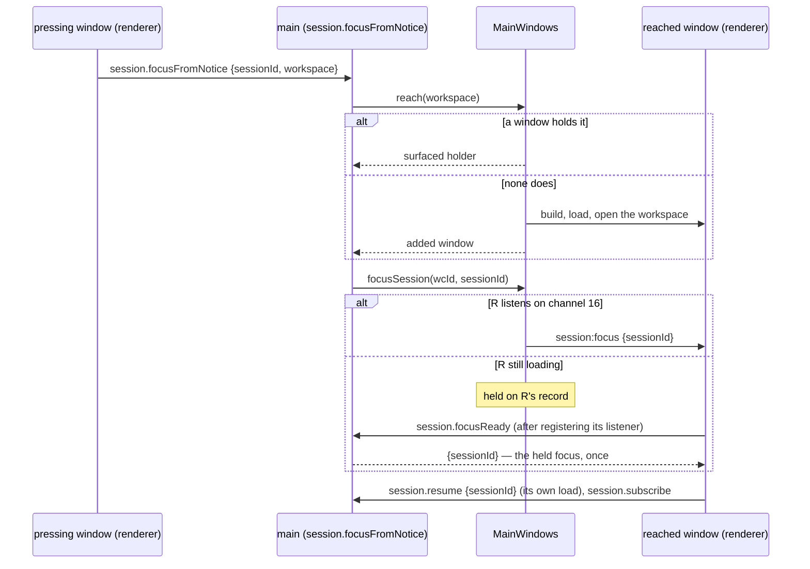

# Sequences — the flows the runtime view does not own — 1. Launch to a painted main window

Part 1 of 4 of [the sequences](../06-sequences.md), which indexes every part.

## 1. Launch to a painted main window

`apps/desktop/src/main/index.ts` (`main()`) and `apps/desktop/src/main/main-windows.ts` (`launch`,
`resolveStartup`, `open`).

```mermaid
sequenceDiagram
  autonumber
  participant OS
  participant M as main
  participant MW as MainWindows
  participant RH as run host
  participant WS as workspace service
  participant R as renderer

  OS->>M: launch (argv may carry a folder)
  Note over M: Phase 0 — BEFORE app.whenReady(),<br/>before any window, before any write
  M->>M: claimInstance(...) — the endpoint listens first, then the record naming it is written (ADR-0055; a named pipe on Windows, pinned there by instance-order.test.ts since 2026-10-21)
  Note over M: (2) hand over to the process the record names — acknowledged only while the record still names it (ADR-0055 consequence 14)<br/>(3) unacknowledged: remove the record unless it now names another live claim, retry once<br/>(4) that retry lost: hand over once more to the record's process
  alt handed over
    M-->>OS: app.exit(0) — shows nothing, leaves nothing behind: its endpoint (opened first) and its per-attempt directory removed (OQ-248)
  else refused (both claims lost and (4)'s hand-over unacknowledged, or no directory could hold the endpoint — no record written)
    M-->>OS: one error line, app.exit(2)
  else claimed
    M->>M: read .rotaris-preparation beside process.execPath; hold a run-scoped finding (REQ-STARTUP-165 (c), ADR-0055 phase −1)
    M->>M: preferences, theme, provider catalogue
    M->>M: await app.whenReady()
    M->>RH: utilityProcess.fork(run-host.js) — one for the application's lifetime
    M->>MW: launch(argvWorkspace)
    MW->>MW: resolveStartup: explicit folder → remembered (if still a directory) → cwd + prompt
    MW->>R: build window, load renderer
    R-->>M: first paint
    MW->>M: postShowActivation(window) — once, on the window's own show event, never during construction
    opt a run-scoped finding is held
      M->>R: notices.report — warning, keyed once per run: could not prepare, the per-user data directory, every launch costs this
    end
    M->>M: updater.activate(window) — REQ-STARTUP-043/114
    alt not updatable (a source-tree or development launch, a payload run without its launcher) or a demo window
      M->>M: one application-log line at info; NO request (REQ-STARTUP-106/057/150)
    else a released artifact, no operation in flight
      M->>M: first check of the launch only — delete a portable's leftover <name>.old (REQ-STARTUP-115)
      M-->>M: GET the one endpoint, 10 s, Accept header (REQ-STARTUP-105)
      Note over M: a strictly newer release carrying this flavour's exact asset<br/>and not the waved-off version → the offer notice (REQ-STARTUP-107/108/109/116);<br/>an update already installed or handed off in this process is not offered again (REQ-STARTUP-119);<br/>every failure one log line, never a surface (REQ-STARTUP-110)
    end
    MW->>WS: open(root) — fork one service per workspace
    WS->>WS: identify workspace, open and migrate the store
    WS->>WS: starter agents.yaml if absent or blank (REQ-CONFIG-025/028), never over a file
    WS-->>MW: workspaceId, storeFile
    MW->>RH: workspace.opened, 5 s (handOffOpenedWorkspace)
    alt workspace.ack
      Note over M: 800 ms later, the open's slot (REQ-WORKSPACE-141): initialization resolution, the board's queue,<br/>hooks.summary → the hook-review or no-provider notice, and config.read → under a fatal load<br/>"The workspace configuration did not load", raised last so it stands (OQ-279)
    else another reply, or none within 5 s (OQ-386)
      Note over M: one warning line for a missed reply; the window keeps the workspace, and no slot is scheduled
    end
    opt no folder was resolved
      MW->>MW: deferProjectOffer(wcId, 650 ms)
      Note over MW: abandoned unshown if the question<br/>was answered first
    end
  end
```

**The window paints before the workspace opens.** A view's start-time read — the Overview's session list, the
repository card — therefore arrives while no workspace exists yet. Those reads **wait, bounded**
(`awaitWorkspace`, 30 s) rather than being refused; getting this wrong was a first-execution defect of the
Overview. The readiness they wait on is pending from `MainWindows.build` and settles when the window's first open settles
(or the window is forgotten), so the wait also covers a read that arrives between the window's load and its open; and a
notice action's `reach` that meets a window still opening the workspace it names waits on the same readiness before acting
on it (2026-10-14, `../../../defects/fixed/a-notice-action-reaching-a-window-still-opening-its-workspace-is-refused.md`). After
that wait only a window that is gone is refused; one that stands with no workspace open (its store refused, OQ-281) is
reached, and the action's surface answers in it (2026-10-14,
`../../../defects/fixed/a-notice-action-reaching-a-window-whose-store-was-refused-answers-an-unreported-failure.md`).

**A reply that never comes ends no start-up.** `main()` awaits `MainWindows.launch`, so until 2026-10-20 a request of the open
that got no reply within its bound rejected out of the launch and ended main's start-up as an unhandled rejection. The
driver seam, the hand-overs and everything after the launch never ran (`compression-proof`'s `automatic` launch, 2026-10-16;
`../../../defects/fixed/a-workspace-opened-timeout-is-an-unhandled-main-rejection.md`). Now the run host's missed
`workspace.opened` reply is a warning and an unacknowledged hand-off (`main/workspace-handoff.ts`). The window keeps its
workspace, and the open's slot is not scheduled, as for any reply that is not `workspace.ack`. Any other rejection of the
launch's open is logged, and the window stands with no workspace open, as a refused open leaves it. What else a missed reply
owes is OQ-386's, ruled 2026-10-21; its main-side points (the idempotent case, the second hand-off, the notice, the log
levels) are not built yet. Its point 1 is: the run host answers `workspace.opened` first and warms its skill catalogue
from a zero-delay timer on its clock port, which runs after the reply is posted. The warm-up reads the tree
asynchronously, at most four reads in flight (`SkillHost.warm`, `discoverSkillsAsync`). It stores its catalogue only if
no rescan or session creation cleared that root while it ran, and the `skills.*` reads wait for it rather than walk the
tree again. That wait is bounded on the clock port (`WARM_UP_WAIT_BOUND`, 6 s, under main's 10 s and 15 s bounds on those
requests): a warm-up that has not settled by then is abandoned, said once at `warn`, and the waiting request reads the
catalogue as a cold ask does. A request the saved configuration refuses (OQ-279) is refused before it waits, and a
warm-up that a clear overtakes stops at its next read instead of finishing beside the next one. Until 2026-10-31 the warm-up was a microtask holding the synchronous walk, which ran before the reply was
posted, so under load a slow discovery was a slow reply
(`../../../defects/fixed/the-run-hosts-skill-discovery-at-a-workspace-open-runs-before-its-workspace-opened-reply.md`;
[OQ-386](../../open-questions/67-spikes-and-later-questions-34.md#oq-386)). The re-discovery after a session creation or
a rescan is still synchronous, which the ruling left open.

**A process the record no longer names stands down (2026-10-31, ADR-0055 consequence 14).** The endpoint reads the record
again as each ordinary hand-over arrives (`listen`, `platform/instance.ts`). Where the file is gone, holds no record, or names
another process (a read that fails any other way shows nothing, and the instance answers: `readHolder`),
it calls no `onHandOver`, so nothing is surfaced. It answers `{"ok":false,"reason":…}` and reports
`onHandOverDeclined`, which main logs at `warn` (`hand-over declined …`). This covers a primary reclaimed from after a wedge
past the 5 s interval, and a predecessor whose record has passed to its successor. The launch that sent it resolves to the
process the record names. Its clause (3) removes the record unless a fresh read finds another live claim: nothing
readable, the claim it failed to reach, or a claim whose process has ended is reclaimed. A record naming another live claim
is left in place, the retry loses, and clause (4) hands the launch to that claim's process: exactly one instance, its
window surfaced (REQ-STARTUP-164). Where that process is live but does not answer (4) either, the launch ends `refused`
with no window, and whether REQ-STARTUP-164 admits that is open
(`../../../defects/a-launch-whose-two-hand-overs-go-unanswered-ends-with-no-window.md`). Until that date a resumed primary
surfaced its window for a stale hand-over, and (4) did not exist
(`../../../defects/fixed/a-primary-resumed-after-a-reclaim-goes-on-acting-as-the-instance.md`). What the stood-down process does
with its own windows is not decided
(`../../../defects/a-stood-down-primary-keeps-its-windows-and-runs-on-with-no-end-the-specification-states.md`, open).

**The update check rides the post-show activation, and so does every window built later.** `MainWindows` fires
`postShowActivation` once per window on the window's own show event — the launch's window, a replacement's
(REQ-STARTUP-047's "fresh update check for that window"), an added one's, a hand-over's — and the updater answers each
with one check or one log line, one operation in flight at a time (REQ-STARTUP-114). Phase 0 has a second entrance
since 2026-09-28: a launch carrying `builtin:update-successor -- <endpoint>` is the successor an update restart
started, performs no claim and no hand-over attempt, and inherits the record instead (`inheritInstance`; below).

### `Update now`, and `Restart now` — the offer to the successor

`apps/desktop/src/main/updater/updater.ts` (`install`, `restart`), `install.ts`, `strategies.ts`;
`packages/platform/src/instance.ts` (`passRecord`, `inheritInstance`). ADR-0054 decided the sequence, ADR-0055 the
hand-over of the record.

```mermaid
sequenceDiagram
  autonumber
  participant R as renderer
  participant M as main (updater)
  participant F as the release feed
  participant S as the successor
  R->>M: update.install (Update now / Try again)
  opt installer flavour: every main window's unsaved settings first (REQ-SHELL-119 (1), REQ-SHELL-124, OQ-311 since 2026-10-14)
    M->>R: askUnsavedInTurn — active window first; a window with no guard installed skipped; each other surfaced, then asked Save/Discard/Cancel
    M-->>R: Cancel or a failed Save: { cancelled } — nothing downloaded, no run box, the notice as it was
  end
  opt installer flavour: guard (2), instance-wide (REQ-SHELL-119 (2), REQ-NOTIFY-056, OQ-361 since 2026-10-21)
    M->>M: integrationAllows at the click — main's own record of an integration running anywhere (noWorktreeIntegration in this build)
    M-->>R: one running ("Integration in progress" over the active window) or the record unreadable (a warn line, no box): { cancelled } — nothing downloaded, no run box, the notice as it was
  end
  opt installer flavour, a run active (REQ-STARTUP-046, OQ-86 since 2026-10-06)
    M->>M: activeRuns — runs.active, instance-wide; confirmClose at the click, the message box "A run is still executing", Return to the window the default
    M-->>R: returned: { cancelled } — nothing downloaded or started, the offer notice stays
  end
  M->>M: the offer notice becomes "Downloading Rotaris {v}" IN PLACE, action disabled (REQ-STARTUP-118, REQ-SHELL-118)
  M->>F: GET SHA256SUMS.txt, then SHA256SUMS.txt.sig
  M->>M: verify the signature against the compiled-in key set — BEFORE parsing (REQ-STARTUP-122/167); empty set → refused, nothing downloaded
  M->>M: parse the manifest (REQ-STARTUP-113)
  M->>F: GET the one asset, redirects followed, into <temp>/rotaris-update-…/ in 1 MiB chunks, never past a non-zero stated size (REQ-STARTUP-169); progress repainted per whole percent
  M->>M: digest verified, case-insensitively, with REQ-STARTUP-123's sentences
  alt portable: place and flush .update, copy aside and flush .old, rename onto the target in one step; the directory flushes either side do nothing on Windows, the one host that classifies as portable (REQ-STARTUP-125, PD-STARTUP-008, REQ-STARTUP-176)
    M->>M: "Update installed" + Restart now (REQ-STARTUP-119)
    R->>M: update.restart
    M->>R: confirmUnsaved at the click — every main window's Save/Discard/Cancel in turn (OQ-311); Cancel or a failed Save → { cancelled }, no run box, nothing started
    M->>M: integrationAllows at the click — guard (2), instance-wide (OQ-361); running or unreadable → { cancelled }, no run box, nothing started
    M->>M: confirmClose next when a run is active (REQ-STARTUP-046, OQ-86); returned → { cancelled }, nothing started
    M->>R: confirmUnsaved again just before the start (OQ-311); Cancel → { cancelled }, no successor
    M->>M: integrationAllows again just before the start (OQ-361); running or unreadable → { cancelled }, no successor
    M->>M: activeRuns re-read just before the start; a run past what the click covered is asked about again (mustAskAtHandOff)
    M->>S: spawn <artifact> builtin:update-successor -- <this endpoint>, detached
    S->>S: no claim; open its own endpoint (inheritInstance)
    S->>M: {"successor": {pid, host, acquired_at, endpoint}} — then waits ≤ the hand-over interval for the offer
    M->>M: only while this restart waits (acceptSuccessor), and only while the record names this instance (passRecord)
    M-->>S: {"record":"offered"} — the record is NOT yet passed
    S->>M: {"ack":true} — still waiting; from here it waits for the last word with no bound of its own
    M->>M: the acknowledgement within the hand-over interval (timer port), then replace the record atomically with the successor's fields
    alt the successor closed before acknowledging, no acknowledgement within the interval, the record is not this instance's, or the replacement fails
      M-->>S: {"ok":false,"reason":…} (if it is still there) — the successor ends; the record is as it was
      M->>M: onRecordPassFailed → the wait rejects → "Update not installed", nothing closes (REQ-STARTUP-121)
    end
    M-->>S: {"ok":true,"record":"passed"} (should the connection end without it, the successor reads the record)
    M->>M: destroy the windows; the ordinary quit; close leaves a record that no longer names it
  else installer: beforeApply — every window's unsaved settings asked again (OQ-311), then guard (2) asked again (OQ-361), then activeRuns re-read and any run active now asked about again (OQ-86); any declined → the download discarded, the offer back in place, { cancelled }
    M->>M: spawn the setup, detached (REQ-STARTUP-125)
    M->>M: "Finish the update", no action; the window closes after ONE 1200 ms delay (REQ-STARTUP-119)
  else any failure
    M->>M: the notice becomes "Update not installed" in place, the sentence as detail, Try again (REQ-STARTUP-120)
  end
```

*Since 2026-10-06 (OQ-86 ruled by R-071):* both actions that close the windows — `Update now` (and `Try again`) on the
installer flavour, whose hand-off closes them after REQ-STARTUP-119's delay, and `Restart now` — ask REQ-STARTUP-046's
active-run confirmation at the click (`UpdaterDeps.confirmClose`), before anything is downloaded, the installer is spawned
or the successor started: main asks the run host `runs.active` (instance-wide, since every window closes; a count it cannot
read is taken as a run active) and, for any active run, shows a message box whose default, Escape and close control are
`Return to the window`; that answer starts nothing and leaves the notice as it was. The portable's in-place apply closes
nothing and asks nothing. *Corrected the same day at verification:* the count is read again **immediately before the
installer is spawned or the successor started** (`UpdaterDeps.activeRuns`; `runInstall`'s `beforeApply`;
`mustAskAtHandOff`), because the installer's download runs for minutes while the window accepts input and a run started
then was ended by the auto-close unasked. After a download any run active then is asked about again (a count has no
identity); `Restart now` asks again only for a run past the count its click was asked about, or where the click asked
nothing. Declined there, the verified download is discarded and the offer comes back in the same notice. The confirmation
belongs to the one update operation in flight, so a second click while its box is open is `update.busy`.

*Since 2026-10-14 (OQ-311, ruled by the consortium under R-072, built by fin46):* the same clicks are user-initiated closes for
REQ-SHELL-119 guard (1), so **before** the run box, at the click and again first at the hand-off, main asks REQ-SHELL-124's
Save/Discard/Cancel of every open main window one at a time (`UpdaterDeps.confirmUnsaved` → `askUnsavedInTurn`, wired in
`index.ts` over `askRendererGuard`): the active window first, then `MainWindows.ordered()`; a window whose renderer installed no
guard (`RENDERER_UNSAVED_PROBE_SCRIPT`) is neither surfaced nor asked; each other is surfaced, then asked; the first Cancel or
failed Save stops the sequence and answers `UPDATE_DECLINED_UNSAVED`, starting nothing (at the installer's hand-off, the
declined path above); a renderer that cannot answer allows (PD-SHELL-010). One log line per asking names the action, the moment
and each window's answer. A renderer asked again while its dialog is open joins that question
(`apps/desktop/src/renderer/guard-question.ts`), and an answer that lets the close go ahead (a Save that succeeded, a Discard)
takes the published guard down before it is given (`settleGuard`, since fin47), so a probe at the hand-off that arrives before
React's effect finds no stale guard to ask again. The portable's apply and the 1,200 ms auto-close ask nothing.

*Since 2026-10-21 (OQ-361, ruled 2026-10-20 by the consortium under R-072, point (a)):* the same clicks close the application,
so REQ-SHELL-119 guard (2) and REQ-NOTIFY-056 govern them as written. **Between** the unsaved-settings guard and the run box, at
the click and again at the hand-off (before the successor's start, and in `beforeApply` before the installer is spawned), main
asks whether it records a worktree integration running anywhere in the instance (`UpdaterDeps.integrationAllows` →
`integrationAllowsUpdate`, `main/integration-guard.ts`). While one runs, "Integration in progress" is shown over the active main
window and the answer is `UPDATE_DECLINED_INTEGRATION`, starting nothing (at the installer's hand-off, the declined path
above); a record that cannot be read declines the same way with a `warn` line and no box. One log line per asking names the
action, the moment and the answer. Main reads `noWorktreeIntegration`, since worktree integration is deferred, so in this build
the question allows every time. The portable's apply and the 1,200 ms auto-close ask nothing (REQ-NOTIFY-057).

A successor that cannot be started surfaces through `Update not installed` and nothing closes; one that never
signals leaves this instance holding its record and its window, with no timeout (REQ-STARTUP-121, ADR-0055). A
successor that started and was accepted, but that the record cannot be passed to — the record no longer names this
instance, the successor stopped waiting (it closed before acknowledging the offer, or its acknowledgement did not arrive
within the hand-over interval: its announcement was read after its own bound had expired, the predecessor's loop having
been blocked), or its atomic replacement fails — is answered `{"ok":false,"reason":…}` if it is still there, and ends; the claim reports it to
main (`onRecordPassFailed`), main's wait (`updater/successor.ts`) rejects with the reason, and the restart takes the
same failure branch: `Update not installed`, nothing closes, the in-flight guard clears. A successor announcement that
arrives while no restart is waiting — a sentinel launch nobody started — is answered `{"ok":false,"reason":…}`, the
record is unchanged, nothing is reported to main, and that launch ends; the instance stays the only one
(REQ-STARTUP-161). **The pass is two steps (2026-09-28)** so the record is never rewritten for a successor that has
stopped waiting: the offer, the acknowledgement within the interval, then the rewrite and `passed`. An ordinary launch's
hand-over (REQ-STARTUP-162) is one line in and `{"ok":true}` out, while the record names the process answering; a
predecessor whose record has passed declines it as below.
Nothing of the installation is moved or modified before the replacement is fetched whole and verified
(REQ-STARTUP-126). The apply strategies and the restart are decided by unit tests over fakes; their run against a real
Windows artifact is owed to the next Windows package (IC-3 — *corrected 2026-10-13: a Windows x64 host, deferred with the pipeline under R-071; IC-3 binds Linux and macOS artifacts*) — ADR-0054's "The updater" note says what was executed.

### Opening another project, from inside

`MainWindows.choose` decides between four endings, in this order:

| Condition | Ending |
|---|---|
| `newWindow` (palette entry, or the chip with the platform's secondary-activation modifier) | `#addWindow` — no gate evaluated, nothing closed |
| the chooser was dismissed | a transient notice, nothing changes |
| the folder is already open **in this window** | a transient offering "Start a new session" |
| the folder is already open **in another window** | that window is surfaced; nothing is built |
| otherwise | `#replace` |

`#replace` is ordered and the order is the requirement: **build the replacement, open its service, show it,
await the outgoing window's own close, and only then persist.** A vetoed close discards the replacement and
changes nothing.

Before a replacement is even attempted, `#workspaceOpenGates` runs two gates: the unsaved-settings close guard,
then the active-run count. A gate that declines answers `{cancelled: true}` — not a failure.

### A notice action that names a workspace (PD-SHELL-001 revisions 2 and 3)

`MainWindows.reach(workspace)` is the chooser's third ending without a chooser: the window holding the workspace is surfaced
and returned (waiting, bounded, for its open if it is still opening it, and returned also when that open left it with no
workspace — a store refused, OQ-281 — so its surface answers), else a window is added for it by `#addWindow` — no
gate, nothing closed, the workspace persisted as last opened, a failure reported under REQ-SHELL-019. The action's surface
then opens in the reached window. For the hook review main parents the dialog to it; a review main refuses ("This workspace
declares no hooks", "Open a workspace before reviewing its hooks") is published by the pressing window as a persistent
`warning` notice in main's words (`renderer/notice-action-refusal.ts`, REQ-NOTIFY-254, since 2026-10-14), except a refused reach,
which REQ-SHELL-019 already reported. The `focus-session` and project-setup presses take the same report for their refusals
("The window holding the session closed before it could focus it", "…the project closed before Settings › Project could open",
"No main window is open"), since 2026-10-15. For `focus-session` (revision 3, OQ-292) main asks it to focus the session on channel 16:



---
