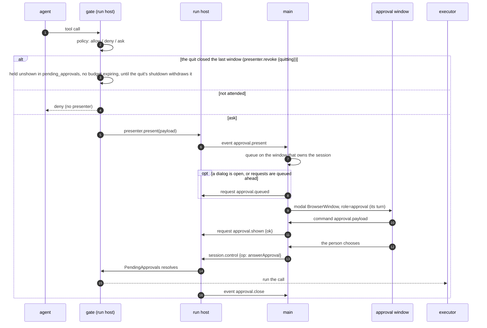

# Sequences — the flows the runtime view does not own — 2. A permission approval, end to end

Part 2 of 4 of [the sequences](../06-sequences.md), which indexes every part.

## 2. A permission approval, end to end

`packages/agent-tools/src/gate.ts` → `approvals.ts` (`PresenterRegistry`, `PendingApprovals`) →
`apps/desktop/src/run-host/index.ts` → `apps/desktop/src/main/index.ts` (`presentNext`).

The parts that are easy to get wrong:

- **Attendedness is a boolean the run host maintains**, not a question it asks. Main polls alive every 250 ms;
  3,000 ms without a reply is a lapse, and a lapse **cancels every waiting approval** — they resolve
  `cancelled`, and the application is unattended until main answers again (`ADR-0019`).
- **Closing the dialog answers Deny** while the application stays: the user closed the dialog, or one main window
  of several. A request already answered or cancelled asks nothing more. A dialog that the application's quit closes
  answers nothing (`QuitState`, `main/exit.ts`). The quit's `shutdown` then withdraws the approval — at a rest,
  and during a plan cycle too, where the cycle's agents end rather than rest (PD-ORCH-005 clauses 9 and 15; OQ-108). The question
  dock's cancellation is held back at a quit the same way. *Until phase 7 the quit's close sent a Deny first, and the
  agent stepped on it: `docs/defects/fixed/a-quit-denies-the-approval-it-should-withdraw.md`.*
- **The quit's gap is not unattended.** Main revokes the last window's presenter as it closes, but sends `shutdown`
  only after `window-all-closed` has waited on the checkpoint operation (REQ-GIT-101). The revoke the quit causes
  carries `quitting` (from `QuitState`), and until a window registers again `PresenterRegistry.quitting` holds what is
  asked: an approval is published `brokered` and waits unshown, a present that crossed the close and came back "not
  shown" waits too, a question is recorded pending, and no timer expires on any of them (`PendingApprovals`'
  and `PendingQuestions`' `held`). The shutdown then withdraws them by `quit` (PD-ORCH-005 clause 9; OQ-132). *Until
  2026-09-29 an ask in the gap met no presenter and was denied by the headless policy:
  `docs/defects/fixed/an-approval-asked-after-the-last-window-closes-is-denied.md`.*
- Presentation order is **oldest first by the published sequence**, and that sequence orders presentation
  *across* windows, not within one.
- A dialog that cannot be shown is not a hang: `approval.shown {ok: false}` comes back, the pending request is
  discarded, and the call is denied with source `presenter-error`. Main must acknowledge a request within 10 s,
  either by showing it or, when it waits behind the open dialog, with `approval.queued`. A queued request then waits
  for its turn without that bound (REQ-TOOLS-063). The gate races the presentation against its own wait, so a queued
  request that times out or is cancelled is dropped unshown and counts as cancelled (REQ-TOOLS-054), and one answered
  elsewhere is honoured. A window that closes while the application stays hands its queued requests to main
  (`MainWindows`' `unshownApprovals`), which answers each `approval.shown {ok: false}`; during a quit it answers
  nothing, and the shutdown withdraws them. *Until the fourteenth review round of the merged revision 4 build, main acknowledged only
  what it showed, so a request queued behind a dialog left open for 10 s was denied unshown:
  `docs/defects/fixed/a-queued-approval-is-denied-unshown-after-ten-seconds.md`.*
- Only an **answer, a cancellation or a withdrawal** releases the wait. A wait with no limit is still released —
  the explicit cancel cancels whatever is blocked on a person as its first act, and a rest (a pause, a stop, a quit)
  **withdraws** it: the call settles blocked and interrupted, `approval_withdrawn` (or `question_withdrawn` for a
  question) names the interruption, no decision is audited, and no `tool_error` issue is filed (PD-ORCH-005 clause 9;
  §4).
- **Approve for the session adds a grant to the agent's `PolicyContext`**, matched before any policy rule on
  every later call (`policy.ts`, REQ-TOOLS-023/024). A grant for the public `write_file` or `haet_edit` (`haet`
  folded in) covers a path, not an argument set (`PD-TOOLS-004`): the gate hands `grant` the workspace root, the
  resolver and the run host's `publicTool` predicate (an MCP tool offered under either name is not the public one),
  the grant stores the set of paths its REQ-TOOLS-018 path arguments resolved to, and a later call of that tool
  from that persona is allowed without a dialog when its own set is exactly that one — a retried edit with a new
  `old_string` included. Every other tool's grant, an MCP tool's under a public name among them, still needs the
  identical command facet or argument set. The same predicate decides whether a rule's tool set holds a call at all
  (`toolSetHolds`, 2026-09-28): `ask:read-only-tool`, `restricted`'s two read rules and the fetch pair are written over
  REQ-TOOLS-007's classes of public tools, so a server's `read_file` or `fetch` offered under the plain name is decided
  by the preset's default, not by the class rule. And the path scope of REQ-TOOLS-018 joins each path argument to the
  workspace root before the resolver, as the approval's `resolvedPathSet` always did.
- **One unanswered wait makes the user away for the rest of the run (`PD-TOOLS-005`).** When a brokered wait ends by
  timeout the gate marks the run's `UserPresence` — the engine's, one holder per run, on every agent's port, a
  delegated child's included. From then until the user's next input to that session (an answer, a message, a run
  control, a mode change — `03-runtime-view.md` §5) every ask that would prompt takes the headless branch above with
  no wait created and nothing presented: `approval.requested` in its headless shape (REQ-EVENTS-049 admits no other
  `unattended_reason`), and the decision `headless-policy` with a reason naming the timeout that expired. A session
  with no presenter is still reported as such, ahead of the away check. The first ask still waits the full timeout, a
  timeout of 0 never marks the user away, and every run starts with the user present.

---
