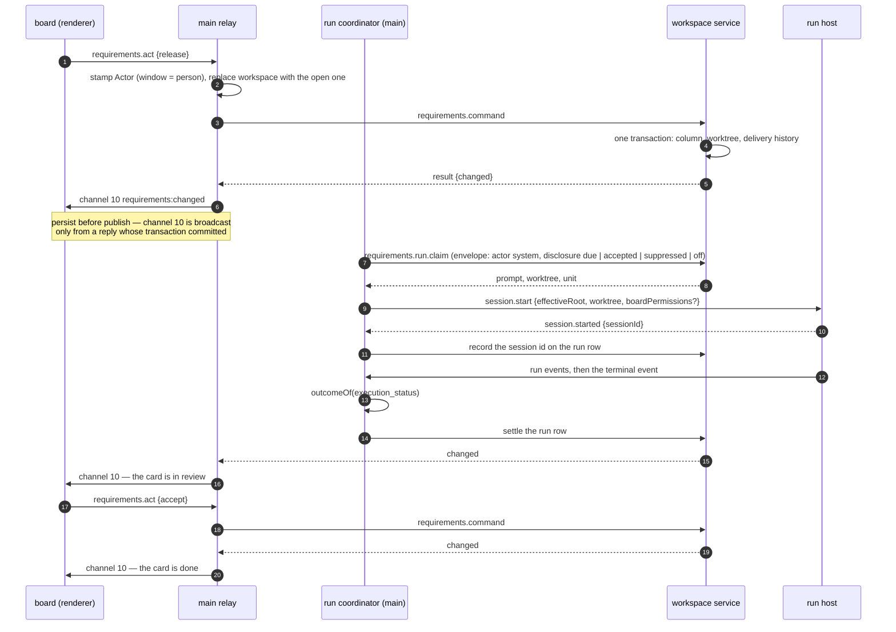

# Sequences — the flows the runtime view does not own — 3. The requirements board: release → run → review → accept

Part 3 of 4 of [the sequences](../06-sequences.md), which indexes every part.

## 3. The requirements board: release → run → review → accept

`packages/ui/src/requirements/` → `apps/desktop/src/main/requirements.ts` (the relay) and
`requirements-runs.ts` (the run coordinator) → `apps/desktop/src/workspace-service/delivery.ts`.

- **A proposed technical requirement is accepted from the review, one at a time** (*since 2026-10-13, fin41*;
  REQ-TRACE-427..433). The review pane's `Accept "<title>"` control sends `requirements.act {accept-proposal, payload
  {proposal, title}}` on the reviewed card. `decide` admits it only in `review`, as a record that moves nothing. The
  delivery service's `beforeCommit` writes the technical requirement into the requirement source through
  `requirements.source.write`'s units, between the admission and the commit, so a refused write records nothing. The
  history entry names the identifier written (`BeforeCommitOutcome.reason`). The pass then re-reads the store, and the
  new requirement gets a `create` record. `confirm_source_writes` is not read. `accept-change-work` is still refused, now
  naming REQ-TRACE-411/412's offer, which no pass makes.
- **A renderer never sends an actor.** The command schema has no field for one; the relay stamps it from where
  the command arrived — a window's `webContents` is a person under the account main runs as, anything else is
  the system. The workspace is likewise replaced with the one this instance has open, so a board cannot act on
  another workspace.
- **One claim is one `session.start`.** The row is written the moment the run host answers, or the launch is
  abandoned with a reason.
- **A unit is provisioned once.** The worktree is provisioned inside the run-starting action's transaction. A later
  run-starting action for the same unit takes that tree over and never provisions it again (REQ-TRACE-464,
  REQ-GIT-140). Such an action is a card held out of `ready` before its run began and then resumed, or returned and
  released again. The tree comes from the launch the service holds, or, after a restart, from the store's worktree row
  through `takeOverUnitWorktree`, which admits only a tree Git lists at that path on that branch (2026-10-02).
- **A card resting in `ready` keeps a way to start after a restart.** The launch (unit, disclosure, tree) lives in the
  workspace service's memory, and the queue's release has no transition. So `recoverLaunch` rebuilds a lost launch
  from the store's worktree row by take-over, never by provisioning: on every pass that parses, for a card holding no
  launch (undisclosed), and on the queue's release, which records the disclosure "Disclose and start" carries and arms
  the card. A tree that cannot be taken over is stated on the entry as the last start's stall, and the claim still
  refuses the card (REQ-TRACE-472/482/464, REQ-TRACE-463; 2026-10-02).
- **A run that stops at its iteration limit rests the card in `blocked`** (*since 2026-10-06, OQ-180 ruled by R-071*):
  `outcomeOf` reads `stopped` — REQ-MONITOR-029's `max_iterations`, the iteration or the time limit — as `failed`, so
  `recordRunEnded` holds the card with a `run-failure` blocker returning to `ready`, as a user's stop (`paused`) already
  did, and a person's resume provisions the next unit. Only an explicit cancel (`cancelling`) still ends `cancelled`.
  Until the ruling `stopped` ended `cancelled` into `ready`, and under `automatic` the dispatch after every run's end
  started the next unit at once, without bound.
- **A card's next unit is provisioned at the claim.** A reject, or a run ending `cancelled` (~~stopped at its iteration
  limit~~ an explicit cancel, since OQ-180's ruling), rests a card in `ready` on a unit no run-starting action provisioned. The launch held for the finished unit
  is spent: the queue names the card's current unit, and its disclosure carries over. The claim — the system's
  dispatch, under both modes — provisions that unit when the store records no tree for it, and writes the row at once
  (`recordWorktreeProvisioned`), so a restart before the start takes it over. The read pass, the queue's release and the
  reject never provision; a recorded tree that is gone stays the stall (REQ-TRACE-423/464/482, REQ-TRACE-408;
  2026-10-02). A claim before the first pass under `manual` with nothing armed answers without parsing the store.
- **Every requirements command carries main's standing disclosure.** Only main holds the two preferences of
  REQ-TRACE-472, so main stamps what they make of an undisclosed launch on every `requirements.command` envelope, beside
  the actor — the relay for a person's commands and the coordinator for its own: `due`, `accepted` (accepted, not
  permanently, earlier in this launch of the application: main holds it in memory, told by the board's
  `requirements.runs {op: 'accept'}`, and the preview reads it too, so no dialog is shown again until the next launch;
  2026-10-02), `suppressed` (accepted permanently) or `off` (the elevation switched off). The service holds the last value and schedules the published
  queue, the launch preview and the claim under the same one, so the queue names what the claim takes (REQ-TRACE-478); a
  value that moved republishes the queue before the answer, which carries `changed`. A launch recorded undisclosed, as a
  recovered one is, is claimed when that is not `due`, and `off` gives the run the workspace's own mode. A permanent
  acceptance reads the board at once. (Until the second repair round of 2026-10-02 it rode the claim alone.)
- **The coordinator is kicked at every workspace open.** Main's post-open slot (`openWorkspaceInner`, beside the
  initialization's resolve, once the window is interactive) calls `requirementsRuns.opened(root, workspaceId)`, a
  dispatch for the workspace just opened rather than the focused window's, so an automatic queue resumes where it
  stopped with no person acting (REQ-TRACE-476/482). Dispatches are serialised per workspace root. The renderer kicks
  after every run-starting move and, under automatic scheduling, after an act that rests a card in `ready` without
  starting a run (a `reject`; `dispatchesAfter` in `ui/src/requirements/model.ts`). The board's own read never
  dispatches (REQ-TRACE-408/512). (Until 2026-10-02 nothing dispatched at launch, and an automatic queue picked a
  recovered card up only at the first kick a person or a run's end gave.)
- The elevated grant (`boardPermissions: 'permissive'`) travels **on the `session.start` of that launch** and
  applies to the configuration captured for it. It is not a mode anything stays in.
- A board read is bounded at 120 s because it may run the engine's three passes; everything else is a store
  read or one transaction, bounded at 30 s.
- If the run host exits holding board runs, the coordinator **reaps with an empty live set** rather than
  leaving rows that claim to be running — every workspace that held one, beside the focused window's.
- **A run is settled against its own workspace.** The coordinator keeps, for each board run, the workspace root and id
  it was started for, and its ending (`run.ended`), its waiting-on-a-person fact (`run.waiting`) and the dispatch that
  follows its end address that workspace's service, whichever window holds the focus (REQ-TRACE-477/466; until
  2026-10-02 they read the most recently focused window's workspace).

---
